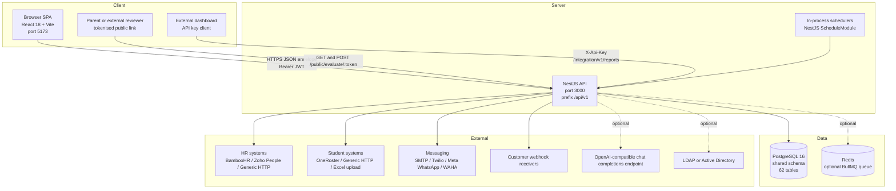
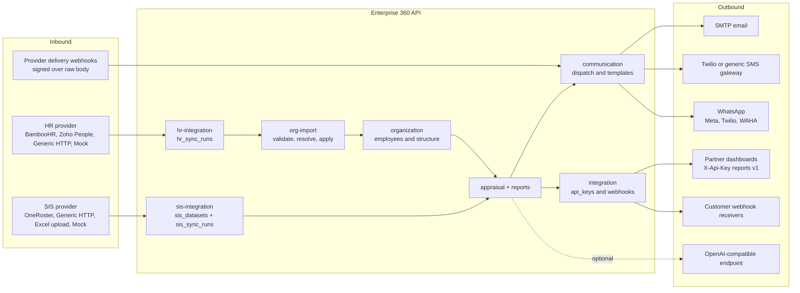
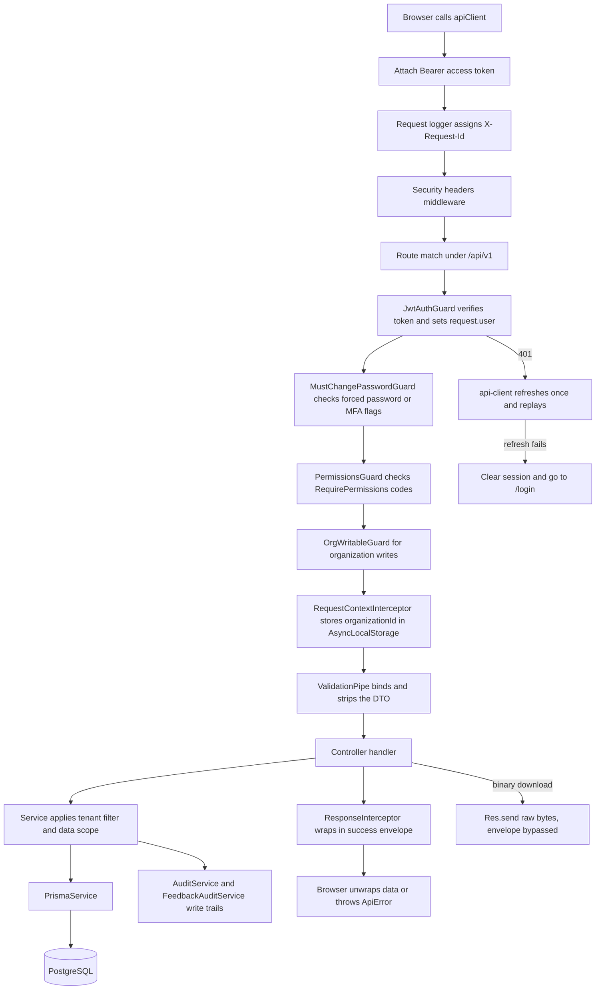

# 01 — System Architecture

**Enterprise 360° Feedback & Performance Management System**

Audience: an architect or senior engineer who has ~20 minutes and wants to know how the
system is put together before touching code. Everything below was verified against the
source tree; anything not yet built is marked **Planned** and nothing planned is
described as existing.

**Sibling documents**

| Document | Covers |
| --- | --- |
| `02-database-erd.md` | Entity relationships and the tenancy column layout |
| `03-table-reference.md` | Column-level reference for all 62 tables |
| `04-business-workflows.md` | Cycle, nomination, calibration and approval workflows end to end |
| `05-module-architecture.md` | Per-module screens, controllers, services, tables, status |
| `06-api-integration-map.md` | Full endpoint catalogue and which screen calls what |
| `07-business-rules.md` | Scoring, anonymity, weighting and validation rules |
| `08-codebase-navigation.md` | Where to find things; naming and folder conventions |

Operational and contract detail is **not** repeated here. See `DEPLOYMENT.md`,
`WINDOWS_DEPLOY.md`, `ops/README-docker.md`, `ops/UPGRADE.md`, `ops/BACKUP_RESTORE.md`
for deployment; the project `API_CONTRACT.md` for the request/response contract; and the
manuals under the project docs space (`Enterprise360_Administrator_Manual.html`,
`Enterprise360_User_Manual.html`, `Enterprise360_Deployment_Manual.html`) for end-user
and operator procedure.

**Status legend used throughout:** **Implemented** = code and UI both present and wired ·
**Partial** = working but a documented slice is missing · **API-only** = endpoints exist
with no user interface · **Planned** = not built.

---

## 1. At a glance

The repository is a single npm-workspaces monorepo. There are three runnable apps and one
shared package.

| Workspace | Stack | Port | Role |
| --- | --- | --- | --- |
| `apps/api` | NestJS 10, TypeScript 5.4, Prisma 5.22, Passport-JWT, BullMQ, ExcelJS, nodemailer, ldapjs | 3000 | The entire backend. Global prefix `/api/v1`. |
| `apps/web` | React 18, Vite 5, React Router 6, Tailwind 3, Radix primitives, Apache ECharts 5, `@xyflow/react` + dagre | 5173 | Single-page admin and reviewer application. |
| `apps/mock-sis` | NestJS 10 + its own Prisma schema | 3100 | Vendor-style Student Information System used for integration testing. Not part of the product. |
| `packages/shared-types` | TypeScript only | — | Declared barrel for cross-app types. Currently an empty `export {}` — see §10. |

Data stores: **PostgreSQL 16** (required) and **Redis** (optional — see §4.6).

Root scripts of note: `npm run dev:api`, `dev:web`, `dev:sis`, `db:apply` (raw SQL schema
+ reconcile), `db:generate` (Prisma client), `db:seed`, `db:bootstrap-tenant`, `db:demo`,
`test` (API node:test), `test:ui`.

### 1.1 Container diagram



---

## 2. Frontend architecture

Entry: `apps/web/src/main.tsx` → `App.tsx`.

### 2.1 Provider stack and routing

`App.tsx` nests `ErrorBoundary → ToastProvider → AuthProvider → BrowserRouter → Suspense
→ Routes`. There are **32 `<Route>` elements**: eight public routes, one layout route,
twenty authenticated screens and a catch-all redirect.

Public routes (no token required): `/login`, `/setup`, `/forgot-password`,
`/reset-password`, `/set-password`, `/enroll-mfa`, `/evaluate/:token`,
`/reports/individual/:employeeId` (standalone so it prints cleanly to PDF).

Everything else sits under a layout route guarded by `RequireAuth`
(`apps/web/src/app/RequireAuth.tsx`) rendering `AppShell`
(`apps/web/src/app/AppShell.tsx`). `RequireAuth` enforces three gates in order: no token →
`/login`; `user.mustChangePassword` → `/set-password`; `user.mustEnrollMfa` →
`/enroll-mfa`. These are convenience redirects only — the same two conditions are enforced
server-side by `MustChangePasswordGuard`, so bypassing the SPA gains nothing.

`AppShell` renders the sidebar from a static array of `{ to, label, icon, perm }` items and
hides any entry whose `perm` code the signed-in user lacks. Menu visibility is cosmetic;
the API re-checks every permission.

One route is additionally feature-flagged: `/ai` is wrapped in
`FeatureRoute flag="ai_insights"` (`apps/web/src/features/config/FeatureRoute.tsx`), and
the backend enforces the same flag via `AiEnabledGuard`.

### 2.2 Code splitting

Every screen except `LoginPage`, the password/MFA pages and `SetupPage` is a
`React.lazy()` import with a shared skeleton fallback. This is deliberate and documented
in the file: the previously monolithic bundle forced the whole admin surface to download
before the login form appeared.

### 2.3 Auth context

`apps/web/src/features/auth/AuthContext.tsx` holds `{ user, token, initializing }` in
React state, mirrored into `localStorage` under `e360.accessToken`, `e360.refreshToken`
and `e360.user`. It exposes `login`, `completeMfa`, `setInitialPassword`,
`refreshSession`, `logout`, plus a `usePermissions()` hook that wraps the permission list
carried on the user object in a `Set`.

The provider registers two callbacks into the API client at mount
(`setAccessTokenGetter`, `setSessionHandlers`) so a background token refresh updates React
state and a terminal refresh failure clears it.

### 2.4 API client

`apps/web/src/lib/api-client.ts` is a dependency-free `fetch` wrapper and the single
network chokepoint.

- Base URL `import.meta.env.VITE_API_BASE_URL ?? '/api/v1'`; the Vite dev server proxies
  `/api/v1` and `^/r/` to `http://localhost:3000`.
- Unwraps the global envelope: returns `envelope.data` on success, throws a typed
  `ApiError` carrying `status`, `message` and the field-level `errors` array otherwise.
- **Silent refresh:** a 401 on any non-credential endpoint triggers one refresh-token
  rotation and one replay of the original request. Concurrent 401s share a single
  in-flight refresh promise, so a screen firing several parallel calls cannot trigger the
  backend's refresh-reuse detection. A failed refresh clears storage and navigates to
  `/login?expired=1`, except on public paths.
- `apiClient.download()` is a separate path for binary responses — it reads a `Blob` and
  drives an anchor click, bypassing the JSON envelope entirely.

### 2.5 Feature-folder pattern

`apps/web/src/features/<domain>/` — **21 folders**, each self-contained with a page
component, any panels/dialogs it needs, and an `api.ts` that is the only place that names
backend paths for that domain. Larger features add `components/`, `pages/`, `hooks.ts`,
`types.ts` (competency) or `dashboard/`, `tabs.tsx` (reports). Cross-cutting UI lives in
`components/ui/` (thin Radix + `class-variance-authority` wrappers: button, dialog, tabs,
switch, toast, badge, skeleton, empty-state, help-hint) and `components/shared/`
(`StatCard`, `DataGridModal`).

### 2.6 Chart layer

`apps/web/src/lib/echart.tsx` exports a single `<EChart option height onClick />`
component — the only place ECharts is initialised. It handles init, option re-application,
window resize and disposal, and surfaces a normalised click payload used for dashboard
drill-down. Dashboard widgets under `features/reports/dashboard/` compose
`EChartsOption` objects and hand them to this wrapper. Org charts are separate and use
`@xyflow/react` with `dagre` layout (`features/organization/OrgChart.tsx`,
`DepartmentOrgChart.tsx`).

---

## 3. Backend architecture

Entry: `apps/api/src/main.ts` → `AppModule` (`apps/api/src/app.module.ts`).

### 3.1 Bootstrap

`main.ts` composes, in order: buffered logs replaced by `StructuredLogger` (JSON);
`createRequestLogger()` middleware (assigns/propagates `X-Request-Id` and logs request
completion); dependency-free security headers (`X-Content-Type-Options`,
`X-Frame-Options: DENY`, `Referrer-Policy: no-referrer`, HSTS only on TLS) plus
`x-powered-by` suppression; the global prefix; body-parser limits; CORS; the global
`ValidationPipe` (`whitelist: true, transform: true`); `ResponseInterceptor`;
`HttpExceptionFilter`.

`app.setGlobalPrefix('api/v1')` **excludes three paths**, which therefore live at the
server root:

| Root path | Why |
| --- | --- |
| `GET /health` | Liveness probe at the conventional path for load balancers |
| `GET /ready` | Readiness probe |
| `GET /r/:code` | Public short-link redirect — must be short |

Body limits are env-tunable (`maxUploadMb()`), because Excel/CSV imports arrive as base64
inside the JSON body and Express's 100 kB default silently truncated them.

### 3.2 Module / controller / service layering

Three layers, consistently:

1. **Module** (`*.module.ts`) — wiring only. Imports sibling modules when it needs their
   exported services.
2. **Controller** (`*.controller.ts`) — HTTP surface: route decorators, guards,
   `@RequirePermissions`, DTO binding, `@CurrentUser()` and `@ReqContext()` param
   decorators. Controllers return plain data; they never build the envelope.
3. **Service** (`*.service.ts`, usually under `services/`) — all business logic, Prisma
   access, tenant scoping, audit writes. **76 `*.service.ts` files in total**, two of which
   (`PrismaService`, `AuditService`) live under `common/`.

Two global modules are imported once in `AppModule` and available everywhere:
`PrismaModule` (`common/prisma/prisma.service.ts` — a `PrismaClient` subclass with
connect/disconnect lifecycle hooks) and `AuditModule`.

Current size: **25 feature modules, 31 controllers, 286 route handlers.**

### 3.3 Guard chain

Guards are applied per controller (and occasionally per handler), not globally, so each
surface declares its own authentication scheme.

| Guard | File | Effect |
| --- | --- | --- |
| `JwtAuthGuard` | `common/auth/jwt-auth.guard.ts` | Passport `jwt` strategy; populates `request.user` as `AuthUser`. |
| `PermissionsGuard` | `common/auth/permissions.guard.ts` | Reads `@RequirePermissions` metadata from handler then class; requires **all** listed codes; throws 403 naming the missing codes. Reads permissions off the token — no DB hit. |
| `MustChangePasswordGuard` | `common/auth/must-change-password.guard.ts` | Decodes the bearer token itself. If `mustChangePassword` or `mustEnrollMfa` is set, only a small allow-list of `/auth/*` paths passes. |
| `OrgWritableGuard` | `common/auth/org-writable.guard.ts` | Applied to `organization` and `org-import`. Lets reads through; refuses mutations when the tenant's `configurations` row `hr_integration/settings` has `mode = external_hr`. |
| `AiEnabledGuard` | `ai/ai-enabled.guard.ts` | Server-side enforcement of the `ai_insights` feature flag. |
| `ApiKeyGuard` | `integration/api-key.guard.ts` | Validates `X-Api-Key` and packs a **synthetic** `AuthUser` whose `permissions` are the key's scopes, so `PermissionsGuard` works unchanged downstream. |
| `ThrottlerGuard` | `@nestjs/throttler`, configured in `integration/integration.module.ts` | Per-API-key rate limit, default 120 requests / 60 s, tracked by the synthetic `userId`. Scoped to the integration module only. |

### 3.4 Interceptors and filters

- **`ResponseInterceptor`** (global) wraps every successful return as
  `{ success: true, message: 'OK', data, errors: null }`.
- **`HttpExceptionFilter`** (global) produces the same envelope shape with
  `success: false` and a populated `errors` array.
- **Envelope bypass:** handlers that inject `@Res()` and call `res.send`/`res.json`
  directly are not wrapped. That is exactly `GET /health`, `GET /ready`, `GET /r/:code`,
  and every binary/CSV download: `reports/export`, `feedback-audit/export`,
  `org-import/export`, `org-import/:jobId/report`, `org-import/template/download`,
  `hr-integration/:runId/report`, `sis-integration/template`,
  `sis-integration/:runId/report`.
- **`EtagInterceptor`** (`integration/etag.interceptor.ts`) is controller-scoped to the
  external Reports API. It hashes the raw payload into a weak ETag, sets
  `Cache-Control: private, max-age`, and answers 304 on a matching `If-None-Match`.
- **`RequestContextInterceptor`** — see next.

### 3.5 AsyncLocalStorage request context

`common/context/request-context.ts` exports a single `AsyncLocalStorage<RequestStore>`
holding `{ organizationId, requestId, cache }`.

- The request-id middleware enters the store first (so every log line correlates).
- `RequestContextInterceptor` (registered as an `APP_INTERCEPTOR` in `AppModule`) runs
  after guards and merges in `req.user.organizationId`.
- `currentOrgId()` lets app-wide singletons — notably the tenant-aware SIS provider —
  resolve the current tenant without threading an org id through every signature.
- `requestCached(key, loader)` memoises per request only. Outside a request (cron jobs,
  startup) there is no store, so the loader simply runs — no cross-request cache is ever
  created, which is what keeps this safe under multi-tenancy. `ScopeService` uses it for
  the reporting-tree lookup.

### 3.6 Scheduled work

`ScheduleModule.forRoot()` is registered in `AppModule`. There are exactly **four** cron
jobs, all in-process (no separate worker):

| Schedule | Service | Job |
| --- | --- | --- |
| Hourly | `appraisal/services/reminder.service.ts` | Evaluator reminders and final-deadline nudges per cycle |
| Hourly | `hr-integration/hr-sync.service.ts` | Auto-sync of employee master data from the tenant's HR provider |
| Hourly | `sis-integration/sis-sync.service.ts` | Auto-sync of the student/teacher roster snapshot |
| Daily 07:00 | `report-schedule/report-schedule.service.ts` | Scheduled report digests |

Because these run inside the API process, **running more than one API replica will run
each job more than once**; there is no distributed lock. See §10.

### 3.7 Optional queue

`communication/services/delivery-queue.service.ts` uses BullMQ when `REDIS_HOST` is set
**and** a TCP probe succeeds; otherwise it logs and degrades to inline delivery. A
configured-but-unreachable Redis therefore does not strand messages. Readiness reflects
this: Redis `down` marks the service `degraded` but still ready.

---

## 4. Database approach

### 4.1 Hand-maintained SQL is the source of truth

There is **no Prisma Migrate**. `apps/api/prisma/` contains only `schema.prisma` and
`seed.ts`; there is no `migrations/` directory, and the only Prisma commands in
`package.json` are `prisma generate` and `prisma validate`.

Schema changes are made in raw SQL under `database/`:

| File | Role |
| --- | --- |
| `database/000_initial_schema.sql` | Full create-from-empty schema |
| `database/001_reconcile.sql` | Idempotent forward reconcile applied on top; also inserts the current `schema_migrations` version row |

`npm run db:apply` copies both into the Postgres container and runs them with
`ON_ERROR_STOP=1`. Prisma is used **only as a typed client generator** and must be kept
1:1 with the SQL by hand — the schema header says so explicitly.

**Version handshake.** `health/health.service.ts` pins
`EXPECTED_SCHEMA_VERSION` and compares it to the applied `schema_migrations` row on
`/ready`. A mismatch reports `schema: outdated` and marks the service `degraded` — this is
what makes "we ran the upgrade script" verifiable. Bump the constant and the reconcile
insert together.

### 4.2 Shape

**61 Prisma models mapping to 61 tables, plus `schema_migrations` = 62 tables.** Eight
Postgres enums are declared and mapped (`org_type`, `competency_version_status`,
`behaviour_indicator_type`, `communication_channel`, `question_type`, `workflow_mode`,
`workflow_status`, `workflow_task_status`). Conventions throughout: UUID primary keys,
`snake_case` columns via `@map`/`@@map`, `created_at`/`updated_at`/`deleted_at` audit
columns, soft delete by `deleted_at IS NULL`, composite tenant-scoped indexes.

### 4.3 Multi-tenancy

**Shared schema, shared tables.** Nearly every table carries `organization_id`. Isolation
is enforced **in application services** — every query filters on the caller's
`user.organizationId`, taken from the JWT. There is **no PostgreSQL row-level security**
and no per-tenant schema or database.

Consequence worth stating plainly: a service method that forgets its `organizationId`
filter is a cross-tenant data leak. This is the single most important review rule in the
codebase. `organizations` is self-referencing (`parent_org_id`, `org_type root | campus`)
so a tenant can model a campus hierarchy.

### 4.4 Auditing

Two separate, unrelated trails:

- **`audit_logs`** — generic before/after mutation log written by
  `common/audit/audit.service.ts`. Write-only: no controller, no endpoint, no UI reads it.
  Failures are swallowed so auditing never breaks the primary operation.
- **`feedback_audit_events`** — the domain-specific, append-only 360 trail
  (`feedback-audit/`), with actor, evaluatee, evaluator, cycle and source denormalised
  onto each row. This one **is** exposed: `GET /feedback-audit`, `/facets`, `/history`,
  `/export`, and the Audit Trail screen.

---

## 5. Authentication and authorization

### 5.1 Three authentication schemes

| Scheme | Credential | Surface | Implementation |
| --- | --- | --- | --- |
| **User session** | `Authorization: Bearer <JWT access token>` | Everything under `/api/v1` guarded by `JwtAuthGuard` | `common/auth/jwt.strategy.ts` |
| **Programmatic** | `X-Api-Key` header | `/api/v1/integration/v1/*` | `integration/api-key.guard.ts` + `integration/services/api-key.service.ts` |
| **Public token** | Opaque token in the URL path | `GET|POST /api/v1/public/evaluate/:token` | `external-evaluation/services/evaluation-link.service.ts` |

Plus one out-of-band platform credential: **`x-provisioning-key`**. `ProvisioningController`
sits deliberately outside JWT and RBAC entirely — creating a tenant is a platform
operation, gated by an open first run and thereafter by `PLATFORM_PROVISIONING_KEY`.

### 5.2 Access token contents

`TokenService.issueSession` (`auth/services/token.service.ts`) signs:

```
sub, organizationId, email, permissions[], scope, employeeId,
mustChangePassword, mustEnrollMfa
```

Embedding the resolved permission list is a deliberate trade: `PermissionsGuard` needs no
database round-trip, at the cost of a permission change not taking effect until the next
token issue or refresh.

### 5.3 Refresh tokens are not JWTs

Refresh tokens are opaque random strings; only their SHA-256 hash is stored in
`refresh_tokens`. `TokenService.rotate` issues a new pair on every use and implements
**reuse detection**: presenting a revoked or expired refresh token revokes *every* active
session for that user. Default TTL 7 days (`REFRESH_TTL_DAYS`). `password_reset_tokens`
follows the same hash-only pattern.

### 5.4 Permissions are data, not code

Permission codes are rows in `permissions`, attached to roles through `role_permissions`,
and to users through `user_roles`. Routes declare requirements with
`@RequirePermissions('organization.read')`. **Role names are never hardcoded in a guard.**
`rbac/system-roles.ts` seeds the standard set; `POST /rbac/users/backfill-default-roles`
repairs users created before a role existed.

### 5.5 Data scopes

Beyond "may I call this endpoint", roles carry a **record-level scope**, resolved to the
broadest across a user's roles and embedded in the token:

| Scope | Visible records |
| --- | --- |
| `organization` | Everyone in the tenant — no restriction |
| `reporting` | The user's own employee row plus the whole line-manager subtree beneath it |
| `own` | The user's own employee row only |

`rbac/scope.service.ts` resolves this. `reporting` is answered by a `WITH RECURSIVE`
Postgres query over `employees.line_manager_id`, memoised per request via
`requestCached`. `assertCanAccessEmployee` throws 403 on a miss. Reports, the employee
directory and individual report reads all call it.

Report payloads add a second layer: `GET /reports/institutional` strips
`topPerformers`/`bottomPerformers` for non-executive callers, and `GET /reports/export`
requires the executive permission outright, so a peer cannot download a named
lowest-performer list.

### 5.6 MFA, SSO and LDAP

| Capability | Backend | UI | Status |
| --- | --- | --- | --- |
| TOTP MFA — setup, enable, disable, backup codes, org policy `optional / required_admins / required_all`, forced enrolment | `auth/services/mfa.service.ts`, `auth/crypto/totp.ts`, `auth.settings.ts` | `features/auth/SecurityPage.tsx`, `/enroll-mfa` | **Implemented** |
| Password policy, lockout policy, login-attempt throttling, CAPTCHA hook, password history | `auth/services/password.service.ts`, `login.service.ts`, `captcha.service.ts` | `SecurityPage.tsx` | **Implemented** |
| Session list and revoke | `auth/services/session.service.ts` | `SecurityPage.tsx` | **Implemented** |
| **SSO** — `GET /auth/sso/:provider/start`, `GET /auth/sso/callback` | `auth/services/sso.service.ts` | none | **API-only** |
| **LDAP** — `POST /auth/ldap/login` | `auth/services/ldap.service.ts` (ldapjs) | none | **API-only** |

Neither SSO nor LDAP is referenced anywhere in `apps/web`; there is no configuration
screen and no login-page entry point for either.

---

## 6. Modules by domain

Full per-module detail — screens, controllers, services, tables, endpoints, status — is in
`05-module-architecture.md`. Grouped here for orientation:

| Domain | Modules |
| --- | --- |
| **Platform foundation** | `provisioning`, `health`, `config`, `rbac`, `auth` |
| **Organization master data** | `organization`, `org-import`, `hr-integration` |
| **Content library** | `competency`, `questionnaire` |
| **Appraisal core** | `appraisal` (cycles, sources, participants, assignments, scoring, calibration, reminders), `bulk-generation`, `workflow` |
| **Feedback capture** | `external-evaluation` (public tokenised links), `identity` (external actor ↔ employee mapping) |
| **Insight** | `reports`, `report-schedule`, `ai`, `development` |
| **Communication** | `communication` (templates, providers, dispatch, OTP, short links, QR), `user-notifications` |
| **Integration surface** | `integration` (API keys, webhooks, external Reports API), `sis`, `sis-integration` |
| **Assurance** | `feedback-audit`, plus the write-only `audit_logs` trail |

---

## 7. External integrations

### 7.1 Inbound — HR master data

`hr-integration/` resolves a provider **per tenant at sync time** via
`hr-provider.registry.ts`: `mock`, `bamboohr`, `zoho_people`, `generic` (configurable HTTP
mapping). Connection secrets are encrypted at rest (`auth/crypto/secret-crypto.ts`) and
returned redacted. A sync runs dry-run or live, reuses `org-import`'s validation, resolver
and import services, and records an `hr_sync_runs` row with a downloadable CSV report.
`bamboohr` and `zoho_people` are self-declared **beta** in the registry — implemented from
vendor documentation, not yet validated against a live tenant.

When a tenant is in `external_hr` mode, `OrgWritableGuard` makes organization master data
read-only in the product.

### 7.2 Inbound — student/teacher roster

Two layers, deliberately separated:

- **`sis-integration/`** owns acquisition: per-tenant config, encrypted connection store,
  an Excel/CSV import wizard, and providers `mock`, `generic`, `oneroster` (OneRoster v1.1,
  declared **beta** for the same reason). Everything normalises to a `SisSnapshot`
  persisted per organization in `sis_datasets`, with `sis_sync_runs` history.
- **`sis/`** owns consumption: a stable `SisProvider` interface with 21 read endpoints
  (campuses, faculties, programs, sessions, semesters, classes, sections, students,
  parents, enrolments, teachers, teaching assignments, subjects). `SIS_PROVIDER` is bound
  to `TenantSisProvider`, which serves the current tenant's stored snapshot via
  `currentOrgId()` and falls back to the mock provider. Adding a real live SIS means
  implementing `SisSnapshotProvider` in the integration module; no consumer changes.

`apps/mock-sis` (port 3100) exists so this path can be exercised end to end without a
customer system.

### 7.3 Outbound — messaging

`communication/providers/provider.factory.ts` resolves a transport per channel from
per-tenant configuration. All transports implement one `ChannelProvider` interface, so
business logic only ever calls `NotificationService` → factory and never touches a vendor
SDK.

| Channel | Transports |
| --- | --- |
| Email | SMTP via nodemailer |
| SMS | Twilio, or a generic HTTP gateway with configurable method, encoding and auth mode |
| WhatsApp | Meta Cloud API, Twilio WhatsApp, WAHA, mock |

Six notification events are defined in `communication/comm.events.ts` — `cycle_started`,
`feedback_reminder`, `final_reminder`, `feedback_submitted`, `cycle_closed`,
`admin_message` — each with per-channel, per-tenant customisable templates and a
placeholder catalogue. Inbound delivery-status webhooks land on
`POST /communication/webhooks/:provider`; the HMAC is verified over `req.rawBody`, which is
why `rawBody: true` is set at bootstrap.

### 7.4 Outbound — partner Reports API

`/api/v1/integration/v1/reports/*` is the read-only, API-key surface for external
dashboards. `integration/reports-api.scopes.ts` is the single source of truth: the
controller decorators, the admin docs endpoint (`GET /integration/reports-api/catalog`) and
the admin UI scope picker all derive from it. Eight scopes / eight endpoints:
`executive`, `hr`, `institutional`, `departmental`, `campus`, `trend`, `nine-box`,
`heatmap`. Scopes live in `api_keys.scopes[]`, are checked by the ordinary
`PermissionsGuard`, and are **not** assignable to RBAC roles — so they can never widen a
human user's access. Responses reuse `ReportsService` verbatim, keeping anonymity
suppression identical to the in-app dashboards, and carry ETag + `Cache-Control`.

### 7.5 Outbound — webhooks

`integration/services/webhook.service.ts` fans a domain event out to every active endpoint
subscribed to it (an empty `events` array means "all"). Payload is
`{ event, timestamp, data }`, signed with the endpoint secret and sent with an
`x-e360-event` header. Delivery is best-effort and never throws into the caller; every
attempt is recorded in `webhook_deliveries` and is inspectable via
`GET /integration/webhooks/:id/deliveries`. Currently the appraisal cycle lifecycle is the
main emitter.

### 7.6 Outbound — AI

`ai/services/ai-provider.service.ts` calls any OpenAI-compatible `/chat/completions`
endpoint. Configuration is data — a `configurations` row under module `ai`, key `provider`
— never an env var or hardcoded vendor. With no key configured the module falls back to a
deterministic heuristic engine, so AI Insights is fully functional offline.

### 7.7 Integration context diagram



---

## 8. Main request and data flows

### 8.1 Authenticated request pipeline



### 8.2 Feedback cycle flow

1. Admin creates a cycle, its feedback sources with weights, and its participants —
   `POST /appraisal/cycles`, `/cycles/:id/sources`, `/cycles/:id/participants` (or import,
   or `bulk` generation across a scope).
2. Reviewer assignments are created; nominations may need approval
   (`/assignments/:id/nominate/approve|reject`).
3. Activating the cycle (`POST /cycles/:id/activate`) dispatches `cycle_started` through
   `CommunicationModule` and fires a webhook through `IntegrationModule`.
4. Reviewers open `My Reviews`, load a form (`GET /assignments/:id/form`), save drafts and
   submit (`POST /assignments/:id/save|submit`). Responses land in `feedback_responses`.
5. `ScoringService` recomputes the weighted score: per source, average the rating responses
   across **submitted, nomination-approved** assignments; combine sources by configured
   weight. An HR calibration override is authoritative and is not overwritten by a late
   submission — the raw average is still refreshed into `computedScore`.
6. HR sets potential and calibrates (`/participants/:id/potential`, `/calibrate`), then
   releases or retracts results.
7. Reports and dashboards read the aggregate; the hourly reminder cron nudges outstanding
   reviewers; every step writes a `feedback_audit_events` row.

### 8.3 Public parent-evaluation flow

`EvaluationLinkService` mints a 24-byte `base64url` token, stores **only its SHA-256 hash**
in `evaluation_links`, and delivers the URL over the tenant's configured channel. The
recipient hits `GET /public/evaluate/:token` (validates and idempotently records the open),
then `POST /public/evaluate/:token` (submits). No guards, no session — the token is the
only credential, and it can be expiry-limited, one-time, revoked or regenerated. IP and
user-agent are captured into the feedback audit trail for every anonymous action.

### 8.4 Master-data import flow

Upload (base64 in the JSON body) → `POST /org-import/validate` creates an
`organization_import_jobs` row → `GET /:jobId/preview` shows resolved and rejected rows →
`POST /:jobId/confirm` applies → `GET /:jobId/report` downloads a CSV of the outcome.
`hr-integration` reuses the same validation, resolver and import services for provider
syncs, so manual upload and automated sync converge on identical semantics.

---

## 9. Conventions worth knowing before you edit

- Controllers return raw data; never construct the envelope by hand.
- Every service query filters on `organizationId`. There is no database-level safety net.
- Soft delete is the norm — filter `deletedAt: null`. A few tables are hard-deleted
  instead (`development_actions`, and `configurations` rows removed by
  `DashboardLayoutService`), so check the owning service before assuming.
- Permission codes are constants in each module's `*.permissions.ts` and rows in the
  `permissions` table. Never test a role name.
- Provider-shaped subsystems (communication, HR, SIS, AI) all follow the same pattern: one
  interface, a registry or factory, per-tenant configuration in `configurations`. Adding a
  vendor should not touch business logic.
- Tenant-scoped settings that do not deserve a table live in `configurations` keyed by
  `(organization_id, module, key)`. Nine modules are actually read or written by code:
  `ai`, `appraisal`, `auth`, `communication`, `dashboards`, `hr_integration`, `reminders`,
  `reports`, `sis_integration` — plus whatever a caller supplies through the generic
  `POST /configuration` CRUD. The full catalogue, with the writer and reader of each key,
  is in [11-configuration-reference.md](11-configuration-reference.md). Do not confuse these
  with the `module` column of the `permissions` table, which uses a different, longer set
  of names.
- Keep `schema.prisma` and `database/*.sql` in lockstep, and bump
  `EXPECTED_SCHEMA_VERSION` with the reconcile insert.

---

## 10. Known architectural gaps

Stated so nobody rediscovers them the hard way. None of these is a defect report — they
are design consequences.

| Gap | Consequence |
| --- | --- |
| Tenant isolation is application-enforced only; no RLS | One missing `organizationId` filter is a cross-tenant leak |
| Cron jobs run in-process with no distributed lock | Horizontal scaling of `apps/api` duplicates reminders, syncs and digests |
| Permissions are baked into the access token | A permission or role change takes effect only after the next token issue or refresh |
| `packages/shared-types/src/index.ts` is `export {}` | API and web DTO shapes are maintained twice and can drift silently |
| `system_settings` table has no code references | Dead table |
| `trusted_devices` is only ever read by `SessionService.listDevices`, which nothing calls | Dead table and dead method |
| `competency_designation_mappings` is read by the competency stats counter but never written by any code path | The "designations mapped" stat is structurally always zero |
| `audit_logs` has no read path | The generic mutation trail is only reachable by direct SQL |
| AI provider configuration is only writable through the generic `POST /configuration` endpoint, which has no admin screen | Enabling a live AI provider currently requires an API call |
| Vite dev proxy rule `^/qr` targets a root path the API does not expose | Dead rule; QR is served at `/api/v1/communication/qr` |

---

*Verified against the repository on 2026-08-20. Counts: 25 API modules · 31 controllers ·
286 route handlers · 76 services · 61 Prisma models / 62 tables · 21 web feature folders ·
32 SPA routes · 4 cron jobs.*
