# 02 — Database ERD

High-level entity-relationship maps for the Enterprise 360 schema. This document is for
**understanding the model**: each diagram is deliberately trimmed to the 6–10 tables that
carry the meaning of its domain. Join tables, token tables and log tables are omitted from
the diagrams where they add noise rather than comprehension.

For column-level detail — every table, every column, every real index — see
[03-table-reference.md](./03-table-reference.md). For how the pieces run at runtime see
[01-system-architecture.md](./01-system-architecture.md); for the flows that move data
through these tables see [04-business-workflows.md](./04-business-workflows.md) and
[07-business-rules.md](./07-business-rules.md).

**Verified against:** `apps/api/prisma/schema.prisma` (61 models),
`database/000_initial_schema.sql` (54 tables), `database/001_reconcile.sql` (62 tables),
and a live `enterprise360` Postgres 16 database (**62 base tables**, 0 views).

---

## Conventions

Read this once; it applies to every diagram and every table below.

| Convention | Detail |
|---|---|
| **Primary keys** | `id UUID DEFAULT gen_random_uuid()` on 60 of 62 tables. **Two exceptions:** `permissions` is keyed by `code VARCHAR(100)` — permission codes *are* the identity, and `role_permissions.permission_code` is a VarChar FK to it; `schema_migrations` is keyed by `version VARCHAR`. |
| **Naming** | `snake_case` in Postgres, `camelCase` in Prisma via `@map` / `@@map`. Every Prisma model carries an explicit `@@map`. |
| **Tenancy** | `organization_id UUID` scopes almost everything. 45 tables carry it. Child-of-a-child tables (`rating_scale_levels`, `template_sections`, `section_questions`, `feedback_sources`, `feedback_responses`, `proficiency_levels`, `mfa_backup_codes`, `webhook_deliveries`, `workflow_steps`, `workflow_tasks`, `password_history`, `trusted_devices`, `employee_matrix_managers`, `user_roles`, `role_permissions`) inherit the tenant through their parent and do **not** repeat the column. |
| **Timestamps** | `created_at TIMESTAMPTZ NOT NULL DEFAULT now()`, `updated_at` where the row is mutable. `created_by` / `updated_by` are **plain UUIDs with no FK to `users`** on every table that has them. |
| **Enums** | 8 native Postgres enums: `org_type`, `question_type`, `communication_channel`, `behaviour_indicator_type`, `competency_version_status`, `workflow_mode`, `workflow_status`, `workflow_task_status`. Everything else that looks like an enum is a `VARCHAR` with an optional CHECK. |
| **Cascades** | Composition edges cascade (`feedback_sources → appraisal_cycles`, `feedback_responses → reviewer_assignments`, `template_sections → questionnaire_templates`, …). Reference edges are `NO ACTION`. |

### Soft delete is *not* universal

`deleted_at TIMESTAMPTZ` exists on **18 of 62 tables only**. Developers routinely assume it
is everywhere and write `WHERE deleted_at IS NULL` against tables that do not have the
column — that is a runtime error, not a no-op. The complete list:

```
appraisal_cycles                  configurations   organizations
behaviour_indicators              departments      questionnaire_templates
competencies                      designations     questions
competency_categories             employees        rating_scales
competency_designation_mappings   roles            rubrics
competency_versions               users            workflow_definitions
```

Everything else — including `appraisal_participants`, `reviewer_assignments`,
`feedback_responses`, `feedback_sources`, `evaluation_links`, `notifications`,
`audit_logs` and `feedback_audit_events` — is hard-deleted or never deleted at all.

Nine of the soft-delete tables back their uniqueness with **partial** unique indexes
(`... WHERE deleted_at IS NULL`), several of them over `lower(name)`. See the
"Schema inconsistencies" section — Prisma does not model this correctly.

---

## Master diagram — how the domains connect

Eleven domain groups. Each box is the *anchor* table of its group; the labels describe the
direction of ownership.

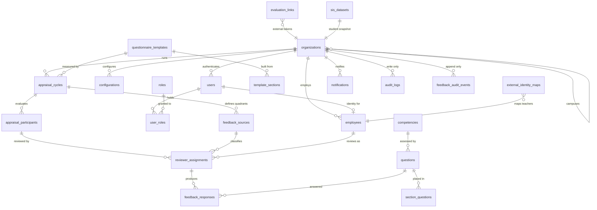

Reading the master diagram top to bottom: an **organization** owns its **campuses**,
**employees** and **users**; a **cycle** binds a **questionnaire** to a set of
**participants**; each participant gets **reviewer assignments** classified by a
**feedback source**; each assignment yields **feedback responses**. External parent
feedback enters through **evaluation_links** and is stitched back onto a reviewer
assignment. Two audit tables observe the whole thing.

---

## 1. Organization & Employees

The single most important structural fact: **there is no campus table**. A campus is a row
in `organizations` with `org_type = 'campus'` and `parent_org_id` pointing at the root
organization. `employees.campus_id` and `departments.campus_id` are foreign keys to
`organizations.id`, not to any campus entity.

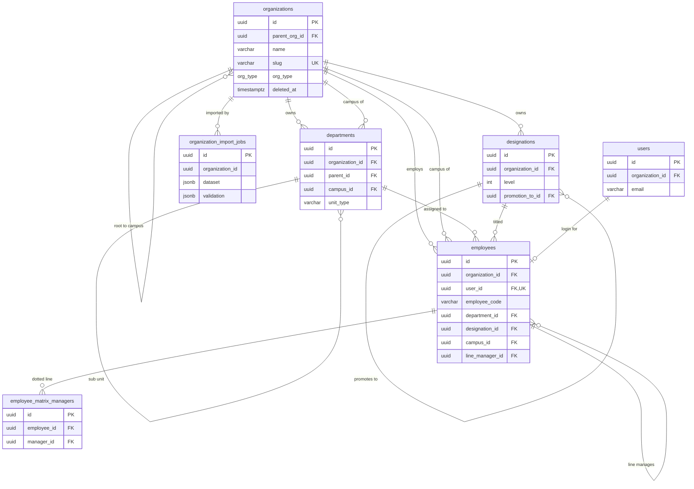

Notes that matter:

- `employees.user_id` is **NOT NULL and UNIQUE** — every employee has exactly one login.
  There is no such thing as an employee without a user account.
- Two manager hierarchies coexist: `employees.line_manager_id` (solid line, one) and
  `employee_matrix_managers` (dotted line, many, `UNIQUE(employee_id, manager_id)`).
- `organization_import_jobs.organization_id` has **no foreign key** — the column exists but
  is not constrained.

## 2. Authentication & RBAC

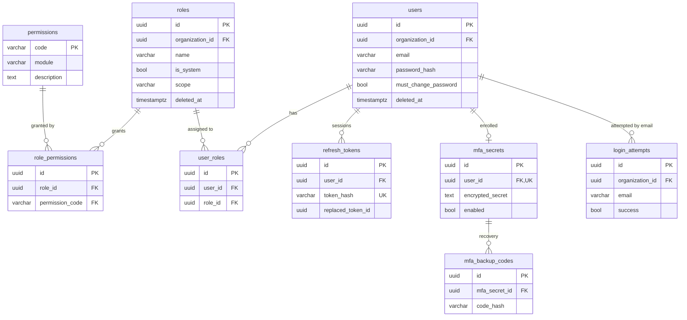

- `permissions` is the **only VarChar-keyed business table**. `permissions.code` is a
  static catalogue seeded from `*.permissions.ts` files in the API; rows are global, not
  tenant-scoped, and `permissions` has no `organization_id`.
- `roles` is tenant-scoped and soft-deleted; `is_system = true` marks the seeded roles.
- `login_attempts` is keyed by **email string, not user_id** — deliberately, so failed
  logins for non-existent accounts are still recorded.
- Not drawn but present: `password_history`, `password_reset_tokens`, `trusted_devices`,
  `otp_codes`, `api_keys`.

## 3. Feedback Cycles

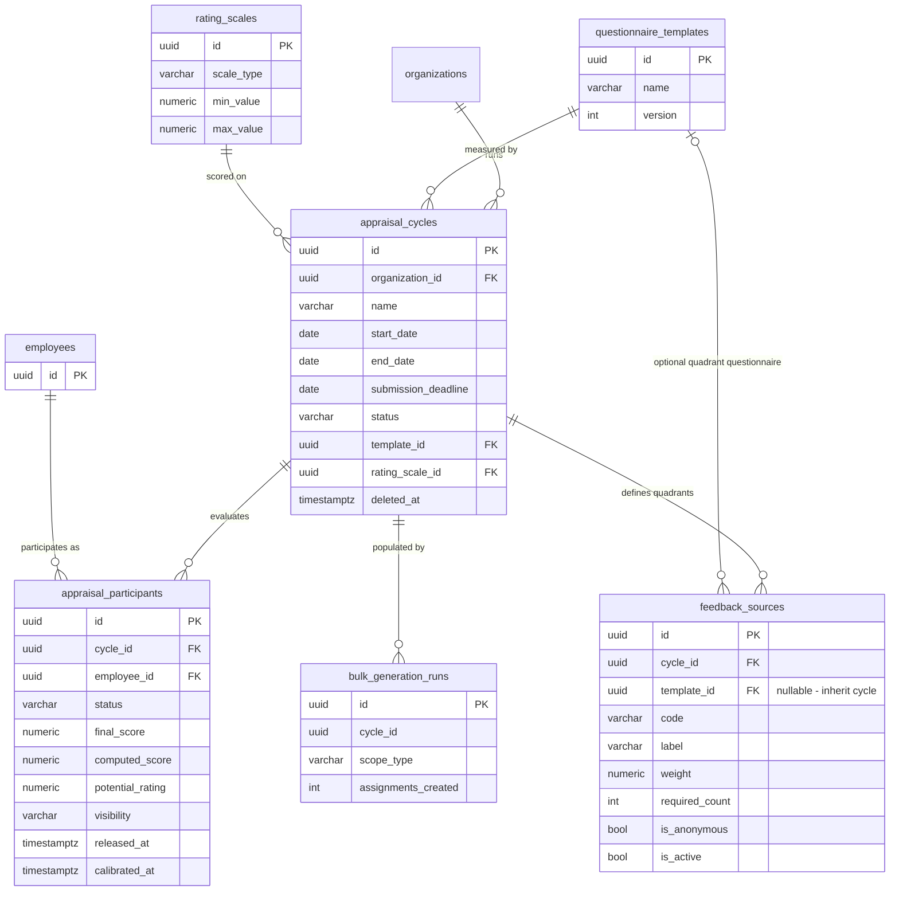

- `appraisal_cycles.status` is CHECK-constrained to `draft | active | closed | archived`.
- **`feedback_sources` are the "quadrants" and they are per-cycle rows, not a global
  lookup.** Cloning a cycle clones its sources. Codes used by the code base are `self`,
  `manager`, `peer`, `subordinate` and `parent`, but nothing constrains the value —
  `UNIQUE(cycle_id, code)` is the only rule.
- **`feedback_sources.template_id` is a nullable per-quadrant questionnaire.** NULL — the
  default and the value on every pre-existing row — means "serve the cycle's
  questionnaire", which is the behaviour that predates the column. Set, it gives that one
  evaluator group its own questions. The resolution is
  `source.template_id ?? cycle.template_id` and lives in one place
  (`appraisal/questionnaire-resolution.ts:resolveTemplateId`). There is still **no**
  quadrant→competency FK: a quadrant reaches competencies only through its questionnaire's
  questions, so which competencies two quadrants share is derived from configuration, never
  stored. Indexed as `ix_feedback_sources_template`.
- **`feedback_sources.required_count` is stored but never enforced.** It is written by the
  setup service, the cycle-template service, bulk generation and the seed scripts, and it
  is read in exactly one place — `reports.service.ts` surfaces it as a display field named
  `required` on the coverage widget. No validator, guard, submission check or close-cycle
  rule ever compares it to the actual assignment count.

## 4. Competencies, Rubrics & Questionnaires

Two sub-structures share this domain: the **competency library** (versioned, with
proficiency levels and behaviour indicators) and the **questionnaire builder** (templates →
sections → questions).

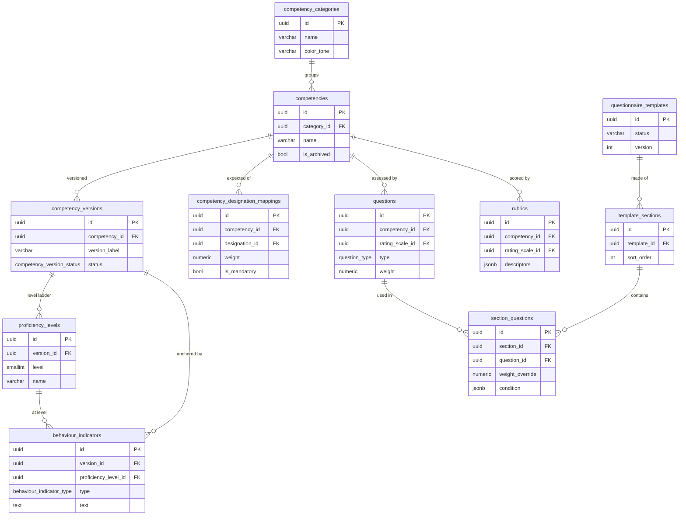

- `uq_competency_versions_one_active` is a **partial unique index** guaranteeing at most
  one `status = 'active'` version per competency. It is enforced by Postgres only — it does
  not appear in `schema.prisma`.
- `competency_designation_mappings.weight` has a CHECK `0 <= weight <= 100`; the mapping is
  unique per `(competency_id, designation_id)` among non-deleted rows.
- `section_questions` is where a question is actually *placed*; `weight_override`,
  `is_mandatory_override` and `condition` let one question behave differently per template.
- Not drawn: `rating_scales` → `rating_scale_levels` (`UNIQUE(rating_scale_id, value)`).

## 5. Evaluator Assignments

The hinge of the whole system. `reviewer_assignments` is where a participant, a quadrant
and a reviewer identity meet.

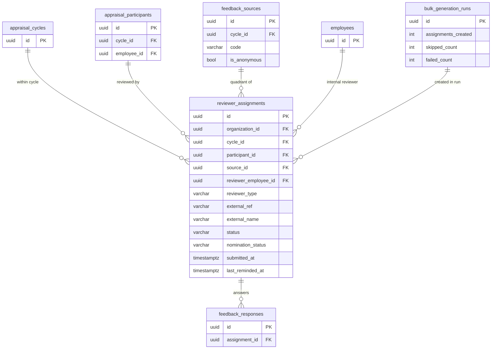

**`reviewer_assignments` is the only link between a response and a reviewer identity.**
`feedback_responses` has no reviewer column of any kind — it points only at
`assignment_id` and `question_id`. Consequently:

- An **internal** reviewer is `reviewer_type = 'internal'` with
  `reviewer_employee_id` set and `external_ref` / `external_name` null.
- An **external** reviewer (parent, student, outside stakeholder) is
  `reviewer_type = 'external'` with `reviewer_employee_id` **null** and
  `external_ref` / `external_name` carrying the identity.
- Anonymity is a property of `feedback_sources.is_anonymous`, not of the assignment.
  Anonymity is enforced in the reporting layer by never projecting the reviewer columns —
  the join path still exists in the database.

`bulk_generation_runs` records the run that produced a batch of assignments but holds **no
foreign key** to them; the relationship above is logical, not enforced.

## 6. Feedback Responses & Scores

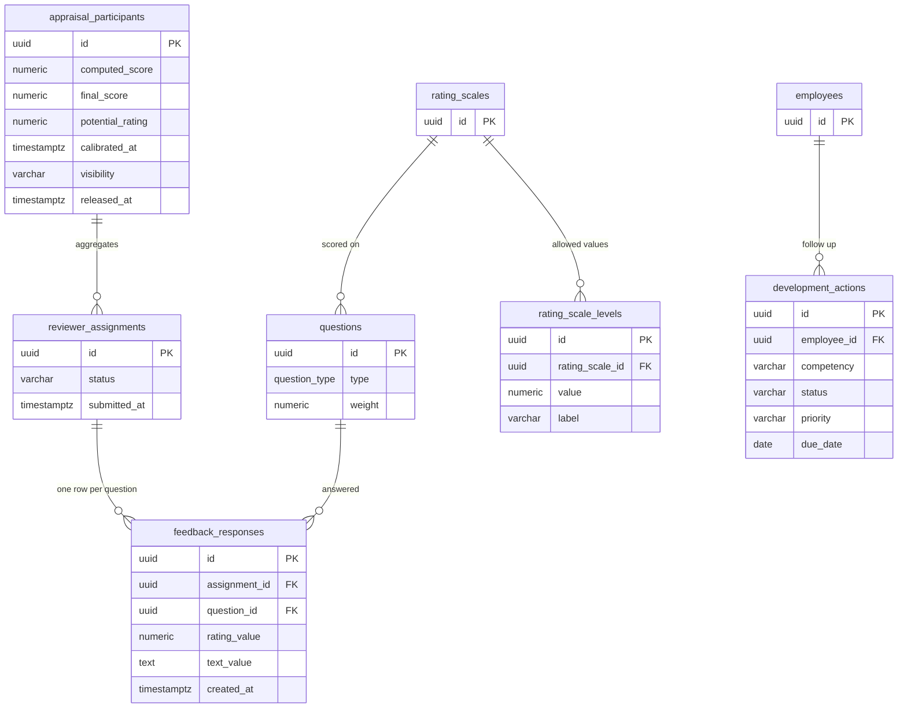

- `UNIQUE(assignment_id, question_id)` — one answer per reviewer per question. Re-submitting
  updates in place rather than inserting.
- `rating_value` and `text_value` are both nullable; the question's `type` decides which is
  meaningful. Nothing in the schema enforces "a rating question must have a rating".
- Scoring lands on the **participant**, not on a separate score table:
  `computed_score` is the machine roll-up, `final_score` is the calibrated/human number,
  `calibrated_at` records the calibration and `released_at` + `visibility` gate whether the
  employee can see it.
- `development_actions` is the post-cycle follow-up list; its `competency` column is a free
  **VARCHAR label, not a FK** to `competencies`.

## 7. Parent/External Feedback

Parent feedback comes in through a tokenised public link rather than a login.

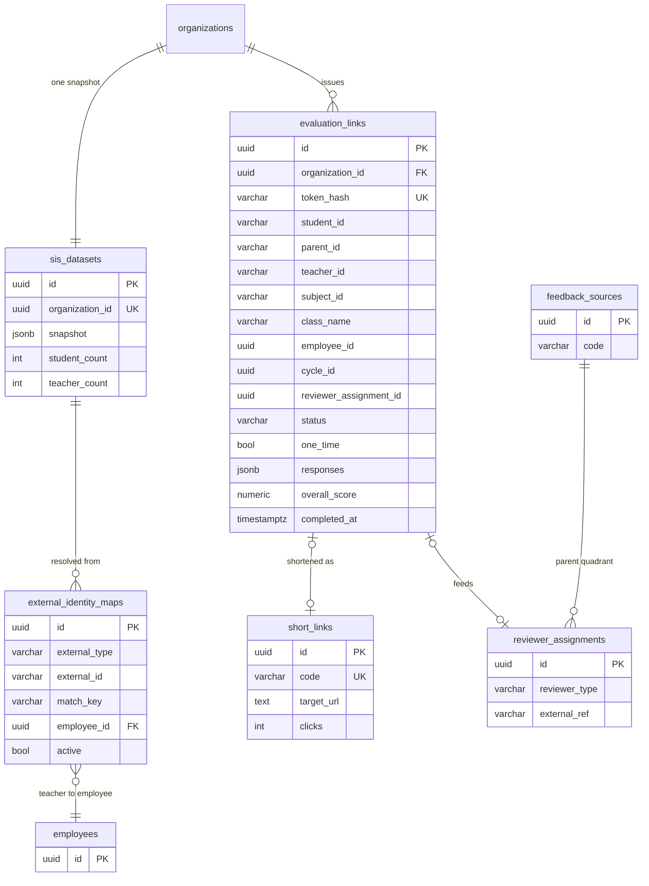

- `evaluation_links.token_hash` is globally UNIQUE; the raw token is never stored.
- The SIS-side columns (`student_id`, `parent_id`, `teacher_id`, `subject_id`,
  `teaching_assignment_id`) are **VARCHAR external identifiers**, not UUIDs and not FKs.
- The 360-side columns (`employee_id`, `cycle_id`, `reviewer_assignment_id`, `template_id`)
  are UUIDs but carry **no foreign key constraints** in the database. `organization_id` is
  the only enforced FK on this table.
- A completed link both stores its own `responses` JSONB *and* is stitched onto a
  `reviewer_assignments` row with `reviewer_type = 'external'`, so parent feedback reaches
  the normal scoring path. `feedback_sources` gains a `parent` row on demand.

## 8. HR & SIS Integration

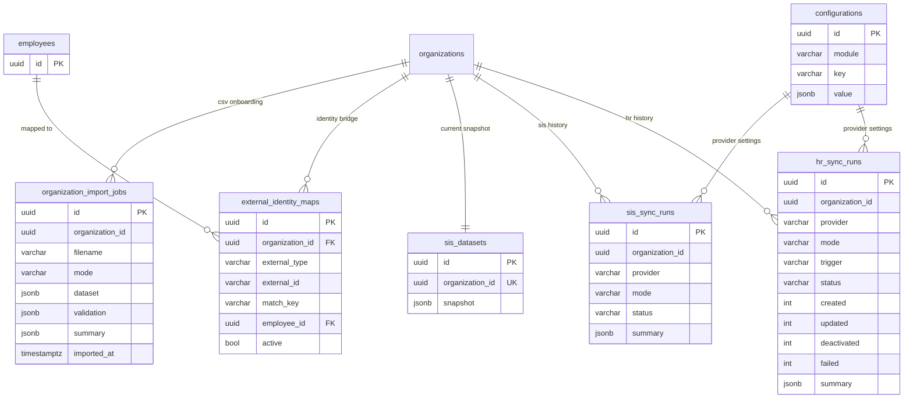

- **Provider credentials and sync settings are not in these tables** — they live in
  `configurations` under `hr_integration/settings`, `hr_integration/connection`,
  `sis_integration/settings` and `sis_integration/connection`.
- `sis_datasets` is `UNIQUE(organization_id)` — exactly one current SIS snapshot per tenant,
  overwritten on each sync. There is no snapshot history; `sis_sync_runs` holds only counters.
- `external_identity_maps` is `UNIQUE(organization_id, external_type, external_id)` and is
  the bridge that turns an SIS teacher id into an `employees.id`.
- `hr_sync_runs`, `sis_sync_runs`, `sis_datasets` and `organization_import_jobs` all carry
  `organization_id` **with no foreign key**.

## 9. Communication

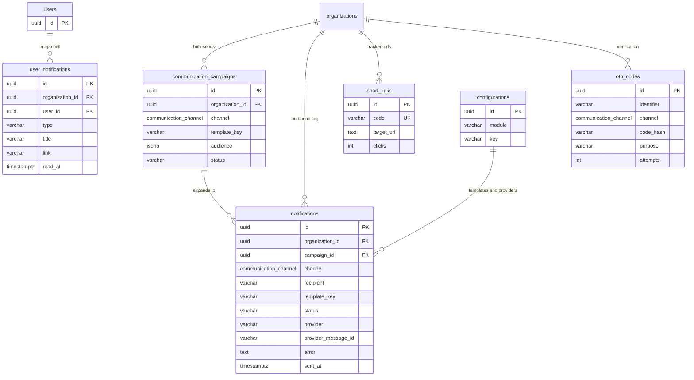

Two distinct notification concepts that are easy to confuse:

| Table | Meaning |
|---|---|
| `notifications` | **Outbound delivery log** — one row per email/SMS/WhatsApp actually dispatched, with provider, provider message id and error. Keyed to a `recipient` string, not to a user. |
| `user_notifications` | **In-app bell items** — one row per user, with `read_at`. Never leaves the product. |

Message bodies, branding, SMTP/SMS credentials and default channels are **not** in these
tables; they are `configurations` rows under module `communication`.

## 10. Dashboard & Configuration

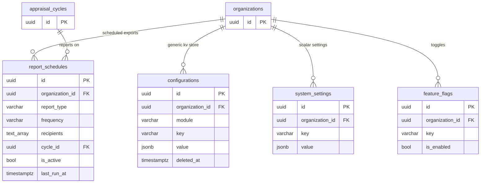

`configurations` is a **generic per-tenant key/value store** keyed
`(organization_id, module, key) → JSONB value`. It is not a settings table for one feature —
it is where roughly a dozen features keep their state, which is why so much of the product
has no dedicated table. See
[03-table-reference.md](./03-table-reference.md#configurations-module--key-catalogue) for
the full catalogue of module/key pairs in use.

Three overlapping stores exist and the boundary is by convention only: `configurations`
(JSON, module-scoped, soft-deletable), `system_settings` (JSON, flat key, no module,
`UNIQUE(organization_id, key)`) and `feature_flags` (boolean only,
`UNIQUE(organization_id, key)`).

## 11. Audit & Operational

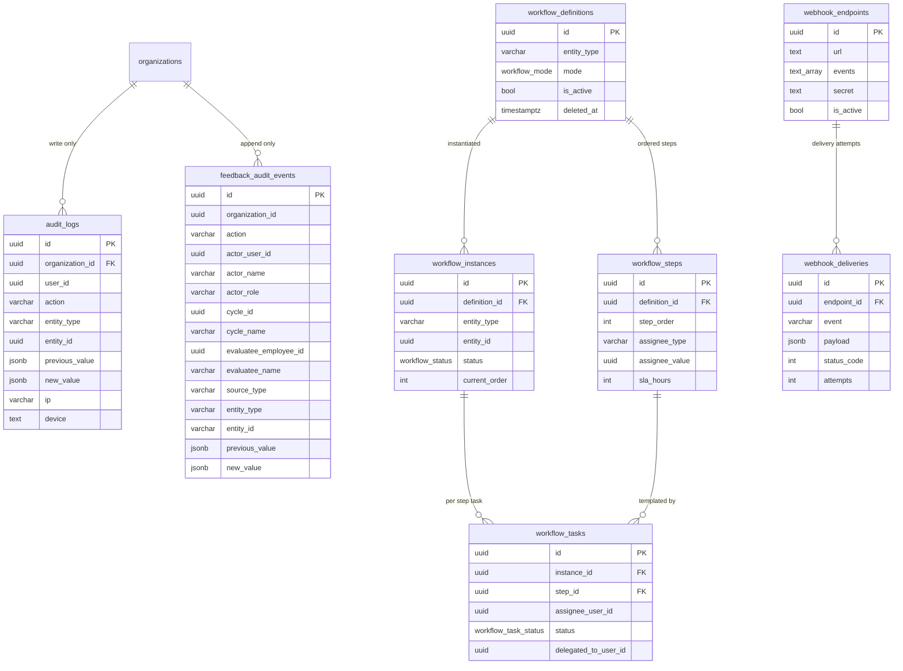

Two audit tables, deliberately different:

- **`feedback_audit_events`** — the compliance trail for feedback. **Append-only, enforced
  by a database trigger**: `trg_feedback_audit_events_no_mutate`
  (`BEFORE UPDATE OR DELETE ... FOR EACH ROW EXECUTE FUNCTION
  feedback_audit_events_no_mutate()`, defined at `database/001_reconcile.sql:1404-1412`).
  The function unconditionally raises
  `'feedback_audit_events is append-only; % is not permitted'`. The table carries **zero
  foreign keys** and denormalises every name it needs (`actor_name`, `cycle_name`,
  `evaluatee_name`, `evaluator_name`, `source_type`) so the trail survives deletion of the
  rows it describes. It has a controller and a UI.
- **`audit_logs`** — the generic mutation log. `AuditService.record()` writes it on most
  mutations across every module. **It has no controller, no API endpoint and no UI.** The
  only Prisma access anywhere in the code base is a single
  `this.prisma.auditLog.create(...)` in `apps/api/src/common/audit/audit.service.ts:28`.
  Nothing reads it back. Write failures are swallowed by design. Treat it as
  forensics-by-`psql` only.

`schema_migrations` (PK `version VARCHAR`) tracks applied SQL migrations and is the one DB
table with **no Prisma model**.

---

## Schema inconsistencies found

Recorded here because they are findings, not documentation:

1. **`schema_migrations` is not modelled in Prisma.** The live database has 62 base tables;
   `schema.prisma` has 61 models. The gap is `schema_migrations`, created by
   `001_reconcile.sql` and invisible to the ORM.
2. **Nine partial unique indexes are declared as plain uniques in Prisma.** The SQL creates
   `uq_users_org_email`, `uq_roles_org_name`, `uq_competencies_org_name`,
   `uq_competency_categories_org_name`, `uq_employees_org_code`, `uq_configuration_scope`,
   `uq_comp_desig_mapping`, `uq_competency_versions_comp_label` and
   `uq_competency_versions_one_active` as `CREATE UNIQUE INDEX ... WHERE deleted_at IS NULL`,
   four of them over `lower(name)`. Prisma models them as ordinary composite `@@unique`
   constraints over the raw columns. Two consequences: Prisma thinks uniqueness is
   case-sensitive when Postgres enforces it case-insensitively, and **`prisma.upsert()`
   against these keys fails at runtime with Postgres error 42P10** because `ON CONFLICT`
   cannot target a partial index. `configuration.service.ts:28-35` already documents and
   works around this with a manual find-then-update; other call sites should assume the same
   hazard.
3. **`uq_competency_categories_org_name` and `uq_competency_versions_one_active` are absent
   from `schema.prisma` entirely.** The "at most one active version per competency" business
   rule exists only as a Postgres partial index.
4. **`uq_reviewer_assignment` does not deduplicate external reviewers.** The constraint is
   `UNIQUE(participant_id, source_id, reviewer_employee_id)`, and external reviewers leave
   `reviewer_employee_id` NULL. Postgres treats NULLs as distinct, so the same parent can be
   assigned to the same participant and quadrant an unlimited number of times.
   `external_ref` is not part of any constraint.
5. **`evaluation_links` has four unconstrained UUID references.** `template_id`,
   `employee_id`, `cycle_id` and `reviewer_assignment_id` are plain UUID columns with no FK
   in either the SQL or Prisma. Deleting a cycle or assignment leaves dangling links.
6. **Five tables carry `organization_id` with no foreign key:** `bulk_generation_runs`,
   `hr_sync_runs`, `sis_sync_runs`, `sis_datasets` and `organization_import_jobs`. Tenant
   scoping on these tables is application-enforced only.
7. **`audit_logs.user_id` is NOT NULL but has no FK to `users`**, and `entity_id` is a UUID
   with no polymorphic discriminator constraint. Every `created_by` / `updated_by` column in
   the schema is likewise an unconstrained UUID.
8. **`feedback_sources.required_count` is dead as a rule.** Written in five places, read in
   one report query as a display value, enforced nowhere.
9. `000_initial_schema.sql` creates 54 tables; `001_reconcile.sql` is idempotent and creates
   all 62. The eight added by `001` are `password_reset_tokens`, `feedback_audit_events`,
   `bulk_generation_runs`, `organization_import_jobs`, `hr_sync_runs`, `sis_sync_runs`,
   `sis_datasets` and `schema_migrations`. **Running only `000` produces a database the
   application cannot boot against** — `001` is mandatory, not optional.
