# 04 — Business Workflows

**Enterprise 360° Feedback & Performance Management System**

Audience: a developer who has just joined and needs to follow a core process from the
HTTP entry point to the rows it writes, **without reading the whole codebase**. Every
step below was traced in the source tree; nothing is described from the manuals.

This is not the user manual. It does not tell you which button to press — it tells you
which controller method runs, which service owns the rule, which table changes, and
where the real behaviour differs from what the naming suggests.

**Sibling documents**

| Document | Covers |
| --- | --- |
| `01-system-architecture.md` | Runtime topology, modules, request pipeline, deployment shape |
| `02-database-erd.md` | Entity relationships and the tenancy column layout |
| `03-table-reference.md` | Column-level reference for all tables |
| `05-module-architecture.md` | Per-module screens, controllers, services, tables, status |
| `07-business-rules.md` | Scoring, anonymity, weighting and validation rules in rule form |

**Status legend used throughout**

| Marker | Meaning |
| --- | --- |
| **Implemented** | Code path exists end to end and is reachable from the UI |
| **API-only** | Endpoint exists; no UI reaches it |
| **Partial** | Works, but a named slice is missing or unenforced |
| **Unenforced** | A column or config value is stored and displayed but no code acts on it |
| ⚠️ **Differs from naming** | Real behaviour is not what the name/comment implies — read the note |

All API paths are relative to the global prefix **`/api/v1`**, except the public
short-link redirect `/r/:code`. Frontend paths are relative to `apps/web/src/`.

---

## 0. Cross-cutting mechanics you need before reading anything else

Every authenticated workflow below passes through the same pipeline, so it is described
once here rather than repeated nineteen times.

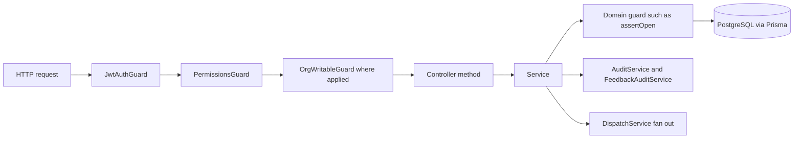

| Concern | Where it lives | Notes |
| --- | --- | --- |
| Authentication | `apps/api/src/common/auth/jwt-auth.guard.ts` | JWT carries `organizationId`, `permissions[]`, `scope`, `employeeId` |
| Permission check | `apps/api/src/common/auth/permissions.guard.ts` + `@RequirePermissions` | Permissions are flat strings; API keys reuse the same guard with scopes as permissions |
| Record-level scope | `apps/api/src/rbac/scope.service.ts:visibleEmployeeIds` | `organization` = unrestricted · `reporting` = recursive line-manager subtree walked in SQL · `own` = self |
| Tenant read-only mode | `apps/api/src/common/auth/org-writable.guard.ts` | When `configurations(module=hr_integration,key=settings).mode = external_hr`, **all** non-GET requests on `organization` and `org-import` are refused |
| Generic audit | `apps/api/src/common/audit/audit.service.ts` | Requires a `userId`; scheduled/system runs therefore write a run row instead |
| Feedback trail | `apps/api/src/feedback-audit/feedback-audit.service.ts` | Append-only, human-readable trail with cycle/participant context; supports `actorRole: 'System'` and anonymous external actors |

Cross-links: pipeline detail in `01-system-architecture.md`; per-module ownership in
`05-module-architecture.md`; rules in condensed form in `07-business-rules.md`.

---

## 1. Organisation and employee setup — manual and import

**Status: Implemented.**

**Entry points**

| Path | File:function |
| --- | --- |
| First-run tenant creation | `apps/api/src/provisioning/provisioning.service.ts:ProvisioningService.create` |
| `POST /organization/campuses` | `organization/organization.controller.ts:OrganizationController.createCampus` |
| `POST /organization/departments` | `organization/organization.controller.ts:OrganizationController.createDept` |
| `POST /organization/designations` | `organization/organization.controller.ts:OrganizationController.createDesignation` |
| `POST /organization/employees` | `organization/services/employee.service.ts:EmployeeService.create` |
| `PUT /organization/employees/:id` | `organization/services/employee.service.ts:EmployeeService.update` — placement and status (see **§2**) |
| `DELETE /organization/employees/:id` | `organization/services/employee.service.ts:EmployeeService.terminate` |
| Screen | `apps/web/src/features/organization/panels/EmployeesPanel.tsx` (Organization → Employees) |
| Bulk file import | see **§17** |

### Trigger

An operator provisions a tenant (first run, or with `X-Provisioning-Key`), then an
HR/Admin builds the structure manually in `/organization`, or uploads a workbook in
`/data-import`.

### Main steps — manual path

1. **Provision the tenant.** `ProvisioningService.create` validates slug/email/password
   (min 10 chars, slug pattern `^[a-z0-9][a-z0-9-]{1,118}[a-z0-9]$`), then calls
   `provisioning/tenant-provisioning.ts:provisionTenant`, which creates the organization,
   the system roles (`rbac/system-roles.ts`), the first Super Admin user and — when
   requested — neutral starter content (`provisioning/starter-content.ts`: one 5-point
   rating scale, four competencies, a published "Standard 360 Review" template).
2. **Campuses.** A campus is *not* a separate table: it is an `organizations` row with
   `org_type = 'campus'` and `parent_org_id` = the tenant. Slugs are globally unique.
3. **Departments** (self-referencing `parent_id`, optional `campus_id`) and
   **designations** (optional `promotion_to_id`).
4. **Employees.** `EmployeeService.create` runs one transaction that creates the `users`
   row **and** the `employees` row. Two behaviours are easy to miss:
   - if no password is supplied, a temporary password is generated
     (`rbac/temporary-password.ts`), hashed with bcrypt, and `mustChangePassword` is set;
   - the `DEFAULT_EMPLOYEE_ROLE` role is attached, otherwise the person would have zero
     permissions and could not complete a review.
   With `sendInvite: true` and no explicit password, `PasswordService.sendInvitation`
   emails a single-use set-password link and the temporary password is **withheld** from
   the response. If mail fails, the temporary password is returned instead so onboarding
   cannot dead-end.
5. **Placement is collected at creation.** Alongside name, email and employee code, the Add
   employee dialog collects **Designation, Department / unit, Campus, Reporting to** and
   **Join date** — the `departmentId`, `designationId`, `campusId`, `lineManagerId` and
   `joinDate` fields of `CreateEmployeeDto`
   (`organization/dto/organization.dto.ts:49-61`), all of which the API had always
   accepted. The four placement selects live in one shared `PlacementFields` component
   (`EmployeesPanel.tsx:199-285`) so the create and edit dialogs cannot drift apart; the
   Campus select only renders when the tenant has campuses.
   Why it matters: department drives departmental and campus reporting, and the reporting
   line drives the org chart, a manager's data scope (**§2**), and who is selected as
   manager, peer and subordinate during bulk generation (**§6b**). Left empty, a person
   lands as "Unassigned" in every departmental report and — because peers are derived from
   a shared line manager — is skipped by bulk generation.
6. **Editing an existing person.** Each row carries an **Edit** action
   (`EmployeesPanel.tsx:448`) that opens a dialog for **Designation, Department / unit,
   Campus, Reporting to** and **Status** (Active / On leave) — the whole of
   `UpdateEmployeeDto` (`organization.dto.ts:62-68`). Selecting "— Unassigned —" or
   "— No manager —" clears the field. Name, email and employee code are deliberately
   **not** editable here: they are identity, owned by the import and HR-sync paths
   (**§15**, **§17**). A **Department** column appears in the employee table.
   Reporting-line rejections are the server's (**§2**): an employee cannot be their own
   manager, and *"This line manager would create a reporting cycle."*
7. **Termination is not a status.** It stays a separate action and remains a soft delete:
   `employees.status='terminated'`, `deleted_at` set, the user disabled, and all live
   refresh tokens revoked — historical feedback is never removed. The Edit dialog says so
   in as many words: *"Use Terminate on the employee row to end employment; it is not a
   status change."*

### Validation and business rules

| Rule | Enforced in |
| --- | --- |
| Email unique per org among non-deleted users | `EmployeeService.assertEmailFree` |
| `employee_code` unique per org among non-deleted employees | `EmployeeService.assertCodeFree` |
| Line manager must exist in the same org | `EmployeeService.create` / `update` |
| No self-management, no reporting cycle | See **§2** — checked in `update` only |
| `status` on update is `active` or `on_leave` only | `UpdateEmployeeDto` `@IsIn(['active','on_leave'])` |
| Name, email and employee code are not editable after creation | `UpdateEmployeeDto` carries no such fields |
| All writes blocked in External HR mode | `OrgWritableGuard` |

### Data affected

`organizations`, `users`, `user_roles`, `employees` (incl. `department_id`,
`designation_id`, `campus_id`, `line_manager_id`, `join_date`, `status`), `departments`,
`designations`, `refresh_tokens` (on terminate), `audit_logs`.

### Output

The created entity, plus — on employee create only — `temporaryPassword` (once, or
`null` if an invitation was sent), `invitation`, and `roleAssigned`.

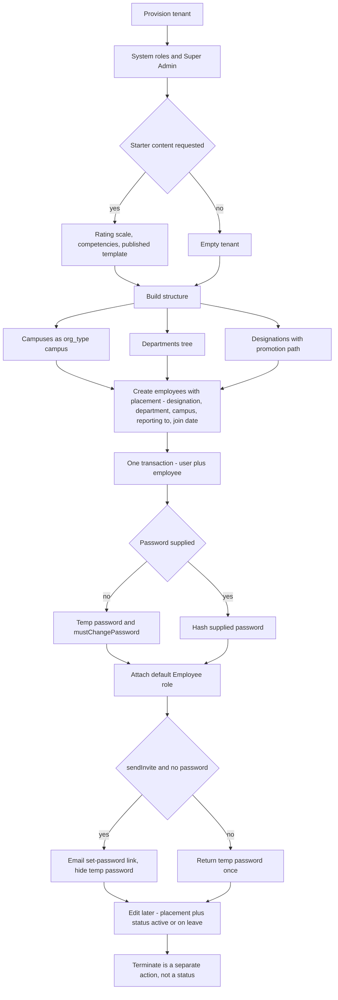

---

## 2. Employee hierarchy and reporting relationships

**Status: Partial** — line manager is fully wired; matrix managers are stored but inert.

**Entry points**

- `PUT /organization/employees/:id` → `organization/services/employee.service.ts:EmployeeService.update`
- `POST /organization/employees/:id/matrix` → `organization/services/employee.service.ts:EmployeeService.assignMatrix`
- `GET /organization/org-chart` → `organization/services/employee.service.ts:EmployeeService.orgChart`
- Cycle detection helper: `organization/cycle-guard.ts:wouldCreateCycle`
- Screens: the **Reporting to** picker in the Add employee and **Edit** dialogs
  (`apps/web/src/features/organization/panels/EmployeesPanel.tsx:199-285`, `:448`)

### Trigger

An admin sets an employee's **Reporting To** while adding them, changes it later from the
per-row **Edit** dialog, or assigns matrix managers.

### Main steps

1. `update` receives `lineManagerId`.
2. Reject self-management (`dto.lineManagerId === id`).
3. Confirm the proposed manager exists in the tenant (`getOwned`).
4. Call `wouldCreateCycle(fetchParentId, proposedParentId, nodeId, maxDepth = 100)`. It
   walks *upward* from the proposed manager one `lineManagerId` hop at a time; it returns
   `true` if it reaches the node being reassigned **or** if it exceeds 100 hops.
5. Persist. All other fields use the `undefined` sentinel so a partial DTO never nulls
   an unrelated column.

`assignMatrix` deletes all `employee_matrix_managers` rows for the employee and recreates
them from `managerIds`, after checking the employee is not in their own list and every id
resolves inside the tenant.

### Validation and business rules

| Rule | Where | Note |
| --- | --- | --- |
| An employee cannot report to themselves | `EmployeeService.update` | Explicit check before the cycle walk |
| Reporting chain must be acyclic | `cycle-guard.ts:wouldCreateCycle` | Depth cap of 100 also trips the guard — a pathological chain is treated as a cycle |
| Same helper reused for department parent and designation promotion path | `cycle-guard.ts` | One implementation, three call sites |
| Matrix manager cannot be the employee | `EmployeeService.assignMatrix` | — |
| ⚠️ Matrix assignment has **no** cycle detection | `EmployeeService.assignMatrix` | Only the self-check exists; A↔B matrix pairs are accepted |
| ⚠️ `create` skips the cycle check | `EmployeeService.create` | Safe in practice: a brand-new employee has no reports yet |
| The picker hides the person themself and anyone `terminated` | `EmployeesPanel.tsx:271` | A courtesy, not the guard — the server checks are authoritative |

> ⚠️ **Differs from naming — matrix managers are display-only.** `employee_matrix_managers`
> is read in exactly two places: `EmployeeService` serialisation and
> `apps/web/src/features/organization/OrgChart.tsx`. It is **not** consulted by
> `bulk-generation/services/plan.service.ts`, `ScopeService`, `ReportsService.myTeam`, or
> scoring. A matrix manager therefore never becomes a reviewer automatically and never
> gains data scope. Every hierarchy-derived behaviour in this system uses
> `employees.line_manager_id` only.

### Data affected

`employees.line_manager_id`, `employee_matrix_managers`, `audit_logs`.

### Output

The updated serialised employee, including `lineManager` and `matrixManagers`.

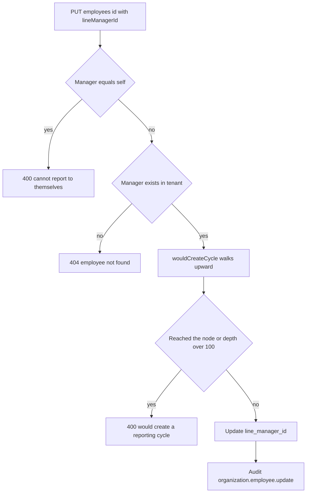

Scope consequences of this edge are computed lazily in
`rbac/scope.service.ts:visibleEmployeeIds` with a recursive CTE over `line_manager_id`,
memoised per request.

---

## 3. Feedback cycle creation and lifecycle

**Status: Partial** — `archived` exists in the schema, the service and the guards, but
no route reaches it.

**Entry points**

| Path | File:function |
| --- | --- |
| `POST /appraisal/cycles` | `appraisal/services/cycle.service.ts:CycleService.create` |
| `POST /appraisal/cycles/:id/activate` | `CycleService.setStatus` with `'active'` |
| `POST /appraisal/cycles/:id/close` | `CycleService.setStatus` with `'closed'` |
| `POST /appraisal/cycles/:id/clone` | `CycleService.clone` |
| Reusable cycle templates | `appraisal/services/cycle-template.service.ts` |

### Trigger

HR/Admin creates a cycle in `/appraisal`, or `bulk-generation` creates one implicitly
(**§6**), or a saved cycle template is applied.

### Main steps

1. `create` validates `endDate >= startDate` and inserts an `appraisal_cycles` row with
   `status = 'draft'`.
2. Setup happens while draft: feedback sources (**§5**), participants, assignments.
3. `setStatus(..., 'active')` flips the status, writes both audit trails, dispatches the
   outbound webhook `appraisal.cycle.active`, then **fires and forgets**
   `DispatchService.notifyCycleStarted` (`void ... .catch(log)`) so activating a
   thousand-assignment cycle does not block the HTTP response.
4. `setStatus(..., 'closed')` does the same with `notifyCycleClosed`.
5. `clone` copies name + `(copy)`, dates, `templateId`, `ratingScaleId` and **all
   feedback sources** into a fresh `draft` cycle in one transaction. Participants,
   assignments and responses are **not** copied.

### The two guards — read these carefully

Everything about cycle state reduces to two methods in `CycleService`:

| Guard | Passes when | Used by |
| --- | --- | --- |
| `assertOpen(orgId, cycleId)` | status is exactly `active` **and** `submission_deadline` is null or in the future | `AssignmentService.requireWritableAssignment` — i.e. `saveDraft` and `submit` |
| `assertNotFinalized(orgId, cycleId)` | status is **not** `closed` and **not** `archived` (so `draft` and `active` both pass) | `SetupService.addParticipant`, `SetupService.importParticipants`, `AssignmentService.create` |

`assertOpen` is deliberately stricter: setup legitimately happens on a `draft` cycle
(bulk generation builds the whole roster before activating), and evaluators may still be
added to a running cycle — but feedback may only be *written* into a live, in-deadline
cycle.

### What each state permits and blocks

| Operation | draft | active | closed | archived |
| --- | --- | --- | --- | --- |
| Add participant / import participants | ✅ | ✅ | ❌ `assertNotFinalized` | ❌ |
| Create reviewer assignment | ✅ | ✅ | ❌ `assertNotFinalized` | ❌ |
| Save feedback draft | ❌ *"not been activated yet"* | ✅ until deadline | ❌ | ❌ |
| Submit feedback | ❌ | ✅ until deadline | ❌ *"is closed and no longer accepts feedback"* | ❌ |
| Parent/external submit | ❌ | ✅ until deadline | ❌ (inline check, **§8**) | ❌ |
| Read an assignment form | ✅ | ✅ | ✅ | ✅ |
| Calibrate / set potential | ✅ | ✅ | ✅ | ✅ |
| Release / retract results | ✅ | ✅ | ✅ | ✅ |
| Remove participant / remove source | ✅ | ✅ | ⚠️ ✅ | ⚠️ ✅ |
| Clone | ✅ | ✅ | ✅ | ✅ |

> ⚠️ **Asymmetry worth knowing.** `SetupService.removeParticipant` and
> `SetupService.removeSource` call only `cycles.getOwned`, **not** `assertNotFinalized`.
> You cannot add a participant to a closed cycle, but you can still delete one — which
> cascades that participant's assignments and responses away.

> ⚠️ **Differs from naming — `closed` is not terminal and `archived` is unreachable.**
> `setStatus` accepts `'archived'` and `assertNotFinalized` handles it, and the SQL
> `CHECK` constraint on `appraisal_cycles.status` allows it, but
> `appraisal.controller.ts` exposes only `/activate` and `/close`. Nothing in
> `apps/api` or `apps/web` ever sets `archived`. Conversely, calling `/activate` on a
> closed cycle re-opens it — the feedback trail records this as `cycle.reopened` rather
> than `cycle.started`.

### Data affected

`appraisal_cycles`, `feedback_sources` (on clone), `audit_logs`,
`feedback_audit_entries`, `notifications`, `user_notifications`,
`webhook_deliveries`, `configurations` (cycle templates are stored as JSON under
`module='appraisal', key='cycle_templates'`).

### Output

`{ id }` on create/clone; `{ id, status }` on a transition.

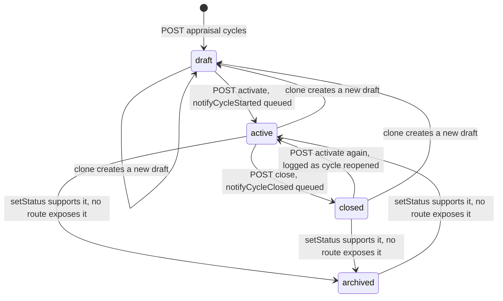

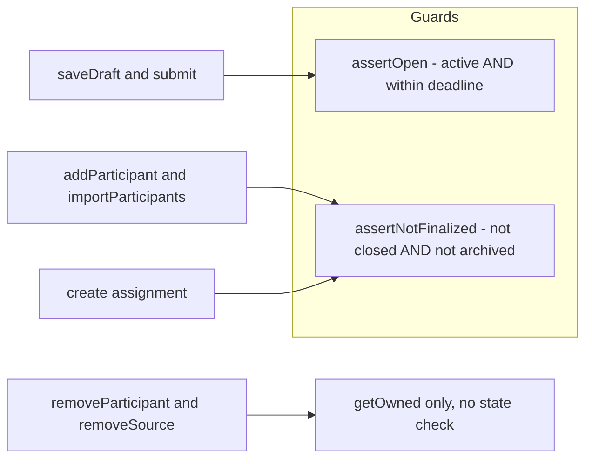

---

## 4. Questionnaire and competency setup

**Status: Partial** — rubrics are API-only; competency retirement has no dedicated route;
the default proficiency scale has no writer.

**Entry points**

| Path | File:function |
| --- | --- |
| `POST /questionnaire/questions` | `questionnaire/services/question.service.ts:QuestionService.create` |
| `POST /questionnaire/templates` | `questionnaire/services/template.service.ts:TemplateService.create` |
| `POST /questionnaire/templates/:id/sections` | `TemplateService.addSection` |
| `POST /questionnaire/templates/:id/sections/:sectionId/questions` | `TemplateService.addQuestion` |
| `POST /questionnaire/templates/:id/publish` | `TemplateService.publish` |
| `POST /questionnaire/templates/:id/clone` | `TemplateService.clone` |
| `POST /competency/competencies` | `competency/services/competency.service.ts:CompetencyService.create` |
| `POST /competency/competencies/:id/versions` | `competency/services/version.service.ts:VersionService.cloneDraft` |
| `POST /competency/versions/:versionId/activate` | `competency/services/version.service.ts:VersionService.activate` |

### Trigger

An admin builds the question bank and the review form before a cycle can be created.

### Main steps — questionnaire

1. Create **questions** in the bank. A question carries an optional `competency_id`, an
   optional `rating_scale_id`, a free-text `category`, `is_mandatory`, and `weight`.
2. Create a **template** (starts `draft`), add **sections**, attach questions to sections
   as `section_questions` rows with `sort_order` and optional `weight_override` /
   `is_mandatory_override` / `condition` JSON.
3. **Publish**: requires at least one section. Sets `status = 'published'` and writes a
   `questionnaire.published` feedback-trail entry.
4. **Clone** to change a published template: deep-copies sections and section-questions
   into a new `draft` with `version + 1`.

### Main steps — competency versioning

1. `CompetencyService.create` creates the competency **and**, in the same transaction, a
   `v1` `draft` version pre-populated with proficiency levels from the org's default
   scale — see the known gap below, because in practice that list is empty.
2. `VersionService.cloneDraft` refuses if a draft already exists, labels the new version
   `v{count+1}`, and deep-copies proficiency levels and behaviour indicators from the
   newest existing version (remapping `proficiency_level_id`).
3. `VersionService.activate` runs one transaction: `updateMany` every currently `active`
   version of that competency to `retired`, then set this draft to `active`.

**Both steps are now reachable from the UI** (Competencies → Library). The lifecycle was
implemented server-side but had no controls, so a competency created in the UI was stuck in
Draft forever.

| Control | Shown when | Does |
| --- | --- | --- |
| **Activate** | the latest version is a draft (`CompetencyCard.tsx:30-33`, `:99-103`) | `POST /competency/versions/:versionId/activate` after a confirmation dialog |
| **New version** | there is a live version and no pending draft (`CompetencyCard.tsx:104-109`) | `POST /competency/competencies/:id/versions` — clones the latest version into an editable draft |
| **"vN draft pending"** amber badge | an active version and a newer draft coexist (`CompetencyCard.tsx:79`) | — |

Both buttons require `competency.version.manage`. The confirmation
(`CompetencyLibrary.tsx:200-245`) names the version being retired, warns that a retired
version can never be reactivated, and warns that the activated version's behaviour
indicators become read-only. The **Indicators** deep-link opens the pending draft when there
is one (`competency/pages/CompetencyPage.tsx:22-32`), because a draft is the only editable
version.

> ⚠️ **Known gap — the default proficiency scale has no writer.** `CompetencyService.create`
> seeds the v1 draft's levels from `ProficiencyScaleService.resolveDefault`
> (`competency/services/proficiency-scale.service.ts:31-46`), which reads `configurations`
> `module='competency'`, `key='default_proficiency_scale'`. **Nothing in the application
> ever writes that key** — `grep -rn default_proficiency_scale apps/api/src` returns two
> hits, both reads in that one file. A competency created through the UI is therefore
> created with **zero proficiency levels**. Seeded competencies have five only because
> `provisioning/starter-content.ts:138` inserts them directly. There is no screen for the
> default scale and no CRUD API for `proficiency_levels`, so today the only ways in are the
> generic `POST /configuration` store or direct SQL. Stated as a gap, not a feature.

### Validation and business rules

| Rule | Where |
| --- | --- |
| Only `draft` templates may be edited | `TemplateService.assertDraft` — thrown from addSection, removeSection, addQuestion, removeQuestion |
| Publishing needs ≥ 1 section | `TemplateService.publish` |
| One active competency version per competency | DB partial unique index `uq_competency_versions_one_active` **and** the retire-then-activate transaction |
| Only `draft` versions may be activated | `VersionService.activate` |
| Only `draft` versions may be edited | `competency/services/indicator.service.ts` — `'Only draft versions can be edited.'` |
| One draft at a time | `VersionService.cloneDraft` |
| Competency name unique per org | `CompetencyService.assertNameFree` |
| Activate / New version require `competency.version.manage` | `competency/controllers/competency.controller.ts:89`, `:99`; the buttons are hidden without it |
| A quadrant questionnaire must belong to this tenant and have ≥ 1 question | `SetupService.assertTemplate` (**§5**) |

> ⚠️ **Differs from the documented lifecycle — there is no retire endpoint.** The doc
> comment on `VersionService` states `draft -> active -> retired`, but `retired` is only
> ever reached as a side effect of activating a *different* draft
> (`competency.controller.ts` exposes only `versions/:versionId/activate`). A competency
> with a single active version can never be retired through the API. Archiving the whole
> competency (`DELETE /competency/competencies/:id`) sets `is_archived` and `deleted_at`
> but leaves version rows untouched.

> **Publishing is not required for use.** `TemplateService.publish` is advisory:
> `CycleService.create` accepts any `templateId` without checking `status`, and
> `AssignmentService.templateQuestions` reads sections regardless of status. Only
> `BulkGenerationService.assertUsableTemplate` insists the template exists in the org and
> has ≥ 1 attached question — and even that does not require `published`.

> ⚠️ **`CycleService.create` does not validate `templateId` or `ratingScaleId` ownership.**
> Both are stored verbatim as nullable FKs. A cycle with `template_id = null` is legal at
> creation time and only fails later, at `assertValidResponses`, with *"This cycle has no
> questionnaire, so feedback cannot be recorded."*

### Data affected

`questions`, `questionnaire_templates`, `template_sections`, `section_questions`,
`rubrics`, `competency_categories`, `competencies`, `competency_versions`,
`proficiency_levels`, `behaviour_indicators`, `audit_logs`, `feedback_audit_entries`.

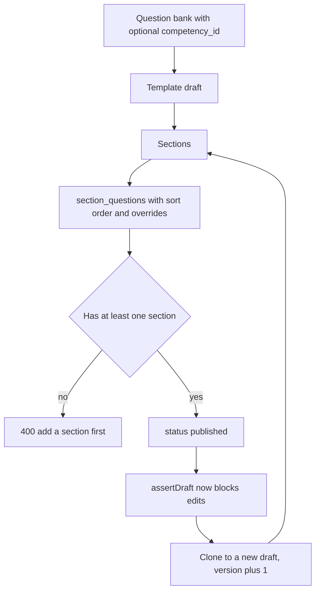

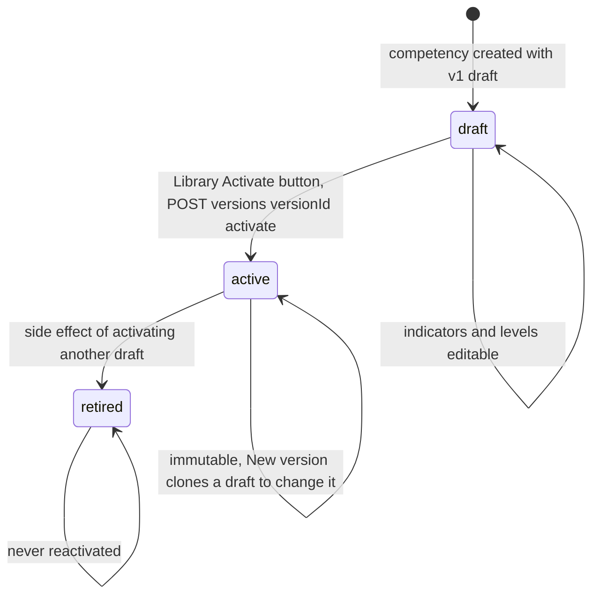

---

## 5. Quadrant / source and competency relationship

**Status: Implemented — but structurally different from what most 360 products do.**
Read this section before touching reporting SQL.

**Terminology, once.** "Quadrant" and "feedback source" are the same thing: the UI tab is
**Sources**, the business term is **quadrant**, the table is `feedback_sources`. A
**questionnaire template** is the instrument; the **cycle questionnaire** is the template
set on `appraisal_cycles.template_id`; a **quadrant questionnaire** is a template set on one
`feedback_sources` row, overriding the cycle's; and the **effective questionnaire** is what
reviewers in that quadrant actually answer once the fallback rule below has been applied.

**Entry points**

- `POST /appraisal/cycles/:id/sources` → `appraisal/services/setup.service.ts:SetupService.addSource`
- `GET /appraisal/cycles/:id/sources` → `SetupService.listSources`
- `PUT /appraisal/cycles/:id/sources/:sourceId/template` → `SetupService.setSourceTemplate`
  (`appraisal.cycle.manage`) — set or clear one quadrant's questionnaire
- `GET /appraisal/cycles/:id/coverage` → `SetupService.coverage` → `cycleCoverage`
  (`appraisal.read`) — the competency × quadrant matrix
- The resolution rule itself: `appraisal/questionnaire-resolution.ts:resolveTemplateId`
- Screen: **Appraisals → Cycles → open a cycle → Sources tab**
  (`apps/web/src/features/appraisal/CycleDetail.tsx` — `SourcesTab` and `CoverageMatrix`)
- Derivation of the scored matrix: `reports/services/reports.service.ts:ReportsService.radar`,
  `ReportsService.sharedCompetencies` and `ReportsService.heatmap`

### The single most important structural fact

> ⚠️ **The quadrant → competency relationship is indirect, and that is deliberate.**
>
> ```
> Quadrant  →  Questionnaire template  →  Questions  →  Competencies
> ```
>
> There is **no direct quadrant → competency mapping table, screen or setting, and none is
> required.** A quadrant assesses exactly the competencies that the questions of its
> *effective* questionnaire are linked to. Coverage therefore cannot drift out of sync with
> the questions reviewers actually answer.
>
> `feedback_sources` still has no `question_id` and no `competency_id`. What it does now
> have is a nullable **`template_id`**: a quadrant may carry its own questionnaire.

**The fallback rule.** `resolveTemplateId()` in
`apps/api/src/appraisal/questionnaire-resolution.ts:29-37`:

> Use the quadrant's own questionnaire if one is configured; otherwise fall back to the
> cycle-level questionnaire.

Expressed in code as `source?.templateId ?? cycle?.templateId ?? null`. The same resolution
is used in three places, so the form a reviewer opens, the answers the server accepts and
the coverage matrix can never disagree:

| Call site | File | What it decides |
| --- | --- | --- |
| `AssignmentService.form()` | `appraisal/services/assignment.service.ts:191` | which questions the reviewer is shown |
| `AssignmentService.assertValidResponses()` | `appraisal/services/assignment.service.ts:397` | which answers are accepted on submit |
| `cycleCoverage()` | `appraisal/questionnaire-resolution.ts:139` | the coverage matrix |

**Backward compatibility.** `feedback_sources.template_id` is a **nullable** column whose
default is NULL, meaning "inherit" — which is exactly the behaviour every cycle had before
the column existed. A cycle configured before this change behaves identically, asserted by
the e2e test *"backward compatibility: a cycle with no quadrant questionnaire behaves
exactly as before"* (`apps/api/test/api.e2e.test.mjs:546`).

**Shared versus quadrant-specific.** A competency is **shared** when **two or more** quadrant
questionnaires contain a question linked to it, and **quadrant-specific** when only one
quadrant asks about it. This is **derived, never stored** — there is no `shared` flag
anywhere in the database (`questionnaire-resolution.ts:174`:
`shared: entry.quadrants.length >= 2`). Changing a quadrant's questionnaire immediately
changes which competencies are shared.

- To make a competency **quadrant-specific**: put its question only in that one quadrant's
  questionnaire.
- To make it **shared**: include a question linked to it in two or more quadrants'
  questionnaires — inheriting the cycle questionnaire counts.

Only shared competencies can be compared between groups, which is what the individual
report's shared-competency panels are built on (**§13**).

**The response-side matrix is unchanged.** The competency × quadrant matrix behind the radar
chart and heatmap is still **derived at query time**, by joining in two directions from
`feedback_responses`:

- **response → question → competency** gives the competency axis
  (`JOIN questions q ON q.id = fr.question_id JOIN competencies cmp ON cmp.id = q.competency_id`)
- **response → assignment → feedback_source** gives the quadrant axis
  (`JOIN reviewer_assignments ra ON ra.id = fr.assignment_id JOIN feedback_sources fs ON fs.id = ra.source_id`)

The cell value is `avg(fr.rating_value)` grouped by `cmp.name, fs.label`. What `cycleCoverage`
adds is the **configuration** side of the same grid — who was *asked* — which is the only
thing that can tell an unasked competency apart from a suppressed one (**§11**, **§13**).

### The Competency Coverage Matrix

Same screen, directly below the quadrant list: **Appraisals → Cycles → open a cycle →
Sources tab → "Competency coverage"** (`CycleDetail.tsx:184-275`). It is built from
configuration only — no scores.

| Element | Behaviour |
| --- | --- |
| Rows | Competencies |
| Columns | Quadrants; each header shows the quadrant label and the questionnaire it effectively uses |
| Final column | **Comparable?** — a green **Shared** badge or a grey **Quadrant-specific** one |
| Cell | Green check with "N question(s)", or an em-dash when that quadrant does not ask about that competency |

Fixed copy worth knowing verbatim, because support answers quote it:

- Explanatory line: *"A competency is shared when two or more quadrants ask about it, which
  is what makes their scores comparable. This is worked out from the questionnaires attached
  to each quadrant above — it is not a separate setting."*
- When every quadrant inherits: *"Every quadrant uses the cycle questionnaire (&lt;name&gt;),
  so all quadrants cover exactly the same competencies."*
- Amber warning when questions carry no competency link: *"N question(s) are not linked to
  any competency. Their answers still count towards the quadrant score, but they appear in
  no competency report."* — the NULL-competency asymmetry below, surfaced at configuration
  time.

The matrix refreshes automatically after a quadrant's questionnaire is changed
(`CycleDetail.tsx:100`, `:126`).

### The quadrant list itself

Each quadrant row on the Sources tab carries a **Questionnaire** dropdown with two kinds of
choice: `Cycle questionnaire (inherited)` — the default, value NULL — or a named
questionnaire template. Next to it the row states *"Reviewers answer &lt;template name&gt;"*
plus an **inherited** badge when the value is NULL (`CycleDetail.tsx:152-175`).

`GET /appraisal/cycles/:id/sources` reflects both levels (`SetupService.listSources`,
`setup.service.ts:41-56`): `templateId` / `templateName` are what is configured **on this
quadrant**, `effectiveTemplateId` / `effectiveTemplateName` are what its reviewers actually
answer after the fallback, and `inheritsCycleTemplate` is `!templateId`.

`SetupService.assertTemplate` (`setup.service.ts:136-156`) refuses a template belonging to
another tenant, and refuses one with no questions:
*"The questionnaire &lt;name&gt; has no questions. Add questions before assigning it to a
quadrant."* Every change is written to the feedback trail as
`source.questionnaire.changed` with the previous and new `templateId`
(`setup.service.ts:119-130`). Changing a quadrant's questionnaire affects forms **not yet
opened** — answers already submitted keep pointing at the questions they were given.

### A worked example

This is what `db:demo` seeds on the **draft** cycle *Mid-Year Review 2027*. Cycle questionnaire
**Standard 360 Review** (7 questions), with the Peer quadrant overridden to **Peer Perspective
2027** (2 questions). It is a draft cycle on purpose: `seedQuadrantQuestionnaire()` deliberately
leaves the scored cycles on a single shared questionnaire, because swapping a quadrant's
questionnaire underneath answers already collected is the failure mode described above.

| Quadrant | Effective questionnaire | Inherited? |
| --- | --- | --- |
| Line Manager | Standard 360 Review | yes |
| Peer | **Peer Perspective 2027** | **no — own questionnaire** |
| Self | Standard 360 Review | yes |
| Subordinate | Standard 360 Review | yes |

Resulting coverage:

| Competency | Line Manager | Peer | Self | Subordinate | Comparable? |
| --- | --- | --- | --- | --- | --- |
| Effective Communication | 1 q | 1 q | 1 q | 1 q | **Shared** |
| Collaboration & Teamwork | 1 q | — | 1 q | 1 q | **Shared** |
| Decision Making | 1 q | — | 1 q | 1 q | **Shared** |
| Strategic Leadership | 1 q | — | 1 q | 1 q | **Shared** |
| Student & Parent Engagement | 1 q | — | 1 q | 1 q | **Shared** |
| Teaching & Delivery Excellence | 1 q | — | 1 q | 1 q | **Shared** |
| Knowledge Sharing | — | 1 q | — | — | **Quadrant-specific** |

Reading it: *Effective Communication* is asked of everyone, so all four groups can be
compared on it. *Knowledge Sharing* is asked only of peers — a real answer, but not a
comparison. The other five are compared across three groups; the Peer column is blank for
them because the peer questionnaire does not ask about them, which is **not assessed**, not
**withheld**. Those two words are never interchangeable in this system (**§11**, **§13**).

### Consequence: the NULL-competency asymmetry

`questions.competency_id` is **nullable** (`database/000_initial_schema.sql`:
`competency_id UUID REFERENCES competencies(id)` — no NOT NULL). Every competency query
in `ReportsService` uses an **INNER** join to `competencies`:

```
JOIN questions q      ON q.id  = fr.question_id
JOIN competencies cmp ON cmp.id = q.competency_id
```

So a rating on a question with `competency_id IS NULL`:

| Surface | Included? | Why |
| --- | --- | --- |
| `ScoringService.compute` → `final_score` | ✅ **counted** | Scoring never joins `questions` at all — it sums `responses.ratingValue` per source |
| `individual().byCompetency`, `radar()`, `heatmap()`, `gap()`, `orgAvgByCompetency()`, `drilldownCompetency()`, `hr().trainingNeeds` | ❌ **excluded** | INNER JOIN drops the row |
| `individual().bySource` | ✅ **counted** | Joins `feedback_sources`, not `questions` |
| `comments()` | ✅ **included** | Joins `questions` for the text but not `competencies` |

Practical effect: an overall score and the mean of the competency bars can legitimately
disagree, and the difference is exactly the weight of the uncategorised questions.
`ReportsService.individual` sidesteps this by reporting `overallScore` from the stored
`final_score` and only falling back to the competency mean when nothing has been scored.

### Feedback source configuration

| Column | Meaning | Enforced? |
| --- | --- | --- |
| `code` | Machine key, unique per cycle. Bulk generation writes `self`, `manager`, `peer`, `subordinate`, `parent` | ✅ `uq_feedback_source_code` |
| `label` | Display name used as the grouping key in **every** report query | — |
| `weight` | Multiplier in `ScoringService.compute` | ✅ |
| `required_count` | Minimum reviewers for this quadrant | ⚠️ **Unenforced** |
| `is_anonymous` | Whether the reviewer's identity is withheld **from the appraisee** | Advisory — see below |
| `is_active` | Set by bulk generation; never read | ⚠️ **Unenforced** |
| `template_id` | Optional quadrant questionnaire. **NULL = inherit the cycle's** | ✅ Ownership and non-emptiness checked by `SetupService.assertTemplate`; resolution by `resolveTemplateId` |

> ⚠️ **`required_count` is stored but never enforced.** It is written by
> `SetupService.addSource` (default 1), copied by `CycleService.clone` and
> `CycleTemplateService`, hard-coded to 1 by `BulkGenerationService.generate` and
> `EvaluationLinkService.provisionCycle`, and surfaced as `required` in
> `ReportsService.employeeDrilldown`. **No code path blocks submission, blocks closing a
> cycle, or suppresses a score because a quadrant is under-populated.** The anonymity
> threshold (`min_responses_to_show`, **§11**) is a *separate* config value and is the
> only reviewer-count rule that actually gates anything.

> ⚠️ **`is_anonymous` does not hide the appraisee.** `AssignmentService.myReviews` and
> `AssignmentService.form` always name the person being reviewed and return
> `anonymousToAppraisee: source.isAnonymous` as a separate, purely informational flag.
> `is_anonymous` is not read by `ReportsService` at all — report-side confidentiality is
> driven entirely by `min_responses_to_show` (**§11**).

### Data affected

`feedback_sources` (including `template_id`); read-only joins against
`feedback_responses`, `questions`, `competencies`, `reviewer_assignments`,
`questionnaire_templates`, `template_sections`, `section_questions`. Every questionnaire
change writes a `source.questionnaire.changed` entry to `feedback_audit_events`.

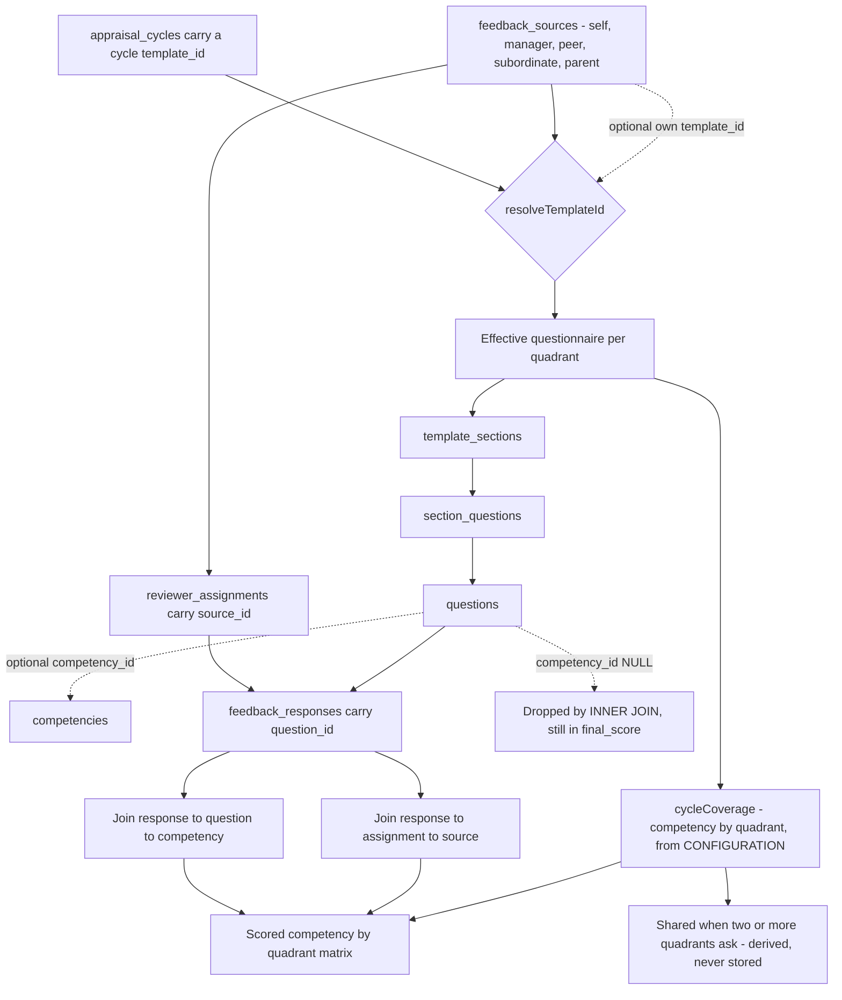

---

## 6. Evaluator determination and assignment

**Status: Implemented.** Three routes into the same `reviewer_assignments` table.

**Entry points**

| Route into assignments | File:function |
| --- | --- |
| Manual, one at a time | `appraisal/services/assignment.service.ts:AssignmentService.create` |
| Nomination approval | `appraisal/services/assignment.service.ts:AssignmentService.setNomination` |
| Bulk generation preview | `bulk-generation/services/bulk-generation.service.ts:BulkGenerationService.preview` |
| Bulk generation execute | `bulk-generation/services/bulk-generation.service.ts:BulkGenerationService.generate` |
| Org-chart derivation | `bulk-generation/services/plan.service.ts:PlanService.buildPlan` |
| External / parent | `external-evaluation/services/evaluation-link.service.ts:EvaluationLinkService.create` (**§8**) |

### 6a. Manual assignment and nomination

`POST /appraisal/cycles/:id/assignments` (`appraisal.assignment.manage`):

1. `assertNotFinalized` on the cycle.
2. Verify the participant belongs to this cycle, the source belongs to this cycle, and
   the reviewer employee belongs to this org and is not soft-deleted.
3. Insert with `nomination_status = dto.propose ? 'proposed' : 'approved'`.
4. A unique-violation is translated to `409 This reviewer is already assigned for this
   source` — the constraint is `uq_reviewer_assignment (participant_id, source_id,
   reviewer_employee_id)`. Because Postgres treats NULLs as distinct, this constraint
   does **not** deduplicate external reviewers (`reviewer_employee_id IS NULL`), which is
   what allows many parent links per source.

`POST /appraisal/assignments/:id/nominate/approve|reject` flips `nomination_status` to
`approved` / `rejected` and writes `assignment.approved` / `assignment.rejected` to the
feedback trail.

**The nomination gate is enforced in three independent places** — this matters:

| Place | Effect |
| --- | --- |
| `AssignmentService.myReviews` | A non-approved assignment is not listed as a task |
| `AssignmentService.requireWritableAssignment` | A `proposed` or `rejected` assignment cannot save a draft or submit |
| `ScoringService.compute` | Only `nominationStatus: 'approved'` assignments contribute to the score |

`DispatchService.reviewersOfCycle` and `ReminderService.dispatchForCycle` also filter on
`nominationStatus: 'approved'`, so an unapproved nominee is never notified or reminded.

### 6b. Bulk generation from the org chart

`PlanService.buildPlan(orgId, scope, config)` is a **pure** function over the employee
table — `preview` and `generate` call it identically, so the confirmed plan is exactly
what gets written.

**Scope resolution** (`PlanService.resolveScope`):

| scopeType | Meaning |
| --- | --- |
| `all` | Entire tenant |
| `campus` | `employees.campus_id = scopeId` |
| `department` | The department **and every descendant** — resolved by walking `parent_id` in memory |

**Config defaults** (`PlanService.DEFAULT_CONFIG`):

```
evaluators: { self:false, manager:true, peer:true, subordinate:true, parent:true }
peer:       { min:1, max:5, crossDepartment:false }
allowOutOfScope: false
includeParents:  true
channels:   ['in_app','email']
notify:     true
```

**Derivation rules**, evaluatee `E`, over **active** employees only:

| Source | Rule | Issue flag |
| --- | --- | --- |
| `self` | `E` reviews `E` — only when `evaluators.self` is on | — |
| `manager` | `byId.get(E.lineManagerId)`, must be `active`, must not be `E` | `missingManager` when absent or inactive. A manager excluded *only* by `allowOutOfScope: false` is deliberately **not** flagged missing |
| `subordinate` | Everyone whose `lineManagerId === E.id`, active, usable | `noSubordinates` when the set is empty |
| `peer` | Everyone sharing `E.lineManagerId`, excluding `E`, active, usable; then filtered to `p.departmentId === E.departmentId` unless `peer.crossDepartment`; sorted by `id` for determinism; then `.slice(0, peer.max)` | `noPeers` when the pre-slice count is below `max(1, peer.min)` |

`usable(emp)` = employee exists, is `active`, and (`allowOutOfScope` OR is inside the
selected scope). A final `cleaned` filter guarantees nobody self-evaluates unless `self`
is explicitly enabled.

> ⚠️ **`peer.min` is advisory only.** It never adds a peer, never widens the search, and
> never blocks generation — it only decides whether the evaluatee's name lands in the
> `issues.noPeers` array shown in the preview summary. `peer.max` *is* enforced, by the
> `slice`. An employee with 2 eligible peers and `min: 5` still gets 2 peer assignments
> and a warning.

> ⚠️ **`crossDepartment: true` does not search other departments.** Peers are *always*
> "people with the same line manager". The flag only removes the department filter from
> that same-manager set. There is no code path that pairs peers across managers.

**`generate` writes, in order:**

1. `assertUsableTemplate` — template required, must exist in the org, must have ≥ 1
   `section_questions` row. This runs **before** the cycle is created, so a bad template
   does not leave an orphan cycle.
2. `CycleService.create` → a `draft` cycle.
3. One `feedback_sources` row per enabled evaluator type, from the hard-coded
   `SOURCE_DEFS` map: `self` w1 non-anon, `manager` **w2** non-anon, `peer` w1 anon,
   `subordinate` w1 anon, `parent` w1 anon.
4. `appraisalParticipant.createMany({ skipDuplicates: true })` for every plan.
5. Assignment rows built in memory, de-duplicated on
   `participantId:sourceId:reviewerEmployeeId`, written in `createMany` chunks of 1000
   with `reviewerType: 'internal'`, `nominationStatus: 'approved'`.
6. Parent links via `EvaluationLinkService.create(user, {...}, cycleId, ctx)` (**§8**).
7. If `config.notify`, `CycleService.setStatus(..., 'active')` — which is what actually
   sends the evaluator notifications.
8. A `bulk_generation_runs` row with `status` = `completed` | `partial` | `failed`, plus
   the full `config`, `summary`, `skipped[]` and `failed[]` JSON.

> ⚠️ **`messagesQueued` in the run row is an estimate, not a count of sends.** After
> activation it does `messagesQueued += assignmentsCreated - parents.items.length`, i.e.
> it assumes one message per internal assignment. The real fan-out is per *distinct
> reviewer* (`DispatchService.reviewersOfCycle` collapses a reviewer who evaluates
> several people into one recipient), and channels with no reachable address are skipped
> silently. Treat the number as an upper bound.

### Data affected

`appraisal_cycles`, `feedback_sources`, `appraisal_participants`,
`reviewer_assignments`, `evaluation_links`, `bulk_generation_runs`, `notifications`,
`user_notifications`, `audit_logs`, `feedback_audit_entries`.

### Output

`preview` → the summary only (no writes). `generate` → `{ runId, cycleId, cycleStatus,
summary, assignmentsCreated, skippedCount, failedCount, messagesQueued, skipped, failed }`.

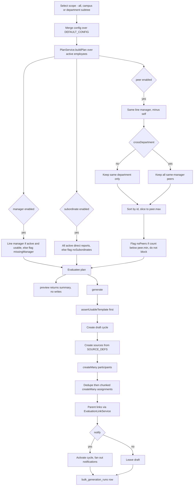

---

## 7. Manager, peer and subordinate feedback

**Status: Implemented.** One code path; the source only changes labels and weights.

**Entry point:** `appraisal/services/assignment.service.ts:AssignmentService.myReviews`,
then `AssignmentService.form`, then `saveDraft` / `submit` (**§9**).

### Trigger

A reviewer opens `/appraisal`; `GET /appraisal/my-reviews` lists their outstanding work.

### Main steps

1. `myReviews` selects assignments where the reviewer's `employee.userId` is the caller,
   `status IN ('pending','in_progress')` and `nominationStatus = 'approved'`.
2. Each row returns: the cycle name, **the appraisee's name, title and department**, the
   source label and code, `anonymousToAppraisee`, the answered count, and the deadline.
3. `GET /appraisal/assignments/:id/form` returns the questions from
   `resolveTemplateId(cycleId, sourceId)` — the quadrant's own questionnaire when it has
   one, otherwise the cycle's (**§5**) — flattened over sections ordered by `sortOrder`,
   any saved answers merged in, the same appraisee name / title / department as the list,
   and the rating-scale levels from `cycle.ratingScaleId` for inline behavioural anchors.
4. Save / submit as in **§9**.

> **The appraisee is always named; `is_anonymous` is about the *reviewer*.** Both
> `myReviews` (`assignment.service.ts:159-173`) and `form` (`:194-233`) return the
> appraisee's name, job title and department, the cycle and the quadrant, plus one line
> stating what happens to the **reviewer's own** name. The UI renders that as one of three
> sentences (`apps/web/src/features/appraisal/AppraisalPage.tsx:246-272`): a
> self-assessment line for `code = 'self'`, *"Your name is not shown to X — &lt;quadrant&gt;
> feedback is reported as a group average only."* for an anonymous quadrant, or an
> attributed-feedback line otherwise. Previously a task on an anonymous quadrant was titled
> "Confidential" and the reviewer could not tell whose performance they were rating.
> Reviewer anonymity itself is unchanged and is still enforced by response-count
> suppression (**§11**), never by hiding the appraisee.

### What actually differs between the three sources

**Nothing in the code path.** All three go through the same resolution, the same scale, the
same validation, and write the same `feedback_responses` rows. What they read is the
quadrant's **effective** questionnaire (**§5**): identical for all three when every quadrant
inherits the cycle questionnaire, which is the default and the historical behaviour, and
different only where an administrator has given one quadrant its own template. The remaining
differences are data:

| Aspect | Manager | Peer | Subordinate |
| --- | --- | --- | --- |
| Derivation (`PlanService`) | `E.lineManagerId` | Same-manager set, department-filtered, capped at `peer.max` | Everyone with `lineManagerId = E.id` |
| Bulk default weight | **2** | 1 | 1 |
| Bulk default `is_anonymous` | `false` | `true` | `true` |
| Typical reviewer count | 1 | 0–5 | 0–n |
| Practical anonymity effect | With 1 reviewer, always below the default threshold of 3 → suppressed for anyone lacking `reports.confidential.view` (**§11**) | Suppressed until 3 distinct reviewers submit | Same |
| Self source | Exempt from suppression by `code = 'self'` — never confidential | — | — |

`requireReviewer` throws `403 This review is not assigned to you` if
`assignment.reviewer.userId !== user.userId`, so a reviewer can only ever act on their
own tasks regardless of permissions.

### Data affected

`reviewer_assignments.status`, `reviewer_assignments.submitted_at`,
`feedback_responses`, `appraisal_participants.final_score` / `computed_score` /
`status`, `feedback_audit_entries`, `notifications`, `user_notifications`.

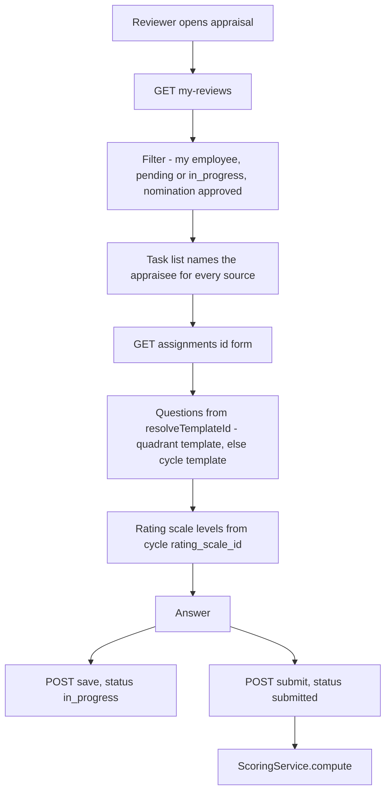

---

## 8. Parent and external feedback via tokenised link

**Status: Implemented.** The only unauthenticated write path in the product.

**Entry points**

| Path | File:function | Auth |
| --- | --- | --- |
| `POST /external-evaluation` | `external-evaluation/services/evaluation-link.service.ts:EvaluationLinkService.create` | JWT + `external.evaluation.manage` |
| `POST /external-evaluation/:id/revoke` | `EvaluationLinkService.revoke` | JWT |
| `POST /external-evaluation/:id/regenerate` | `EvaluationLinkService.regenerate` | JWT |
| `GET /public/evaluate/:token` | `external-evaluation/public-evaluation.controller.ts:PublicEvaluationController.validate` | **None** |
| `POST /public/evaluate/:token` | `external-evaluation/public-evaluation.controller.ts:PublicEvaluationController.submit` | **None** |

Frontend: `/evaluate/:token` → `apps/web/src/features/external-evaluation` (outside the
authenticated route tree in `App.tsx`).

### Token generation and hashing

```
token     = randomBytes(24).toString('base64url')      // 192 bits, URL-safe
tokenHash = createHash('sha256').update(token).hex()   // only this is stored
url       = `${publicBaseUrl}/evaluate/${token}`
```

`evaluation_links.token_hash` is `VARCHAR(128) NOT NULL UNIQUE`. The plaintext token is
returned to the admin **once** from `create` / `regenerate` and is included in the
outbound message body; it is never recoverable afterwards. `findByToken` re-hashes the
presented token and does a single `findUnique` on `token_hash`.

### Main steps — issuing a link

1. Resolve `studentId` and `teachingAssignmentId` against the SIS provider
   (`SIS_PROVIDER` injection token). 404 if either is unknown.
2. Resolve the parent (optional) to get a name and a fallback recipient
   (`whatsapp ?? mobile ?? email`).
3. **Identity mapping is mandatory.**
   `IdentityMapService.resolveEmployee(orgId, 'teacher', assignment.teacherId)` reads
   `external_identity_maps` where `active = true`. If unmapped:
   `400 Teacher "X" is not yet mapped to a 360 employee.` (**§16**)
4. `provisionCycle(orgId, employeeId, explicitCycleId?)`:
   - target cycle = the explicit one (bulk generation passes its fresh cycle) **or** the
     org's `status = 'active'` cycle ordered by `start_date DESC`;
   - creates the `appraisal_participants` row if missing;
   - creates a `feedback_sources` row `code='parent', label='Parents', weight=1,
     requiredCount=1, isAnonymous=true` if missing;
   - returns the cycle's `templateId`.
5. Insert `evaluation_links` with `expiresAt = now + (expiresInDays ?? 14) days` and
   `oneTime = dto.oneTime ?? true`.
6. Insert **one** `reviewer_assignments` row per link: `reviewerEmployeeId = null`,
   `reviewerType = 'external'`, `externalRef = link.id`, `externalName = parentName ??
   "Parent of {student}"`, `nominationStatus = 'approved'`, `status = 'pending'`. Then
   back-fill `evaluation_links.reviewer_assignment_id`.
7. If `send`, `deliverWithToken` composes the message and calls
   `NotificationService.send` with `templateKey = 'external_evaluation.invite'`, then
   sets `status='sent'`, `sentAt`, `sendChannel`, `recipient`.

### Main steps — the public path

`GET /public/evaluate/:token` (`validate`), in order:

1. `findByToken` → 404 `This evaluation link is invalid.`
2. `status === 'revoked'` → **410 Gone**
3. `status === 'completed' && oneTime` → **410 Gone** — this is the single-use gate
4. `expiresAt < now` → set `status='expired'`, log `link.expired` as actor `System`, → **410 Gone**
5. `status in ('pending','sent')` → set `status='opened'`, set `openedAt` if unset, log
   `link.accessed` as *"Parent (secure link)"* with IP and user-agent
6. Return student/parent/teacher/subject/class/section/session, org branding, the
   question list, and `DEFAULT_RATING_SCALE` (1–5)

`POST /public/evaluate/:token` (`submit`):

1. Re-checks revoked / expired / completed-and-oneTime.
2. **Cycle-state check, duplicated inline.** `row.cycleId` is looked up directly and
   rejected with 410 if `status !== 'active'` or the `submission_deadline` has passed.
   The comment states this avoids a module dependency cycle with `CycleService` — so
   this is a second implementation of `assertOpen`, not a call to it.
3. Computes `overallScore` = mean of numeric ratings (2dp) and `comment` = the first
   non-empty `textValue`; stores the whole `responses` array as JSONB on the link.
4. Sets the link to `completed` / `completedAt`.
5. **Persists real feedback only for real question ids:**

```ts
const UUID_RE = /^[0-9a-f]{8}-[0-9a-f]{4}-[0-9a-f]{4}-[0-9a-f]{4}-[0-9a-f]{12}$/i;
const items = dto.responses.filter((r) => UUID_RE.test(r.questionId));
if (items.length > 0) { /* upsert feedback_responses, mark assignment submitted */ }
```

   The built-in fallback questionnaire (`external-evaluation/default-questionnaire.ts`)
   uses string ids `q_clarity`, `q_preparation`, `q_engagement`, `q_fairness`,
   `q_feedback`, `q_communication`, `q_comment`. **None of these are UUIDs**, so when the
   cycle has no template the parent's answers live only on `evaluation_links.responses`
   / `overall_score` and contribute **nothing** to `feedback_responses`, the 360 score,
   the competency views or the reports. Only when the link inherited the cycle's real
   `template_id` do the answers carry UUID question ids and flow into scoring.
6. If any rows were written: mark the assignment `submitted`, then
   `ScoringService.compute(participantId)`.
7. Log `parent.feedback.submitted` to the feedback trail with the anonymous actor.

### Revoke and regenerate

Both **withdraw the parent's contribution**: delete every `feedback_responses` row for
the linked assignment, reset the assignment to `status='pending', submittedAt=null`, and
re-run `ScoringService.compute`. `regenerate` additionally mints a new token (invalidating
the old URL) and resets `status/openedAt/completedAt/sentAt/overallScore/comment`.

### Validation and business rules

| Rule | Where | Note |
| --- | --- | --- |
| Token is 192-bit random, stored only as SHA-256 | `EvaluationLinkService.hash` | Lost links are re-minted, never recovered |
| Expiry 1–365 days, default 14 | `CreateEvaluationLinkDto` + `create` | Lazily materialised to `status='expired'` on first access after expiry |
| Single use when `oneTime` | `validate` / `submit` | `oneTime: false` allows re-submission until expiry |
| Teacher must be identity-mapped | `IdentityMapService.resolveEmployee` | Names are never matched |
| Ratings 1–5 | `EvaluationResponseItemDto` | ⚠️ hard-coded, see below |
| At least one response | `SubmitEvaluationDto` `@ArrayMinSize(1)` | — |
| Cycle must be active and in-deadline | inline in `submit` | Duplicate of `assertOpen` |

> ⚠️ **The public submit path does not run `assertValidResponses`.** The internal path
> (**§9**) checks that every `questionId` belongs to the cycle's template and that every
> rating lies inside the cycle's configured rating scale. The parent path checks only the
> *UUID shape* of `questionId` and the DTO's hard-coded `@Min(1) @Max(5)`. A cycle using
> a 1–10 scale therefore silently caps parent ratings at 5, and a syntactically valid
> question UUID from a different template would be accepted by the service (the database
> FK `feedback_responses.question_id → questions(id)` is the only backstop, and it does
> not check the template).

> ⚠️ **`provisionCycle` silently picks one active cycle.** With two `active` cycles in a
> tenant, the single-link flow attaches the parent to whichever has the later
> `start_date`. Bulk generation avoids this by passing an explicit `cycleId`.

> **The parent's `feedback_sources` row is auto-created if absent.** An admin who never
> configured a "Parents" quadrant will find one appearing on the active cycle — with
> `weight = 1` — the first time a parent link is issued. That immediately changes the
> weighted denominator in `ScoringService.compute` for every participant who receives
> parent feedback.

### Data affected

`evaluation_links`, `reviewer_assignments`, `feedback_responses`,
`appraisal_participants`, `appraisal_cycles` (participant/source provisioning),
`feedback_sources`, `notifications`, `feedback_audit_entries`.

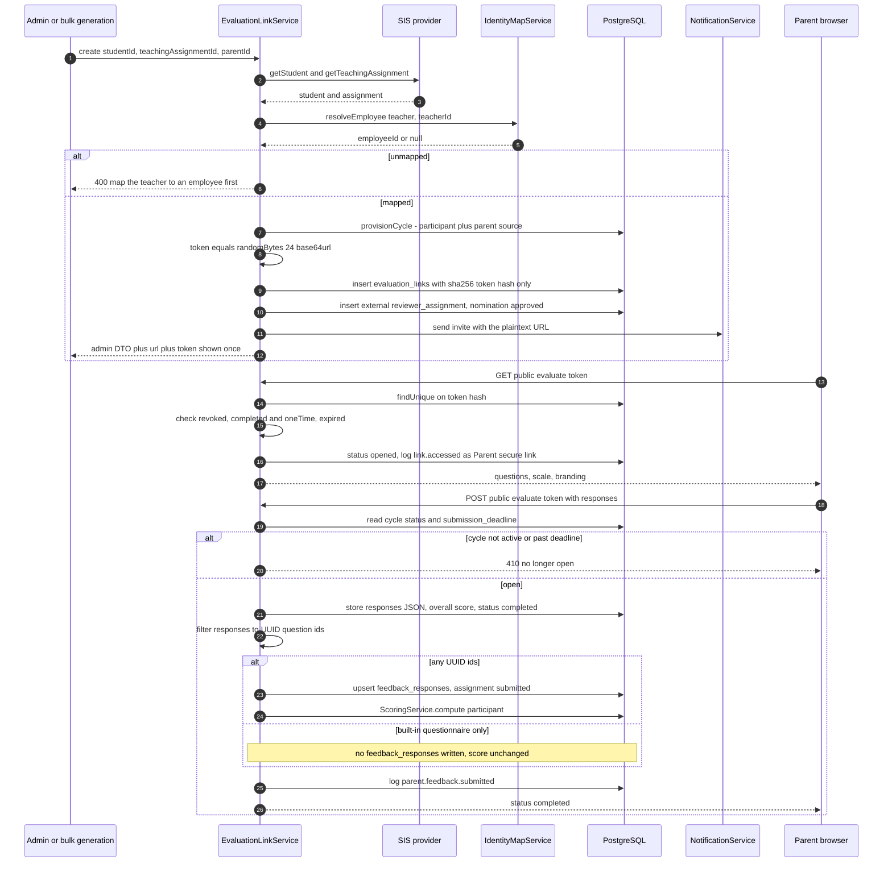

---

## 9. Feedback submission — draft, submit, validation

**Status: Implemented.**

**Entry points**

- `POST /appraisal/assignments/:id/save` → `AssignmentService.saveDraft`
- `POST /appraisal/assignments/:id/submit` → `AssignmentService.submit`
- Validation: `appraisal/services/assignment.service.ts:AssignmentService.assertValidResponses`
- Both require the `appraisal.feedback.submit` permission.

### Trigger

A reviewer saves progress or finalises a review form.

### Main steps

Both methods share `requireWritableAssignment(user, assignmentId)`:

1. `requireReviewer` — assignment exists in the org **and** `assignment.reviewer.userId
   === user.userId`, else 403.
2. `cycles.assertOpen(orgId, assignment.cycleId)` — active and within deadline (**§3**).
3. Nomination gate — `nominationStatus` must be `approved`, else 400 with a message that
   distinguishes *rejected* from *awaiting approval*.

Then:

| | `saveDraft` | `submit` |
| --- | --- | --- |
| Rejects an already-submitted assignment | ✅ | ✅ |
| Runs `assertValidResponses` | ✅ | ✅ |
| Upserts `feedback_responses` on `(assignment_id, question_id)` | ✅ | ✅ |
| Sets assignment status | `in_progress`, only on the first touch | `submitted` + `submitted_at` |
| Recomputes the score | ❌ | ✅ `ScoringService.compute` |
| Sends a confirmation | ❌ | ✅ `confirmSubmission` → `COMM_EVENTS.feedbackSubmitted` |
| Feedback trail action | `evaluation.started` on first touch, else `evaluation.saved` | `evaluation.submitted` |
| Returns | `{ status:'in_progress', answered }` | `{ status:'submitted', score }` |

Writes are wrapped in `prisma.$transaction`. `confirmSubmission` is wrapped in
try/catch — a notification failure never fails the submission.

### `assertValidResponses` — the real rules

```
if (responses.length === 0) return;                       // an empty submit is allowed
cycle = findUniqueOrThrow(cycleId) -> { templateId, ratingScaleId }
templateId = resolveTemplateId(cycleId, assignment.sourceId)   // §5 — quadrant, else cycle
if (!templateId) throw 400 'This cycle has no questionnaire, so feedback cannot be recorded.'
allowed = set of section_questions.question_id where section.templateId = templateId
if (any response.questionId not in allowed) throw 400 'One or more answers do not belong to this questionnaire.'
rated = responses with a numeric ratingValue
scale = cycle.ratingScaleId ?? question.ratingScaleId      // cycle wins
if (a scale resolves) enforce minValue <= ratingValue <= maxValue
```

Notes a new developer will need:

- ⚠️ **The allow-list is the reviewer's *effective* questionnaire, not the cycle's.**
  `assertValidResponses` calls the same `resolveTemplateId` that built the form
  (`assignment.service.ts:397`, **§5**). Validating against `cycle.templateId` alone —
  which is what this used to do — would reject every answer from a quadrant carrying its
  own questionnaire.
- An empty `responses[]` array short-circuits **before** the no-template check, so
  `submit` with `{responses: []}` marks the assignment `submitted` on a template-less
  cycle. `ScoringService.compute` then yields `null`.
- If neither the cycle nor the question has a rating scale, bounds are simply not
  checked (`if (scaleIds.size === 0) return`).
- Text-only answers bypass bounds checking entirely.
- ⚠️ The method's doc comment says *"`FeedbackResponse.questionId` has no foreign key"*.
  That is true of the **Prisma model** (`FeedbackResponse` declares no `question`
  relation), but **not** of the database: `database/000_initial_schema.sql` declares
  `question_id UUID NOT NULL REFERENCES questions(id)`. The application check is still the
  meaningful one, because the FK does not constrain the question to *this cycle's*
  template.

### Data affected

`feedback_responses`, `reviewer_assignments.status` / `submitted_at`,
`appraisal_participants` (via scoring), `notifications`, `user_notifications`,
`feedback_audit_entries`.

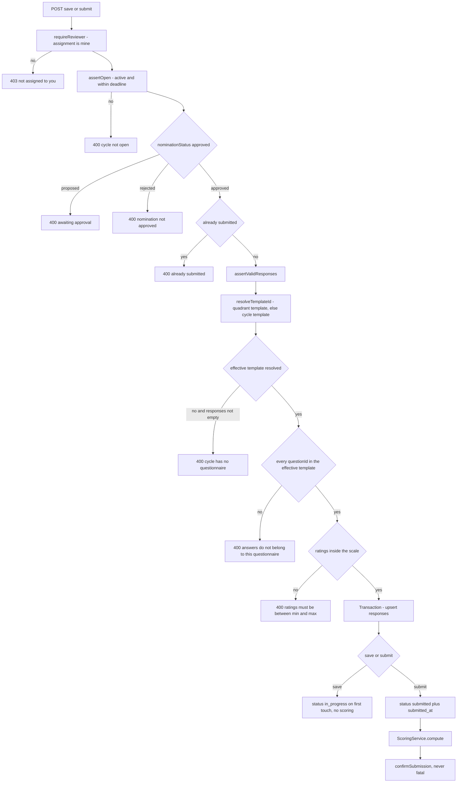

---

## 10. Score calculation and aggregation

**Status: Implemented.** Entry point:
`appraisal/services/scoring.service.ts:ScoringService.compute(participantId)`.

### Trigger

Called after every write that can change a participant's result:
`AssignmentService.submit`, `EvaluationLinkService.submit`, `EvaluationLinkService.revoke`,
`EvaluationLinkService.regenerate`.

### The algorithm, exactly as written

```ts
existing = participant { calibratedAt, finalScore }

assignments = reviewer_assignments
  where participantId = X
    AND status           = 'submitted'
    AND nominationStatus = 'approved'
  include source.weight, responses where ratingValue is not null

bySource: Map<sourceId, { weight, sum, count }>
for each assignment:
  bucket = bySource[sourceId] ?? { weight: source.weight, sum: 0, count: 0 }
  for each rating response: bucket.sum += rating; bucket.count += 1

weightedSum = 0; weightTotal = 0
for each bucket with count > 0:
  weightedSum += (bucket.sum / bucket.count) * bucket.weight
  weightTotal += bucket.weight

score = weightTotal > 0 ? round(weightedSum / weightTotal, 2) : null
```

Three properties fall out of this that are easy to get wrong:

1. **Weights are normalised by the weights that actually contributed.** A quadrant with
   zero rating responses contributes neither to `weightedSum` nor to `weightTotal`, so
   weights need not sum to 1 or to 100 and a missing quadrant does not drag the score
   down — it simply drops out of the denominator.
2. ⚠️ **Within a quadrant, ratings are pooled, not averaged per reviewer.** `sum` and
   `count` accumulate across *all* assignments of that source. A peer who answers 20
   rating questions therefore carries twice the weight of a peer who answers 10. This is
   a mean over responses, not a mean of reviewer means.
3. **The questionnaire is irrelevant to scoring.** No join to `questions` or
   `competencies` exists here — see the NULL-competency asymmetry in **§5**.

### Calibration override precedence

`ScoringService.calibrate` (permission `appraisal.calibrate`, route
`POST /appraisal/participants/:participantId/calibrate`) sets:

```
final_score   = the HR-supplied value
status        = 'completed'
calibrated_at = now()
```

`compute` then honours it permanently:

| Condition | `final_score` | `computed_score` | `status` | Returned |
| --- | --- | --- | --- | --- |
| `calibratedAt` is set | **untouched** | refreshed to the new raw average | **untouched** (`completed`) | the stored `finalScore` |
| Not calibrated, `score !== null` | `score` | `score` | `in_progress` | `score` |
| Not calibrated, `score === null` | `null` | `null` | `pending` | `null` |

So the precedence is **calibration > recomputation**, and the raw average stays visible
in `computed_score` for audit. There is no "de-calibrate" endpoint — clearing
`calibrated_at` requires a direct database change.

`setPotential` (`POST /appraisal/participants/:id/potential`) writes
`potential_rating`, which is the Y axis of the nine-box grid and is never computed.

### Data affected

`appraisal_participants.final_score`, `.computed_score`, `.status`, `.calibrated_at`,
`.potential_rating`; `audit_logs`; `feedback_audit_entries` (`score.calibrated`,
`potential.set`).

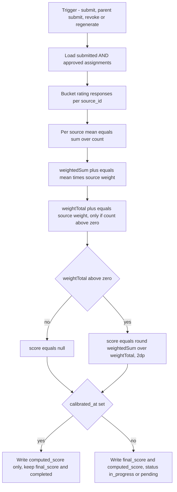

---

## 11. Anonymity and suppression rules

**Status: Implemented.** Entry point:
`reports/services/reports.service.ts` — `minResponses`, `sourceCounts`, `suppressed`.

### The threshold

```
value = configurations where module='reports' AND key='min_responses_to_show' AND deleted_at IS NULL
min   = (typeof value === 'number' && value >= 1) ? value : 3
```

Editable through `PUT /reports/feedback-rules` (`reports.dashboard.configure`) and
readable by any report viewer via `GET /reports/feedback-rules` so the UI can explain
what it is hiding.

### Reviewer counting

`sourceCounts` counts **distinct reviewers per source label** for one appraisee:

```sql
count(DISTINCT COALESCE(ra.reviewer_employee_id::text, ra.id::text))
  ...WHERE ra.status = 'submitted'
```

External reviewers have a NULL `reviewer_employee_id`, so the assignment id stands in —
each parent link counts as one distinct reviewer. Only **submitted** assignments count.

### The decision

```ts
private suppressed(counts, source, min, unlocked = false): boolean {
  const c = counts.get(source);
  if (!c) return false;        // no data at all -> nothing to hide
  if (unlocked) return false;  // reports.confidential.view
  return c.code !== 'self' && c.reviewers < min;
}
```

| Input | Result |
| --- | --- |
| Source has no submitted assignments | **Not** suppressed — but there is no score to show either |
| Source code is exactly `self` | **Never** suppressed — it is the employee's own rating |
| Caller holds `reports.confidential.view` | Not suppressed |
| Otherwise, distinct reviewers < `min` | Suppressed |

### Where suppression is applied

| Surface | Applies threshold | Honours `unlocked` |
| --- | --- | --- |
| `individual().bySource` | ✅ `score` becomes `null`, `suppressed: true`, `reviewers` count still returned | ✅ |
| `individual().comments` | ✅ Non-self comments are **pooled across all sources** and withheld entirely when `0 < others.length < min` | ✅ |
| `radar()` series | ✅ Entire rater-source series is dropped; the dropped labels come back as `withheldSources` so a blank cell can be labelled *withheld* rather than left ambiguous | ✅ |
| `sharedCompetencies().quadrants[]` | ✅ Cell `score` becomes `null` with `state: 'withheld'`; the quadrant contributes nothing to the mean, spread or SD — never a silent zero | ✅ |
| `heatmap()` | ✅ Cell set to `null` when `reviewers < min` | ⚠️ **No** — `heatmap` takes no `unlocked` parameter |
| `individual().byCompetency`, `strengths`, `weaknesses`, `gap()`, `overallScore` | ❌ Never suppressed | — |
| `employeeDrilldown().sourceStatus` | ❌ Returns counts only, never scores or names | — |

Note the heatmap's counting is different in kind: it counts distinct reviewers per
**competency × department cell** across all appraisees, not per appraisee.

> **Withheld is not the same as not assessed.** Suppression is a decision about data that
> exists. A quadrant whose questionnaire never asked about a competency has no data to
> suppress, and is reported as *not assessed* using the coverage payload (**§5**), not as
> *withheld*. `radar()` returns `assessedBy` and `withheldSources` precisely so the two can
> be told apart; the full four-state table is in **§13**.

### The `reports.confidential.view` permission

Defined in `reports/reports.permissions.ts` as
`confidentialView: 'reports.confidential.view'`. Computed in
`reports/reports.controller.ts:ReportsController.canSeeConfidential` and passed as the
`unlocked` argument to `individual()` and `radar()`.

Granted by `rbac/system-roles.ts` to:

| Role | Data scope | Effective reach |
| --- | --- | --- |
| Super Admin | organization | `*` permissions |
| HR/Admin | organization | Whole tenant |
| Manager | **reporting** | Only their own line-manager subtree, because `ScopeService.assertCanAccessEmployee` runs first |
| Employee, Viewer | own / organization | **Not** granted |

Rationale recorded in the source: the threshold exists so an **appraisee** cannot infer
who said what. A Line Manager quadrant has exactly one reviewer by definition and was
therefore permanently "Confidential" to everyone including HR, which made a cycle
impossible to audit. Lifting suppression changes nothing else — **no reviewer identity
is ever selected or returned in either mode**, the stored data and the threshold are
untouched, and the resulting view is recorded in the feedback trail as
`results.viewed { confidential: true }`.

### Data affected

Read-only. Writes only `configurations` (via `setFeedbackRules`) and
`feedback_audit_entries` (view records).

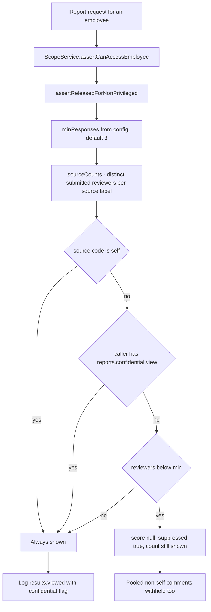

---

## 12. Result release and retraction

**Status: Implemented.**

**Entry points**

- `POST /appraisal/cycles/:id/participants/:participantId/release` →
  `appraisal/services/setup.service.ts:SetupService.setRelease(..., true)`
- `POST /appraisal/cycles/:id/participants/:participantId/retract` →
  `SetupService.setRelease(..., false)`
- Gate: `reports/reports.controller.ts:ReportsController.assertReleasedForNonPrivileged`

Both routes require `appraisal.cycle.manage`.

### Main steps

| Action | Writes | Side effect |
| --- | --- | --- |
| Release | `visibility='released'`, `released_at=now()`, `released_by=userId` | In-app notification `results_released` linking to `/reports`; trail `results.released` |
| Retract | `visibility='draft'`, `released_at=null`, `released_by=null` | No notification; trail `results.retracted` |

Release is **per participant, per cycle** — there is no bulk release endpoint.
Neither action checks the cycle state.

### The gate

```ts
private async assertReleasedForNonPrivileged(user, employeeId, cycleId?) {
  if (user.permissions.includes('reports.executive')) return;   // full bypass
  const released = await this.reports.hasReleasedResults(orgId, employeeId, cycleId);
  if (!released) throw new ForbiddenException('These results have not been released yet.');
}
```

Applied to **four** endpoints: `GET /reports/individual/:employeeId`,
`GET /reports/radar/:employeeId`, `GET /reports/employee-360/:employeeId`,
`GET /reports/gap/:employeeId`.

| Caller | Behaviour |
| --- | --- |
| Holds `reports.executive` (Super Admin, HR/Admin) | Bypassed — pre-release visibility is required for calibration |
| Manager or Employee (`reports.read` only) | Must wait for release |
| Viewer | Deliberately **not** granted `reports.executive`, so it is release-gated too |

`hasReleasedResults` counts `appraisal_participants` with `visibility='released'`,
optionally narrowed to one cycle.

> **Two notes.** (1) When `cycleId` is omitted, **any** released participant record for
> that employee unlocks the un-filtered report, which spans all cycles. (2)
> `hasReleasedResults(_orgId, employeeId, cycleId)` deliberately ignores its first
> argument — the comment records that the caller has already run
> `ScopeService.assertCanAccessEmployee`, which is org-scoped.

Aggregate reports are governed separately by
`ReportsService.assertAggregateVisible` (config `reports/aggregate_visibility`,
`all_report_viewers` | `executives_only`) applied to `institutional`, `departmental`,
`campus`, `trend` and `heatmap`.

### Data affected

`appraisal_participants.visibility` / `.released_at` / `.released_by`,
`user_notifications`, `audit_logs`, `feedback_audit_entries`.

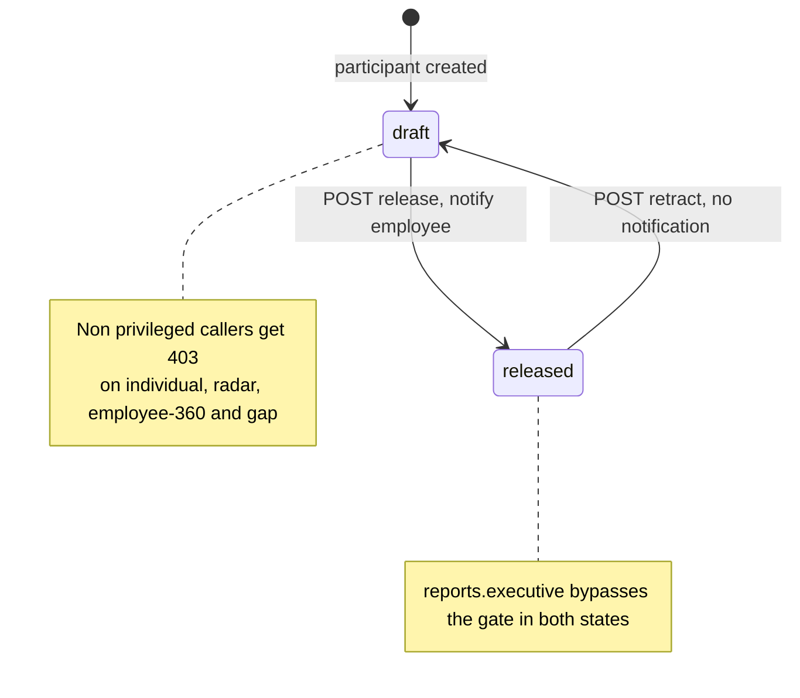

---

## 13. Individual appraisal and report generation

**Status: Implemented.** Two distinct surfaces over the **same** endpoint.

**Entry points**

| Surface | Route | File |
| --- | --- | --- |
| In-app analysis | `/reports` → Individual tab | `apps/web/src/features/reports/IndividualPerformance.tsx` |
| Printable report | `/reports/individual/:employeeId` | `apps/web/src/features/reports/IndividualReportPage.tsx` |
| Backend | `GET /reports/individual/:employeeId` | `reports/services/reports.service.ts:ReportsService.individual` |
| Competency × quadrant matrix | `GET /reports/radar/:employeeId` | `ReportsService.radar` (`reports.service.ts:822`) |
| Shared-competency comparison | `GET /reports/shared-competencies/:employeeId` | `ReportsService.sharedCompetencies` (`reports.service.ts:925`) |
| Bulk export | `GET /reports/export?type=&format=` | `reports/services/report-export.service.ts:ReportExportService.export` |

All four person-level reads carry the same guards: `ScopeService.assertCanAccessEmployee`,
`assertReleasedForNonPrivileged`, the `reports.confidential.view` unlock and a
`results.viewed` audit entry (**§11**).

### What `ReportsService.individual` assembles

| Key | Source | Suppression |
| --- | --- | --- |
| `employee` | `employees` + `users` + `designations` + `departments` | — |
| `overallScore` | `currentFinalScore` — the stored `final_score`, falling back to the competency mean only when nothing has been scored | — |
| `previousOverall` | `previousOverall` — most recent *other* cycle when `cycleId` is given, else the prior cycle | — |
| `byCompetency` | `avg(rating)` grouped by competency, INNER JOIN (**§5**) | none |
| `bySource` | `avg(rating)` grouped by `fs.label` | ✅ **§11** |
| `strengths` / `weaknesses` | Top 3 / bottom 3 of `byCompetency` | none |
| `gap` | `target - score` per competency; priority high ≥ 1.0, medium ≥ 0.5, else low | none |
| `comments` | Open-text answers grouped by question, self separated, others pooled | ✅ **§11** |
| `minResponses`, `confidentialUnlocked` | So the UI can explain what it hid | — |

`target` comes from `configurations` `reports/target_score`, default **4**.

> **Why `overallScore` reads the stored column.** The source comment records that this
> used to be the unweighted mean of the competency means, so the same person showed a
> different overall score on the report than on every dashboard, the nine-box and
> my-team, and HR calibration was ignored entirely. It now reads `final_score`.

> ⚠️ **`myTeam()` was not migrated.** `ReportsService.myTeam` still computes
> `overallScore` as `comps.reduce(...) / comps.length` — the unweighted mean of
> competency means. A manager's team roster and the same employee's individual report
> can therefore show different overall scores, and `myTeam` silently ignores calibration
> and any question with a NULL `competency_id`.

### Shared-competency analysis

Three panels on **Reports → Individual**, each rendered only when the data supports it
(`IndividualPerformance.tsx:433`, `:508`, `:523`), fed by
`GET /reports/shared-competencies/:employeeId`:

1. **"Shared competencies — how the groups compare"** — a table of competencies assessed by
   two or more groups. Columns are the quadrants, then **Spread**, then **Reading**. Each
   cell shows the score with `n=` the reviewer count behind it, or one of the four blank-cell
   states below. Each group keeps its own score; nothing is averaged away.
2. **"Where the groups agree, and where they do not"** — competencies ranked by spread,
   widest disagreement at the bottom. Each line runs lowest-scoring group to highest, with a
   marker for the average of the other groups.
3. **"Compare two evaluator groups"** — pick any two quadrants and compare directly.

**The four blank-cell states.** This is the distinction the whole coverage payload exists to
make, and the words are not interchangeable (see also **§5**, `07-business-rules.md` BR-10.7):

| State | Rendered | Means |
| --- | --- | --- |
| a score | `4.20 n=5` | that group answered and the anonymity threshold was met |
| `withheld` | *withheld* | that group answered, but fewer than `min_responses_to_show` reviewers replied, so the score is suppressed to protect them (**§11**) |
| `no_responses` | *no replies* | the quadrant exists and was asked, but nobody submitted |
| *(absent from `assessedBy`)* | *not assessed* | that quadrant's questionnaire never asked about this competency (**§5**) |

Before the coverage data existed, a blank cell could not be told apart from a withheld one.
A score always wins the precedence, so answers collected before a quadrant's questionnaire
was repointed are still shown rather than being relabelled "not assessed".

**Findings vocabulary.** `sharedCompetencies` attaches zero or more findings per competency
(`reports.service.ts:1000-1032`). Self is reported alongside the others but excluded from the
consensus spread — it is one person's view of themselves, and it drives the blind-spot
verdict instead. A withheld quadrant contributes **nothing**: it is not treated as a zero and
not dropped silently, it is reported as withheld.

| Finding | Rule |
| --- | --- |
| Blind spot | Self is at least `gapModerate` (0.5) above the average of the other groups |
| Blind spot (pronounced) | Self is at least `gapPronounced` (1.0) above |
| Hidden strength | The mirror image — the other groups rate them above their own view |
| Perspectives differ sharply | Highest group minus lowest group ≥ `gapPronounced` |
| Divergent perception | SD across groups ≥ `consensusSdHigh` |
| Groups agree | SD across groups ≤ `consensusSdLow` |
| Consistent strength | SD ≤ `consensusSdLow` **and** every group scores at or above `target_score` |
| Comparable at all | At least `comparisonMinQuadrants` (2) non-self groups have a visible score |

Below `comparisonMinQuadrants` the row still shows its scores but draws no verdict:
*"Fewer than N groups available — scores shown, no comparison drawn."* All five thresholds
are admin-editable at **Settings → Feedback Rules** (`11-configuration-reference.md` §2.1).

### In-app analysis versus printable report

| | In-app (`IndividualPerformance.tsx`) | Printable (`IndividualReportPage.tsx`) |
| --- | --- | --- |
| Route | Inside the authenticated shell at `/reports` | `/reports/individual/:employeeId`, declared **outside** the shell in `App.tsx` |
| Chrome | Full navigation, tabs, cycle filter | None — self-contained, with an inline `<style>` block for print |
| Auth | Session context | Reads `token` from `useAuth`, redirects to `/login` if absent |
| Data | `individual` + `radar` + charts | `individual` only |
| Extra visuals | ECharts radar, comparisons | Plain tables; readiness bands Ready ≥ target, Developing ≥ target − 1, At risk below |
| PDF | — | Browser print / save-as-PDF. `ReportExportService`'s comment states PDF is deliberately produced client-side to avoid shipping a headless browser |

Both surfaces hit the same guarded endpoint, so scope, release gating, suppression and
the `results.viewed` audit entry apply identically.

`GET /reports/export` (`reports.executive`) produces CSV/XLSX for `institutional` or
`departmental` only — it composes `ReportsService` outputs, adds no new SQL, and writes a
`results.exported` trail entry. It is gated above `reports.read` because the
institutional sheet contains **named** top/bottom performers.

### Data affected

Read-only, plus `feedback_audit_entries`.

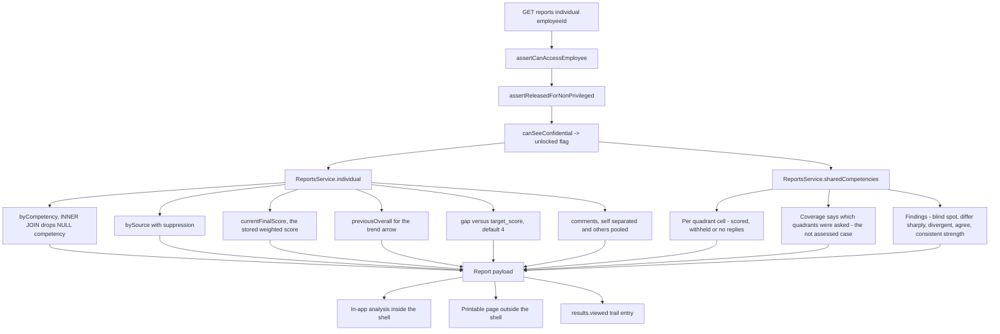

---

## 14. Dashboard → drill-down → individual employee

**Status: Implemented.** Three levels, one modal, one stack.

**Entry points**

| Layer | File:function |
| --- | --- |
| Stack controller | `apps/web/src/features/reports/useDrilldown.ts:useDrilldown` |
| Dashboard host | `apps/web/src/features/reports/dashboard/ConfigurableDashboard.tsx` |
| Level 3 component | `apps/web/src/features/reports/EmployeeDrilldown.tsx:EmployeeDrilldown` |
| Level 1 data | `GET /reports/executive` → `ReportsService.executive`, `GET /reports/hr` → `ReportsService.hr` |
| Level 2 data | `GET /reports/drilldown/participants` · `/pending` · `/competency` |
| Level 3 data | `GET /reports/individual/:id` + `/reports/radar/:id` + `/reports/employee-360/:id` |

Every drill-down endpoint requires **`reports.executive`**, not merely `reports.read`,
because they list named participants across the whole organisation.

### The stack

`useDrilldown` keeps `DrillLevel[]`:

- `open(title, subtitle, fetcher)` — **replaces** the whole stack (a top-level
  drill-down) and resolves the fetcher into the top level, guarded by `replaceTop` so a
  late response for an abandoned level is discarded.
- `openEmployee(employeeId, name, subtitle, cycleId)` — **pushes** a level.
- `back()` pops (no-op at the root); `close()` empties.
- `canGoBack` is `stack.length > 1`.

The dashboard behind the modal — including its cycle filter — is never re-rendered or
reset, which is the whole point of the stack.

### The three levels

**Level 1 — a KPI, bar, band or at-risk row is clicked.** The widget calls `open()` with
a fetcher that hits one of:

| Endpoint | Returns | Filters |
| --- | --- | --- |
| `/reports/drilldown/participants` | Employee, department, campus, designation, status, final score | `cycleId`, `department`, `campus`, `band` ∈ `scored`, `pending`, `ready`, `developing`, `atrisk` |
| `/reports/drilldown/pending` | Appraisee, department, reviewer, source, status — outstanding, nomination-approved assignments only | `cycleId`, `department` |
| `/reports/drilldown/competency` | Employee × competency mean and gap vs target | `cycleId`, `competency`, `belowTarget` |

Bands are computed against `target_score`: `ready` ≥ target, `developing` ≥ target − 1
and < target, `atrisk` < target − 1.

**Level 2 — a row in that grid is clicked.** `ConfigurableDashboard` reads the row's
`employeeId` and calls `drill.openEmployee(id, row.name, cycleLabel, cy)`.

> `employeeId` is carried **on the row but is not declared as a column**, so the grid
> renders exactly as before while the UI can still navigate. The source comment notes
> this is safe because it is an internal id already visible to anyone who can open the
> individual report, and the report itself re-checks scope and release.

**Level 3 — `EmployeeDrilldown`.** Fires three requests in parallel; `radar` and
`employee-360` are `.catch(() => null)` so the profile still renders if either fails.
`GET /reports/employee-360/:id` (`ReportsService.employeeDrilldown`) supplies the two
things no other endpoint returns:

- `trend` — `final_score` per cycle the employee actually participated in, oldest first,
  including cycles with a null score so participation is visible;
- `sourceStatus` — per quadrant `assigned`, `submitted`, `pending`, `required`
  (= `max(fs.required_count)`), `completionPct`. **Counts only, never who.**

It recalculates nothing: the trend reads the same `final_score` the rest of the product
treats as authoritative, so calibration is reflected. `employee-360` carries the *same*
guards as `individual` — `assertCanAccessEmployee`, `assertReleasedForNonPrivileged`, and
a `results.viewed` audit entry. A 403 renders as *"These results have not been released
yet, or you do not have access to this employee."*

### Data affected

Read-only, plus one `feedback_audit_entries` row per level-3 view.

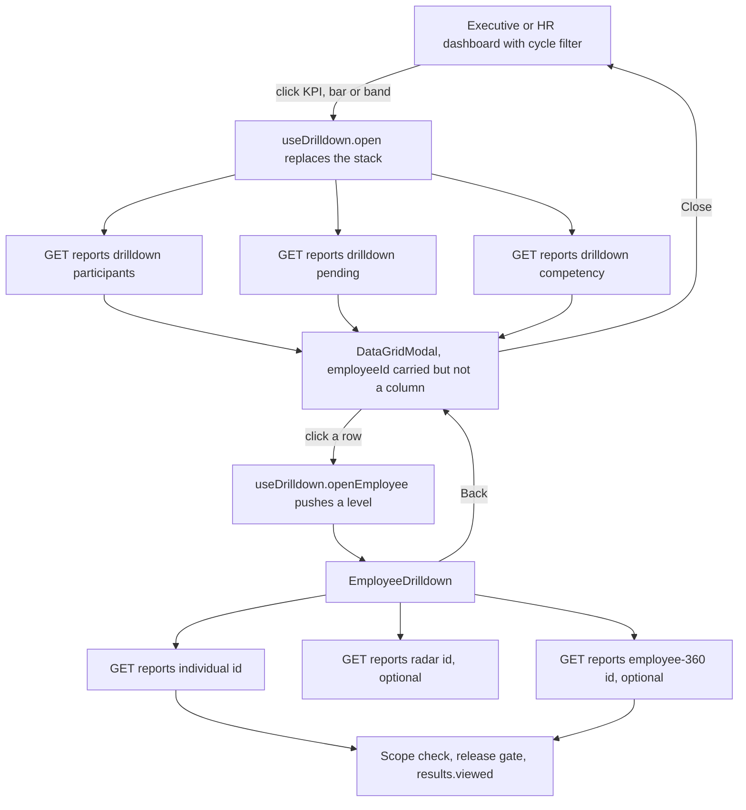

---

## 15. HR synchronisation

**Status: Implemented.** Entry point: `hr-integration/hr-sync.service.ts:HrSyncService`.

**Routes** (all `organization.hr.manage`): `GET /hr-integration/status`,
`GET|PUT /hr-integration/connection`, `POST /hr-integration/test`,
`GET /hr-integration/history`, `PUT /hr-integration/config`,
`POST /hr-integration/sync`, `GET /hr-integration/:runId/report`.

`POST /hr-integration/sync` is **dry-run by default**; `{ live: true }` selects
`HrSyncService.sync`, anything else selects `HrSyncService.preview`.

### The design in one line

HR sync **reuses the Organization Import engine**. `toDataset` converts the provider
snapshot into the importer's `ImportDataset`, then `ValidationService.build(dataset,
existing, 'update')` and `ImportService.run(..., { mode: 'update' })` do the work. No
parallel data model. It adds exactly two things the importer does not have: external-id
identity mapping, and deactivate-missing.

### Dry-run versus live

| | `preview` (dry run) | `sync` (live) |
| --- | --- | --- |
| Requires `mode === 'external_hr'` | ❌ | ✅ else 400 *"switch the data source"* |
| Pulls the snapshot | ✅ | ✅ |
| Validates | ✅ | ✅ — a failing validation writes a `failed` run and throws |
| Blast-radius guard | ❌ | ✅ evaluated **before** any write |
| Writes org data | ❌ | ✅ `ImportService.run` |
| Refreshes identity maps | ❌ | ✅ |
| Deactivates leavers | ❌ (listed only) | ✅ |
| Writes an `hr_sync_runs` row | ✅ mode `dry_run` | ✅ mode `live` |
| Reports `internalOnly` | ✅ employees with no HR mapping and not in the feed | forced to 0 |

### Deactivate — never delete

`computeDeactivations` finds `external_identity_maps` rows with
`externalType='hr_employee'`, `active=true`, whose `externalId` is **absent from the
feed**, whose employee is not soft-deleted and not already `inactive`. For each, one
transaction:

```
employees.status = 'inactive'
users.status     = 'disabled'
refresh_tokens.revoked_at = now()   (all live tokens)
external_identity_maps.active = false
```

Nothing is deleted, so historical feedback keeps resolving.

### The blast-radius guard

```
MAX_DEACTIVATION_PERCENT = 20
MIN_DEACTIVATION_ALLOWANCE = 5
allowed = max(5, floor(activeEmployees * 20 / 100))

if (activeEmployees > 0 && snapshot.employees.length === 0) -> abort
if (deactivate.length > allowed)                            -> abort
```

An abort writes an `hr_sync_runs` row with `status='aborted'` carrying the deactivation
list that *would* have been applied, then throws — **before** anything is written. The
rationale in the source: a truncated feed, a provider returning only page 1, or a
vendor outage returning an empty 200 would otherwise lock out the workforce unattended
on the hourly cron.

### Scheduling and side effects

`@Cron(CronExpression.EVERY_HOUR) runScheduled()` iterates orgs having a
`configurations(module='hr_integration', key='settings')` row and runs a **live** sync
where `mode === 'external_hr'`, `autoSync` is on, and `intervalHours` has elapsed since
`lastSyncAt`. Failures are logged per org and never abort the loop.

While `mode === 'external_hr'`, `OrgWritableGuard` makes `/organization` and
`/org-import` read-only for every user — HR is the source of truth.

Scheduled runs pass `{ userId: null }`. `AuditService.record` requires a user, so a
scheduled run's evidence lives **only** in the `hr_sync_runs` row.

### Data affected

`organizations`, `departments`, `designations`, `employees`, `users`, `refresh_tokens`,
`external_identity_maps`, `hr_sync_runs`, `configurations` (`lastSyncAt`), `audit_logs`
(manual runs only).

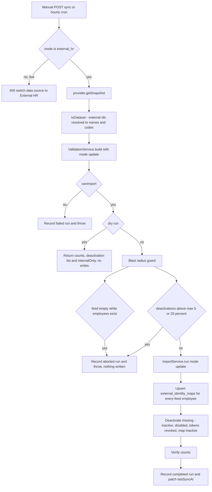

---

## 16. SIS synchronisation

**Status: Implemented.** Entry point:
`sis-integration/sis-sync.service.ts:SisSyncService`.

**Routes** (`organization.sis.manage`): `GET /sis-integration/status`,
`GET /sis-integration/history`, `GET|PUT /sis-integration/connection`,
`POST /sis-integration/test`, `POST /sis-integration/import`,
`POST /sis-integration/sync`, `GET /sis-integration/template`,
`GET /sis-integration/:runId/report`.

`POST /import` is dry-run unless `dryRun === false`; `POST /sync` is dry-run unless
`{ live: true }`.

### The snapshot model — different from HR sync

HR sync reconciles into the **normalised** internal tables. SIS sync does **not**. The
whole roster is stored as one versioned **snapshot document** via
`SisDatasetService.save(orgId, provider, merged, actorUserId)`. There are no
`students`, `parents` or `teaching_assignments` tables in the 360 schema.

`SisSnapshot` (`sis-integration/sis-snapshot.types.ts`) holds `students`, `teachers`,
`parents`, `enrollments`, `teachingAssignments`, `subjects`, plus derived reference lists
(`campuses`, `faculties`, `departments`, `programs`, `sessions`, `semesters`, `classes`,
`sections`) rebuilt from the merged rows on every reconcile.

### Reconcile rules (`SisSyncService.reconcile`)

- Incoming rows **win** on id conflict; `created` / `updated` counted by presence in the
  existing snapshot.
- Rows absent from the feed are **carried forward**, marked `status='inactive'`, and
  counted as `deactivated` — never dropped, so historical parent feedback keeps
  resolving.
- ⚠️ **Deactivate-missing is scoped to entity types actually present in the feed**
  (`hasIncomingStudents` / `hasIncomingTeachers`). A students-only CSV upload must not
  deactivate every teacher just because the file had no teacher rows. A full provider
  snapshot contains every type, so its behaviour is unchanged.
- Parents and enrollments are **replaced** for incoming students and **retained** for
  carried-over ones; enrollments are de-duplicated on `studentId|teachingAssignmentId`
  and re-keyed `enr-1, enr-2, …`; teaching assignments and subjects are de-duplicated by id.

### Teacher ↔ employee identity mapping

Two mechanisms, one table (`external_identity_maps`, `externalType = 'teacher'`):

| Mechanism | File:function | Behaviour |
| --- | --- | --- |
| Automatic, on every live apply | `SisSyncService.autoMapTeachers` | Matches `teacher.employeeCode` against `employees.employee_code` within the org, then upserts on the unique `identity_scope (organizationId, externalType, externalId)`. `active` mirrors `teacher.status === 'active'` |
| Manual | `identity/identity-map.service.ts:IdentityMapService.upsert` (`PUT /identity/...`, `identity.manage`) | Admin picks the employee. Rejects mapping the same employee to a second active external actor of the same type |

`IdentityMapService.suggestTeachers` powers the mapping screen: it returns each SIS
teacher with its current mapping and a *suggested* employee matched by code.

> **Resolution never uses the code match.** `IdentityMapService.resolveEmployee` reads
> **only** `external_identity_maps` where `active = true`. The code match is a UI
> convenience; a real production SIS drops in by syncing its identifiers into this table.
> This is the hinge the entire parent-feedback flow (**§8**) turns on — an unmapped
> teacher cannot receive parent feedback at all.

### Scheduling

`@Cron(CronExpression.EVERY_HOUR) runScheduled()` runs a **live** sync per org where
`autoSync` is on, the configured provider supports live sync
(`SisProviderRegistry.get(provider)` is non-null — `csv` / `internal` do not), and
`intervalHours` has elapsed.

### Data affected

The stored SIS dataset (a snapshot document and its metadata),
`external_identity_maps`, `sis_sync_runs`, `configurations` (`lastSyncAt`),
`audit_logs` (manual runs only).

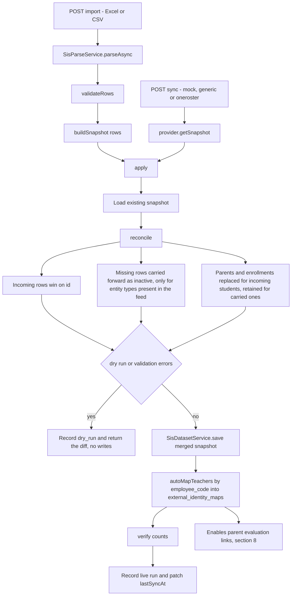

---

## 17. Import: validate → preview → confirm

**Status: Implemented.** Entry point:
`org-import/org-import.service.ts:OrgImportService`. Permission
`organization.import.manage`, plus `OrgWritableGuard` — **spreadsheet import is disabled
entirely while the tenant is in External HR mode.**

**Routes**

| Route | Method | Writes? |
| --- | --- | --- |
| `GET /org-import/template/download` | `TemplateService.workbook` / `.csv` | No |
| `GET /org-import/export` | `OrgExportService.workbook` / `.csv` | No |
| `POST /org-import/validate` | `OrgImportService.validateUpload` | Only the job row |
| `GET /org-import/:jobId/preview` | `OrgImportService.preview` | **No** |
| `GET /org-import/:jobId` | `OrgImportService.getJob` | No |
| **`POST /org-import/:jobId/confirm`** | `OrgImportService.confirm` | **Yes — the only writing endpoint** |
| `GET /org-import/:jobId/report` | `OrgImportService.reportCsv` | No |

The controller doc comment states the contract plainly: *"Nothing is written until
POST /:jobId/confirm."*

### Step 1 — validate

1. `ParseService.parse` decodes the base64 upload and matches sheets and columns by
   **alias** (`SHEET_ALIASES`, `COLUMN_ALIASES` — e.g. `serviceno`, `empcode`, `staffid`
   all map to `employeeCode`), producing a normalised `ImportDataset`.
2. Zero data rows → `400 The file contained no data rows to import.`
3. `ResolverService.loadExisting(orgId)` builds lookup maps of what already exists.
4. `ValidationService.build(dataset, existing, mode)` — pure and read-only.
5. An `organization_import_jobs` row is stored with `status='validated'` and the whole
   `dataset` + `validation` as JSONB.

### Validation rules

| Check | Severity |
| --- | --- |
| More than `MAX_EMPLOYEE_ROWS` (5000) employee rows | **error** — surfaced at validate, not only at confirm |
| Duplicate name/code within the file (campuses, departments, designations, competencies) | error |
| Department parent / campus not found in the file **or** the database | error |
| Designation promotion target not found | error |
| Circular department parent, designation promotion path, or manager chain | error — `detectCycles` merges file edges over existing DB edges, so a file row pointing into the database is still checked |
| Employee missing full name or email | error |
| Email already used by a **different** user | error |
| Employee department / designation / campus not found | error |
| Manager code equals own code | error |
| Manager code not found in file or database | error |
| Email fails the shape regex | warning |
| No manager code | warning — treated as top-level |
| Status is inactive/terminated/disabled/left/resigned | warning |

`canImport = errors.length === 0`.

### Step 2 — preview

`GET /:jobId/preview?mode=` re-runs `ResolverService.loadExisting` and
`ValidationService.build` for a **different mode** without re-uploading. Issues do not
depend on mode; counts do:

| Mode | Per-entity plan |
| --- | --- |
| `skip` (default) | Existing rows skipped, new rows created |
| `update` | Existing rows updated, new rows created |
| `replace` | Wipe first, then create everything |
| `reset` | Wipe only — **nothing is imported** (`if (opts.mode === 'reset') return;` after the wipe) |

Competencies are special: existing ones are **always** skipped, because versioned content
is never overwritten by an import.

### Step 3 — confirm

1. Reject if `status === 'imported'` (idempotence).
2. **Re-validate against current data** — the database may have changed since upload. A
   now-failing dataset is refused with *"The file still has blocking errors."*
3. `ImportService.run` in one `$transaction` with a **120 s** timeout:
   - `replace`/`reset` require `confirmDestructive: true`, else 400;
   - the 5000-row cap is re-checked;
   - bcrypt hashes and the default role are resolved **outside** the transaction;
   - order: wipe (if destructive) → organization metadata → campuses → designations →
     designation promotion pass → departments → department parent pass → competencies
     (+ a `v1` draft version with default proficiency levels) → employees →
     **second pass** resolving `managerCode` once all employees exist;
   - imported users get the default Employee role and `mustChangePassword` when a
     password hash was produced; a missing role does **not** fail the import;
   - per-row failures are collected into `failures[]` — they do not abort the batch.
4. `verify()` re-counts straight from the database.
5. The job is updated to `status='imported'` with the summary + verify counts; a failure
   sets `status='failed'` and rethrows.

### The wipe — what it does and does not touch

`ImportService.wipe` **soft-deletes org-structural data only**: employees (status
`terminated`, `line_manager_id` nulled, their users disabled and deleted, tokens
revoked), departments, designations, campus organizations, competencies; competency
categories are deactivated. The class comment is explicit that it *"never touches RBAC,
settings, configuration, rating scales, the root org or the admin."*

### Data affected

`organization_import_jobs`, `organizations`, `departments`, `designations`, `employees`,
`users`, `user_roles`, `refresh_tokens`, `competency_categories`, `competencies`,
`competency_versions`, `proficiency_levels`, `audit_logs`.

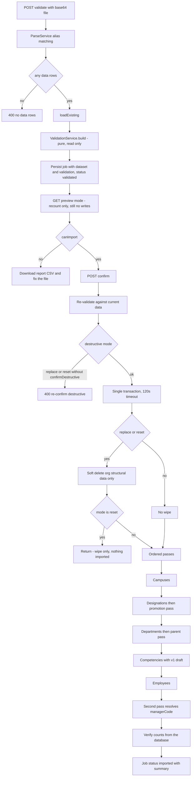

---

## 18. Email, SMS and WhatsApp communication

**Status: Partial** — campaigns and QR are API-only. Entry point:
`communication/services/dispatch.service.ts:DispatchService.notifyUser`.

### The layering

```mermaid
flowchart TD
  CALL[Caller - cycle activate, reminder, submit confirmation, results released] --> D[DispatchService.notifyUser]
  D --> BR[TemplateService.branding org]
  D --> CH[Channels - options.channels or TemplateService.defaults]
  CH --> LOOP[For each channel]
  LOOP --> ADDR{recipient has an address for this channel}
  ADDR -->|no| SKIP[Skip quietly]
  ADDR -->|yes| RES[TemplateService.resolve event, channel]
  RES --> ACT{template isActive}
  ACT -->|no| SKIP
  ACT -->|yes| RENDER[render double brace tokens against context]
  RENDER --> NS[NotificationService.send]
  NS --> EN{channel enabled in settings}
  EN -->|no| ROWSK[Row status skipped, never delivered]
  EN -->|yes| ROWQ[Row status queued]
  ROWQ --> Q[DeliveryQueue.enqueue]
  D --> IA{recipient has userId and inApp wanted}
  IA -->|yes| BELL[user_notifications row using the email template as canonical copy]
```

### Template resolution

`TemplateService` stores everything in the generic `configurations` table with
`module='communication'` — **no schema migration**. Keys:

| Key | Content |
| --- | --- |
| `template:{event}:{channel}` | `{ subject, body, isActive }` override |
| `branding` | `organizationName`, `logoUrl`, `primaryColor`, `supportEmail`, `footer` |
| `defaults` | `{ channels }` — falls back to `['email','whatsapp']` |

`resolve(orgId, event, channel)` returns the org override if one exists (`isCustom:
true`), otherwise `DEFAULT_TEMPLATES[event]` from `communication/comm.events.ts`. Note
that the built-in default is per **event**, not per event × channel — the same default
subject/body is used for every channel until an override is written.

`render(text, context)` replaces `{{token}}` with the context value; unknown or nullish
tokens become **empty strings**, so a recipient never sees a raw placeholder.

The in-app bell always renders from the **email** template — the source calls it the
canonical rich copy.

> ⚠️ `writeConfig` deliberately does a manual find-then-update instead of
> `prisma.upsert()`: `configurations` has a *partial* unique index
> (`WHERE deleted_at IS NULL`), which Postgres will not accept for `ON CONFLICT`.

### Queue versus inline fallback

`communication/services/delivery-queue.service.ts:DeliveryQueue.onModuleInit`:

1. No `REDIS_HOST` → log *"Redis not configured — using inline delivery."*, no queue.
2. `REDIS_HOST` set → **probe it first** with `lazyConnect`, `connectTimeout: 1500`,
   `maxRetriesPerRequest: 1`, `retryStrategy: () => null`, then `connect()` + `ping()`.
3. Probe fails → log *"unreachable — using inline delivery."*, no queue.
4. Probe succeeds → create the BullMQ `Queue` and `Worker` on `'communication'`.

`enqueue(notificationId)` adds a job with `attempts: 3`, exponential backoff from 2000 ms
and `removeOnComplete: true` when the queue exists — **otherwise it calls the handler
inline**. The registered handler is `NotificationService.deliver`, so the delivery code
is identical in both modes. The comment records the bug this fixes: a set-but-unreachable
`REDIS_HOST` used to leave every message stuck in `queued` forever.

### Delivery tracking

`NotificationService.deliver` resolves the provider via `ProviderFactory.forChannel`,
sends, then records the outcome on the `notifications` row:

| Status | Set by |
| --- | --- |
| `queued` | `send` when the channel is enabled |
| `skipped` | `send` when the channel is disabled — `error` explains why; never delivered |
| `sent` | `deliver` success — records `provider`, `providerMessageId`, `sentAt`, clears `error` |
| `failed` | `deliver` catch — records `error`, then rethrows so BullMQ can retry |

Three entry variants: `send` (queued/inline), `sendDirect` (inline, honours the enable
switch — for transactional mail such as password resets), `test` (inline, **bypasses**
the enable switch, for the admin "send test message" action).

### Inbound signed webhooks

`POST /communication/webhooks/:provider` is public by necessity —
`NotificationService.applyWebhook(providerMessageId, status, signatureHeader, rawBody)`:

1. No signature header → reject **before any lookup**. Accepted headers:
   `x-webhook-signature`, `x-hub-signature-256`, `x-twilio-signature`.
2. Resolve the notification by `providerMessageId` — that row is what identifies the
   tenant. Nothing is written before the signature verifies.
3. Read that org's secret: the **WhatsApp-specific** `webhookSecret` for WhatsApp
   messages, otherwise the general communication secret.
4. Verify `sha256=<hex>` HMAC over the **raw request bytes** (`main.ts` boots Nest with
   `rawBody: true`) using `timingSafeEqual`, with a length pre-check because
   `timingSafeEqual` throws on length mismatch.
5. Only then `updateMany` the status.

**Fail-closed by design:** an org with no webhook secret configured cannot accept
callbacks — allowing unsigned updates "when no secret is set" would leave exactly the
hole this closes. Every rejection returns the **same 401** regardless of cause, so an
unauthenticated caller cannot probe which message ids exist or which tenants have a
secret; the real reason goes to the log.

Outbound webhooks are the mirror image
(`integration/services/webhook.service.ts`): HMAC-SHA256 over the JSON body, header
`x-e360-signature: sha256=<hex>`, 10 s `AbortController` timeout, attempts and status
recorded in `webhook_deliveries`.

### Events and their triggers

| Event constant | Fired by |
| --- | --- |
| `cycleStarted` | `CycleService.setStatus` → `DispatchService.notifyCycleStarted` (queued, not awaited) |
| `cycleClosed` | `CycleService.setStatus` → `DispatchService.notifyCycleClosed` |
| `feedbackSubmitted` | `AssignmentService.confirmSubmission` |
| Reminder / final reminder | `ReminderService` — hourly cron, per-org `sendHour` and `cadenceDays`, `lastRemindedAt` respected |
| `external_evaluation.invite` | `EvaluationLinkService.deliverWithToken` |
| `results_released` | `SetupService.setRelease` — in-app only, via `UserNotificationService.create` |

`DispatchService.reviewersOfCycle` deduplicates by user: a reviewer evaluating several
people is notified once, and `employeeName` collapses to *"your colleagues"*. External
reviewers are excluded (`reviewerEmployeeId: { not: null }`) — they get their own
tokenised-link message instead.

### Data affected

`notifications`, `user_notifications`, `configurations` (templates/branding/defaults),
`communication_campaigns` (API-only), `feedback_audit_entries`.

---

## 19. External dashboard / partner API access

**Status: Implemented.** Entry point:
`integration/reports-api.controller.ts:ReportsApiController`.

**Base path:** `/api/v1/integration/v1/reports` — the platform prefix plus the
integration API's own `v1`. **GET-only by design. `X-Api-Key` only, never JWT.**

### The chain

```mermaid
flowchart TD
  C[External dashboard such as Power BI or Looker] --> H[GET with X-Api-Key header]
  H --> G1[ApiKeyGuard]
  G1 --> V[ApiKeyService.validate - sha256 the presented key, findUnique on key_hash]
  V --> VC{found, not revoked, not expired}
  VC -->|no| E401[401 invalid or expired API key]
  VC -->|yes| LU[Bump last_used_at]
  LU --> PR[Attach synthetic AuthUser - userId api-key colon id, organizationId, permissions equal scopes, scope organization]
  PR --> G2[ThrottlerGuard, tracker is the api-key user id]
  G2 --> TL{within API_RATE_LIMIT per API_RATE_TTL_MS}
  TL -->|no| E429[429 rate limit exceeded for this API key]
  TL -->|yes| G3[PermissionsGuard checks the endpoint scope]
  G3 --> SC{key holds reports.api.something}
  SC -->|no| E403[403]
  SC -->|yes| SVC[Existing ReportsService method with the key organizationId]
  SVC --> RED[Redaction for institutional and nine-box]
  RED --> ET[EtagInterceptor]
  ET --> NM{If-None-Match equals the weak ETag}
  NM -->|yes| E304[304 Not Modified]
  NM -->|no| OK[200 with ETag and Cache-Control private max-age]
```

### Key lifecycle

`ApiKeyService.create` (`integration.manage`) mints `prefix = e360_<8 hex>` and
`secret = randomBytes(24).base64url`; the plaintext is `prefix.secret`. Only
`sha256(plaintext)` is stored in `api_keys.key_hash` (UNIQUE). **The plaintext is
returned once and never again.** `revoke` sets `revoked_at`. `validate` re-hashes,
`findUnique`s, rejects revoked or expired keys, and bumps `last_used_at`.

### Scopes

`integration/reports-api.scopes.ts` is the single source of truth for the scope
catalogue, the controller decorators, the admin docs endpoint
(`GET /integration/reports-api/catalog`) and the admin scope picker. Scopes are plain
strings on `api_keys.scopes[]` checked by the **same** `PermissionsGuard` as human
permissions: `reports.api.executive`, `.hr`, `.institutional`, `.departmental`,
`.campus`, `.trend`, `.ninebox`, `.heatmap`.

These are API-only strings — they are never assignable to RBAC roles, so a key can never
widen a human user's access. `GET /integration/v1/reports` (discovery) requires **any**
valid key and no specific scope.

### Throttling

`ThrottlerModule.forRoot` is registered **inside `IntegrationModule` only**, so internal
dashboards are never throttled. Defaults 120 requests / 60 000 ms, overridable by
`API_RATE_LIMIT` and `API_RATE_TTL_MS`. The tracker is `req.user.userId`, which
`ApiKeyGuard` has set to `api-key:<id>` — limits are **per key**, not per IP.

### ETag

`EtagInterceptor` is controller-scoped, so it runs **inside** the global response
envelope and hashes the raw controller return value (weak SHA-1 ETag). It sets
`Cache-Control: private, max-age=${API_CACHE_MAX_AGE ?? 60}` and answers **304** when
`If-None-Match` matches, so a dashboard polling every minute mostly gets cheap 304s.
Hashing failures fall through and serve normally without caching headers.

### What the external surface redacts

The external API reuses `ReportsService` **verbatim** — tenant isolation, suppression and
every calculation are inherited unchanged, and no reporting SQL is duplicated. Two
endpoints are deliberately narrowed relative to their internal twins:

| Endpoint | Internal | External |
| --- | --- | --- |
| `institutional` | `topPerformers` / `bottomPerformers` returned to `reports.executive` holders only | **Always** returned empty |
| `nine-box` | Named employees with performance and potential | Aggregated to per-cell **counts** — `{ scaleMax, total, cells: [{ box, count }] }` bucketed into 1/2/3 bands by thirds of `scaleMax` |

> ⚠️ Note the asymmetry: `departmental`, `campus`, `trend` and `heatmap` on the external
> surface do **not** call `assertAggregateVisible`, so an org set to `executives_only`
> still exposes those aggregates to any suitably scoped API key.

### Data affected

`api_keys` (create/revoke/`last_used_at`), `audit_logs` (key create/revoke). Report reads
are otherwise side-effect-free — notably they write **no** `results.viewed` trail entry.

---

## 20. Critical end-to-end sequences

The three flows worth having in your head before you change anything.

### (a) Reviewer submits feedback through to a recomputed score

```mermaid
sequenceDiagram
  autonumber
  participant R as Reviewer browser
  participant C as AppraisalController
  participant A as AssignmentService
  participant CY as CycleService
  participant S as ScoringService
  participant DB as PostgreSQL
  participant D as DispatchService

  R->>C: GET appraisal my-reviews
  C->>A: myReviews user
  A->>DB: assignments where reviewer is me, pending or in_progress, nomination approved
  DB-->>A: tasks naming each appraisee
  A-->>R: task list

  R->>C: GET appraisal assignments id form
  C->>A: form user, assignmentId
  A->>A: requireReviewer - 403 if not mine
  A->>DB: cycle templateId and ratingScaleId
  A->>DB: template sections, questions, saved responses, scale levels
  A-->>R: questions, saved answers, behavioural anchors

  R->>C: POST appraisal assignments id save
  C->>A: saveDraft
  A->>CY: assertOpen - active and within deadline
  A->>A: nomination gate - must be approved
  A->>A: assertValidResponses - questions in template, ratings in scale
  A->>DB: transaction upsert feedback_responses, status in_progress on first touch
  A->>DB: feedback trail evaluation.started or evaluation.saved
  A-->>R: status in_progress, answered count

  R->>C: POST appraisal assignments id submit
  C->>A: submit
  A->>CY: assertOpen
  A->>A: nomination gate plus already-submitted check
  A->>A: assertValidResponses
  A->>DB: transaction upsert responses, status submitted, submitted_at
  A->>S: compute participantId
  S->>DB: submitted AND nomination approved assignments with source weights
  S->>S: per source mean, then weighted mean over contributing weights
  alt participant already calibrated
    S->>DB: write computed_score only, keep final_score and completed
  else not calibrated
    S->>DB: write final_score and computed_score, status in_progress
  end
  S-->>A: score or null
  A->>D: notifyUser feedbackSubmitted - never fatal
  A->>DB: feedback trail evaluation.submitted with answered count and score
  A-->>R: status submitted, score
```

### (b) Parent evaluates a teacher through the tokenised link

```mermaid
sequenceDiagram
  autonumber
  participant AD as HR admin
  participant EL as EvaluationLinkService
  participant IM as IdentityMapService
  participant DB as PostgreSQL
  participant NS as NotificationService
  participant DQ as DeliveryQueue
  participant PA as Parent browser
  participant SC as ScoringService

  AD->>EL: POST external-evaluation
  EL->>IM: resolveEmployee teacher, teacherId - active maps only
  IM-->>EL: employeeId
  EL->>DB: provisionCycle - active cycle, participant, Parents source, templateId
  EL->>EL: token equals randomBytes 24 base64url
  EL->>DB: insert evaluation_links storing only sha256 of the token
  EL->>DB: insert external reviewer_assignment, nomination approved
  EL->>NS: send invite containing the plaintext URL
  NS->>DB: notifications row status queued
  NS->>DQ: enqueue
  alt Redis reachable
    DQ->>NS: BullMQ worker calls deliver, 3 attempts exponential backoff
  else Redis absent or unreachable
    DQ->>NS: inline deliver in the same request
  end
  NS->>DB: status sent with provider and providerMessageId
  EL-->>AD: url and token shown once

  PA->>EL: GET public evaluate token
  EL->>DB: findUnique on token hash
  EL->>EL: revoked, completed and oneTime, expired
  EL->>DB: status opened, trail link.accessed as Parent secure link with IP
  EL-->>PA: questions from the cycle template or the built-in set, 1 to 5 scale

  PA->>EL: POST public evaluate token with responses
  EL->>DB: read cycle status and submission_deadline
  alt not active or past deadline
    EL-->>PA: 410 no longer open
  else open
    EL->>DB: store responses JSON, overall score, status completed
    EL->>EL: keep only responses whose questionId is a UUID
    alt cycle template questions - real UUIDs
      EL->>DB: upsert feedback_responses, assignment submitted
      EL->>SC: compute participantId
      SC->>DB: recompute weighted score including the Parents quadrant
    else built-in questionnaire - string ids
      Note over EL,DB: nothing enters feedback_responses, the 360 score is unchanged
    end
    EL->>DB: trail parent.feedback.submitted
    EL-->>PA: status completed
  end
```

### (c) Executive drills from a dashboard KPI to one employee's 360 profile

```mermaid
sequenceDiagram
  autonumber
  participant EX as Executive browser
  participant DASH as ConfigurableDashboard
  participant DR as useDrilldown stack
  participant RC as ReportsController
  participant RS as ReportsService
  participant SS as ScopeService
  participant DB as PostgreSQL

  EX->>DASH: open reports Executive with a cycle filter
  DASH->>RC: GET reports executive with cycleId
  RC->>RS: executive orgId, cycleId
  RS->>DB: KPIs, readiness bands, trend, by department, by campus, at risk, top gaps
  RS-->>DASH: dashboard bundle

  EX->>DASH: click the At risk KPI
  DASH->>DR: open title, subtitle, fetcher - replaces the stack
  DR->>RC: GET reports drilldown participants with band atrisk
  RC->>RS: drilldownParticipants
  RS->>DB: participants joined to employees, departments, campuses, designations
  RS-->>DR: columns and rows, employeeId carried but not a column
  DR-->>EX: record grid, level 1

  EX->>DASH: click one row
  DASH->>DR: openEmployee employeeId, name, cycleLabel, cycleId - pushes level 2
  DR-->>EX: EmployeeDrilldown mounts

  par three parallel requests
    DR->>RC: GET reports individual employeeId
  and
    DR->>RC: GET reports radar employeeId
  and
    DR->>RC: GET reports employee-360 employeeId
  end

  RC->>SS: assertCanAccessEmployee - organization, reporting subtree or own
  SS-->>RC: allowed or 403
  RC->>RC: assertReleasedForNonPrivileged - bypassed for reports.executive
  RC->>RC: canSeeConfidential - reports.confidential.view
  RC->>RS: individual orgId, employeeId, cycleId, unlocked
  RS->>DB: byCompetency, bySource, sourceCounts, comments, gap, stored final_score
  RS->>RS: suppress non-self quadrants below min_responses_to_show unless unlocked
  RS-->>RC: report with suppressed flags
  RC->>DB: feedback trail results.viewed with confidential flag
  RC-->>DR: individual, radar and employee-360 payloads
  DR-->>EX: quadrants, competency radar with org benchmark, cross cycle trend, coverage counts

  EX->>DR: Back
  DR-->>EX: pops to the level 1 grid, dashboard and cycle filter untouched
```

---

## 21. Quick reference — workflow to entry point

| # | Workflow | Primary entry point (`file:function`) |
| --- | --- | --- |
| 1 | Org and employee setup | `organization/services/employee.service.ts:EmployeeService.create` · `provisioning/provisioning.service.ts:ProvisioningService.create` |
| 2 | Hierarchy and cycle detection | `organization/services/employee.service.ts:EmployeeService.update` · `organization/cycle-guard.ts:wouldCreateCycle` |
| 3 | Cycle lifecycle | `appraisal/services/cycle.service.ts:CycleService.setStatus` · `.assertOpen` · `.assertNotFinalized` |
| 4 | Questionnaire and competency setup | `questionnaire/services/template.service.ts:TemplateService.publish` · `competency/services/version.service.ts:VersionService.activate` |
| 5 | Quadrant and competency derivation | `reports/services/reports.service.ts:ReportsService.radar` · `.heatmap` |
| 6 | Evaluator determination | `bulk-generation/services/plan.service.ts:PlanService.buildPlan` · `bulk-generation/services/bulk-generation.service.ts:BulkGenerationService.generate` |
| 7 | Manager / peer / subordinate feedback | `appraisal/services/assignment.service.ts:AssignmentService.myReviews` · `.form` |
| 8 | Parent tokenised link | `external-evaluation/services/evaluation-link.service.ts:EvaluationLinkService.create` · `.validate` · `.submit` |
| 9 | Feedback submission | `appraisal/services/assignment.service.ts:AssignmentService.submit` · `.assertValidResponses` |
| 10 | Scoring and calibration | `appraisal/services/scoring.service.ts:ScoringService.compute` · `.calibrate` |
| 11 | Anonymity and suppression | `reports/services/reports.service.ts:ReportsService.suppressed` · `.minResponses` |
| 12 | Release and retract | `appraisal/services/setup.service.ts:SetupService.setRelease` · `reports/reports.controller.ts:ReportsController.assertReleasedForNonPrivileged` |
| 13 | Individual report | `reports/services/reports.service.ts:ReportsService.individual` · `apps/web/src/features/reports/IndividualReportPage.tsx` |
| 14 | Dashboard drill-down | `apps/web/src/features/reports/useDrilldown.ts:useDrilldown` · `ReportsService.employeeDrilldown` |
| 15 | HR sync | `hr-integration/hr-sync.service.ts:HrSyncService.sync` · `.preview` |
| 16 | SIS sync | `sis-integration/sis-sync.service.ts:SisSyncService.apply` · `.autoMapTeachers` |
| 17 | Import | `org-import/org-import.service.ts:OrgImportService.confirm` · `org-import/services/import.service.ts:ImportService.run` |
| 18 | Communication | `communication/services/dispatch.service.ts:DispatchService.notifyUser` · `communication/services/delivery-queue.service.ts:DeliveryQueue.enqueue` |
| 19 | Partner API | `integration/reports-api.controller.ts:ReportsApiController` · `integration/services/api-key.service.ts:ApiKeyService.validate` |

## 22. Consolidated list of unenforced and surprising behaviour

Everything flagged ⚠️ above, in one place, so it can be reviewed as a set.

| Area | Behaviour |
| --- | --- |
| `feedback_sources.required_count` | **Stored, copied, displayed as `required`, never enforced.** No submission, closure or score is affected by an under-populated quadrant |
| `feedback_sources.is_active` | Written by bulk generation, never read |
| `bulk` `peer.min` | Only produces a `noPeers` warning; generation proceeds. `peer.max` *is* enforced |
| `bulk` `crossDepartment` | Removes the department filter from the same-line-manager set; never searches other managers' reports |
| `bulk` `messagesQueued` | Estimated as `assignmentsCreated - parentItems`; real fan-out is per distinct reviewer with reachable addresses |
| Cycle `archived` | Supported by `setStatus`, the guards and the SQL CHECK; **no route sets it** |
| Cycle `closed` | Not terminal — `/activate` re-opens it, logged as `cycle.reopened` |
| `removeParticipant` / `removeSource` | Use `getOwned` only, so they work on a closed cycle although `add*` does not |
| Matrix managers | Stored and drawn on the org chart; never used for assignments, scope, scoring or reports. No cycle detection on assignment |
| Competency `retired` | Reachable only as a side effect of activating another draft; no retire endpoint |
| Template `published` | Advisory — cycles and forms read draft templates happily |
| `CycleService.create` | Does not validate that `templateId` / `ratingScaleId` belong to the org, nor that a template exists at all |
| `assertValidResponses` comment | Says `questionId` has no FK — true of the Prisma model, **false** of the SQL schema |
| Public parent submit | Bypasses `assertValidResponses`; validates only UUID shape and a hard-coded 1–5 rating range |
| `provisionCycle` | Auto-creates a `Parents` source on the active cycle and silently picks the latest-starting active cycle when several exist |
| `is_anonymous` | Protects the reviewer's identity in reports, not the appraisee's; not read by `ReportsService` at all |
| `ScoringService.compute` | Pools ratings within a quadrant, so a reviewer answering more questions carries more weight |
| NULL `competency_id` | Counted in `final_score`, excluded from every competency view by INNER JOIN |
| `ReportsService.myTeam` | Still uses the unweighted mean of competency means, disagreeing with `individual()` and every dashboard |
| `heatmap` suppression | Applies the threshold but has no `unlocked` bypass, and counts reviewers per department cell rather than per appraisee |
| `hasReleasedResults` | Ignores its `orgId` argument by design, relying on the caller's prior scope check |
| Release without `cycleId` | Any single released participant row unlocks the all-cycles report |
| Import `reset` mode | Wipes and returns — imports nothing |
| External reports API | `departmental`, `campus`, `trend` and `heatmap` skip `assertAggregateVisible`, unlike their internal twins |
| External reports API | Report reads write no `results.viewed` feedback-trail entry |

---

*Verified against the source tree. For the rules in condensed form see
`07-business-rules.md`; for per-module ownership see `05-module-architecture.md`; for the
tables named above see `02-database-erd.md` and `03-table-reference.md`.*
