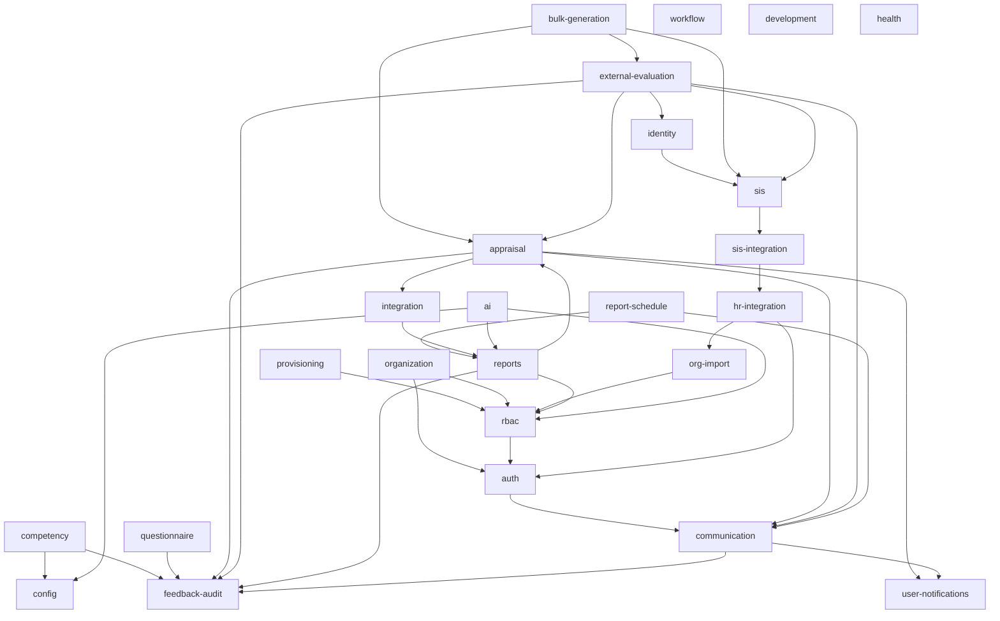

# 05 — Module Architecture

Per-module reference for the Enterprise 360° Feedback System. One section per module under
`apps/api/src/`, enumerated from the source tree: **25 feature modules** (plus the shared
`common/` foundation, which is not a Nest feature module).

All API paths below are **relative to the global prefix `/api/v1`**, except the three
root-mounted paths noted explicitly (`/health`, `/ready`, `/r/:code`). Frontend paths are
relative to `apps/web/src/`.

**Related documents:** `01-system-architecture.md` (how it all fits together) ·
`02-database-erd.md` · `03-table-reference.md` · `04-business-workflows.md` ·
`06-api-integration-map.md` (complete endpoint catalogue) · `07-business-rules.md` ·
`08-codebase-navigation.md`. Deployment lives in `DEPLOYMENT.md` and `ops/`; the
request/response contract in the project `API_CONTRACT.md`; end-user procedure in the
Administrator and User manuals.

## Status legend

| Status | Meaning |
| --- | --- |
| **Implemented** | Backend and UI both present and wired end to end |
| **Partial** | Working, but a named slice of the backend has no UI |
| **API-only** | Endpoints exist; no user interface anywhere in `apps/web` |
| **No API, no UI** | Tables exist; nothing exposes them |

## Module index

| # | Module | Status | Web route |
| --- | --- | --- | --- |
| 1 | `provisioning` | Implemented | `/setup` |
| 2 | `health` | Implemented, no UI by design | — |
| 3 | `auth` | Partial — SSO and LDAP API-only | `/login`, `/security` |
| 4 | `rbac` | Implemented | `/access-control` |
| 5 | `config` | Partial — generic config store API-only | `/settings` |
| 6 | `organization` | Implemented | `/organization` |
| 7 | `org-import` | Implemented | `/data-import` |
| 8 | `hr-integration` | Implemented | `/hr-integration` |
| 9 | `competency` | Partial — mappings and levels lack CRUD | `/competency` |
| 10 | `questionnaire` | Partial — rubrics API-only | `/questionnaire` |
| 11 | `appraisal` | Implemented | `/appraisal` |
| 12 | `bulk-generation` | Implemented | `/bulk-generation` |
| 13 | `workflow` | Partial — instances API-only | `/workflow` |
| 14 | `external-evaluation` | Implemented | `/sis-evaluations`, `/evaluate/:token` |
| 15 | `identity` | Implemented | inside `/sis-evaluations` |
| 16 | `sis` | API-only | — |
| 17 | `sis-integration` | Implemented | `/student-integration` |
| 18 | `communication` | Partial — campaigns and QR API-only | `/communication` |
| 19 | `user-notifications` | Implemented | notification bell |
| 20 | `reports` | Implemented | `/reports`, `/reports/individual/:id` |
| 21 | `report-schedule` | Implemented | `/reports` → Schedules tab |
| 22 | `ai` | Partial — provider config has no screen | `/ai` |
| 23 | `development` | Implemented | `/development` |
| 24 | `integration` | Implemented | `/integration` |
| 25 | `feedback-audit` | Implemented | `/audit-trail` |
| — | `common` (foundation) | Implemented; `audit_logs` has no read path | — |

---

## 1. `provisioning`

| | |
| --- | --- |
| **Purpose** | Create a tenant organization with its first admin user and optional starter content. Deliberately outside JWT/RBAC — a platform operation, not a tenant one. |
| **Frontend** | `features/provisioning/SetupPage.tsx` (public route `/setup`) |
| **Backend** | `provisioning/provisioning.controller.ts`, `provisioning.service.ts`, `tenant-provisioning.ts`, `starter-content.ts`, `bootstrap.cli.ts` |
| **Tables** | `organizations`, `users`, `roles`, `permissions`, `role_permissions`, `user_roles` |
| **APIs** | `GET /provisioning/status` · `POST /provisioning/organizations` |
| **Auth** | Open on first run; thereafter the `x-provisioning-key` header matched against `PLATFORM_PROVISIONING_KEY`. No JWT, no permission codes. |
| **Depends on** | `rbac/system-roles.ts` for the seeded role set; Prisma |
| **Status** | **Implemented** — also runnable headless via `npm run bootstrap` |

## 2. `health`

| | |
| --- | --- |
| **Purpose** | Liveness and readiness probes for load balancers and orchestrators, plus a schema-version handshake. |
| **Frontend** | none by design |
| **Backend** | `health/health.controller.ts`, `health.service.ts` |
| **Tables** | `schema_migrations` (read); a `SELECT 1` probe against Postgres |
| **APIs** | `GET /health` and `GET /ready` — **root paths, excluded from the `/api/v1` prefix**, and both bypass the response envelope via `@Res()` |
| **Behaviour** | Database is the hard gate → 503 when unreachable. Redis unset = `skipped`; configured-but-unreachable = `down` + overall `degraded`, still ready. Applied schema version ≠ `EXPECTED_SCHEMA_VERSION` → `schema: outdated` + `degraded`. |
| **Depends on** | Prisma only |
| **Status** | **Implemented** |

## 3. `auth`

| | |
| --- | --- |
| **Purpose** | Login, token issue and rotation, password lifecycle, MFA, lockout, sessions, and the org-level security policies. |
| **Frontend** | `features/auth/LoginPage.tsx` · `PasswordPages.tsx` (forgot / reset / set-initial / enrol-MFA) · `SecurityPage.tsx` (`/security`) · `AuthContext.tsx` · `api.ts` |
| **Backend** | `auth/auth.controller.ts`; services `login`, `token`, `password`, `mfa`, `session`, `sso`, `ldap`, `captcha`; `auth.settings.ts`; `crypto/totp.ts`, `crypto/secret-crypto.ts`; `common/auth/jwt.strategy.ts`, `must-change-password.guard.ts` |
| **Tables** | `users`, `refresh_tokens`, `password_reset_tokens`, `password_history`, `login_attempts`, `mfa_secrets`, `mfa_backup_codes`, `trusted_devices`, `configurations` (module `auth`) |
| **APIs** | `POST /auth/login` · `POST /auth/mfa/login` · `POST /auth/refresh` · `POST /auth/logout` · `GET /auth/me` · `POST /auth/password/change|set-initial|forgot|reset` · `GET|POST /auth/mfa/status|setup|enable|disable` · `GET /auth/sessions`, `DELETE /auth/sessions/:id` · `GET|PUT /auth/mfa/policy` · `GET /auth/security-policy`, `PUT /auth/security-policy/password|lockout` · `GET /auth/sso/:provider/start`, `GET /auth/sso/callback` · `POST /auth/ldap/login` (23 handlers) |
| **Depends on** | `communication` (password-reset and OTP delivery) |
| **Status** | **Partial.** Password, MFA, lockout, policy and session management are **Implemented**. **`sso.service.ts` and `ldap.service.ts` are API-only** — no configuration screen, no login-page entry point, zero references in `apps/web`. `trusted_devices` is written but `SessionService.listDevices()` is never called. |

## 4. `rbac`

| | |
| --- | --- |
| **Purpose** | Roles, permission codes, the role↔permission matrix, user↔role assignment, data scopes, and admin user actions. |
| **Frontend** | `features/rbac/AccessControlPage.tsx` (tabs: Users, Roles & Permissions) · `api.ts` |
| **Backend** | `rbac/rbac.controller.ts`, `rbac.service.ts`, `scope.service.ts`, `system-roles.ts`, `temporary-password.ts`, `rbac.permissions.ts` |
| **Tables** | `roles`, `permissions`, `role_permissions`, `user_roles`, `users`, `employees` (scope anchor) |
| **APIs** | `GET /rbac/roles|permissions|matrix|users|users/:id` · `PUT /rbac/users/:id/roles` · `POST /rbac/users/backfill-default-roles` · `POST /rbac/users/:id/active|reset-password|invite` |
| **Key service** | `ScopeService` — resolves `organization` / `reporting` / `own` visibility. `reporting` uses a `WITH RECURSIVE` query over `employees.line_manager_id`, memoised per request. |
| **Consumed by** | `reports`, `ai`, `organization` (all import `ScopeService`); `org-import` and `provisioning` import `system-roles` |
| **Depends on** | `auth` (`PasswordService` for resets and invites) |
| **Status** | **Implemented** — gated by `security.rbac.manage` |

## 5. `config`

| | |
| --- | --- |
| **Purpose** | Three distinct stores: the generic per-tenant configuration key/value store, feature flags, and rating scales. |
| **Frontend** | `features/config/SettingsPage.tsx` — panels: Reminders, Feedback Rules, Feature Flags, Rating Scales · `useFeatureFlags.ts` · `FeatureRoute.tsx` |
| **Backend** | `config/config.controller.ts`; services `configuration.service.ts`, `feature-flag.service.ts`, `rating-scale.service.ts` |
| **Tables** | `configurations` (unique per `organization_id` + `module` + `key`), `feature_flags`, `rating_scales`, `rating_scale_levels` |
| **APIs** | `GET|POST /configuration`, `DELETE /configuration/:id` · `GET|POST /configuration/feature-flags`, `PUT|DELETE /configuration/feature-flags/:id` · `GET|POST /configuration/rating-scales`, `PUT|DELETE /configuration/rating-scales/:id` |
| **Reach** | `configurations` is the tenant settings backbone for modules `ai`, `appraisal`, `auth`, `communication`, `competency`, `configuration`, `development`, `external_evaluation`, `hr_integration`, `identity`, `integration`, `organization`, `questionnaire`, `reminders`, `reports`, `sis`, `sis_integration`, `system`, `workflow` |
| **Depends on** | none |
| **Status** | **Partial.** Feature flags and rating scales are **Implemented**. The **generic `/configuration` CRUD is API-only** — nothing in `apps/web` calls it, so settings stored only there (notably the AI provider block) can be changed only via API. The Settings screen also surfaces two panels owned by other modules (`appraisal` reminders, `reports` feedback rules). |

## 6. `organization`

| | |
| --- | --- |
| **Purpose** | Employee master data and organizational structure: departments, designations, campuses, reporting lines and matrix managers. |
| **Frontend** | `features/organization/OrganizationPage.tsx` (tabs: Employees, Departments, Designations, Campuses, Org Chart) · `panels/EmployeesPanel.tsx` — the employee table now carries a **Department** column and a per-row **Edit** action; `PlacementFields` (Designation, Department / unit, Campus, Reporting to) is shared by the Add and Edit dialogs so they cannot drift apart, and Add additionally collects **Join date** · `panels/StructurePanels.tsx` · `DepartmentDrawer.tsx` · `OrgChart.tsx`, `DepartmentOrgChart.tsx` (`@xyflow/react` + dagre) |
| **Backend** | `organization/organization.controller.ts`; services `employee.service.ts`, `department.service.ts`, `designation.service.ts`, `campus.service.ts`; `cycle-guard.ts` |
| **Tables** | `employees`, `employee_matrix_managers`, `departments`, `designations`, `organizations` (**campuses are `organizations` rows with `org_type = 'campus'` — there is no separate campuses table**) |
| **APIs** | `GET /organization/departments/tree`, `POST/PUT/DELETE /organization/departments[/:id]` · `GET/POST/PUT/DELETE /organization/designations[/:id]` · `GET/POST/PUT/DELETE /organization/employees[/:id]` · `POST /organization/employees/:id/matrix` · `GET /organization/org-chart` · `GET/POST/PUT/DELETE /organization/campuses[/:id]` (18 handlers) |
| **Guards** | `JwtAuthGuard`, `PermissionsGuard`, **`OrgWritableGuard`** — all mutations are refused when the tenant is in `external_hr` mode |
| **Placement rules** | `PUT /organization/employees/:id` accepts `departmentId`, `designationId`, `campusId`, `lineManagerId` and `status` (`active` \| `on_leave`) only. Name, email and employee code are **not** editable — they are identity, owned by the import and HR-sync paths. Terminate stays a separate action, not a status. `EmployeeService.update` refuses a self-reference and runs `wouldCreateCycle`, rejecting a loop with *"This line manager would create a reporting cycle."* |
| **Depends on** | `auth` (`PasswordService` when an employee gets a login), `rbac` (`ScopeService`, `system-roles`, `temporary-password`) |
| **Status** | **Implemented** |

## 7. `org-import`

| | |
| --- | --- |
| **Purpose** | Spreadsheet import and export of organization master data, with a validate → preview → confirm → report pipeline. |
| **Frontend** | `features/org-import/ImportPage.tsx` (`/data-import`) · `api.ts` |
| **Backend** | `org-import/org-import.controller.ts`, `org-import.service.ts`; services `parse`, `validation`, `resolver`, `import`, `export`, `template`; `org-import.types.ts` |
| **Tables** | `organization_import_jobs`; writes `employees`, `departments`, `designations`, `organizations`, `users`, `user_roles` |
| **APIs** | `POST /org-import/validate` · `GET /org-import/:jobId`, `/:jobId/preview` · `POST /org-import/:jobId/confirm` · `GET /org-import/:jobId/report` (CSV) · `GET /org-import/export` (CSV or XLSX) · `GET /org-import/template/download` |
| **Notes** | Files arrive as base64 in the JSON body — hence the raised body-parser limit in `main.ts`. Export and report handlers use `@Res()` and bypass the envelope. Guarded by `OrgWritableGuard`. |
| **Depends on** | `rbac/system-roles`; **consumed by** `hr-integration` |
| **Status** | **Implemented** |

## 8. `hr-integration`

| | |
| --- | --- |
| **Purpose** | Per-tenant connection to an external HR system as the source of truth for employee master data, with dry-run and live sync. |
| **Frontend** | `features/hr-integration/HrIntegrationPage.tsx` (`/hr-integration`) · `api.ts` |
| **Backend** | `hr-integration/hr-integration.controller.ts`, `hr-config.service.ts`, `hr-connection.service.ts`, `hr-sync.service.ts`, `hr-provider.registry.ts`, `hr-provider.interface.ts`, `provider-connection.ts`; providers `mock-hr`, `bamboohr`, `zoho-people`, `generic-hr`, `provider-util` |
| **Tables** | `hr_sync_runs`, `configurations` (module `hr_integration`); writes the `organization` tables through `org-import` services |
| **APIs** | `GET /hr-integration/status|connection|history` · `PUT /hr-integration/connection|config` · `POST /hr-integration/test|sync` · `GET /hr-integration/:runId/report` (CSV) |
| **Cron** | Hourly auto-sync in `hr-sync.service.ts` |
| **Security** | Connection secrets encrypted with `auth/crypto/secret-crypto.ts`; always returned redacted |
| **Depends on** | `org-import` (validation, resolver, import services), `auth/crypto` |
| **Status** | **Implemented.** Provider maturity is self-declared in the registry: `mock` and `generic` stable; **`bamboohr` and `zoho_people` are beta** — written from vendor documentation, not yet validated against a live tenant. |

## 9. `competency`

| | |
| --- | --- |
| **Purpose** | The competency library: categories, competencies, versions with lifecycle status, proficiency levels and behaviour indicators. |
| **Frontend** | `features/competency/pages/CompetencyPage.tsx` · `components/` — `CompetencyLibrary` (**Activate** with a confirmation dialog, **New version**), `CompetencyCard` (`pendingDraft()`, the amber **"vN draft pending"** badge), `CompetencyFormDialog`, `CategoriesPanel`, `CategoryFormDialog`, `CompetencyStatsRow`, `BehaviourIndicatorsEditor`, `IndicatorColumn` · `hooks.ts`, `types.ts`, `badges.ts`. The **Indicators** deep-link opens the pending draft when there is one, because a draft is the only editable version. |
| **Backend** | Controllers `controllers/competency.controller.ts`, `category.controller.ts`, `indicator.controller.ts`; services `competency`, `category`, `indicator`, `version`, `proficiency-scale`, `stats`; `mappers.ts`, `competency.seed.ts` |
| **Tables** | `competency_categories`, `competencies`, `competency_versions`, `behaviour_indicators`, `proficiency_levels`, `competency_designation_mappings` |
| **APIs** | `GET /competency/stats` · `GET/POST/PUT/DELETE /competency/competencies[/:id]` · `POST /competency/competencies/:id/versions` · `POST /competency/versions/:versionId/activate` · `GET/POST /competency/versions/:versionId/indicators`, `PUT/DELETE /competency/indicators/:indicatorId` · `GET/POST/PUT/DELETE /competency/categories[/:id]` |
| **Depends on** | `config` (proficiency scale defaults resolved from `configurations`), `feedback-audit` |
| **Status** | **Partial.** Categories, competencies, versions and indicators are **Implemented** — the draft → active → retired lifecycle became reachable from the Library tab (**Activate** / **New version**, both gated on `competency.version.manage`); before that a competency created in the UI stayed in Draft forever. `proficiency_levels` has **no dedicated CRUD API and no management screen** — rows are seeded from the tenant's configured scale when a version is created and are rendered read-only in the indicators editor. ⚠️ **Known gap:** that scale is read from `configurations` `module='competency'`, `key='default_proficiency_scale'` (`proficiency-scale.service.ts`), and **nothing in the application ever writes that key**, so a competency created through the UI gets **zero** proficiency levels. Seeded competencies have five only because `provisioning/starter-content.ts` inserts them directly. There is no screen for it; the only routes in are the generic `POST /configuration` store or direct SQL. **`competency_designation_mappings` has no API and no UI at all**: no code writes it; `stats.service.ts` only counts distinct `designation_id` values, so the "designations mapped" stat is structurally zero. |

## 10. `questionnaire`

| | |
| --- | --- |
| **Purpose** | Question bank, questionnaire templates with sections, publishing and cloning, and scoring rubrics. |
| **Frontend** | `features/questionnaire/QuestionnairePage.tsx` (tabs: Question Bank, Templates) · `QuestionBankPanel.tsx`, `TemplatesPanel.tsx` · `api.ts` |
| **Backend** | `questionnaire/questionnaire.controller.ts`; services `question.service.ts`, `template.service.ts`, `rubric.service.ts` |
| **Tables** | `questions`, `questionnaire_templates`, `template_sections`, `section_questions`, `rubrics` |
| **APIs** | `GET/POST/PUT/DELETE /questionnaire/questions[/:id]` · `GET /questionnaire/templates`, `/templates/:id` · `POST /questionnaire/templates` · `POST/DELETE /questionnaire/templates/:id/sections[/:sectionId]` · `POST /questionnaire/templates/:id/sections/:sectionId/questions` · `DELETE /questionnaire/templates/:id/section-questions/:sectionQuestionId` · `POST /questionnaire/templates/:id/publish|clone` · `GET/POST /questionnaire/rubrics`, `DELETE /questionnaire/rubrics/:id` |
| **Depends on** | `feedback-audit` |
| **Status** | **Partial.** Questions and templates are **Implemented**. **Rubrics are API-only** — `rubric.service.ts` and the three `/questionnaire/rubrics` endpoints exist, but the string `rubric` appears nowhere in `apps/web`. |

## 11. `appraisal`

The largest module: 36 route handlers on one controller.

| | |
| --- | --- |
| **Purpose** | The 360 cycle itself — cycles and cycle templates, weighted feedback sources (quadrants) and their optional per-quadrant questionnaires, competency coverage, participants, reviewer assignments and nominations, review forms, scoring, calibration, potential rating, release/retract, and reminders. |
| **Frontend** | `features/appraisal/AppraisalPage.tsx` (tabs: Cycles, My Reviews) · `CycleDetail.tsx` — its **Sources** tab carries the per-quadrant **Questionnaire** dropdown and the **Competency coverage** matrix (`SourcesTab`, `CoverageMatrix`) · `api.ts` (`setSourceTemplate`, `coverage`). Reminder settings surface in `features/config/SettingsPage.tsx` → Reminders panel. |
| **Backend** | `appraisal/appraisal.controller.ts`; services `cycle`, `cycle-template`, `setup`, `assignment`, `scoring`, `reminder`; **`questionnaire-resolution.ts`** — plain functions (`resolveTemplateId`, `templateQuestionIds`, `cycleCoverage`, `coverageForCycles`) rather than an injectable service, because `appraisal`, `external-evaluation` and `reports` all need them and none of them should import each other |
| **Tables** | `appraisal_cycles`, `feedback_sources` (incl. the nullable `template_id`), `appraisal_participants`, `reviewer_assignments`, `feedback_responses`; reads `questionnaire_templates`, `template_sections`, `section_questions`, `questions`, `competencies` for resolution and coverage; `configurations` (modules `appraisal` for templates, `reminders` for reminder settings) |
| **APIs** | Cycles `GET/POST /appraisal/cycles`, `GET /cycles/:id`, `POST /cycles/:id/activate|close|clone` · Templates `GET/POST /appraisal/cycle-templates`, `DELETE /cycle-templates/:templateId`, `POST /cycle-templates/:templateId/apply` · Sources `GET/POST /cycles/:id/sources`, **`PUT /cycles/:id/sources/:sourceId/template`**, `DELETE /cycles/:id/sources/:sourceId` · Coverage **`GET /cycles/:id/coverage`** · Participants `GET/POST /cycles/:id/participants`, `POST /cycles/:id/participants/import`, `GET /cycles/:id/participation`, `DELETE /cycles/:id/participants/:participantId`, `POST .../release`, `POST .../retract` · Reminders `POST /cycles/:id/remind`, `GET/PUT /appraisal/reminder-settings` · Talent `POST /appraisal/participants/:participantId/potential|calibrate` · Assignments `GET/POST /cycles/:id/assignments`, `POST /assignments/:id/nominate/approve|reject`, `POST /assignments/:id/remind` · Reviewing `GET /appraisal/my-reviews`, `GET /assignments/:id/form`, `POST /assignments/:id/save|submit` |
| **Questionnaire rule** | A quadrant's `template_id` overrides the cycle's; NULL inherits. `resolveTemplateId` is the single resolution used by `AssignmentService.form`, `AssignmentService.assertValidResponses` and `cycleCoverage`, so the form, the submit validation and the coverage matrix cannot disagree. See `07-business-rules.md` BR-6.5. |
| **Scoring rule** | Per source: mean of rating responses across assignments that are **both `submitted` and nomination-`approved`**; sources combined by configured weight. An HR calibration is authoritative and is never overwritten by a late submission — the raw average still refreshes `computedScore`. |
| **Cron** | Hourly evaluator reminders and final-deadline nudges |
| **Depends on** | `communication` (dispatch + settings), `integration` (`WebhookService` on cycle status change), `user-notifications`, `feedback-audit` |
| **Consumed by** | `bulk-generation`, `external-evaluation` (`ScoringService`), `reports` (`coverageForCycles`) |
| **Status** | **Implemented** |

## 12. `bulk-generation`

| | |
| --- | --- |
| **Purpose** | Generate participants, assignments and external evaluation links en masse across a chosen scope, with a preview before committing. |
| **Frontend** | `features/bulk-generation/BulkGenerationPage.tsx` (`/bulk-generation`) · `api.ts` |
| **Backend** | `bulk-generation/bulk-generation.controller.ts`; services `plan.service.ts`, `bulk-generation.service.ts` |
| **Tables** | `bulk_generation_runs`; writes `appraisal_participants`, `reviewer_assignments`, `evaluation_links` |
| **APIs** | `GET /appraisal/bulk/scopes` · `POST /appraisal/bulk/preview` · `POST /appraisal/bulk/generate` · `GET /appraisal/bulk/runs`, `/runs/:id` |
| **Auth** | Whole controller requires `appraisal.cycle.manage` |
| **Depends on** | `appraisal` (`CycleService`), `external-evaluation` (`EvaluationLinkService`), `sis` (`SisProvider`) |
| **Status** | **Implemented** |

## 13. `workflow`

| | |
| --- | --- |
| **Purpose** | A generic, polymorphic approval engine over any `(entityType, entityId)` — sequential steps, task assignment, act and delegate. |
| **Frontend** | `features/workflow/WorkflowPage.tsx` (`/workflow`) · `api.ts` — exposes `myTasks`, `act`, `listDefinitions`, `createDefinition`, `deleteDefinition` |
| **Backend** | `workflow/workflow.controller.ts`; services `definition.service.ts`, `engine.service.ts` |
| **Tables** | `workflow_definitions`, `workflow_steps`, `workflow_instances`, `workflow_tasks` |
| **APIs** | `GET /workflow/definitions`, `/definitions/:id` · `POST/DELETE /workflow/definitions[/:id]` · `POST /workflow/instances` · `GET /workflow/instances/:id` · `GET /workflow/my-tasks` · `POST /workflow/tasks/:id/act|delegate` |
| **Depends on** | `common/audit` only — intentionally decoupled from `appraisal` |
| **Status** | **Partial.** Definitions and the personal task inbox are **Implemented**. **Instance endpoints are API-only** — `POST /workflow/instances`, `GET /workflow/instances/:id` and `POST /workflow/tasks/:id/delegate` have no caller in `apps/web`, so an instance can currently only be started programmatically. |

## 14. `external-evaluation`

| | |
| --- | --- |
| **Purpose** | Tokenised, no-login evaluation links for parents and other external reviewers — mint, deliver, validate, submit, revoke, regenerate. |
| **Frontend** | `features/external-evaluation/SisEvaluationPage.tsx` (`/sis-evaluations`) · `PublicEvaluationPage.tsx` (public `/evaluate/:token`) · `TeacherMappingPanel.tsx` · `api.ts` |
| **Backend** | `external-evaluation/external-evaluation.controller.ts` (admin), `public-evaluation.controller.ts` (public), `services/evaluation-link.service.ts`, `default-questionnaire.ts` |
| **Tables** | `evaluation_links`; writes `feedback_responses` / participant scores through `ScoringService`; `configurations` (module `external_evaluation`) |
| **APIs** | Admin: `POST /external-evaluation`, `GET /external-evaluation`, `GET /external-evaluation/:id`, `POST /external-evaluation/:id/revoke|regenerate` — all require `external.evaluation.manage`. Public: `GET /public/evaluate/:token`, `POST /public/evaluate/:token` — **no guards**. |
| **Token model** | 24 random bytes, `base64url`; only the SHA-256 hash is stored. Supports expiry, one-time use, revoke and regenerate. Every anonymous action records IP and user-agent into the feedback audit trail. |
| **Depends on** | `sis` (roster context), `identity` (external actor → employee), `communication` (delivery + templates), `appraisal` (`ScoringService`), `feedback-audit` |
| **Status** | **Implemented** |

## 15. `identity`

| | |
| --- | --- |
| **Purpose** | Map an external actor — a SIS teacher, a parent — onto an internal employee, so external feedback lands on the right person. |
| **Frontend** | `features/external-evaluation/TeacherMappingPanel.tsx` (rendered inside `/sis-evaluations`); calls live in `features/external-evaluation/api.ts` |
| **Backend** | `identity/identity.controller.ts`, `identity-map.service.ts` |
| **Tables** | `external_identity_maps`; reads `employees`; `configurations` (module `identity`) |
| **APIs** | `GET /identity/maps` · `POST /identity/maps` · `DELETE /identity/maps/:id` · `POST /identity/maps/unmap` · `GET /identity/employees` · `GET /identity/teacher-mapping` |
| **Depends on** | `sis` (`SisProvider`) |
| **Status** | **Implemented** — the module has no route of its own, but its screen exists |

## 16. `sis`

| | |
| --- | --- |
| **Purpose** | The stable read interface over whatever roster the tenant has loaded: campuses, faculties, departments, programs, sessions, semesters, classes, sections, students, parents, enrolments, teachers, teaching assignments, subjects. |
| **Frontend** | **none** — no `apps/web` file calls any `/sis/*` endpoint |
| **Backend** | `sis/sis.controller.ts` (21 GET handlers), `sis-provider.interface.ts`, `sis.types.ts`, `providers/` (`MockSisProvider`, `TenantSisProvider`) |
| **Tables** | none of its own — reads the `sis_datasets` snapshot through `SisDatasetService` |
| **APIs** | `GET /sis/campuses|faculties|departments|programs|sessions|semesters|classes|sections|subjects|teachers|students|teaching-assignments` and the nested `students/:id/{parents,enrollments,teachers}`, `teachers/:id/{assignments,students}`, `subjects/:id/students` |
| **Wiring** | `SIS_PROVIDER` is bound to `TenantSisProvider`, which resolves the tenant from `currentOrgId()` in AsyncLocalStorage and falls back to the mock provider. Snapshot parsing is memoised per request via `requestCached`. |
| **Depends on** | `sis-integration` (`SisDatasetService`) |
| **Consumed by** | `bulk-generation`, `identity`, `external-evaluation` |
| **Status** | **API-only** — by design; it is an internal seam and a manual inspection surface, not a screen |

## 17. `sis-integration`

| | |
| --- | --- |
| **Purpose** | Acquire the student/teacher roster: per-tenant provider config, encrypted connections, Excel/CSV import wizard, scheduled sync, run history. |
| **Frontend** | `features/sis-integration/SisIntegrationPage.tsx` (`/student-integration`) · `api.ts` |
| **Backend** | `sis-integration/sis-integration.controller.ts`, `sis-config.service.ts`, `sis-connection.service.ts`, `sis-dataset.service.ts`, `sis-sync.service.ts`, `sis-provider.registry.ts`, `stored-sis.provider.ts`, `sis-snapshot.types.ts`; providers `mock-sis-snapshot`, `generic-sis`, `oneroster-sis`, `sis-parse.service` |
| **Tables** | `sis_datasets`, `sis_sync_runs`, `configurations` (module `sis_integration`) |
| **APIs** | `GET /sis-integration/status|history|connection` · `PUT /sis-integration/config|connection` · `POST /sis-integration/test|import|sync` · `GET /sis-integration/template` (XLSX) · `GET /sis-integration/:runId/report` (CSV) |
| **Cron** | Hourly auto-sync |
| **Depends on** | `hr-integration/providers/provider-util` (shared HTTP connection helper) |
| **Status** | **Implemented.** `oneroster` is self-declared **beta** — built to OneRoster v1.1 but not validated against a live PowerSchool / Infinite Campus / Clever / ClassLink tenant. |

## 18. `communication`

| | |
| --- | --- |
| **Purpose** | The outbound messaging gateway: per-tenant providers for email, SMS and WhatsApp, event templates with placeholders, dispatch, OTP, short links, QR codes, campaigns, and inbound delivery webhooks. |
| **Frontend** | `features/communication/CommunicationPage.tsx` — tabs Send, Notifications, Short Links, and (manage-only) Templates, Providers, Branding & Channels · `api.ts` |
| **Backend** | `communication/communication.controller.ts` (19 handlers), `redirect.controller.ts`; services `notification`, `dispatch`, `template`, `campaign`, `otp`, `qr`, `short-link`, `delivery-queue`; `providers/provider.factory.ts`, `providers/types.ts`; `comm.events.ts`, `communication.settings.ts` |
| **Tables** | `notifications`, `communication_campaigns`, `otp_codes`, `short_links`, `configurations` (module `communication`) |
| **APIs** | `POST /communication/send` · `GET /communication/notifications` · `POST /communication/otp/request|verify` · `GET/POST /communication/campaigns` · `GET/POST /communication/short-links` · `GET /communication/qr` · `GET /communication/meta` · `GET/POST /communication/templates`, `POST /communication/templates/reset` · `GET /communication/settings`, `POST /communication/settings/providers|branding|defaults|test` · `POST /communication/webhooks/:provider` · **`GET /r/:code` — root path, outside the `/api/v1` prefix** |
| **Events** | `cycle_started`, `feedback_reminder`, `final_reminder`, `feedback_submitted`, `cycle_closed`, `admin_message` — templates customisable per event *and* per channel |
| **Queue** | BullMQ when `REDIS_HOST` is set and reachable; otherwise inline delivery |
| **Depends on** | `user-notifications`, `feedback-audit` |
| **Consumed by** | `auth`, `appraisal`, `external-evaluation`, `report-schedule` |
| **Status** | **Partial.** Send, notifications, short links, templates, providers and branding are **Implemented**. **Campaigns are API-only** — `listCampaigns`/`createCampaign` exist in `features/communication/api.ts` but no component calls them and there is no campaigns tab. **QR is API-only** — `GET /communication/qr` and `qr.service.ts` exist with no `apps/web` caller. See `COMMUNICATION_SETUP.md` for provider setup. |

## 19. `user-notifications`

| | |
| --- | --- |
| **Purpose** | In-app notification inbox for the signed-in user, distinct from the outbound `notifications` delivery log. |
| **Frontend** | `features/notifications/NotificationBell.tsx` (in `AppShell`) · `api.ts` |
| **Backend** | `user-notifications/user-notification.controller.ts`, `user-notification.service.ts` |
| **Tables** | `user_notifications` |
| **APIs** | `GET /notifications` · `GET /notifications/unread-count` · `POST /notifications/:id/read` · `POST /notifications/read-all` |
| **Auth** | `JwtAuthGuard` only — no permission code; a user only ever sees their own rows |
| **Depends on** | none; **consumed by** `communication` and `appraisal` |
| **Status** | **Implemented** |

## 20. `reports`

| | |
| --- | --- |
| **Purpose** | Every analytical read: institutional, departmental, campus, my-team, individual 360, radar, gap, trend, heatmap, nine-box, executive and HR dashboards, drill-downs, configurable dashboard layouts, and exports. |
| **Frontend** | `features/reports/ReportsPage.tsx` (tabs: Institutional, My Team, Departmental, Campus, Individual, Heatmap, Nine-box*, Trend, Schedules*) · `tabs.tsx` · `ExecutiveDashboard.tsx`, `HrDashboard.tsx` · `IndividualPerformance.tsx` — including the three shared-competency panels ("Shared competencies — how the groups compare", "Where the groups agree, and where they do not", "Compare two evaluator groups") and the four-way `cellState` that labels a blank cell *withheld* / *no replies* / *not assessed* · `IndividualReportPage.tsx` (standalone printable route) · `EmployeeDrilldown.tsx`, `useDrilldown.ts` · `dashboard/ConfigurableDashboard.tsx`, `WidgetSettings.tsx`, `executive-widgets.tsx`, `hr-widgets.tsx`, `shared.tsx` (*permission-gated tabs) |
| **Backend** | `reports/reports.controller.ts` (23 handlers); services `reports.service.ts`, `report-export.service.ts`, `dashboard-layout.service.ts` |
| **Tables** | Reads `appraisal_participants`, `reviewer_assignments`, `feedback_responses`, `employees`, `departments`, `designations`, `organizations`, `rating_scales`; reaches `feedback_sources`/`questionnaire_templates`/`questions` indirectly through `appraisal/questionnaire-resolution.ts:coverageForCycles` for competency coverage; dashboard layouts and feedback rules are stored in `configurations` (module `reports`) — **no reports-owned table** |
| **APIs** | `GET /reports/institutional|my-team|departmental|campus|trend|heatmap|nine-box|executive|hr` · `GET /reports/individual/:employeeId`, `/radar/:employeeId`, **`/shared-competencies/:employeeId`**, `/employee-360/:employeeId`, `/gap/:employeeId` · `GET /reports/drilldown/participants|pending|competency` · `GET/PUT /reports/feedback-rules` · `GET/PUT/DELETE /reports/dashboard-layout/:type` · `GET /reports/export` (CSV/XLSX, bypasses the envelope) |
| **Access control** | Controller-level `reports.read`; executive-only handlers add `reports.executive`. `GET /reports/institutional` strips named `topPerformers`/`bottomPerformers` for non-executive callers; `GET /reports/export` requires the executive permission outright. Individual reads — including `/shared-competencies/:employeeId` — go through `ScopeService.assertCanAccessEmployee`, the release gate and a `results.viewed` audit entry. **`reports.confidential.view`** lifts sub-threshold suppression for that caller only (`canSeeConfidential`), and never exposes reviewer identity. |
| **Comparison thresholds** | `comparisonRules()` reads five admin-editable `configurations` keys — `gap_moderate` (0.5), `gap_pronounced` (1.0), `consensus_sd_low` (0.3), `consensus_sd_high` (0.75), `comparison_min_quadrants` (2) — surfaced at Settings → Feedback Rules. See `11-configuration-reference.md` §2.1. |
| **Depends on** | `rbac` (`ScopeService`), `appraisal` (`questionnaire-resolution` for coverage), `feedback-audit` (views and exports are recorded) |
| **Consumed by** | `integration` (external Reports API reuses `ReportsService` verbatim), `report-schedule`, `ai` |
| **Status** | **Implemented** |

## 21. `report-schedule`

| | |
| --- | --- |
| **Purpose** | Recurring report digests emailed to a recipient list. |
| **Frontend** | Schedules tab inside `features/reports/ReportsPage.tsx` (`tabs.tsx` → `SchedulesTab`) · `features/reports/api.ts` |
| **Backend** | `report-schedule/report-schedule.controller.ts`, `report-schedule.service.ts` |
| **Tables** | `report_schedules` |
| **APIs** | `GET /reports/schedules` · `POST /reports/schedules` · `DELETE /reports/schedules/:id` · `POST /reports/schedules/:id/run` |
| **Cron** | Daily at 07:00 |
| **Depends on** | `reports` (`ReportsService`), `communication` (`NotificationService`) |
| **Status** | **Implemented** |

## 22. `ai`

| | |
| --- | --- |
| **Purpose** | Narrative insights over 360 results — organisation overview and per-employee insight — from an OpenAI-compatible provider, with a deterministic heuristic fallback. |
| **Frontend** | `features/ai/AiPage.tsx` (`/ai`, wrapped in `FeatureRoute flag="ai_insights"`) · `api.ts` |
| **Backend** | `ai/ai.controller.ts`, `ai-enabled.guard.ts`; services `ai-provider.service.ts`, `insights.service.ts` |
| **Tables** | none of its own; reads `configurations` (module `ai`, key `provider`) and the appraisal/report tables |
| **APIs** | `GET /ai/status` · `GET /ai/overview` (adds `reports.executive`) · `GET /ai/insights/:employeeId` |
| **Guards** | `JwtAuthGuard`, `PermissionsGuard` (`ai.read` at class level), **`AiEnabledGuard`** — the feature flag is enforced server-side, not just hidden in the menu |
| **Depends on** | `reports` (`ReportsService`), `rbac` (`ScopeService`), `config` (`FeatureFlagService`) |
| **Status** | **Partial.** The screen, both read endpoints and the heuristic fallback are **Implemented** and work with no API key. **Provider configuration has no UI** — `{ enabled, baseUrl, apiKey, model }` must be written to `configurations` via the generic `POST /configuration` endpoint, which itself has no screen. |

## 23. `development`

| | |
| --- | --- |
| **Purpose** | Turn feedback into trackable development actions per employee. |
| **Frontend** | `features/development/DevelopmentPage.tsx` (`/development`) · `api.ts` |
| **Backend** | `development/development.controller.ts`, `development.service.ts`, `dto/development.dto.ts` |
| **Tables** | `development_actions`; reads `employees` |
| **APIs** | `GET /development/actions` · `POST /development/actions` · `PUT /development/actions/:id` · `DELETE /development/actions/:id` |
| **Depends on** | none |
| **Status** | **Implemented** |

## 24. `integration`

| | |
| --- | --- |
| **Purpose** | The programmatic surface: API keys with scopes, outbound webhooks with delivery history, and the read-only external Reports API v1. |
| **Frontend** | `features/integration/IntegrationPage.tsx` (tabs: API Keys, External API, Webhooks) · `ApiKeysTab.tsx`, `ExternalApiDocsTab.tsx`, `WebhooksTab.tsx` · `api.ts` |
| **Backend** | `integration/integration.controller.ts` (admin), `integration-api.controller.ts`, `reports-api.controller.ts`; `api-key.guard.ts`, `etag.interceptor.ts`, `reports-api.scopes.ts`; services `api-key.service.ts`, `webhook.service.ts` |
| **Tables** | `api_keys`, `webhook_endpoints`, `webhook_deliveries` |
| **Admin APIs** | `GET /integration/reports-api/catalog` · `GET/POST /integration/api-keys`, `DELETE /integration/api-keys/:id` · `GET/POST /integration/webhooks`, `PUT/DELETE /integration/webhooks/:id`, `GET /integration/webhooks/:id/deliveries`, `POST /integration/webhooks/:id/test` |
| **Partner APIs** | `GET /integration/v1/whoami` · `GET /integration/v1/reports` and `/executive`, `/hr`, `/institutional`, `/departmental`, `/campus`, `/trend`, `/nine-box`, `/heatmap` — `X-Api-Key` + `ThrottlerGuard` (default 120 req / 60 s per key) + `PermissionsGuard` over the key's scopes, with ETag and `Cache-Control` |
| **Design note** | `reports-api.scopes.ts` is the single source of truth for scopes, endpoints and docs — the controller, the catalog endpoint and the admin UI all derive from it. Scopes (`reports.api.*`) live only on API keys and are never assignable to RBAC roles, so they cannot widen a human user's access. |
| **Depends on** | `reports` (`ReportsService` reused verbatim) |
| **Consumed by** | `appraisal` (emits cycle webhooks via `WebhookService`) |
| **Status** | **Implemented** |

## 25. `feedback-audit`

| | |
| --- | --- |
| **Purpose** | Append-only 360 audit trail — who saw, changed, released, calibrated or submitted what, with actor, evaluatee, evaluator, cycle and source denormalised onto each row. |
| **Frontend** | `features/feedback-audit/AuditTrailPage.tsx` (`/audit-trail`) · `api.ts` |
| **Backend** | `feedback-audit/feedback-audit.controller.ts`, `feedback-audit.service.ts` |
| **Tables** | `feedback_audit_events` |
| **APIs** | `GET /feedback-audit` · `GET /feedback-audit/facets` · `GET /feedback-audit/history` · `GET /feedback-audit/export` (CSV, bypasses the envelope) — all require `feedback.audit.read` |
| **Written by** | `appraisal` (all six services), `communication/dispatch`, `external-evaluation`, `questionnaire` (templates, rubrics), `reports` (export events) |
| **Status** | **Implemented** |

## — `common` (shared foundation, not a feature module)

| | |
| --- | --- |
| **Purpose** | Cross-cutting infrastructure imported by every module. |
| **Backend** | `common/prisma/` (`PrismaService`, global `PrismaModule`) · `common/audit/` (`AuditService`, global `AuditModule`) · `common/auth/` (`jwt.strategy`, `jwt-auth.guard`, `permissions.guard`, `require-permissions.decorator`, `must-change-password.guard`, `org-writable.guard`, `current-user`) · `common/context/` (`request-context` AsyncLocalStorage, `request-context.interceptor`) · `common/interceptors/response.interceptor` · `common/filters/http-exception.filter` · `common/logging/` (`structured-logger`, `request-logging`) · `common/dto/pagination.dto` |
| **Tables** | `audit_logs` |
| **Status** | Infrastructure **Implemented**. **`audit_logs` has no controller, no endpoint and no UI** — `AuditService.record()` is the only code that touches it, so the generic mutation trail is reachable only by direct SQL. It is *not* the same thing as `feedback_audit_events`, which is fully exposed. |

---

## Tables with no module owner

| Table | Situation |
| --- | --- |
| `audit_logs` | Write-only; no read path anywhere |
| `system_settings` | **No code references at all.** Declared in `schema.prisma` and the SQL, never queried |
| `trusted_devices` | Written by `SessionService`; the only reader, `listDevices()`, is never called |
| `competency_designation_mappings` | Never written; read only by the competency stats counter |
| `proficiency_levels` | Written only as a side effect of creating a competency version; no CRUD API, no management screen |
| `schema_migrations` | Managed by `database/001_reconcile.sql`; read by `/ready` for the version handshake. No Prisma model |

---

## Module dependency graph

Edges are real imports — a module importing another module's exported service, guard or
constants. `common/` (Prisma, audit, guards, request context) is imported by everything and
is omitted for readability.

Notable properties of that graph:

- **`reports` → `rbac`** for `ScopeService` is the choke point for record-level
  visibility; `ai` and `organization` take the same dependency.
- **`appraisal` → `scoring`** is internal (`appraisal/services/scoring.service.ts`), and
  `external-evaluation` reaches into it so external submissions score identically to
  internal ones.
- **`external-evaluation` → `sis` + `identity` + `communication`** is the widest fan-out in
  the system: roster context, actor mapping and delivery for one anonymous submission.
- **`integration` → `reports`** reuses `ReportsService` verbatim, which is what keeps
  anonymity suppression identical between the in-app dashboards and the partner API.
- **`reports` → `appraisal`** is a single import of the plain functions in
  `appraisal/questionnaire-resolution.ts` (`coverageForCycles`), not of an injectable
  service. That is why those helpers are plain exported functions: `appraisal`,
  `external-evaluation` and `reports` all need the same questionnaire resolution and none
  of them should have to import each other's Nest modules.
- **`workflow`, `development` and `health` have no feature-module dependencies** — the
  workflow engine is deliberately generic over `(entityType, entityId)` rather than coupled
  to appraisal.
- `hr-integration` → `org-import` means manual spreadsheet upload and automated HR sync
  converge on one validation and apply path.

---

*Verified against the repository on 2026-08-21: 25 API modules, 31 controllers, 289 route
handlers, 76 services, 61 Prisma models across 62 tables, 21 web feature folders, 32 SPA
routes.*
