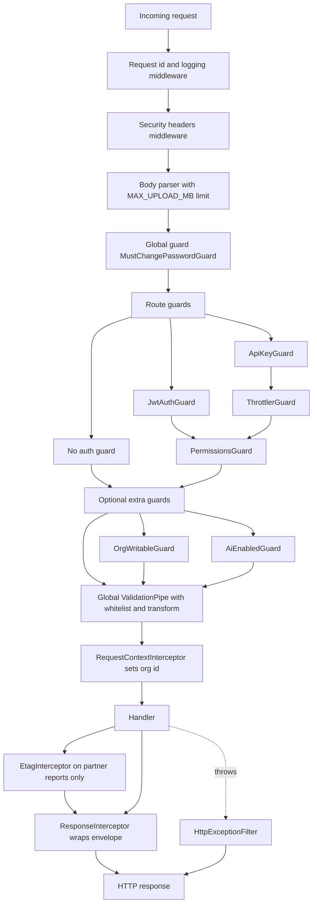
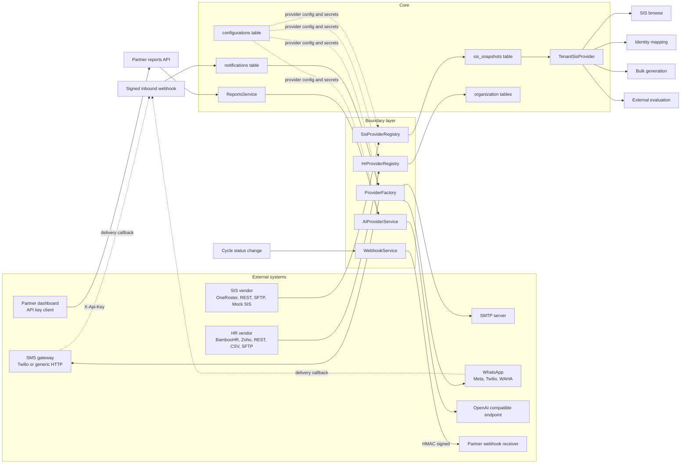

# 06 — API & Integration Map

**Enterprise 360° Feedback & Performance Management System**

Audience: an engineer who needs to know **what surfaces exist, who is allowed to call them,
and how an external system plugs in** — before reading a single endpoint signature. This is
a *map*, not a contract.

**This document deliberately does not repeat the endpoint catalogue.** Per-endpoint request
and response detail already lives in:

| Where | What it covers |
| --- | --- |
| `docs/content/api.html` (documentation bundle) | The partner Reports API, outbound webhooks, inbound delivery webhooks, HR connectors, SIS connectors, connector maturity, integration troubleshooting |
| `Enterprise360_Deployment_Manual.html` | Operator procedure: keys, secrets, TLS, proxying, health probes |
| `API_CONTRACT.md` (project docs) | The request/response envelope contract in prose |

**Sibling documents:** `01-system-architecture.md` (how it all fits together) ·
`05-module-architecture.md` (per-module screens, controllers, services, tables, status) ·
`07-business-rules.md` (scoring, anonymity, weighting and validation rules).

**Status legend:** **Implemented** = code and UI both present and wired · **Partial** =
working but a documented slice is missing · **API-only** = endpoints exist with no user
interface · **Unused** = present in code or seed data but nothing reads it.

---

## 1. The surfaces at a glance

There are **five distinct authentication surfaces**, not one API. Almost everything is the
JWT surface; the other four are small and exist for specific reasons.

| Surface | Path shape | Credential | Handlers |
| --- | --- | --- | --- |
| Internal application API | `/api/v1/**` | JWT bearer | 269 |
| Partner Reports API | `/api/v1/integration/v1/**` | `X-Api-Key` header | 10 |
| Public external evaluation | `/api/v1/public/evaluate/:token` | Opaque hashed token in the URL | 2 |
| Platform provisioning | `/api/v1/provisioning/**` | `X-Provisioning-Key` header, or open on first run | 2 |
| Unauthenticated infrastructure | `/health`, `/ready`, `/r/:code` | None | 3 |

Nine of those 269 internal handlers are themselves unauthenticated by design — the `auth`
entry points that must work before, or independently of, an access token: `login`,
`mfa/login`, `refresh`, `logout`, `ldap/login`, `sso/:provider/start`, `sso/callback`,
`password/forgot`, `password/reset`. `logout` is unguarded because it revokes a *refresh*
token supplied in the body, so it still works once the access token has expired. Everything
else on that surface carries `JwtAuthGuard`.

**286 route handlers** across **31 controllers** and **25 API groups**. The global prefix is
`api/v1`, set in `apps/api/src/main.ts`; the three root-mounted paths above are explicitly
excluded from it so load balancers and short links reach conventional URLs.

---

## 2. Internal API groups

One row per controller group. "Dominant permission" is the code that gates most handlers in
the group — individual handlers often require a narrower one, and a few require none beyond
a valid token. Permission codes are constants in each module's `*.permissions.ts`.

| Group | Base path | Purpose | Dominant permission | Handlers |
| --- | --- | --- | --- | --- |
| `auth` | `auth` | Login, MFA, refresh/rotate, SSO, LDAP, password lifecycle, sessions, org security policy | Mixed — public, JWT-only, or `security.rbac.manage` for policy | 23 |
| `rbac` | `rbac` | Roles, permission matrix, user↔role assignment, activation, invitations | `security.rbac.manage` | 10 |
| `config` | `configuration` | Generic tenant key/value store, feature flags, rating scales | `configuration.read` / `configuration.manage` | 11 |
| `organization` | `organization` | Departments, designations, employees, campuses, org chart, matrix managers | `organization.read` + per-entity `*.manage` | 18 |
| `org-import` | `org-import` | Spreadsheet validate → preview → confirm → report, plus export and templates | `organization.import.manage` | 7 |
| `hr-integration` | `hr-integration` | HR data-source mode, provider connection, test, dry-run/live sync, run reports | `organization.hr.manage` | 8 |
| `competency` | `competency`, `competency/categories` | Categories, competencies, versions, behaviour indicators | `competency.read` + granular `competency.*` | 16 |
| `questionnaire` | `questionnaire` | Question bank, templates, sections, publish, clone, rubrics | `questionnaire.read` / `*.manage` | 16 |
| `appraisal` | `appraisal` | Cycles, templates, sources and their per-quadrant questionnaires, competency coverage, participants, assignments, nomination, calibration, reminders, feedback capture | `appraisal.cycle.manage` | 36 |
| `bulk-generation` | `appraisal/bulk` | Scope preview and bulk creation of participants and assignments | `appraisal.cycle.manage` | 5 |
| `workflow` | `workflow` | Generic definitions, instances, task inbox, act, delegate | `workflow.read` / `workflow.definition.manage` / `workflow.act` | 9 |
| `external-evaluation` | `external-evaluation` | Issue, list, revoke and regenerate tokenised parent/external links | `external.evaluation.manage` | 5 |
| *(public evaluation)* | `public/evaluate` | Token validation and anonymous submission | **None** — the token is the credential | 2 |
| `identity` | `identity` | Map external actors such as SIS teachers onto 360 employees | `identity.manage` | 6 |
| `sis` | `sis` | Read-only roster browse: campuses, students, teachers, subjects, assignments | `sis.read` | 21 |
| `sis-integration` | `sis-integration` | Student data source, provider connection, import wizard, sync, run reports | `organization.sis.manage` | 10 |
| `communication` | `communication` | Send, notifications, OTP, campaigns, short links, QR, templates, branding, provider settings, delivery webhooks | `communication.read` / `send` / `manage` | 19 |
| *(short-link redirect)* | `r/:code` | 302 to the target URL; outside the API prefix | **None** | 1 |
| `user-notifications` | `notifications` | In-app bell: list, unread count, mark read | **None** beyond a valid token | 4 |
| `reports` | `reports` | Dashboards, drilldowns, individual and 360 reports, shared-competency comparison, trends, heatmap, nine-box, export, feedback rules, dashboard layout | `reports.read`, `reports.executive` for privileged views | 23 |
| `report-schedule` | `reports/schedules` | Scheduled digest definitions and manual run | `reports.read` / `reports.manage` | 4 |
| `ai` | `ai` | Provider status, org overview, per-employee insights | `ai.read` + the `ai_insights` feature flag | 3 |
| `development` | `development` | Individual development actions | `development.read` / `development.manage` | 4 |
| `integration` | `integration` | API keys, outbound webhooks, delivery log, test fire, partner API catalogue | `integration.read` / `integration.manage` | 10 |
| *(partner identity)* | `integration/v1` | `whoami` — echoes the key's org and scopes | API-key scopes | 1 |
| *(partner reports)* | `integration/v1/reports` | Read-only executive, HR, institutional, departmental, campus, trend, nine-box, heatmap | `reports.api.*` scopes | 9 |
| `feedback-audit` | `feedback-audit` | Append-only 360 feedback trail, facets, history, CSV export | `feedback.audit.read` | 4 |
| `provisioning` | `provisioning` | Installation status and tenant creation | **None** — platform key, see §3.4 | 2 |
| `health` | `/health`, `/ready` | Liveness and readiness probes | **None** | 2 |

Notes worth carrying:

- `hr-integration`, `sis-integration` and `org-import` all reuse the **`organization.*`
  permission module**, not their own. An operator granted "manage the org data source" holds
  `organization.hr.manage`, not `hr_integration.manage`.
- `competency` is three controllers on two base paths; `integration` is three controllers on
  three base paths with two *different* authentication schemes.
- `user-notifications` is the only group with a `JwtAuthGuard` and **no** `PermissionsGuard`
  — every authenticated user owns their own bell.

### 2.1 Per-quadrant questionnaires and shared competencies — the added surface

Three endpoints were added, all **additive**. Nothing was removed, renamed or given a
different meaning, so no existing client needs to change.

| Method | Path | Permission | Purpose |
| --- | --- | --- | --- |
| `PUT` | `/appraisal/cycles/:id/sources/:sourceId/template` | `appraisal.cycle.manage` | Set or clear one quadrant's questionnaire. Body `{ templateId: string \| null }`; `null` (or an omitted field) restores inheritance from the cycle questionnaire. 404 if the source is not in this cycle or the template is not in this tenant; 400 if the template has no questions. |
| `GET` | `/appraisal/cycles/:id/coverage` | `appraisal.read` | The competency × quadrant coverage matrix for a cycle. Derived from configuration — which questionnaires are attached — not from responses. |
| `GET` | `/reports/shared-competencies/:employeeId` | `reports.read` | Per-competency, per-quadrant scores for one employee plus derived findings. Same guards as `/reports/individual/:employeeId`: data scope, release gate, `reports.confidential.view` unlock, `results.viewed` audit entry. |

Two existing responses gained fields. Both are pure additions:

| Endpoint | New fields |
| --- | --- |
| `GET /appraisal/cycles/:id/sources` | `templateId`, `templateName` — what is configured **on this quadrant** (`null` when it inherits) · `effectiveTemplateId`, `effectiveTemplateName` — what its reviewers actually answer after the fallback rule · `inheritsCycleTemplate` — `true` when `templateId` is `null` |
| `GET /reports/radar/:employeeId` | `assessedBy` — competency → the quadrant labels whose questionnaire asks about it · `withheldSources` — quadrant labels present but held back by the anonymity threshold · `minResponses` · `confidentialUnlocked` |

`assessedBy` and `withheldSources` exist so a client can label a blank cell correctly:
*withheld* (data exists, too few reviewers) is not the same as *not assessed* (that
questionnaire never asked). `07-business-rules.md` BR-10.7 has the full four-state table.

The **partner Reports API** (`/api/v1/integration/v1/reports`) is unchanged by all of this:
it exposes aggregate endpoints only, and none of the three additions is among them.

---

## 3. Authentication method per surface

### 3.1 The guard chain

Guards run in a fixed order, and the order is load-bearing.



Reading the chain:

1. **`MustChangePasswordGuard` is the only globally registered guard**
   (`APP_GUARD` in `auth.module.ts`). It decodes the bearer token *itself* rather than
   relying on `request.user`, so it works regardless of guard ordering. If the token carries
   `mustChangePassword` or `mustEnrollMfa`, every request is refused with 403 except a small
   allow-list — the password-set, MFA-enrolment, `me`, and `logout` endpoints. This is
   server-side enforcement; hiding the screen in the SPA is not what stops the user.
2. **`JwtAuthGuard`** is Passport's `AuthGuard('jwt')`. `JwtStrategy` verifies with
   `JWT_ACCESS_SECRET` and populates `request.user` from the token payload.
3. **`ApiKeyGuard`** validates `X-Api-Key` and packs a *synthetic* `AuthUser` onto the
   request whose `permissions` array is the key's `scopes`. Downstream guards cannot tell the
   difference, which is exactly why the partner API reuses `PermissionsGuard` verbatim.
4. **`PermissionsGuard`** reads `@RequirePermissions` and checks it against
   `request.user.permissions`. The caller must hold **all** listed codes. A group-level
   decorator is inherited by every handler unless a handler overrides it.
5. **`OrgWritableGuard`** (organization and org-import only) refuses mutating verbs when the
   tenant's HR mode is `external_hr`, reading that mode straight from the `configurations`
   table so it stays decoupled from the HR module.
6. **`AiEnabledGuard`** (ai only) answers **404**, not 403, when the `ai_insights` feature
   flag is off — a disabled module should look absent, not withheld.

### 3.2 Permissions are baked into the access token

`PermissionsGuard` performs **no database lookup**. The permission list is resolved once at
token issue by `TokenService.resolvePermissions()` and embedded in the JWT payload.

**Consequence:** a role change, a permission grant, or a role revocation takes effect only
on the **next access-token issue or refresh** — not immediately. Access-token TTL defaults to
`15m` (`JWT_ACCESS_TTL`), so the practical worst case is one token lifetime of stale
authority. Revoking a user's *session* (`DELETE /auth/sessions/:id`) or deactivating the
account is the immediate lever; changing their roles is not.

The same applies to the data scope (`organization` | `reporting` | `own`) and the
`mustChangePassword` / `mustEnrollMfa` flags — all are token claims.

### 3.3 API-key surface

`integration/v1/*` is the only key-authenticated surface. Keys live in `api_keys` with a
`scopes[]` array; the eight `reports.api.*` scopes are declared in
`apps/api/src/integration/reports-api.scopes.ts`, which is the single source of truth for the
controller decorators, the admin docs endpoint and the admin scope picker. These scopes are
**API-only** — they are not assignable to RBAC roles, so a key can never widen a human user's
access.

Two behaviours apply only here:

- **`ThrottlerGuard`**, registered by `IntegrationModule` alone, keyed on the **API key id**
  rather than the IP. Defaults: 120 requests per 60 s (`API_RATE_LIMIT`, `API_RATE_TTL_MS`).
  Internal dashboard endpoints are never throttled.
- **`EtagInterceptor`**, controller-scoped so it hashes the raw payload inside the envelope.
  It emits a weak ETag plus `Cache-Control: private, max-age` (`API_CACHE_MAX_AGE`, default
  60 s) and answers **304** on a matching `If-None-Match`.

### 3.4 Provisioning surface

`provisioning/*` sits **outside RBAC entirely** — creating tenant B must not be reachable by
any signed-in user of tenant A. Two gates, in order:

- **First run.** While the installation contains zero organisations the setup wizard is open.
- **After that.** Every further organisation requires `PLATFORM_PROVISIONING_KEY`, presented
  as `X-Provisioning-Key` and compared with `timingSafeEqual`.

Fail-closed: if the key is unset once organisations exist, provisioning is refused outright.
`POST /provisioning/organizations` is the **only** handler in the codebase that returns 201.

### 3.5 Public token surface

`public/evaluate/:token` carries no guards at all. The token is hashed at rest, can be
expiry-limited, one-time, revoked or regenerated, and IP plus user-agent are captured into
the feedback audit trail for every anonymous action.

---

## 4. Request and response flow

### 4.1 The envelope

`ResponseInterceptor` is registered globally and wraps **every** successful controller return:

```
{ "success": true, "message": "OK", "data": <payload>, "errors": null }
```

`HttpExceptionFilter` renders every thrown error as the mirror shape:

```
{ "success": false, "message": "<human sentence>", "data": null, "errors": [{ "field"?, "message" }] | null }
```

`class-validator` failures become `message: "Validation failed"` plus a populated `errors[]`.
Controllers **never** build the envelope by hand.

### 4.2 The exceptions to the envelope

Eleven handlers bypass it by taking `@Res()` and writing the response directly — eight file
downloads plus the three infrastructure endpoints:

| Endpoint | Content type |
| --- | --- |
| `GET /reports/export` | CSV or XLSX, per `?format` |
| `GET /org-import/export` | CSV or XLSX, per `?format` |
| `GET /org-import/template/download` | CSV or XLSX |
| `GET /org-import/:jobId/report` | CSV |
| `GET /hr-integration/:runId/report` | CSV |
| `GET /sis-integration/template` | XLSX |
| `GET /sis-integration/:runId/report` | CSV |
| `GET /feedback-audit/export` | CSV |
| `GET /health`, `GET /ready` | Raw JSON, so monitoring tools parse a flat document |
| `GET /r/:code` | 302 redirect, no body |

Note that `GET /communication/qr` is **not** in this list — it returns a base64 data URL
inside the normal envelope, not image bytes.

### 4.3 Status codes actually in use

| Code | When |
| --- | --- |
| **200** | The overwhelming default, including for creation — see below |
| **201** | Exactly one handler: `POST /provisioning/organizations` |
| **304** | Partner reports API only, via `EtagInterceptor` |
| **302** | `GET /r/:code` short-link redirect |
| **400** | Validation and business-rule refusals — by far the most common failure, 103 explicit throws |
| **401** | Missing or invalid JWT, invalid API key, bad or absent webhook signature — 22 explicit throws |
| **403** | Missing permission, forced password change, MFA enrolment pending, read-only org in external-HR mode, restricted aggregates — 16 explicit throws |
| **404** | Not found, plus the deliberate "feature disabled" answer from `AiEnabledGuard` — 63 explicit throws |
| **409** | Widely used for uniqueness and state conflicts — 17 explicit throws across 12 files |
| **413** | Oversized upload. `body-parser` rejects before routing; the filter rewrites the error into a sentence naming `MAX_UPLOAD_MB` instead of leaking a bare 500 |
| **429** | Partner API rate limit only |
| **503** | `GET /ready` when the database check fails |
| **500** | Anything unhandled; logged with request context and stack |

**422 is never used.** Validation failures are 400.

**201 is suppressed on ~45 POST handlers.** Those handlers carry an explicit `@HttpCode(200)`
so a create returns 200 with the envelope rather than Nest's default 201. Seventeen `DELETE`
handlers do the same so a delete returns 200 with a body. If you are writing a client, do not
branch on 201 — branch on `success`.

### 4.4 Cross-cutting request behaviour

- **Validation.** One global `ValidationPipe` with `whitelist: true` and `transform: true`.
  Unknown body fields are silently stripped project-wide.
- **Body limit.** `MAX_UPLOAD_MB` (default 10 MB) applies to both JSON and urlencoded bodies.
  Org, HR and SIS imports post the spreadsheet as base64 inside the JSON body, so this is the
  effective import ceiling.
- **Raw body.** The app is created with `rawBody: true` because inbound delivery webhooks
  must verify an HMAC over the exact bytes, not a re-serialised DTO.
- **CORS.** Single origin from `CORS_ORIGIN`, credentials enabled.
- **Security headers.** `X-Content-Type-Options`, `X-Frame-Options: DENY`,
  `Referrer-Policy: no-referrer` on every response; HSTS only when the request arrived over
  TLS. `x-powered-by` is disabled. No `helmet` dependency.
- **Correlation.** Every response carries `X-Request-Id`; the structured logger attaches it
  to every line, and 5xx errors are logged with method, path and stack.

---

## 5. API versioning — what actually exists

Two independent version markers, and nothing else:

| Marker | Where it comes from | Meaning |
| --- | --- | --- |
| `/api/v1` | `app.setGlobalPrefix('api/v1')` in `main.ts` | The platform prefix for every application endpoint |
| `integration/v1` | Hard-coded in the partner controllers' `@Controller` paths | The partner Reports API contract version, declared as `REPORTS_API_VERSION = 'v1'` |

They nest: the partner reports base path is literally `/api/v1/integration/v1/reports`.

State plainly what is **not** there:

- **No content negotiation.** No `Accept`-driven representation switching. Binary downloads
  select format with a `?format=` query parameter, not a media type.
- **No version negotiation header.** No `Accept-Version`, no `X-API-Version`, no vendor media
  types. The version is in the path or nowhere.
- **No deprecation policy.** No `Sunset` or `Deprecation` headers, no `/api/v2` scaffolding,
  no version-routing middleware. A breaking change to `/api/v1` would be a breaking change to
  every client with no signalling mechanism.
- **Nest's `VersioningType` is not enabled.** The prefix is a plain string; there is no
  framework versioning machinery to switch on.

---

## 6. HR provider integration model

The 360 app's sync logic depends on **one interface** and nothing else.

- **Interface** — `apps/api/src/hr-integration/hr-provider.interface.ts`. A provider exposes
  a `name` and a single method, `getSnapshot(organizationId, options)`, returning an
  `HrSnapshot` of organization, campuses, departments, designations and employees. Every
  record carries a **stable `externalId`**, which is the correlation key stored in
  `ExternalIdentityMap`. Names are never used for matching.
- **Registry** — `HrProviderRegistry` holds a `Map<string, HrProvider>` and resolves the
  provider **per tenant at sync time**, falling back to `mock`. Different organisations on the
  same installation can use different HR systems.
- **Connection fields** — `provider-connection.ts` declares a `ConnectionFieldSpec[]` per
  provider. That one declaration drives the admin form, the server-side allow-list, and which
  fields are secret. Secrets are encrypted at rest with AES-256-GCM and never returned to the
  client; the API reports only a `secretSet` boolean per field.
- **Storage** — `configurations` rows `hr_integration/settings` and `hr_integration/connection`.
  No dedicated table.

**Adding a provider** is four mechanical steps and touches no business logic:

1. Implement `HrProvider` in `hr-integration/providers/`.
2. Add its field spec to `PROVIDER_FIELDS` in `provider-connection.ts`.
3. Inject it into `HrProviderRegistry`'s constructor and add it to the `byKey` map.
4. If it has not been exercised against a live vendor tenant, add it to `BETA_PROVIDERS`.

| HR provider key | Configurable | Maturity |
| --- | --- | --- |
| `mock` | No | Stable — built-in test source |
| `bamboohr` | Yes | **Beta** — written from vendor docs, never run against a live tenant |
| `zoho_people` | Yes | **Beta** — written from vendor docs, never run against a live tenant |
| `generic` | Yes | Stable — REST JSON, CSV over HTTPS, or CSV over SFTP, with a configurable field mapping |

Maturity is not cosmetic: `HrProviderRegistry.available()` returns `maturity` and a
`maturityNote` explaining exactly what has not been validated, and the admin UI surfaces both.

---

## 7. SIS provider integration model

The SIS side has **two layers**, which is the part that surprises people.

**Layer 1 — the consumer-facing interface.** `SisProvider` (token `SIS_PROVIDER`, a Symbol)
declares 21 read methods over campuses, students, guardians, teachers, subjects, enrolments
and teaching assignments. Four modules inject it: `sis` (browse), `identity` (teacher↔employee
mapping), `bulk-generation`, and `external-evaluation` (parent feedback). **None of them knows
which SIS is behind it.**

**Layer 2 — the snapshot providers.** `SisSnapshotProvider` implementations pull a roster
snapshot from a real source. `SisProviderRegistry` resolves them by key.

The two layers are bridged by `TenantSisProvider`, which is what `SIS_PROVIDER` is actually
bound to:

- On every call it reads the current tenant from **`AsyncLocalStorage`**
  (`common/context/request-context.ts`, populated by `RequestContextInterceptor` after auth).
- If that org has a stored snapshot it serves `StoredSisProvider` over it; otherwise it falls
  back to the legacy HTTP `MockSisProvider`.
- The resolved provider is **memoised for the lifetime of the request** via `requestCached`.
  Bulk parent generation calls the interface once per teacher and again per student, so
  without this a single request re-read and re-parsed the whole roster blob thousands of
  times. Nothing is cached across requests, so a fresh sync is visible immediately and no
  tenant's data can leak into another's request.

| SIS provider key | Kind | Configurable | Maturity |
| --- | --- | --- | --- |
| `internal` | Import — manual roster | No | Stable |
| `csv` | Import — Excel/CSV wizard | No | Stable |
| `mock` | Sync | No | Stable |
| `generic` | Sync — REST bundle or SFTP JSON/XLSX | Yes | Stable |
| `oneroster` | Sync — OneRoster v1.1 | Yes | **Beta** — spec-complete, not validated against a live PowerSchool, Infinite Campus, Clever or ClassLink tenant |

Storage mirrors HR exactly: `configurations` rows `sis_integration/settings` and
`sis_integration/connection`, secrets encrypted with the same AES-256-GCM helper.

Adding a real SIS means implementing `SisSnapshotProvider` and registering it. Nothing in
`sis`, `identity`, `bulk-generation` or `external-evaluation` changes.

---

## 8. Communication provider model

Three channels, one interface, one factory.

- **Interface** — `ChannelProvider`, a single `send(payload)` returning
  `{ provider, providerMessageId }`.
- **Factory** — `ProviderFactory.forChannel(orgId, channel)` reads per-org configuration and
  constructs the transport. Business logic only ever calls `NotificationService`, which calls
  the factory, so no module touches SMTP, Twilio, WAHA or a vendor SDK directly.

| Channel | Provider options | Transport |
| --- | --- | --- |
| `email` | SMTP only | `nodemailer`, with optional SMTP AUTH and a configurable connection timeout |
| `sms` | `twilio`, `generic` | Twilio REST, or a fully config-driven HTTP gateway |
| `whatsapp` | `meta`, `twilio`, `waha`, `mock` | Meta Cloud API, Twilio, self-hosted WAHA, or an in-memory recorder |

The `generic` SMS gateway is worth calling out: endpoint, HTTP method, JSON or form body,
the field names for recipient/message/sender, and the auth scheme
(`none` | `apikey` | `basic` | `bearer` | `oauth2` client-credentials) are all configuration.
It also honours a retry policy — `retryMaxAttempts` and `retryBackoffMs`. Retry is
**SMS-only**; the WhatsApp and email transports send once.

A missing channel config is a `400`, not a silent no-op. A configured-but-disabled channel is
skipped, except by `POST /communication/settings/test`, which deliberately bypasses the
enable switch so credentials can be validated before going live.

---

## 9. Webhooks

### 9.1 Outbound — the system notifying a partner

Registered per tenant in `webhook_endpoints`, managed under `integration/webhooks`.

- **Payload**: `{ event, timestamp, data }`, POSTed as JSON.
- **Headers**: `x-e360-event`, `x-e360-delivery` (a random per-attempt id), and
  `x-e360-signature: sha256=<hex>` — an HMAC-SHA256 of the exact serialised body keyed with
  the endpoint's own secret (`whsec_…`, generated at creation and shown **once**; the list
  endpoint returns only a masked form).
- **Subscription**: an endpoint's `events[]` filters delivery; an **empty array means all
  events**.
- **Delivery**: 10-second timeout via `AbortController`, best-effort, never throws — callers
  fire and forget. Every attempt writes a `webhook_deliveries` row with status, HTTP code,
  error and attempt count. `GET /integration/webhooks/:id/deliveries` returns the last 25.
- **Retries**: **there are none.** `attempts` is always written as `1`. A failed delivery is
  recorded, not requeued.
- **Test fire**: `POST /integration/webhooks/:id/test` sends a synthetic `ping`.

**Events actually emitted: one family.** `appraisal.cycle.<status>` from
`CycleService`, where status is the new cycle status. No other module calls
`WebhookService.dispatch()`. Treat the event catalogue as **Partial** — the delivery
machinery is complete and generic; the set of producers is not.

### 9.2 Inbound — a provider reporting delivery status

`POST /communication/webhooks/:provider` is public by necessity, so the signature rule is the
whole security model, and it is **fail-closed**:

1. No signature header at all → **401**, before any database lookup.
2. Look up the notification by `providerMessageId` to learn which organisation the callback
   belongs to. **Nothing is written before the signature checks out.**
3. Read that org's webhook secret — the channel-specific one if the channel defines one, else
   the general `communication/general.webhookSecret`.
4. **No secret configured → 401.** An organisation that has not set a secret cannot receive
   delivery callbacks. This is deliberate: the alternative is accepting unsigned status
   updates from anyone who can guess a message id.
5. Compare with `timingSafeEqual` over the **raw request bytes** — which is why the app is
   bootstrapped with `rawBody: true`.

Accepted header aliases: `X-Webhook-Signature`, `X-Hub-Signature-256` (Meta),
`X-Twilio-Signature`. All five failure modes return the **same** 401 with the same message, so
a caller cannot probe which message ids exist or which orgs have secrets configured.

---

## 10. Integration and data-flow diagram



The shape to take away: **every external system enters through a registry or factory, and
every one of them is configured by rows in `configurations`, not by code.** That is the
property that makes "add a vendor" a boundary-layer change.

---

## 11. Cross-references

| Question | Document |
| --- | --- |
| How do the apps, stores and cron jobs fit together? | `01-system-architecture.md` |
| Which screens and services belong to a module, and what is Partial? | `05-module-architecture.md` |
| What are the scoring, anonymity, weighting and validation rules behind these endpoints? | `07-business-rules.md` |
| Where does a specific setting live — env, database row, or feature flag? | `11-configuration-reference.md` |
| What exactly does a partner endpoint return? | `docs/content/api.html` |
| How do I deploy, key and proxy this? | `Enterprise360_Deployment_Manual.html`, `DEPLOYMENT.md`, `ops/` |

---

*Verified against the repository on 2026-08-21: 25 API groups · 31 controllers · 289 route
handlers · 5 authentication surfaces · 8 partner API scopes · 4 HR providers · 5 SIS provider
keys · 3 communication channels with 7 transports.*
