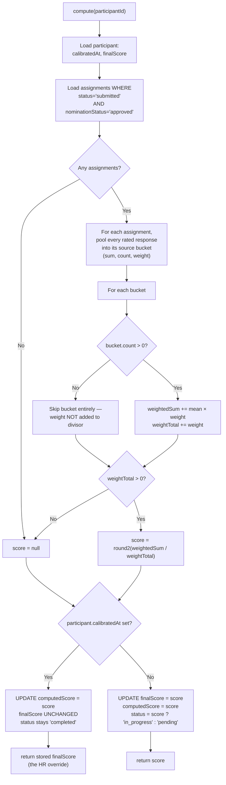
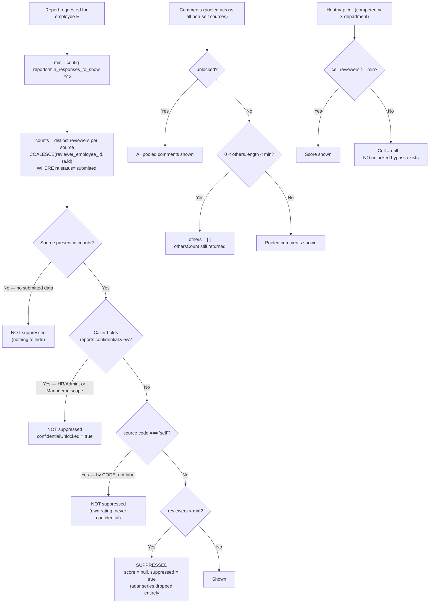
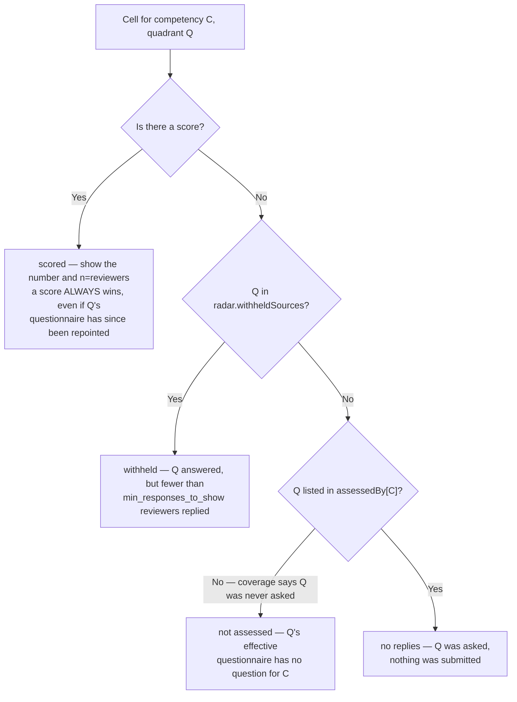
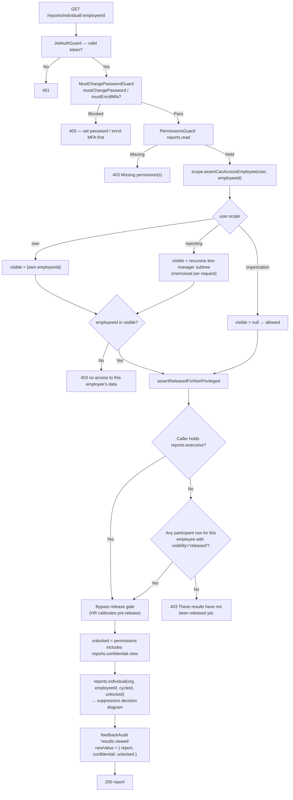

# 07 — Business Rules

The rules that are **spread across the code** rather than declared in one place, and that a
new developer would otherwise break by accident. Everything here was read out of the source
tree at `/root/e360/enterprise-360-app`; every rule carries a `file:line` or
`file:function` anchor so you can go and look.

**Related documents:** `02-database-erd.md` (what the tables are and how they relate) ·
`04-business-workflows.md` (the end-to-end flows these rules govern) ·
`05-module-architecture.md` (which module owns which service) ·
`03-table-reference.md` · `06-api-integration-map.md` · `11-configuration-reference.md`.

All API paths are relative to the global prefix `/api/v1`.

## How to read a rule card

Every rule is stated in the same four parts:

| Part | Meaning |
| --- | --- |
| **Rule** | One sentence. If you remember nothing else, remember this line. |
| **Lives in** | `file:line` or `file:function`. The authoritative location — not a copy. |
| **Logic** | Short pseudocode. Deliberately *not* the source; read the source for detail. |
| **Break it and** | The concrete failure. What a user sees, what data goes wrong. |

Rules are numbered `BR-<section>.<n>` and are referenced by that number in the summary
table at the end.

> **The single most important framing fact:** this system enforces almost nothing in the
> database. Tenancy, scope, anonymity, cycle state and release are all enforced **in
> service code**. There is no Row-Level Security anywhere (`grep 'ROW LEVEL SECURITY'
> database/*.sql` returns nothing). A query written without the right `WHERE` clause is a
> data leak, not a bug the database will catch for you.

---

## 1. Tenant / organisation data rules

The product is **multi-tenant on a shared schema**. One Postgres database, one set of
tables, every tenant's rows side by side, separated only by `organization_id`.

### BR-1.1 — Every tenant-owned row carries `organization_id`, and every query must filter on it

- **Rule:** A tenant's data is identified solely by the `organization_id` column, so every
  read and write must constrain it to `user.organizationId`.
- **Lives in:** `apps/api/prisma/schema.prisma` (nearly every model declares
  `organizationId String @map("organization_id")`); the filter itself lives in each
  service, e.g. `apps/api/src/appraisal/services/cycle.service.ts:181`
  (`getOwned`), `apps/api/src/organization/services/employee.service.ts:207`.
- **Logic:**

```text
// the pattern repeated in ~every service
row = prisma.<model>.findFirst({
        where: { id, organizationId: user.organizationId, deletedAt: null }
      })
if (!row) throw NotFound        // NOT Forbidden — do not confirm the row exists
```

- **Break it and:** you leak another customer's employees, scores or comments. There is no
  second line of defence. Note the deliberate `NotFoundException` (not `Forbidden`) — it
  refuses to confirm that an id exists in some other tenant. Guarded by the e2e test
  `tenant isolation: unknown employee id is not found`.

### BR-1.2 — Tenancy is enforced in services, never by RLS

- **Rule:** There is no Row-Level Security, no Prisma middleware and no global tenant
  interceptor; isolation exists only because each service writes the filter by hand.
- **Lives in:** `database/000_initial_schema.sql` and `database/001_reconcile.sql` — the
  absence of any `ENABLE ROW LEVEL SECURITY` statement is the rule.
  `apps/api/src/common/prisma/prisma.service.ts` adds no tenant middleware.
- **Logic:**

```text
DB layer:      no policy, no session variable, no tenant context
Service layer: `where: { organizationId: user.organizationId }`  ← the only guard
Raw SQL:       `WHERE x.organization_id = ${orgId}::uuid`         ← same guard, by hand
```

- **Break it and:** a single new raw-SQL report that forgets `organization_id` (see the
  many `Prisma.sql` blocks in `apps/api/src/reports/services/reports.service.ts`)
  silently serves cross-tenant aggregates and nothing anywhere will complain.

### BR-1.3 — Campuses are `organizations` rows with `org_type='campus'`, not tenants

- **Rule:** A campus is an `organizations` row whose `orgType` is `campus` and whose
  `parentOrgId` is the tenant root; it is an attribution label, not a tenant boundary.
- **Lives in:** `apps/api/src/organization/services/campus.service.ts:7-11` (the doc
  comment states the rule), `:21`, `:30`, `:55`; schema at
  `apps/api/prisma/schema.prisma:19-36` (`enum OrgType { root campus }`).
- **Logic:**

```text
createCampus(user, dto):
  organization.create({ name, slug, orgType: 'campus', parentOrgId: user.organizationId })

getOwnedCampus(rootOrgId, id):
  organization.findFirst({ id, parentOrgId: rootOrgId, orgType: 'campus', deletedAt: null })
```

- **Break it and:** if you ever set an employee's `organizationId` to a campus id instead
  of `campusId`, that person vanishes from every tenant-scoped query at once — the
  directory, their cycles, their reports — because everything else keys off the ROOT id.

### BR-1.4 — Every other table keys off the ROOT organisation id

- **Rule:** `employees.campus_id` points at a campus row, but `employees.organization_id`
  — and the `organization_id` on cycles, questions, competencies, assignments, audit
  events — always points at the **root** organisation.
- **Lives in:** `apps/api/src/organization/services/employee.service.ts:98-110` (create
  sets `organizationId: user.organizationId` and `campusId` separately);
  `apps/api/src/reports/services/reports.service.ts:224-238` (`campus()` rolls up by
  `LEFT JOIN organizations cmp ON cmp.id = e.campus_id` while still filtering
  `c.organization_id = ${orgId}`).
- **Logic:**

```text
employee = {
  organizationId: ROOT,          // tenancy — what every filter uses
  campusId:       CAMPUS_ORG_ID  // attribution — reporting dimension only
}
// note: campusId has NO Prisma relation; campus names are resolved by a
// second query (department.service.ts:42-51)
```

- **Break it and:** campus roll-ups double-count or lose people; worse, an employee
  written with `organizationId = campusId` becomes invisible and unrecoverable through the
  UI.

### BR-1.5 — Soft delete is `deletedAt IS NULL`, applied per query

- **Rule:** Deletion is almost always a soft delete, and the `deletedAt: null` filter is
  applied by each query individually — it is not automatic.
- **Lives in:** `apps/api/src/organization/services/employee.service.ts:177-191`
  (`terminate` sets `status:'terminated'` + `deletedAt`); the filter appears in
  `employee.service.ts:44`, `cycle.service.ts:24`, `plan.service.ts:133` and dozens more.
- **Logic:**

```text
terminate(id): employee.update({ status: 'terminated', deletedAt: now })
               user.update({ status: 'disabled' })
               refreshToken.updateMany({ revokedAt: now })   // kill live sessions
```

- **Break it and:** terminated staff reappear in the directory, in bulk-generation plans
  and in dashboards. See BR-14.1 for a place where this filter is genuinely inconsistent
  today.

---

## 2. Employee hierarchy

### BR-2.1 — The reporting line is a single self-relation on `employees`

- **Rule:** The whole organisational hierarchy is one nullable self-referencing column,
  `employees.line_manager_id`.
- **Lives in:** `apps/api/prisma/schema.prisma:587-621` — `lineManagerId String?` with
  `lineManager Employee? @relation("LineManagement", ...)` and `reports Employee[]`.
- **Logic:**

```text
employee.lineManagerId -> employee.id        // 0..1 manager
employee.reports        = employees where lineManagerId = this.id
// null lineManagerId = a root of the tree (CEO, or an unassigned person)
```

- **Break it and:** everything downstream is derived from this one column — data scope
  (BR-11.2), manager/peer/subordinate evaluator resolution (section 3), and the My Team
  rollup (`reports.service.ts:931`). A wrong `lineManagerId` silently reassigns who
  evaluates whom *and* who can read whose results.

### BR-2.2 — Reassigning a line manager runs cycle detection; self-reference is refused first

- **Rule:** `PUT /organization/employees/:id` refuses a `lineManagerId` that is the
  employee themself, or that would close a loop in the reporting tree.
- **Lives in:** `apps/api/src/organization/services/employee.service.ts:132-142`
  (`update`), using `apps/api/src/organization/cycle-guard.ts:7` (`wouldCreateCycle`);
  route at `organization/organization.controller.ts:127`.
- **Logic:**

```text
update(id, dto):
  if dto.lineManagerId == id             -> 400 "cannot report to themselves"
  assertOwned(dto.lineManagerId)         // same tenant, not soft-deleted
  if wouldCreateCycle(managerOf, dto.lineManagerId, id) -> 400 "would create a reporting cycle"

wouldCreateCycle(fetchParent, proposedParent, node, maxDepth = 100):
  current = proposedParent; depth = 0
  while current:
    if current == node      -> true          // loop
    if depth >= maxDepth    -> true          // treat runaway chain as a loop
    depth++; current = fetchParent(current)  // one DB round-trip per hop
  return false
```

- **Break it and:** a cycle in `line_manager_id` makes the recursive scope query
  (`scope.service.ts:37-48`) and the peer/subordinate indexes loop or return nonsense; the
  `maxDepth = 100` fallback is what stops a pathological chain from hanging the request.
  The same helper is reused for department parents and designation promotion paths — do
  not fork it.
- **Reachable from the UI.** Organization → Employees now carries a per-row **Edit**
  dialog whose "Reporting to" picker posts this endpoint
  (`apps/web/src/features/organization/panels/EmployeesPanel.tsx:448` and the shared
  `PlacementFields` at `:199-285`), so both rejections are now user-visible messages rather
  than API-only behaviour: *"An employee cannot report to themselves."* and
  *"This line manager would create a reporting cycle."* The picker also filters the
  employee themself and anyone `terminated` out of the list (`EmployeesPanel.tsx:271`) —
  a courtesy, not the guard; the server check is the guard.
- **Still true of `create`:** `EmployeeService.create` (`employee.service.ts:70-97`)
  validates that a supplied `lineManagerId` exists in the tenant but runs **no** cycle
  walk. That is safe only because a brand-new employee has no reports yet.

### BR-2.3 — Matrix managers are display-only and are **not** cycle-checked

- **Rule:** `employee_matrix_managers` records dotted-line relationships that are shown in
  the UI and nothing else — they grant no access, produce no evaluators, and
  `assignMatrix` performs **no cycle detection**.
- **Lives in:** `apps/api/src/organization/services/employee.service.ts:160-174`
  (`assignMatrix`); serialised at `employee.service.ts:255-258`; schema at
  `apps/api/prisma/schema.prisma:625-635`.
- **Logic:**

```text
assignMatrix(id, managerIds):
  assertOwned(id)
  if managerIds contains id       -> 400 "cannot be their own matrix manager"
  if any managerId not in this org (or soft-deleted) -> 400
  // NOTE: no wouldCreateCycle() here — A→B and B→A is accepted
  replace all rows for employeeId with the new set   // deleteMany + createMany

// consumers: employee.service serialize() -> `matrixManagers` field, UI only.
// NOT consulted by: scope.service, plan.service, reports.service.
```

- **Break it and:** nothing breaks *today* — the absence of cycle detection is harmless
  precisely because the data is inert. The trap is the opposite direction: if you ever
  make matrix managers grant visibility or generate evaluators, you inherit a table that
  can legally contain mutual and circular links, and you must add `wouldCreateCycle`
  first. Note also that `assignMatrix` is a full replace, so a partial payload silently
  deletes the omitted managers.

---

## 3. How Manager / Peer / Subordinate evaluators are determined

All of this lives in one pure planning service used **identically by preview and
generate**, so the plan an admin confirms is exactly what gets written
(`plan.service.ts:63-69`).

### BR-3.1 — Only active, in-scope employees are evaluatees or evaluators

- **Rule:** The candidate pool is active employees in the selected scope; an out-of-scope
  person may only be used as an evaluator when `allowOutOfScope` is set.
- **Lives in:** `apps/api/src/bulk-generation/services/plan.service.ts:131-166`.
- **Logic:**

```text
all       = employees where organizationId = org AND deletedAt IS NULL
activeById= all where status == 'active'
evaluatees= activeById filtered by inScope(scope)

usable(emp) = emp exists
           && emp.status == 'active'
           && (config.allowOutOfScope || inScope(emp, scope))

inScope(e, scope):
  'all'        -> true
  'campus'     -> e.campusId == scope.scopeId
  'department' -> e.departmentId ∈ scope.departmentIds   // unit + all descendants
```

- **Break it and:** terminated or inactive people get review tasks they can never
  complete, and the cycle can never reach 100% completion (BR-14.x reads completion off
  assignment counts).

### BR-3.2 — Manager = the evaluatee's `lineManagerId`, and only that

- **Rule:** The Manager quadrant is exactly one person: the evaluatee's line manager, if
  they are active.
- **Lives in:** `apps/api/src/bulk-generation/services/plan.service.ts:177-185`.
- **Logic:**

```text
if config.evaluators.manager:
  mgr = byId[E.lineManagerId]
  if !mgr or mgr.status != 'active':
      issues.missingManager = true            // reported, not fatal
  else if usable(mgr) and mgr.id != E.id:
      push { sourceCode: 'manager', reviewerEmployeeId: mgr.id }
  // a manager excluded ONLY by out-of-scope is deliberately NOT "missing"
```

- **Break it and:** the Manager quadrant has exactly one reviewer *by definition*, which
  is why it is permanently below the anonymity threshold and why
  `reports.confidential.view` exists at all (BR-10.4). Matrix managers (BR-2.3) are never
  considered here.

### BR-3.3 — Subordinates = direct reports only, not the whole subtree

- **Rule:** The Subordinate quadrant is the evaluatee's **direct** reports — one level
  down, not the transitive subtree.
- **Lives in:** `apps/api/src/bulk-generation/services/plan.service.ts:150-153` (the
  index) and `:188-192` (the use).
- **Logic:**

```text
reportsByManager = index of activeById grouped by lineManagerId   // one level

if config.evaluators.subordinate:
  subs = reportsByManager[E.id] filtered (s.id != E.id and usable(s))
  if subs is empty: issues.noSubordinates = true
  for s in subs: push { sourceCode: 'subordinate', reviewerEmployeeId: s.id }
  // NOTE: no cap. A manager with 40 reports gets 40 subordinate assignments.
```

- **Break it and:** contrast with `scope.service.ts` (BR-11.2), which *does* walk the full
  recursive subtree. Reusing one where the other is meant either floods a senior leader
  with hundreds of subordinate raters, or under-samples them.

### BR-3.4 — Peers = other people sharing the same line manager

- **Rule:** Peers are the evaluatee's siblings in the reporting tree — everyone else
  reporting to the same manager — with no manager meaning no peers at all.
- **Lives in:** `apps/api/src/bulk-generation/services/plan.service.ts:195-206`.
- **Logic:**

```text
if config.evaluators.peer:
  peers = E.lineManagerId
          ? reportsByManager[E.lineManagerId] filtered (p.id != E.id and usable(p))
          : []                                  // no manager -> NO peers
  if !config.peer.crossDepartment:
      peers = peers filtered (p.departmentId == E.departmentId)
  peers.sort(by id)                             // deterministic, not random
  if peers.length < max(1, config.peer.min): issues.noPeers = true   // advisory
  for p in peers.slice(0, max(0, config.peer.max)): push peer assignment
```

- **Break it and:** a flat org where everyone reports to the CEO gives every employee
  *every colleague* as a peer (capped at `peer.max`); an org where senior people have no
  manager gives them no peers at all. The sort is by raw UUID, so "the first 5 peers" is
  arbitrary but stable — changing the sort silently changes who reviews whom on
  regeneration.

### BR-3.5 — `crossDepartment` does not widen the peer search — it only removes a filter

- **Rule:** `peer.crossDepartment` is **not** a search across departments; it is a toggle
  that skips the same-department narrowing of an already-fixed candidate set.
- **Lives in:** `apps/api/src/bulk-generation/services/plan.service.ts:196-199`.
- **Logic:**

```text
// candidate set is fixed BEFORE the flag is consulted:
peers = siblings under E.lineManagerId

if !crossDepartment:  peers = peers.filter(same department as E)
if  crossDepartment:  peers = peers                 // ← that is the entire effect
// nothing ever looks outside reportsByManager[E.lineManagerId]
```

- **Break it and:** an admin turns on "cross-department peers" expecting peers from other
  departments and gets the same list, or a slightly longer one — because siblings under a
  shared manager are usually in the same department anyway. If someone files this as "the
  toggle does nothing", the fix is to widen the candidate set (e.g. same department, or
  same designation, org-wide), not to touch the filter.

### BR-3.6 — `peer.min` is advisory; `peer.max` is a hard cap

- **Rule:** Falling below `peer.min` only sets a warning flag in the preview summary and
  never blocks generation; `peer.max` genuinely truncates the list.
- **Lives in:** `apps/api/src/bulk-generation/services/plan.service.ts:202-205`; surfaced
  at `bulk-generation.service.ts:413-415` and `:440-448`.
- **Logic:**

```text
if peers.length < max(1, peer.min): issues.noPeers = true    // a REPORT, not a guard
for p in peers.slice(0, max(0, peer.max)): create assignment // a real cap

// summarize() then rolls issues.noPeers into
//   summary.issues.noPeers  (names)  and  summary.counts.noPeers (count)
```

- **Break it and:** someone reads `peer.min` as a guarantee and ships a cycle where half
  the peer quadrants have one reviewer — permanently suppressed by the anonymity threshold
  (BR-10.1) and invisible to everyone except `reports.confidential.view` holders. The
  preview's "No peers" count is the only warning anyone gets.

### BR-3.7 — Self-evaluation only when explicitly enabled, and a final self-exclusion sweep

- **Rule:** Nobody ever appears as their own non-self evaluator; a Self assignment exists
  only when `config.evaluators.self` is on (and it is **off** by default).
- **Lives in:** `apps/api/src/bulk-generation/services/plan.service.ts:54-61`
  (`DEFAULT_CONFIG` has `self: false`), `:173-174`, `:208-209`.
- **Logic:**

```text
if config.evaluators.self: push { sourceCode: 'self', reviewerEmployeeId: E.id }
...
cleaned = evaluators.filter(ev => ev.sourceCode == 'self' || ev.reviewerEmployeeId != E.id)
```

- **Break it and:** with `self` off by default, a generated cycle has **no Self quadrant
  at all** — and the Self source is the one exempt from the anonymity threshold
  (BR-10.2). Turning it on changes which quadrant is visible to a low-privilege viewer.

### BR-3.8 — Bulk-generated sources have fixed codes, labels, weights and anonymity

- **Rule:** Bulk generation creates each enabled quadrant from a hard-coded table:
  Manager weighs 2, everyone else weighs 1; peer/subordinate/parent are anonymous,
  self/manager are not.
- **Lives in:** `apps/api/src/bulk-generation/services/bulk-generation.service.ts:39-45`
  (`SOURCE_DEFS`), written at `:133-141`.
- **Logic:**

```text
SOURCE_DEFS = {
  self:        { label:'Self',         weight:1, anonymous:false },
  manager:     { label:'Line Manager', weight:2, anonymous:false },
  peer:        { label:'Peer',         weight:1, anonymous:true  },
  subordinate: { label:'Subordinate',  weight:1, anonymous:true  },
  parent:      { label:'Parents',      weight:1, anonymous:true  },
}
for code in enabledEvaluators:
  feedbackSource.create({ cycleId, code, ...SOURCE_DEFS[code], requiredCount: 1, isActive: true })
```

- **Break it and:** the manager's double weight is a *product* decision baked into a
  constant. Change it and every bulk-generated cycle scores differently, with no migration
  and no audit trail — existing cycles keep their stored per-cycle weights (BR-6.1), so
  cycles generated before and after your change become incomparable in the trend chart.

### BR-3.9 — Bulk-generated internal assignments are pre-approved and de-duplicated in memory

- **Rule:** Assignments created by bulk generation are written with
  `nominationStatus: 'approved'` and `reviewerType: 'internal'`, de-duplicated on
  `(participant, source, reviewer)` before the insert.
- **Lives in:** `apps/api/src/bulk-generation/services/bulk-generation.service.ts:163-193`.
- **Logic:**

```text
seen = Set()
for plan in plans:
  for ev in plan.evaluators:
    key = `${participantId}:${sourceId}:${ev.reviewerEmployeeId}`
    if seen.has(key): record skipped("Duplicate assignment"); continue
    seen.add(key)
    rows.push({ ..., reviewerType: 'internal', nominationStatus: 'approved' })
chunked createMany(rows, { skipDuplicates: true })   // CHUNK = 1000
```

- **Break it and:** the in-memory dedupe is only safe because the cycle is brand new. If
  you reuse this path against an existing cycle, `skipDuplicates` still saves you at the
  DB level (unique index `uq_reviewer_assignment`), but the per-row "skipped" reporting
  the admin sees becomes a lie. Also note: pre-approving means the nomination workflow
  (BR-8.3) is bypassed entirely for bulk cycles — intentionally.

### BR-3.10 — A generated cycle must have a questionnaire with at least one question

- **Rule:** Generation refuses up front unless the chosen template exists in this
  organisation and has at least one question attached.
- **Lives in:**
  `apps/api/src/bulk-generation/services/bulk-generation.service.ts:306-325`
  (`assertUsableTemplate`), called at `:109` before anything is written.
- **Logic:**

```text
assertUsableTemplate(orgId, templateId):
  if !templateId                                  -> 400 "select a questionnaire"
  t = template where { id, organizationId: orgId, deletedAt: null }
  if !t                                           -> 400 "not found in this organization"
  if count(sectionQuestions where section.templateId = t.id) == 0 -> 400 "has no questions"
```

- **Break it and:** without this the system creates a cycle, creates thousands of
  assignments, activates it, and emails every evaluator a form with no questions that
  cannot be submitted. This check runs **before** cycle creation for exactly that reason.

---

## 4. Parent feedback linkage

Parent (external) feedback is the one path where a reviewer is not an employee and holds
no account — only a hashed secure link.

### BR-4.1 — A parent link maps to a `reviewer_assignment` with `reviewer_employee_id = NULL`

- **Rule:** Each evaluation link owns exactly one reviewer assignment whose
  `reviewerEmployeeId` is NULL, `reviewerType` is `'external'`, and whose `externalRef`
  points back at the link.
- **Lives in:** `apps/api/src/external-evaluation/services/evaluation-link.service.ts:99-113`;
  schema at `apps/api/prisma/schema.prisma:1029-1050`.
- **Logic:**

```text
asg = reviewerAssignment.create({
        organizationId, cycleId, participantId, sourceId,
        reviewerEmployeeId: null,        // ← the marker for "external"
        reviewerType: 'external',
        externalRef:  link.id,
        externalName: parentName ?? `Parent of ${student.name}`,
        nominationStatus: 'approved', status: 'pending' })
evaluationLink.update({ id: link.id, reviewerAssignmentId: asg.id })
```

- **Break it and:** the unique index is `(participantId, sourceId, reviewerEmployeeId)`
  (`schema.prisma:1052`). Because Postgres treats NULLs as distinct, **many** parent
  assignments can coexist for one participant+source — which is what makes multiple
  parents possible. Any code that assumes `reviewerEmployeeId` is non-null will crash or
  silently drop parent feedback; see `reports.service.ts:48` and `:566`, which count
  distinct reviewers as `COALESCE(ra.reviewer_employee_id::text, ra.id::text)` precisely
  to handle this.

### BR-4.2 — The teacher must already be identity-mapped, or link creation is refused

- **Rule:** A parent link can only be created for a SIS teacher who has an explicit
  Teacher ↔ Employee mapping; there is no name-based fallback.
- **Lives in:** `apps/api/src/external-evaluation/services/evaluation-link.service.ts:60-65`.
- **Logic:**

```text
employeeId = identity.resolveEmployee(orgId, 'teacher', assignment.teacherId)
if !employeeId:
  throw 400 `Teacher "${assignment.teacher}" is not yet mapped to a 360 employee.`
```

- **Break it and:** see section 5. Resolution reads only `external_identity_maps`, so an
  unmapped teacher fails loudly at link creation rather than quietly attaching parent
  feedback to the wrong person.

### BR-4.3 — The active cycle, participant record and `Parents` source are auto-provisioned

- **Rule:** Creating a parent link finds (or is given) a cycle, creates the teacher's
  participant record if missing, and creates a `parent` / "Parents" feedback source on
  that cycle if missing.
- **Lives in:** `apps/api/src/external-evaluation/services/evaluation-link.service.ts:313-352`
  (`provisionCycle`).
- **Logic:**

```text
cycle = explicitCycleId                                   // bulk generation passes this
        ? cycle where { id: explicitCycleId, organizationId, deletedAt: null }
        : cycle where { organizationId, status: 'active', deletedAt: null }
              order by startDate desc, first                     // single-link flow
if !cycle -> 400 "There is no active feedback cycle."

participant = participant(cycleId, employeeId) ?? create({ cycleId, employeeId })
source      = source(cycleId, code='parent')
              ?? create({ code:'parent', label:'Parents', weight:1,
                          requiredCount:1, isAnonymous:true, isActive:true })
return { cycleId, participantId, sourceId, templateId: cycle.templateId }
```

- **Break it and:** two traps. (a) With no `explicitCycleId` the target is *whichever
  cycle happens to be active with the latest start date* — activate a second cycle and new
  parent links silently retarget. (b) The auto-created source always has `weight: 1` and
  is created **outside** the normal setup UI, so a cycle can gain a scoring quadrant that
  the admin never configured. See BR-6.1 — that weight then participates in every score.

### BR-4.4 — Parent answers persist only for real UUID question ids

- **Rule:** A parent's submission is written to `feedback_responses` only for responses
  whose `questionId` is a well-formed UUID (i.e. a real question from the cycle template);
  answers to the built-in generic questionnaire affect only the link's own
  `overallScore`.
- **Lives in:** `apps/api/src/external-evaluation/services/evaluation-link.service.ts:20`
  (`UUID_RE`), `:281-297`; the fallback questionnaire is
  `apps/api/src/external-evaluation/default-questionnaire.ts` via
  `evaluation-link.service.ts:384-394`.
- **Logic:**

```text
submit(token, dto):
  ... validate link state and cycle state (BR-12.5) ...
  link.update({ responses: dto.responses, overallScore: avg(ratings),
                comment: first non-empty text, status: 'completed' })

  if link.reviewerAssignmentId:
    items = dto.responses.filter(r => UUID_RE.test(r.questionId))
    if items.length > 0:
      tx: upsert feedbackResponse per item
          reviewerAssignment.update({ status:'submitted', submittedAt: now })
      scoring.compute(participantId)          // ← feeds the real 360 score
    // else: NOTHING enters the 360 score. The link still shows "completed".
```

- **Break it and:** this is the quiet one. If the cycle has no template, `questions()`
  falls back to `DEFAULT_TEACHER_QUESTIONS` whose ids are **not** UUIDs, so every parent
  submission is recorded as completed, shows an `overallScore` on the links screen, and
  contributes **zero** to the teacher's 360 score. `feedback_responses.question_id` has no
  foreign key (`schema.prisma:1058-1067`), so this regex is the only thing standing
  between the scoring table and junk ids.

### BR-4.5 — Revoke and regenerate withdraw the parent's contribution and recompute

- **Rule:** Revoking or regenerating a link deletes its feedback responses, resets the
  assignment to `pending`, and recomputes the appraisee's score.
- **Lives in:** `apps/api/src/external-evaluation/services/evaluation-link.service.ts:148-167`
  (`revoke`) and `:174-205` (`regenerate`).
- **Logic:**

```text
revoke(id):
  link.update({ status: 'revoked' })
  if link.reviewerAssignmentId:
    feedbackResponse.deleteMany({ assignmentId })
    reviewerAssignment.update({ status: 'pending', submittedAt: null })
    scoring.compute(participantId)         // score drops back
```

- **Break it and:** skip the recompute and a revoked parent's ratings stay baked into
  `finalScore` forever, because `compute()` only ever reads currently-submitted
  assignments. Note this recompute respects calibration (BR-8.6) — a calibrated score is
  not walked back.

---

## 5. Employee ↔ teacher identity mapping

### BR-5.1 — `external_identity_maps` is the only resolution path; names are never used

- **Rule:** An external actor resolves to an employee **only** through an active row in
  `external_identity_maps` keyed on a stable external id.
- **Lives in:** `apps/api/src/identity/identity-map.service.ts:8-14` (the contract),
  `:26-33` (`resolveEmployee`); schema at `apps/api/prisma/schema.prisma:1250`.
- **Logic:**

```text
resolveEmployee(orgId, externalType, externalId):
  row = externalIdentityMap.findFirst({ organizationId: orgId, externalType,
                                        externalId, active: true })
  return row?.employeeId ?? null      // null = unmapped, callers must fail loudly
```

- **Break it and:** the whole point is that a real production SIS can be swapped in
  unchanged — sync its identifiers into this table and every downstream flow follows. Add
  a name-based fallback and you will one day attach a parent's feedback about one teacher
  to a different teacher with a similar name, and the audit trail will look perfectly
  normal.

### BR-5.2 — Code matching is a *suggestion* only, surfaced in the UI, never applied

- **Rule:** The mapping screen suggests an employee whose `employeeCode` case-insensitively
  equals the SIS teacher's code, but the suggestion is never auto-saved — an admin
  confirms it.
- **Lives in:** `apps/api/src/identity/identity-map.service.ts:161-201`
  (`suggestTeachers`), especially `:188` and `:196-198`.
- **Logic:**

```text
suggestTeachers(orgId):
  teachers = sis.getTeachers()
  maps     = externalIdentityMap where { organizationId, externalType: 'teacher' }
  // load ONLY the employees this screen references
  emps     = employees where employeeCode IN teacherCodes OR id IN mappedIds
  empByCode= index emps by lower(employeeCode)

  for t in teachers:
    existing  = maps[t.id]
    suggested = t.employeeCode ? empByCode[lower(t.employeeCode)] : undefined
    emit { mappedEmployeeId: existing?.employeeId ?? null,
           suggestedEmployeeId: existing ? null : suggested?.id ?? null }
           // ↑ an existing mapping suppresses the suggestion entirely
```

- **Break it and:** turning the suggestion into an auto-match makes BR-5.1's guarantee
  worthless. Employee codes are tenant-unique (`uq_employees_org_code`) but SIS codes are
  not under your control.

### BR-5.3 — One employee, at most one active mapping per external type

- **Rule:** Two different teachers cannot both map to the same employee while active; the
  upsert refuses with a conflict naming the existing mapping.
- **Lives in:** `apps/api/src/identity/identity-map.service.ts:55-73`; the reverse
  direction is enforced by the unique key `identity_scope` at `:75-77`.
- **Logic:**

```text
upsert(dto):
  if dto.active != false:
    clash = map where { org, externalType, employeeId: dto.employeeId,
                        active: true, NOT: { externalId: dto.externalId } }
    if clash -> 409 "already mapped to another <type> (code …). Clear that mapping first."
  upsert on unique(organizationId, externalType, externalId)
```

- **Break it and:** without the forward check, one employee could accumulate parent
  feedback from two teacher identities in the same cycle — inflating their reviewer count
  past the anonymity threshold (BR-10.1) with duplicated data.

### BR-5.4 — Bulk generation reads the mapping in reverse to find teachers

- **Rule:** The bulk plan builds an `employeeId -> teacherId` index from active `teacher`
  mappings; an employee with no mapping simply gets no parent evaluations.
- **Lives in:** `apps/api/src/bulk-generation/services/plan.service.ts:156-161`, consumed
  at `:214` and `bulk-generation.service.ts:330-333`.
- **Logic:**

```text
maps = externalIdentityMap where { org, externalType: 'teacher', active: true }
teacherByEmployee = Map(maps -> [employeeId, externalId])
plan.teacherId = (parent evaluators enabled) ? teacherByEmployee[E.id] ?? null : null
// resolveParents() then only iterates plans where teacherId != null,
// and reports every mapped teacher that produced no parents as `teachersNoParents`
```

- **Break it and:** an unmapped teacher is silently absent from the parent flow — they do
  not even appear in the `teachersNoParents` warning list, because that list only covers
  *mapped* teachers who happened to yield no students/parents.

---

## 6. Quadrant / source rules

"Quadrant", "source" and `feedback_sources` are the same thing.

### BR-6.1 — Feedback sources are **per cycle**, and `weight` drives scoring

- **Rule:** Each cycle owns its own `feedback_sources` rows, unique on `(cycleId, code)`;
  the `weight` on those rows is the multiplier `ScoringService` uses.
- **Lives in:** `apps/api/prisma/schema.prisma:985-1001`
  (`@@unique([cycleId, code])`); consumed at
  `apps/api/src/appraisal/services/scoring.service.ts:36`, `:40`, `:52-53`.
- **Logic:**

```text
feedback_sources: (id, cycleId, code, label, weight, requiredCount, isAnonymous, isActive)
UNIQUE (cycleId, code)                     // one 'peer' row per cycle, no more

scoring: weightedSum += sourceMean * source.weight
         weightTotal += source.weight
```

- **Break it and:** because sources are per-cycle, editing a weight affects only that
  cycle — but it affects it **retroactively** the next time any assignment in that cycle
  is submitted or recomputed, silently restating already-published scores. Cloning a cycle
  copies the sources verbatim (`cycle.service.ts:149-161`), which is how weights propagate
  between cycles.

### BR-6.2 — `is_anonymous` protects the REVIEWER, never the appraisee — and ReportsService never reads it

- **Rule:** `feedback_sources.is_anonymous` means "this reviewer's identity is withheld
  from the appraisee's report"; it never means "hide who is being reviewed", and
  `ReportsService` does not read the column at all.
- **Lives in:** the rule is documented at
  `apps/api/src/appraisal/services/assignment.service.ts:159-166`; the flag is surfaced to
  reviewers as `anonymousToAppraisee` at `:172` and `:227`. Confirm the negative with
  `grep -n isAnonymous apps/api/src/reports/` — no hits.
- **Logic:**

```text
// what is_anonymous DOES:
myReviews():  appraisee            = ALWAYS the real name
              anonymousToAppraisee = source.isAnonymous   // informs the reviewer

// what actually suppresses anything in reports:
reports.service.suppressed(counts, source, min, unlocked)
   -> uses source CODE + distinct reviewer COUNT + min_responses_to_show
   -> never consults is_anonymous
```

- **Break it and:** the historical bug this comment memorialises: masking the appraisee
  left two thirds of review tasks titled "Confidential" with no way to tell whose
  performance was being rated — while the invitation email named them anyway. Conversely,
  if you *start* honouring `is_anonymous` in `ReportsService` you will change what every
  existing report shows, because today anonymity in reports is purely a count threshold.

### BR-6.3 — `required_count` is stored and displayed but never enforced

- **Rule:** `feedback_sources.required_count` is written on creation, echoed in the setup
  UI and in the employee drill-down as `required`, and is checked by nothing.
- **Lives in:** written at `setup.service.ts:48` and
  `bulk-generation.service.ts:137`; read at `setup.service.ts:32` and
  `reports.service.ts:649` (`max(fs.required_count)::int AS required`). No comparison
  exists anywhere.
- **Logic:**

```text
// everywhere it appears:
create:  requiredCount: dto.requiredCount ?? 1
display: { ..., required: fs.required_count }
// nowhere:
//   if submittedCount < requiredCount -> block / warn / suppress
```

- **Break it and:** an admin sets "minimum 3 peers required" and the cycle happily closes
  and publishes a score computed from one peer. If you decide to enforce it, note it would
  interact with BR-8.2 (pooling) and BR-10.1 (suppression) — three different "minimum"
  concepts that currently do not talk to each other.

### BR-6.4 — `is_active` on a source is also never enforced in scoring

- **Rule:** `feedback_sources.is_active` is set to `true` on creation and is not consulted
  by `ScoringService.compute` or by any report query.
- **Lives in:** set at `bulk-generation.service.ts:137` and
  `evaluation-link.service.ts:347`; absent from
  `apps/api/src/appraisal/services/scoring.service.ts:34-46`.
- **Logic:**

```text
compute(): assignments = reviewerAssignment where { participantId,
              status: 'submitted', nominationStatus: 'approved' }
           // joins source ONLY for `weight` — isActive is never in the predicate
```

- **Break it and:** deactivating a quadrant does not remove it from scores. The only way
  to take a quadrant out of the score today is `removeSource` (`setup.service.ts:68`),
  which deletes the row.

### BR-6.5 — A quadrant may carry its own questionnaire; NULL means "inherit the cycle's"

- **Rule:** `feedback_sources.template_id` is a **nullable** override. The questionnaire a
  reviewer actually answers is *the quadrant's template when one is set, otherwise the
  cycle's, otherwise nothing* — and that one resolution is used everywhere a form is
  built, validated or analysed.
- **Lives in:** `apps/api/src/appraisal/questionnaire-resolution.ts:29-37`
  (`resolveTemplateId`). Column at `apps/api/prisma/schema.prisma:994-1000`,
  `database/000_initial_schema.sql:648-657` and `database/001_reconcile.sql:1543-1544`.
  Written by `appraisal/services/setup.service.ts:99` (`setSourceTemplate`), exposed as
  `PUT /appraisal/cycles/:id/sources/:sourceId/template` at
  `appraisal/appraisal.controller.ts:141` (`appraisal.cycle.manage`).
- **Logic:**

```ts
// questionnaire-resolution.ts:29-37 — this is the whole rule
export async function resolveTemplateId(db, cycleId, sourceId): Promise<string | null> {
  const [cycle, source] = await Promise.all([
    db.appraisalCycle.findUnique({ where: { id: cycleId }, select: { templateId: true } }),
    sourceId ? db.feedbackSource.findUnique({ where: { id: sourceId }, select: { templateId: true } })
             : Promise.resolve(null),
  ]);
  return source?.templateId ?? cycle?.templateId ?? null;
}

// the three call sites that must never disagree:
AssignmentService.form()                  assignment.service.ts:191   // questions shown
AssignmentService.assertValidResponses()  assignment.service.ts:397   // answers accepted
cycleCoverage()                           questionnaire-resolution.ts:139
```

- **Break it and:** those three call sites are the point. Resolve the template differently
  in any one of them and a reviewer is shown questions the server then rejects
  (*"One or more answers do not belong to this questionnaire."*), or the coverage matrix
  describes a form nobody answered. `??` is a **nullish** coalesce, so an empty-string
  template id would beat the cycle's — keep the column strictly UUID-or-NULL.
  `SetupService.assertTemplate` (`setup.service.ts:136-156`) refuses a template belonging
  to another tenant and refuses one with zero questions, so a quadrant can never be
  pointed at an empty form. Changing a quadrant's questionnaire affects forms **not yet
  opened**; answers already stored keep pointing at the questions they were given, so
  nothing historic is rewritten.
- **Backward compatibility:** NULL is the default and is exactly the pre-existing
  behaviour — one cycle questionnaire served to every quadrant. Guarded by the e2e test
  *"backward compatibility: a cycle with no quadrant questionnaire behaves exactly as
  before"* (`apps/api/test/api.e2e.test.mjs:546`), which asserts `ownTemplate === false`,
  `effectiveTemplateId === cycleTemplateId` and an identical question count across every
  quadrant of an untouched cycle.

---

## 7. Competency relationships

### BR-7.1 — Question → competency is the **only** configured link

- **Rule:** A competency reaches a score exclusively through `questions.competency_id`;
  there is no other configured path.
- **Lives in:** `apps/api/prisma/schema.prisma:744-771` (`Question.competencyId String?`
  with `competency Competency? @relation(...)`); every competency report joins through it,
  e.g. `reports.service.ts:851-863`, `:879-892`, `:563-576`.
- **Logic:**

```text
FeedbackResponse -> Question -> Competency -> (name shown in reports)
                 -> ReviewerAssignment -> FeedbackSource (quadrant)

// the join, repeated in every competency query:
JOIN questions q     ON q.id = fr.question_id
JOIN competencies cmp ON cmp.id = q.competency_id     // INNER JOIN
```

- **Break it and:** the join is an **INNER** join. A question with `competency_id = NULL`
  contributes to `finalScore` (which averages raw ratings, BR-8.2) but appears in **no**
  competency report, heatmap, radar or training-needs list. That asymmetry is the source
  of the recurring "the overall score doesn't match the competency averages" question —
  see `04-business-workflows.md` §5 for the full walkthrough.

### BR-7.2 — The quadrant → competency link is **indirect**, through the questionnaire

- **Rule:** A quadrant assesses exactly the competencies that the questions of its
  *effective* questionnaire are linked to. The chain is
  **quadrant → questionnaire template → questions → competencies**. There is no direct
  quadrant↔competency mapping table, screen or setting, and none is needed.
- **Lives in:** `apps/api/src/appraisal/questionnaire-resolution.ts:94-192`
  (`cycleCoverage`) walks the chain; `:199-214` (`coverageForCycles`) does the same across
  every cycle an employee took part in. The schema still holds **no** FK between
  `feedback_sources` and `competencies` — `apps/api/prisma/schema.prisma:986-1006`
  (`FeedbackSource` relates to `AppraisalCycle`, `QuestionnaireTemplate` and
  `ReviewerAssignment`) and `:377-400` (`Competency` relates to category, versions,
  mappings, questions, rubrics). The link is the template, not a mapping row.
- **Logic:**

```text
// configuration side — what each quadrant is ASKED (cycleCoverage):
for each feedback_source s of the cycle:
    effective = s.template_id ?? cycle.template_id            // BR-6.5
    questions = section_questions where section.template_id = effective
    competencies(s) = distinct questions.competency_id (NULLs counted separately)

// response side — what each quadrant ACTUALLY SCORED (unchanged, still a GROUP BY):
SELECT cmp.name, fs.label, avg(fr.rating_value)
  FROM feedback_responses fr
  JOIN reviewer_assignments ra ON ra.id  = fr.assignment_id
  JOIN feedback_sources    fs ON fs.id  = ra.source_id       -- quadrant
  JOIN questions            q ON q.id   = fr.question_id
  JOIN competencies       cmp ON cmp.id = q.competency_id    -- competency
 GROUP BY cmp.name, fs.label                                 -- reports.service.ts:824-834
```

- **Break it and:** the two sides answer different questions and both are needed. The
  response side alone cannot tell *"this quadrant was never asked about this competency"*
  from *"this quadrant was asked and nobody answered"* — that is the whole reason the
  configuration side exists (BR-10.7). Deriving coverage from responses instead would make
  a competency silently vanish from the matrix the moment its quadrant went quiet.
- **Note for anyone reading an older version of this document:** the previous rule stated
  flatly that a competency could not be scoped to "peers only". It can now: give that
  quadrant its own questionnaire and put the question only there. What has *not* changed is
  that there is still no stored quadrant→competency mapping to maintain.

### BR-7.3 — Competency versions move draft → active → retired, one direction only

- **Rule:** Only drafts are editable and only drafts can be activated; activating
  auto-retires the previous active version, and a retired version can never be
  reactivated.
- **Lives in:** `apps/api/src/competency/services/version.service.ts:14-17` (the
  contract), `:25-71` (`cloneDraft`), `:74-113` (`activate`); both gated on
  `competency.version.manage` at `competency/controllers/competency.controller.ts:89` and
  `:99`. Driven from the UI at
  `apps/web/src/features/competency/components/CompetencyLibrary.tsx:82` (`handleActivate`)
  and `:99` (`handleNewVersion`).
- **Logic:**

```text
cloneDraft(competencyId):
  if any version.status == 'draft' -> 409 "A draft already exists. Edit or activate it."
  source = newest version by createdAt
  label  = `v${versions.length + 1}`
  tx: create version(status='draft'); copyContent(source -> draft)
      // copies proficiency levels (remapping ids) then behaviour indicators

activate(versionId):
  if version.status != 'draft' -> 409 "Only draft versions can be activated."
  tx: updateMany(competencyId, status='active') -> status='retired'   // demote first
      update(versionId, status='active')                             // then promote
```

- **Break it and:** the demote-then-promote order inside one transaction is what keeps the
  partial unique index (BR-7.4) satisfied. Reverse it and activation fails with a
  constraint violation. "Retired cannot be reactivated" is enforced by the
  `status != 'draft'` check alone — there is no explicit retired branch.
- **Now reachable from the UI.** The lifecycle was implemented server-side but had no
  controls, so a competency created in the UI stayed in Draft forever. Competencies →
  Library now shows **Activate** on a card whose latest version is a draft, and **New
  version** on a card with an active version and no pending draft
  (`CompetencyCard.tsx:99-109`; `pendingDraft()` at `:30-33` is the whole test — the latest
  version being a draft). When an active version and a newer draft coexist the card carries
  an amber **"vN draft pending"** badge (`CompetencyCard.tsx:79`). Activation is confirmed
  first (`CompetencyLibrary.tsx:200-245`): the dialog names the version being retired,
  states that a retired version cannot be reactivated, and warns that the activated
  version's behaviour indicators become read-only. The **Indicators** deep-link prefers a
  pending draft over the active version (`competency/pages/CompetencyPage.tsx:22-32`),
  because a draft is the only editable version — opening the active one would land the user
  on a read-only screen telling them to create the draft they already have.

### BR-7.4 — "One active version per competency" is a Postgres partial unique index, not app logic

- **Rule:** The invariant is enforced by a partial unique index in the database, which
  means it holds even against direct SQL — and it is Postgres-only.
- **Lives in:** `database/000_initial_schema.sql:259` and
  `database/001_reconcile.sql:1283`.
- **Logic:**

```sql
CREATE UNIQUE INDEX uq_competency_versions_one_active
  ON competency_versions (competency_id)
  WHERE status = 'active' AND deleted_at IS NULL;
```

- **Break it and:** partial (filtered) unique indexes are a Postgres feature and are
  **not** expressible in `schema.prisma` — the Prisma model at `schema.prisma:402-423`
  declares only `@@unique([competencyId, versionLabel])`. A `prisma db push` or a schema
  regenerated from the Prisma model will silently drop this index. It exists only in the
  raw SQL files, which is why `database/*.sql` is the source of truth for constraints and
  the Prisma schema is not.

### BR-7.5 — "Shared" vs "quadrant-specific" is derived at read time, never stored

- **Rule:** A competency is **shared** when two or more quadrant questionnaires contain a
  question linked to it, and **quadrant-specific** when only one does. Shared is what makes
  two groups' scores comparable. There is **no `shared` column, flag or setting anywhere in
  the database**; it is recomputed from the questionnaires currently attached.
- **Lives in:** `apps/api/src/appraisal/questionnaire-resolution.ts:174`
  (`shared: entry.quadrants.length >= 2`), surfaced by `GET /appraisal/cycles/:id/coverage`
  (`appraisal.controller.ts:158`, `appraisal.read`) and by
  `ReportsService.sharedCompetencies` (`reports/services/reports.service.ts:925`,
  `shared: assessedBy.length >= 2` at `:1038`). Rendered by
  `apps/web/src/features/appraisal/CycleDetail.tsx:184-275` (the "Competency coverage"
  matrix on the cycle **Sources** tab) and
  `apps/web/src/features/reports/IndividualPerformance.tsx:433`.
- **Logic:**

```text
coverage.competencies[i].shared = (number of quadrants asking about it) >= 2

// to make a competency quadrant-specific: put its question only in that quadrant's
//   questionnaire
// to make it shared:                      include a question linked to it in two or more
//   quadrants' questionnaires — inheriting the cycle questionnaire counts
```

- **Break it and:** storing the flag is the failure mode this design exists to prevent.
  A stored "shared" column drifts the instant someone edits a questionnaire or repoints a
  quadrant, and the report then claims a comparison the questions do not support. Because
  it is derived, changing a quadrant's questionnaire changes comparability immediately —
  the matrix in `CycleDetail.tsx` re-reads on every questionnaire change
  (`CycleDetail.tsx:100`, `126`). The corollary is that comparability is **not** historical:
  it describes the questionnaires as configured **now**, while the scores beside it come
  from answers given earlier.
- **Related:** questions with `competency_id = NULL` are counted separately as
  `questionsWithoutCompetency` (`questionnaire-resolution.ts:180-181`) and surfaced as an
  amber warning — *"N question(s) are not linked to any competency. Their answers still
  count towards the quadrant score, but they appear in no competency report."* That is
  BR-7.1's INNER-JOIN asymmetry made visible at configuration time.

### BR-7.6 — A new competency gets its proficiency levels from a config key nothing writes

- **Rule:** `CompetencyService.create` seeds the v1 draft's proficiency levels from
  `configurations` `module='competency'`, `key='default_proficiency_scale'`. **No code path
  in the application ever writes that key.** A competency created through the UI is
  therefore created with **zero** proficiency levels.
- **Lives in:** read at
  `apps/api/src/competency/services/proficiency-scale.service.ts:31-46`
  (`resolveDefault`, a raw query, returning `[]` on absence or parse failure); consumed at
  `apps/api/src/competency/services/competency.service.ts:68` and `:88-95`. Confirm the
  negative with `grep -rn default_proficiency_scale apps/api/src` — two hits, both in
  `proficiency-scale.service.ts`, both reads.
- **Logic:**

```text
create(dto):
  levels = ProficiencyScaleService.resolveDefault(orgId)   // [] when the key is absent
  tx: create competency
      create competencyVersion(v1, draft, proficiencyLevels: create levels)   // creates none
```

- **Break it and:** nothing breaks loudly — that is the problem. Seeded competencies have
  five levels because `provisioning/starter-content.ts:138` inserts them directly, so the
  demo tenant looks correct and a UI-created competency quietly does not. `proficiency_levels`
  has no CRUD API and no management screen either (see `05-module-architecture.md` §9), so
  there is currently **no supported way to add them after the fact**. Recorded here as a
  known gap, not a feature: do not document a settings screen for the default scale,
  because none exists. The only routes in today are the generic
  `POST /configuration` store or direct SQL.

---

## 8. Scoring and weighting

This is the heart of the product and the section most likely to be broken by a
well-intentioned change.

### BR-8.1 — `ScoringService.compute` is the only writer of `finalScore`

- **Rule:** Every score recomputation goes through one function, which is called after any
  event that changes submitted feedback.
- **Lives in:** `apps/api/src/appraisal/services/scoring.service.ts:27-72`. Callers:
  `assignment.service.ts:254` (internal submit), `evaluation-link.service.ts:295`
  (parent submit), `:156` (revoke), `:187` (regenerate).
- **Logic:**

```ts
async compute(participantId): number | null {
  existing = participant.select({ calibratedAt, finalScore })

  // 1. Only submitted AND approved assignments count (BR-8.4)
  assignments = reviewerAssignment.findMany({
    where:   { participantId, status: 'submitted', nominationStatus: 'approved' },
    include: { source: { weight }, responses: { where: { ratingValue: { not: null } } } },
  })

  // 2. Pool EVERY rating into its source bucket (BR-8.2)
  bySource = Map<sourceId, { weight, sum, count }>
  for (a of assignments)
    for (r of a.responses) { bucket.sum += r.ratingValue; bucket.count += 1 }

  // 3. Weighted mean of the source means (BR-8.3)
  for (b of bySource.values()) {
    if (b.count === 0) continue                    // empty source contributes nothing,
    weightedSum += (b.sum / b.count) * b.weight    // and its weight is NOT counted
    weightTotal += b.weight
  }
  score = weightTotal > 0 ? round2(weightedSum / weightTotal) : null

  // 4. Calibration wins (BR-8.6)
  if (existing.calibratedAt) {
    participant.update({ computedScore: score })       // refresh the shadow value only
    return existing.finalScore                          // stored override is authoritative
  }
  participant.update({ finalScore: score, computedScore: score,
                       status: score !== null ? 'in_progress' : 'pending' })
  return score
}
```

- **Break it and:** any new path that marks an assignment `submitted` without calling
  `compute()` leaves `finalScore` stale forever — nothing recomputes on read. Dashboards,
  nine-box, My Team and the individual report all read the stored column (BR-8.7).

### BR-8.2 — Per source, ALL ratings are pooled — so a reviewer who answers more questions weighs more

- **Rule:** Within a quadrant the mean is taken over every individual rating row, not over
  per-reviewer means, so reviewers are **not** equally weighted.
- **Lives in:** `apps/api/src/appraisal/services/scoring.service.ts:38-46`.
- **Logic:**

```text
// what the code does — one flat pool per source:
bucket.sum   = Σ over ALL assignments in the source, over ALL their rated responses
bucket.count = number of those rating rows
sourceMean   = bucket.sum / bucket.count

// worked example, Peer quadrant, 2 reviewers:
//   Peer A answers 10 questions, all 5   -> contributes 10 rows summing 50
//   Peer B answers  2 questions, both 1  -> contributes  2 rows summing  2
//   sourceMean = 52 / 12 = 4.33      (NOT (5 + 1) / 2 = 3.0)
//
// the per-reviewer-equal alternative would be:
//   mean(mean(A.responses), mean(B.responses))
```

- **Break it and:** partial submissions skew a quadrant toward whoever answered most.
  Because `saveDraft` (`assignment.service.ts:304`) persists partial answers but leaves
  the assignment `in_progress`, drafts do *not* pollute the pool today — but any change
  that counts drafts, or that lets a reviewer submit a subset, immediately exposes this.
  Switching to per-reviewer means is a one-line change that would restate every score in
  the database.

### BR-8.3 — Sources combine as a weighted mean of source means, and empty sources are skipped entirely

- **Rule:** The final score is `Σ(sourceMean × weight) / Σ(weight)`, where the denominator
  only includes sources that actually produced at least one rating.
- **Lives in:** `apps/api/src/appraisal/services/scoring.service.ts:48-55`.
- **Logic:**

```text
weightedSum = 0; weightTotal = 0
for bucket in bySource:
  if bucket.count == 0: continue          // ← skipped: weight NOT added to the divisor
  weightedSum += (bucket.sum / bucket.count) * bucket.weight
  weightTotal += bucket.weight
score = weightTotal > 0 ? round(weightedSum / weightTotal, 2) : null

// consequence with SOURCE_DEFS weights (manager 2, peer 1, subordinate 1):
//   all three respond   -> (2·M + 1·P + 1·S) / 4
//   only manager responds -> (2·M) / 2 = M      ← the manager becomes 100% of the score
```

- **Break it and:** a score is published from whoever happened to respond, with no
  indication that it rests on one quadrant. `required_count` (BR-6.3) exists to express
  "don't score until N responded" and is not enforced, so nothing stops this. The
  employee drill-down's `sourceStatus` (`reports.service.ts:642-670`) is the only place
  coverage is visible.

### BR-8.4 — Only `status='submitted'` AND `nominationStatus='approved'` count

- **Rule:** Both conditions must hold; a pending or rejected nomination never influences a
  score, and neither do drafts.
- **Lives in:** `apps/api/src/appraisal/services/scoring.service.ts:32-37`; the matching
  submit-time guard is `assignment.service.ts:355-361`.
- **Logic:**

```text
scoring:  where { participantId, status: 'submitted', nominationStatus: 'approved' }

submit:   requireWritableAssignment(assignmentId):
            requireReviewer(...)                       // it is genuinely your task
            cycles.assertOpen(orgId, cycleId)          // BR-12.1
            if nominationStatus && nominationStatus != 'approved':
               400 'rejected' -> "This nomination was not approved…"
                   'proposed' -> "This nomination is still awaiting approval."
```

- **Break it and:** before the submit-time guard existed, only the reviewer *list* was
  filtered — a rejected nominee could still open the form, submit, and have their ratings
  counted. Both halves are needed: the scoring filter protects historical rows, the submit
  guard protects the workflow. Guarded by the e2e test
  `a nomination awaiting approval cannot submit feedback (F-H3)`.

### BR-8.5 — Question weights exist in the schema but are never used

- **Rule:** `questions.weight` and `section_questions.weight_override` are stored, edited
  and returned by the API, and are read by no scoring code.
- **Lives in:** `apps/api/prisma/schema.prisma:752` (`weight Decimal @default(1)`);
  written at `questionnaire/services/question.service.ts:73`, `:94` and
  `questionnaire/services/template.service.ts:127`; **absent** from
  `scoring.service.ts` and from every `avg(fr.rating_value)` in `reports.service.ts`.
- **Logic:**

```text
// stored:
question.weight            = dto.weight ?? 1
sectionQuestion.weightOverride = dto.weightOverride ?? null

// used in scoring:
bucket.sum += Number(r.ratingValue)      // ← every rating counts exactly 1
// used in reports:
round(avg(fr.rating_value), 2)           // ← unweighted average
```

- **Break it and:** an admin sets a question's weight to 3 expecting it to matter and
  nothing changes. If you implement it, note it must be implemented in **two** places
  consistently — `ScoringService` (the stored score) and every `avg()` in
  `ReportsService` (the competency views) — or you reintroduce the score-disagreement bug
  that BR-8.7 was written to fix.

### BR-8.6 — Calibration overrides recomputation: `calibratedAt` set ⇒ stored `finalScore` wins

- **Rule:** Once HR calibrates a participant, later submissions refresh `computedScore`
  but never overwrite `finalScore`, and never move the participant out of `completed`.
- **Lives in:** `apps/api/src/appraisal/services/scoring.service.ts:17-26` (the rationale),
  `:59-65` (the branch), `:74-111` (`calibrate`). Columns at
  `apps/api/prisma/schema.prisma:1003-1027` (`calibratedAt`, `computedScore`).
- **Logic:**

```text
calibrate(participantId, finalScore, reason):
  participant.update({ finalScore, status: 'completed', calibratedAt: now })
  audit.record('appraisal.calibrate', prev={finalScore}, next={finalScore}, reason)
  feedbackAudit.record('score.calibrated', ...)

compute(participantId):
  ... compute `score` as usual ...
  if participant.calibratedAt is set:
      participant.update({ computedScore: score })   // raw average stays visible
      return participant.finalScore                  // ← authoritative, unchanged
  else:
      participant.update({ finalScore: score, computedScore: score,
                           status: score != null ? 'in_progress' : 'pending' })
```

- **Break it and:** the bug this fixed: a late submission silently reverted an approved
  calibrated score to the raw average *and* reset the participant out of `completed`,
  leaving an audit trail describing a calibration that no longer matched the stored data.
  Note there is no un-calibrate endpoint — clearing `calibratedAt` requires direct SQL.

### BR-8.7 — The overall score on every surface is the stored `finalScore`, never a re-derived mean

- **Rule:** Individual report, dashboards, nine-box, trend and drill-downs all read
  `appraisal_participants.final_score`; the competency mean is only a fallback when nothing
  has been scored.
- **Lives in:** `apps/api/src/reports/services/reports.service.ts:702-714` (the comment
  explains the bug) and `:900-910` (`currentFinalScore`).
- **Logic:**

```text
competencyMean = byCompetency.length ? mean(byCompetency.scores) : null
overall        = currentFinalScore(orgId, employeeId, cycleId) ?? competencyMean

currentFinalScore: SELECT ap.final_score
                     FROM appraisal_participants ap JOIN appraisal_cycles c …
                    WHERE c.organization_id = org AND ap.employee_id = emp
                      AND ap.final_score IS NOT NULL AND c.deleted_at IS NULL
                      [AND ap.cycle_id = cycleId]
                    ORDER BY c.start_date DESC        -- first row
```

- **Break it and:** the historical bug: `overall` was the unweighted mean of competency
  means while every other screen used the weighted `finalScore`, so the same person showed
  two different overall scores depending on where you looked, the trend arrow compared
  unlike quantities, and HR calibration was ignored entirely. **Known live inconsistency:**
  `myTeam` (`reports.service.ts:943-960`) still computes `overall` as the mean of
  competency means — a manager's team list can therefore disagree with that same
  employee's individual report.

---

## 9. Multiple evaluator aggregation

How several reviewers inside one quadrant combine — the mechanics behind BR-8.2, stated
from the reviewer's point of view.

### BR-9.1 — Reviewers in a quadrant are merged into one flat pool before averaging

- **Rule:** Individual reviewers have no identity in the score: their rating rows are
  concatenated into the source bucket and averaged together.
- **Lives in:** `apps/api/src/appraisal/services/scoring.service.ts:39-46`.
- **Logic:**

```text
for a in assignments:                                  // ALL reviewers in ALL sources
  bucket = bySource[a.sourceId] ?? { weight: a.source.weight, sum: 0, count: 0 }
  for r in a.responses: bucket.sum += r.ratingValue; bucket.count += 1
  bySource[a.sourceId] = bucket
// note: `weight` is taken from the FIRST assignment seen for that source.
// All assignments for one source share a source row, so it is always the same value.
```

- **Break it and:** there is deliberately no per-reviewer intermediate value anywhere in
  the pipeline — not in scoring, not in the reports. That is what makes reviewer identity
  structurally unrecoverable from a score, and it is why the anonymity guarantees
  (section 10) are about *counts*, not about redaction.

### BR-9.2 — Report aggregates use plain SQL `avg()` over the same rating rows

- **Rule:** Every report figure — by source, by competency, radar, heatmap, org benchmark
  — is `round(avg(fr.rating_value), 2)` over rows filtered to `ra.status = 'submitted'`.
- **Lives in:** `reports.service.ts:865-876` (`bySource`), `:851-863` (`byCompetency`),
  `:806-816` (`radar`), `:563-576` (`heatmap`), `:879-892` (`orgAvgByCompetency`).
- **Logic:**

```text
SELECT <grouping>, round(avg(fr.rating_value), 2) AS score
  FROM feedback_responses fr
  JOIN reviewer_assignments   ra ON ra.id = fr.assignment_id
  JOIN appraisal_participants ap ON ap.id = ra.participant_id
  …
 WHERE ra.organization_id = org AND ra.status = 'submitted'
   AND fr.rating_value IS NOT NULL [AND ap.cycle_id = cycleId]
 GROUP BY <grouping>
```

- **Break it and:** note what these queries do **not** filter: `nominationStatus`. A
  rejected nominee's ratings are excluded from `finalScore` (BR-8.4) but are **included**
  in every competency/radar/heatmap average — see BR-14.2. Note also that the per-source
  report average is unweighted, so `bySource` values will not reconstruct `overallScore`
  unless every source weight is equal.

### BR-9.3 — Distinct-reviewer counting treats each external assignment as its own reviewer

- **Rule:** Reviewer counts are `count(DISTINCT COALESCE(reviewer_employee_id, ra.id))`,
  so external reviewers (whose employee id is NULL) each count as one.
- **Lives in:** `apps/api/src/reports/services/reports.service.ts:46-55` (`sourceCounts`)
  and `:563-566` (`heatmap`).
- **Logic:**

```text
count(DISTINCT COALESCE(ra.reviewer_employee_id::text, ra.id::text)) AS reviewers
//   internal reviewer -> deduped by employee id (same person, two assignments = 1)
//   external (parent)  -> deduped by assignment id (each link = 1 reviewer)
```

- **Break it and:** replace the `COALESCE` with a plain `count(DISTINCT
  reviewer_employee_id)` and every parent quadrant reports **0 reviewers**, which (per
  BR-10.1) means `counts.get(source)` is undefined and `suppressed()` returns `false` —
  quietly *unsuppressing* the parent quadrant instead of hiding it.

---

## 10. Anonymity / minimum-response rules

### BR-10.1 — `min_responses_to_show` defaults to 3 and is read per organisation

- **Rule:** A non-self quadrant with fewer than `min_responses_to_show` distinct reviewers
  has its score withheld; the value is an org configuration with a default of 3.
- **Lives in:** `apps/api/src/reports/services/reports.service.ts:9`
  (`DEFAULT_MIN_RESPONSES = 3`), `:48-55` (`minResponses`), `:86-97` (`suppressed`).
  Editable via `PUT /reports/feedback-rules` (`reports.controller.ts:39-43`,
  `reports.service.ts:1280`).
- **Logic:**

```text
minResponses(orgId):
  row = configuration where { organizationId, module: 'reports',
                              key: 'min_responses_to_show', deletedAt: null }
  return (typeof row.value === 'number' && row.value >= 1) ? row.value : 3

suppressed(counts, source, min, unlocked = false):
  c = counts.get(source)            // keyed by fs.label
  if !c        return false         // ← no data at all: NOT suppressed
  if unlocked  return false         // BR-10.4
  return c.code !== 'self' && c.reviewers < min
```

- **Break it and:** note the `if (!c) return false` branch — a source with no submitted
  assignments is not in `counts` and is therefore *not* marked suppressed. That is
  correct today (there is nothing to hide), but it means "not suppressed" does not imply
  "safe to show a number". Guarded by the e2e test
  `anonymity: sub-threshold non-self sources are suppressed for ordinary viewers`.

### BR-10.2 — `self` is exempt by CODE, not by label

- **Rule:** The exemption tests `feedback_sources.code === 'self'`; the label is used only
  as the map key and can be renamed freely.
- **Lives in:** `apps/api/src/reports/services/reports.service.ts:95`
  (`return c.code !== 'self' && c.reviewers < min`); the code is carried alongside the
  label at `:56-74` (`sourceCounts`). The same code test appears in SQL at `:788`
  (`(fs.code = 'self') AS is_self`).
- **Logic:**

```text
counts: Map<label, { code, reviewers }>       // keyed by LABEL
suppressed: test c.code !== 'self'            // decided by CODE

// so renaming the Self quadrant to "Self assessment" is harmless,
// but creating a source with label "Self" and code "peer" is NOT exempt
```

- **Break it and:** switching the test to the label — an easy "simplification" since the
  map is label-keyed — makes any quadrant an admin names "Self" bypass the anonymity
  threshold. It also breaks the moment a tenant localises the label.

### BR-10.3 — Comments are pooled across all non-self sources, then withheld below the threshold

- **Rule:** Written feedback is grouped by question; self answers stay attributable to the
  appraisee, every other source is pooled together, and the pool is withheld entirely
  until it reaches `min`.
- **Lives in:** `apps/api/src/reports/services/reports.service.ts:737-802` (`comments`),
  especially `:786-801`.
- **Logic:**

```text
// SQL: order by q.text ASC, trim(fr.text_value) ASC   ← stable, content-independent
//      no reviewer id, no reviewer name, no ordering by reviewer

for r in rows:
  bucket = byQuestion[r.question]
  (r.is_self ? bucket.self : bucket.others).push(r.text)    // ONE pool for all others

per question:
  suppressed = !unlocked && others.length > 0 && others.length < min
  emit { question, self, others: suppressed ? [] : others,
         othersCount: others.length, suppressed }
```

- **Break it and:** two subtleties. (a) `othersCount` is returned **even when
  suppressed** — deliberately, so the UI can say "2 comments withheld" — so do not treat
  a non-empty count as permission to render. (b) The pool is across *sources*, meaning you
  must never group comments by quadrant in the UI: two peer comments and one subordinate
  comment pass the threshold as a pool of three but would each be identifying if split
  back apart. Guarded by the e2e test
  `written feedback is surfaced but anonymised (F-C7/F-C8)`.

### BR-10.4 — `reports.confidential.view` lifts suppression for HR/Admin and in-scope Managers

- **Rule:** Callers holding `reports.confidential.view` see sub-threshold quadrants and
  sub-threshold comment pools; nothing else changes, and no reviewer identity is exposed
  in either case.
- **Lives in:** permission defined at
  `apps/api/src/reports/reports.permissions.ts:7-19` and seeded at `:27`; granted in
  `apps/api/src/rbac/system-roles.ts` to `HR/Admin` (`:49`) and `Manager` (`:69`) —
  `Super Admin` holds it through `permissions: '*'` (`:20-24`), and **`Employee` and
  `Viewer` never hold it**. Read at `reports.controller.ts:300` (`canSeeConfidential`);
  applied at `reports.service.ts:86-97` (`suppressed`), `:692` (`individual`), `:770`
  (`comments`), `:822` (`radar`), `:925` (`sharedCompetencies`).
- **Logic:**

```text
controller: unlocked = user.permissions.includes('reports.confidential.view')
            individual(orgId, employeeId, cycleId, unlocked)
            radar(orgId, employeeId, cycleId, unlocked)
            sharedCompetencies(orgId, employeeId, cycleId, unlocked)

service:    suppressed(counts, source, min, unlocked): if (unlocked) return false
            comments:  suppressed = !unlocked && others.length in (0, min)

response:   individual().confidentialUnlocked = unlocked   // the UI can say why
            radar().confidentialUnlocked, sharedCompetencies().confidentialUnlocked
audit:      results.viewed newValue = { report, confidential: unlocked }  // BR-15.3
```

- **What it does NOT do.** State this precisely, because the permission's name invites the
  wrong reading:
  - It **never reveals who said what.** Reviewer identity is not in any report payload at
    any permission level — the guarantee is structural (BR-10.6), not a redaction step this
    permission switches off.
  - It does **not** widen data scope. A Manager still only reaches employees inside their
    own reporting line, because `ScopeService.assertCanAccessEmployee` runs first and is
    unaffected by this permission (BR-11.3).
  - It does **not** bypass the release gate — that is `reports.executive` (BR-13.3).
  - It does **not** change stored data, the threshold value, the score calculation, or what
    any other caller sees. It lifts small-sample suppression for **that caller's request
    only**.
  - It does **not** apply to `heatmap()`, which takes no `unlocked` argument at all
    (BR-10.5).
- **Audited.** Every use is written to the append-only feedback trail:
  `ReportsController.recordView` (`:316-329`) records `results.viewed` with
  `newValue = { report, confidential: <boolean> }`, so an elevated view is distinguishable
  from an ordinary one after the fact (BR-15.3).
- **Break it and:** the reason this exists: the Manager quadrant has exactly one reviewer
  *by definition* (BR-3.2) and was therefore permanently confidential to **everyone**,
  including HR running the programme. The scoping that makes it safe is separate — a
  Manager's data scope is `reporting` (BR-11.2), so `assertCanAccessEmployee` already
  limits them to their own line. Grant `reports.confidential.view` to an
  `organization`-scoped role and you have handed them every sub-threshold quadrant in the
  company. Guarded by the e2e test
  `anonymity: sub-threshold non-self sources are suppressed for ordinary viewers`, which
  asserts both halves.
- **Operational note:** a new permission code only takes effect after the permission table
  is re-seeded (`npm run db:seed` → `seedReportsPermissions`, `prisma/seed.ts:39`) and the
  role grants are re-synced (`npm run db:seed-roles` → `seedSystemRoles`,
  `apps/api/scripts/seed-roles.ts:15`) **and** the affected user signs in again —
  permissions are baked into the access token (BR-11.1), so an existing session keeps the
  old set until it refreshes.

### BR-10.5 — `heatmap` has no unlocked bypass and counts reviewers **per department cell**

- **Rule:** The competency × department heatmap suppresses any cell backed by fewer than
  `min` reviewers, for every caller including HR — it takes no `unlocked` parameter.
- **Lives in:** `apps/api/src/reports/services/reports.service.ts:560-589`; compare its
  signature `heatmap(orgId, cycleId?)` with `individual(orgId, employeeId, cycleId?,
  unlocked = false)` at `:674`.
- **Logic:**

```text
heatmap(orgId, cycleId?):                       // ← no `unlocked` argument at all
  min  = minResponses(orgId)
  rows = SELECT cmp.name, COALESCE(d.name,'Unassigned'), avg(rating),
                count(DISTINCT COALESCE(ra.reviewer_employee_id, ra.id)) AS reviewers
           …  GROUP BY cmp.name, department      // ← count is per CELL, org-wide
  cell[comp|dept] = reviewers >= min ? score : null
  return { competencies, departments, data: [deptIdx, compIdx, score|null] }
```

- **Break it and:** the count here is *reviewers contributing to that competency in that
  department*, aggregated across every appraisee in it — a fundamentally different
  denominator from `sourceCounts`, which counts reviewers for **one** appraisee. A
  small department therefore blanks out entirely, and HR cannot unblank it. If you add an
  `unlocked` parameter for consistency, be aware that these cells aggregate many people:
  the threshold here is protecting a small department, not a single reviewer, and the
  argument for lifting it is weaker than for `individual()`.

### BR-10.6 — Reviewer identity is never selected in any report query

- **Rule:** No report endpoint selects a reviewer's name, email or employee id; the
  guarantee is structural, not a redaction step.
- **Lives in:** every query in `reports.service.ts` — the only reviewer column that ever
  appears is inside a `count(DISTINCT …)`. The exception is
  `drilldownPending` (`:454-488`), which names the *reviewer* of an outstanding task and
  is gated to `reports.executive` (`reports.controller.ts:171-175`).
- **Logic:**

```text
individual / radar / gap / employee-360 / heatmap / comments:
    SELECT … no ra.reviewer_employee_id, no reviewer user join
drilldownPending (executive only):
    LEFT JOIN employees re ON re.id = ra.reviewer_employee_id
    COALESCE(ru.full_name, ru.email, ra.external_name, 'External') AS reviewer
    -- names a PENDING reviewer (who has not answered), never links a name to an answer
```

- **Break it and:** two e2e tests assert on the serialised response
  (`!/reviewerName|reviewerEmail|raterName|reviewerId/i`), so adding a reviewer field to
  an individual report fails the suite. `drilldownPending` is safe because it lists people
  who have *not* submitted — it never associates a name with a rating.

### BR-10.7 — A blank competency × quadrant cell has **four** distinct meanings

- **Rule:** An empty cell is never just "empty". It is one of *scored*, *withheld*,
  *no responses*, or *not assessed*, and **withheld ≠ not assessed** — one is an anonymity
  decision about data that exists, the other is a configuration fact about a question that
  was never asked. They must never be rendered or described interchangeably.
- **Lives in:** server side, `apps/api/src/reports/services/reports.service.ts:966-986`
  builds the per-quadrant cells for `sharedCompetencies` with an explicit
  `state: 'scored' | 'withheld' | 'no_responses'`; the fourth state is the *absence* of a
  quadrant from `assessedBy`. `radar()` carries the same raw material as `assessedBy`
  (competency → quadrant labels that ask about it) and `withheldSources` (`:863-867`), both
  fed by `questionnaire-resolution.ts:199` (`coverageForCycles`). Client side, the
  four-way decision is `apps/web/src/features/reports/IndividualPerformance.tsx:154-174`
  (`cellState`), rendered at `:454-466`.
- **Logic:**

```ts
// IndividualPerformance.tsx:168-174 — precedence matters, a score always wins
(competency, source, value) => {
  if (value != null)                return 'scored';        // a number: shown as-is
  if (withheld.has(source))         return 'withheld';      // answered, below min_responses_to_show
  const list = assessedBy[competency];
  if (list && !list.includes(source)) return 'not_assessed'; // that questionnaire never asked
  return 'no_data';                                          // asked, allowed, nothing came back
}
```

| State | Rendered as | Means |
| --- | --- | --- |
| `scored` | the score plus `n=<reviewers>` | that group answered and the anonymity threshold was met |
| `withheld` | *withheld* | that group answered, but fewer than `min_responses_to_show` reviewers replied, so the score is suppressed to protect them (BR-10.1) |
| `no_responses` / `no_data` | *no replies* | the quadrant exists and was asked, but nobody submitted |
| `not_assessed` | *not assessed* | that quadrant's effective questionnaire never asked about this competency (BR-7.2) |

- **Break it and:** collapsing any two of these is the specific defect this rule exists to
  prevent. Before the coverage data existed, a blank cell could not be told apart from a
  withheld one, so a competency the peer questionnaire simply does not ask about read as
  *"peers said something we are hiding"*. Note the precedence: **a score always wins**. A
  quadrant whose questionnaire has since been repointed can still hold answers from before
  the change, and those are real data that must not be hidden behind a "not assessed"
  label — which is also why the score and the coverage line can legitimately disagree
  (BR-7.5).
- **Corollary for scoring:** `byCompetency` (`reports.service.ts:1098-1108`) additionally
  returns `quadrants` — the number of rater groups that contributed — precisely so an
  all-quadrants-combined number sourced from one group is not mistaken for an all-round
  score.

---

## 11. Confidentiality / visibility rules

### BR-11.1 — Three data scopes ride on the JWT: `organization`, `reporting`, `own`

- **Rule:** Every token carries a `scope` and an `employeeId`; the scope decides which
  employee records the caller may touch, independently of their permissions.
- **Lives in:** `apps/api/src/common/auth/current-user.ts:7` (`type DataScope`),
  `:20-22`; issued at `apps/api/src/common/auth/jwt.strategy.ts:40-44`; role scopes at
  `apps/api/src/rbac/system-roles.ts` (`Super Admin`/`HR/Admin`/`Viewer` =
  `organization`, `Manager` = `reporting`, `Employee` = `own`).
- **Logic:**

```text
AuthUser = { userId, organizationId, email, permissions[], scope, employeeId, … }
// pre-RBAC tokens without a scope default to 'organization' so nothing breaks mid-rollout
scope: payload.scope ?? 'organization'
```

- **Break it and:** permissions and scope are orthogonal and both are required. A
  `Manager` holds `reports.confidential.view` (BR-10.4) *and* `reporting` scope; the
  permission is only safe because of the scope. Note the legacy default: an old token with
  no `scope` claim is treated as `organization` — if you reuse this pattern for a new
  claim, default it closed, not open.

### BR-11.2 — `visibleEmployeeIds` resolves the scope; `reporting` is a recursive CTE, memoised per request

- **Rule:** `organization` scope returns `null` (unrestricted), `own` returns just the
  caller, and `reporting` returns the caller plus their entire line-manager subtree
  computed in Postgres.
- **Lives in:** `apps/api/src/rbac/scope.service.ts:21-49`.
- **Logic:**

```text
visibleEmployeeIds(user):
  if user.scope == 'organization': return null        // null = NO restriction
  if !user.employeeId:             return new Set()   // restricted but no anchor = nothing
  if user.scope == 'own':          return Set([user.employeeId])

  // 'reporting' — memoised for the request under `scope:${org}:${anchor}`
  WITH RECURSIVE subtree AS (
    SELECT id FROM employees
     WHERE id = anchor AND organization_id = org AND deleted_at IS NULL
    UNION
    SELECT e.id FROM employees e JOIN subtree s ON e.line_manager_id = s.id
     WHERE e.organization_id = org AND e.deleted_at IS NULL
  ) SELECT id FROM subtree
```

- **Break it and:** the `null` return is a "no restriction" sentinel, not "no access" —
  invert that test and you either lock out every admin or open the directory to everyone.
  The empty-set branch is the fail-closed case for a restricted user with no employee
  record. Contrast with BR-3.3: this is the *full* subtree, bulk generation uses direct
  reports only.

### BR-11.3 — `assertCanAccessEmployee` is the per-employee gate on every person-level endpoint

- **Rule:** Any endpoint returning one person's data calls
  `ScopeService.assertCanAccessEmployee` first, which throws 403 when the employee is not
  in the caller's visible set.
- **Lives in:** `apps/api/src/rbac/scope.service.ts:51-58`; called at
  `reports.controller.ts:207`, `:221`, `:242`, `:256` (individual, radar, employee-360,
  gap). Used in list form at `employee.service.ts:41-45`.
- **Logic:**

```text
assertCanAccessEmployee(user, employeeId):
  visible = visibleEmployeeIds(user)
  if visible === null: return                       // organization scope — allowed
  if !visible.has(employeeId): throw Forbidden("You do not have access to this employee’s data.")

// list form (employee.service.ts:45):
where: { organizationId, deletedAt: null, ...(visible ? { id: { in: [...visible] } } : {}) }
```

- **Break it and:** add a new per-employee report endpoint and forget this call and any
  authenticated user with `reports.read` — including an `own`-scoped Employee — can read
  any colleague's 360. Both this and the release gate (BR-13.2) are needed; they check
  different things. Guarded by the e2e tests
  `tenant isolation: unknown employee id is not found` and
  `executive drill-down reaches an employee without widening access (F-DD)`.

### BR-11.4 — `assertAggregateVisible` gates org-wide aggregates on a per-org setting

- **Rule:** Organisation-wide aggregate reports are visible to every report viewer unless
  the org sets `aggregate_visibility = 'executives_only'`, in which case only
  `reports.executive` holders may see them.
- **Lives in:** `apps/api/src/reports/services/reports.service.ts:1002-1027`
  (`aggregateVisibility` + `assertAggregateVisible`); called at
  `reports.controller.ts:112`, `:132`, `:152`, `:190`, `:196` — institutional, campus,
  departmental, trend, heatmap.
- **Logic:**

```text
aggregateVisibility(orgId):
  row = configuration { module:'reports', key:'aggregate_visibility' }
  return row.value === 'executives_only' ? 'executives_only' : 'all_report_viewers'  // default

assertAggregateVisible(user):
  if user.permissions includes 'reports.executive': return          // always allowed
  if aggregateVisibility(org) == 'executives_only':
      throw Forbidden("Organisation-wide reports are restricted to executive and HR users…")
```

- **Break it and:** the default deliberately preserves prior behaviour so nobody's
  dashboards change on upgrade. The five endpoints listed are the complete set — add a new
  org-wide aggregate and you must add the call by hand. Guarded by the e2e test
  `org-wide aggregate visibility is configurable (F15)`.

### BR-11.5 — Named-individual payloads are stripped or blocked for non-executive callers

- **Rule:** Endpoints that name individuals org-wide require `reports.executive`; the one
  mixed endpoint (`institutional`) is allowed but has its named lists emptied.
- **Lives in:** `apps/api/src/reports/reports.controller.ts:110-116` (the strip),
  `:74-99` (export), `:124-128` (nine-box), `:159-186` (three drill-downs), `:137-148`
  (executive + hr bundles).
- **Logic:**

```text
GET /reports/institutional:
  assertAggregateVisible(user)
  report = reports.institutional(org, cycleId)
  if user has 'reports.executive': return report
  return { ...report, topPerformers: [], bottomPerformers: [] }   // ← stripped, not 403

@RequirePermissions('reports.executive'):
  /reports/export            (institutional export names top/bottom performers)
  /reports/nine-box          (named talent grid)
  /reports/drilldown/participants|pending|competency
  /reports/executive, /reports/hr
```

- **Break it and:** the `Viewer` role deliberately does **not** hold `reports.executive`
  (`system-roles.ts` — the comment explains why): that permission both exposes named
  per-person results and bypasses the release gate (BR-13.2). Granting it to a "read-only"
  role gives a read-only user pre-release access to individual 360 results. Guarded by the
  e2e test `individual results are not exposed to a read-only Viewer (F-C8)`.

### BR-11.6 — Org master data becomes read-only in External HR mode

- **Rule:** When the tenant's `hr_integration.settings.mode` is `external_hr`, every
  mutating request to organisation master data is refused; reads always pass.
- **Lives in:** `apps/api/src/common/auth/org-writable.guard.ts`.
- **Logic:**

```text
canActivate(req):
  if req.method in (GET, HEAD, OPTIONS): return true
  mode = configuration{ module:'hr_integration', key:'settings' }.value.mode ?? 'internal'
  if mode == 'external_hr':
      throw Forbidden("Organization data is managed by the external HR system and is read-only…")
```

- **Break it and:** this is applied at the **controller** level, not in services, so a new
  controller touching employees/departments/designations/campuses must opt in by adding
  the guard. Miss it and local edits silently diverge from the HR system until the next
  sync overwrites them.

---

## 12. Cycle status rules

Statuses: `draft` → `active` → `closed` (→ `archived`, unreachable). Stored as a plain
`VARCHAR(20)` with default `'draft'` (`schema.prisma:961-983`) — there is no enum and no
check constraint.

### BR-12.1 — `assertOpen` guards SUBMITTING feedback: active **and** within deadline

- **Rule:** Feedback may be submitted only while the cycle is `active` and on or before
  its `submissionDeadline`.
- **Lives in:** `apps/api/src/appraisal/services/cycle.service.ts:186-208`; called from
  `assignment.service.ts:350` (`requireWritableAssignment`), which backs both `submit` and
  `saveDraft`.
- **Logic:**

```text
assertOpen(orgId, cycleId):
  cycle = getOwned(orgId, cycleId)                 // tenant + not soft-deleted
  if cycle.status != 'active':
     throw 400 (status == 'draft'
                ? "This feedback cycle has not been activated yet."
                : `This feedback cycle is ${status} and no longer accepts feedback.`)
  if cycle.submissionDeadline && now > submissionDeadline:
     throw 400 "The submission deadline for this feedback cycle has passed."
```

- **Break it and:** before this existed, nothing checked cycle status on submit — feedback
  landed in *closed* cycles, `submissionDeadline` was purely decorative, published results
  kept moving after the cycle ended, and a late submission could silently overwrite a
  calibrated score (the other half of that fix is BR-8.6). Note reading a form is
  deliberately still allowed on a closed cycle (`requireReviewer` alone,
  `assignment.service.ts:333`), so a reviewer can see what they submitted.

### BR-12.2 — `assertNotFinalized` guards STRUCTURAL changes and is deliberately more permissive

- **Rule:** Adding participants or reviewer assignments is allowed in `draft` **and**
  `active`, and blocked only once the cycle is `closed` or `archived`.
- **Lives in:** `apps/api/src/appraisal/services/cycle.service.ts:210-222`; called from
  `setup.service.ts:165` (`addParticipant`), `:213` (`importParticipants`),
  `assignment.service.ts:96` (`create`).
- **Logic:**

```text
assertNotFinalized(orgId, cycleId):
  cycle = getOwned(orgId, cycleId)
  if cycle.status in ('closed', 'archived'):
     throw 400 `This feedback cycle is ${status} and can no longer be changed.`
  // draft and active both PASS — bulk generation builds the whole cycle before
  // activating it, and evaluators may legitimately be added to a running cycle
```

- **Break it and:** collapsing the two guards into one is the classic mistake. Use
  `assertOpen` for structural changes and bulk generation cannot build a draft cycle at
  all; use `assertNotFinalized` for submissions and feedback flows into draft cycles and
  past the deadline.

### What each transition blocks — the complete matrix

| Cycle status | Submit / save feedback (`assertOpen`) | Add participant / assignment (`assertNotFinalized`) | Remove participant (**no check**) | Reachable from |
| --- | --- | --- | --- | --- |
| `draft` | ✗ "not been activated yet" | ✓ | ✓ | creation default |
| `active` | ✓ (until deadline) | ✓ | ✓ | `POST /appraisal/cycles/:id/activate` |
| `closed` | ✗ "no longer accepts feedback" | ✗ "can no longer be changed" | ✓ | `POST /appraisal/cycles/:id/close` |
| `archived` | ✗ | ✗ | ✓ | **nothing — unreachable** |

### BR-12.3 — `archived` is unreachable through the API

- **Rule:** `setStatus` accepts `'archived'` in its type signature, but no controller route
  ever passes it — only `activate` and `close` exist.
- **Lives in:** `apps/api/src/appraisal/services/cycle.service.ts:86` (signature
  `status: 'active' | 'closed' | 'archived'`); routes at
  `apps/api/src/appraisal/appraisal.controller.ts:70-81` — `activate` → `'active'`,
  `close` → `'closed'`. The web UI has a badge style for it
  (`apps/web/src/features/appraisal/AppraisalPage.tsx:16`) and no action.
- **Logic:**

```text
POST /appraisal/cycles/:id/activate  -> setStatus(..., 'active')
POST /appraisal/cycles/:id/close     -> setStatus(..., 'closed')
// no route passes 'archived'; the guards still handle it defensively
```

- **Break it and:** nothing today. The trap is assuming archived cycles exist: guards
  handle the value, `04-business-workflows.md` documents it, the UI styles it — but you
  will never see one in real data unless it was set by direct SQL. Do not build a feature
  that depends on it without first adding the route.

### BR-12.4 — Re-activating a closed cycle fully reopens it, and the audit trail says "reopened"

- **Rule:** `setStatus(..., 'active')` on a closed cycle simply sets the status back to
  active — every guard passes again, feedback flows again — and the feedback audit records
  `cycle.reopened` rather than `cycle.started`.
- **Lives in:** `apps/api/src/appraisal/services/cycle.service.ts:86-128`, especially
  `:92-93`.
- **Logic:**

```text
setStatus(id, status):
  existing = getOwned(org, id)
  cycle.update({ status })                      // ← no transition validation whatsoever
  wasInactive    = existing.status in ('closed','archived')
  feedbackAction = status == 'active' ? (wasInactive ? 'cycle.reopened' : 'cycle.started')
                                      : `cycle.${status}`
  feedbackAudit.record(feedbackAction, previous={status}, next={status})
  webhooks.dispatch(`appraisal.cycle.${status}`, { cycleId, status })
  if status == 'active': void dispatch.notifyCycleStarted(...)     // fire-and-forget
  if status == 'closed': void dispatch.notifyCycleClosed(...)      // fire-and-forget
```

- **Break it and:** there is **no state machine** — `draft → closed → active → draft` is
  all reachable. Reopening also re-fires `notifyCycleStarted`, emailing every evaluator in
  the cycle again. The notification fan-out is intentionally **not awaited** (the status
  change is already committed, and the dispatcher never throws), so a failed reopen
  notification is logged and lost, never rolled back.

### BR-12.5 — Parent submissions re-check cycle state inline, not through `CycleService`

- **Rule:** The external evaluation path queries the cycle directly to enforce the same
  active-and-within-deadline rule, to avoid a module dependency cycle.
- **Lives in:** `apps/api/src/external-evaluation/services/evaluation-link.service.ts:245-259`.
- **Logic:**

```text
submit(token, dto):
  if row.cycleId:
    cycle = appraisalCycle.findFirst({ id: row.cycleId, deletedAt: null })
    if cycle && cycle.status != 'active': throw Gone("…no longer open.")
    if cycle.submissionDeadline && now > deadline: throw Gone("…deadline has passed.")
  // note: 410 Gone here vs 400 Bad Request from assertOpen — different status codes
  // note: `if (cycle && …)` — a MISSING cycle row silently passes
```

- **Break it and:** this is a hand-maintained duplicate of BR-12.1. Change the rule in
  `CycleService` and this copy keeps the old behaviour — parents will still be able to
  submit under rules internal reviewers no longer face.

### BR-12.6 — Add/remove asymmetry: `removeParticipant` does **not** check cycle state

- **Rule:** Adding a participant calls `assertNotFinalized`; removing one calls only
  `getOwned`, so participants can be deleted from a closed or archived cycle.
- **Lives in:** `apps/api/src/appraisal/services/setup.service.ts:163-165` (add) versus
  `:187-190` (remove).
- **Logic:**

```text
addParticipant(cycleId, dto):
  await cycles.assertNotFinalized(org, cycleId)      // ← state check
  … employee exists? already enrolled? … create

removeParticipant(cycleId, participantId):
  await cycles.getOwned(org, cycleId)                // ← tenancy ONLY, no state check
  context = feedbackAudit.participantContext(participantId)   // captured before delete
  appraisalParticipant.deleteMany({ id: participantId, cycleId })
  feedbackAudit.record('participant.removed', ...)
```

- **Break it and:** `AppraisalParticipant.assignments` cascades on delete
  (`schema.prisma:1048`), and `FeedbackResponse` cascades from the assignment
  (`:1065`) — so removing a participant from a **closed** cycle permanently destroys every
  reviewer assignment and every rating and comment collected about that person, with only
  a `participant.removed` audit row to show for it. The audit context is deliberately
  captured *before* the delete because it would be unresolvable afterwards.
  `removeSource` (`setup.service.ts:68`) has the same missing check.

---

## 13. Result release rules

### BR-13.1 — Visibility is per participant: `draft` until HR releases it

- **Rule:** Each `appraisal_participants` row carries its own `visibility` (`draft` |
  `released`) plus `releasedAt` / `releasedBy`; release is an explicit HR action, per
  person.
- **Lives in:** `apps/api/prisma/schema.prisma:1003-1027`
  (`visibility String @default("draft")`); the action is
  `apps/api/src/appraisal/services/setup.service.ts:108-161` (`setRelease`).
- **Logic:**

```text
setRelease(cycleId, participantId, release):
  cycles.getOwned(org, cycleId)                     // NOTE: no cycle-state check
  participant = participant where { id, cycleId }   or 404
  participant.update(release
      ? { visibility:'released', releasedAt: now, releasedBy: user.userId }
      : { visibility:'draft',    releasedAt: null, releasedBy: null })   // retract
  if release: userNotification.create('results_released', link:'/reports')
  audit.record('appraisal.participant.release' | '…retract')
  feedbackAudit.record('results.released' | 'results.retracted')
```

- **Break it and:** release is reversible (retract), and retracting genuinely re-hides the
  report from non-privileged viewers — but the employee has already had the in-app
  notification. There is no bulk release endpoint, so releasing a 1,500-person cycle is
  1,500 calls.

### BR-13.2 — `assertReleasedForNonPrivileged` blocks unreleased person-level reports

- **Rule:** A caller without `reports.executive` may read an employee's results only after
  at least one of that employee's participant records is `released`.
- **Lives in:** `apps/api/src/reports/reports.controller.ts:284-288`; the query is
  `reports.service.ts:591-602` (`hasReleasedResults`). Applied at
  `reports.controller.ts:208`, `:222`, `:243`, `:257`.
- **Logic:**

```text
assertReleasedForNonPrivileged(user, employeeId, cycleId?):
  if user.permissions includes 'reports.executive': return           // bypass
  released = count(appraisalParticipant where { employeeId, visibility: 'released',
                                                [cycleId] }) > 0
  if !released: throw Forbidden("These results have not been released yet.")

hasReleasedResults: filters by employeeId ONLY — the caller has already passed
                    assertCanAccessEmployee, so org scoping is established there
```

- **Break it and:** note the **order** in the controller — `assertCanAccessEmployee`
  first, then this. `hasReleasedResults` does not filter by organisation (its own comment
  explains why); call it without the scope check first and you have a cross-tenant
  existence oracle. Note also: with no `cycleId`, *any* released cycle unlocks the report
  for *every* cycle.

### BR-13.3 — `reports.executive` is the bypass, and that is exactly why `Viewer` must not hold it

- **Rule:** `reports.executive` skips the release gate entirely so HR can calibrate before
  release; every role holding it therefore has pre-release access to individual results.
- **Lives in:** `apps/api/src/reports/reports.controller.ts:285`; role grants in
  `apps/api/src/rbac/system-roles.ts` — `HR/Admin` and `Super Admin` hold it, `Manager`,
  `Employee` and `Viewer` do not.
- **Logic:**

```text
holders of reports.executive:
  • bypass assertReleasedForNonPrivileged           (see unreleased individual results)
  • receive topPerformers / bottomPerformers        (BR-11.5)
  • may call nine-box, drill-downs, export, executive & hr bundles

non-holders (Manager, Employee, Viewer):
  • must wait for release, per employee
  • Manager additionally limited to their reporting subtree (BR-11.2)
```

- **Break it and:** the `Viewer` role's comment in `system-roles.ts` spells this out: a
  read-only observer must not see individual 360 feedback HR has not released. Adding
  `reports.executive` to a role is not a "view more dashboards" change — it is a
  confidentiality decision.

---

## 14. Dashboard KPI calculation rules

Two bundles: `GET /reports/executive` (`reports.service.ts:248-314`) and
`GET /reports/hr` (`:316-379`). Both are gated on `reports.executive`.

### The executive KPIs

```text
target = config reports/target_score ?? 4

summary  = SELECT count(*)                AS total,
                  count(ap.final_score)   AS completed,
                  round(avg(ap.final_score),2) AS avg_score
             FROM appraisal_participants ap JOIN appraisal_cycles c …
            WHERE c.organization_id = org AND c.deleted_at IS NULL [AND ap.cycle_id = cycleId]

kpis.participants  = total
kpis.completed     = completed                     // = participants with a non-null score
kpis.completionPct = total ? round(completed / total * 100) : 0
kpis.avgScore      = avg_score                     // Postgres avg over final_score
kpis.enps          = enps(org, cycleId)            // see below

// readiness bands, over participants WITH a score:
ready      = count(score >= target)
developing = count(target - 1 <= score < target)
notYet     = count(score < target - 1)
atRisk     = first 6 of (score < target - 1), ordered by score ASC, with employeeId

// organisation-wide competency gaps:
topGaps = orgAvgByCompetency(org, cycleId)
            .map(c => { competency, score, gap: round2(target - score) })
            .filter(gap > 0).sort(desc by gap).take(5)

trend        = trend(org)                 // ALL cycles, ignores the cycleId filter
byDepartment = departmental(org, cycleId)
byCampus     = campus(org, cycleId)
```

```text
enps(org, cycleId):                        // reports.service.ts:141-168
  over feedback_responses joined to questions where lower(q.category) = 'enps'
  and ra.status = 'submitted' and fr.rating_value IS NOT NULL
    promoters  = count(rating >= 9)
    detractors = count(rating <= 6)
    passives   = total - promoters - detractors
    score      = round((promoters - detractors) / total * 100)
  returns null when total == 0
```

### The HR KPIs

```text
pendingByDepartment = SELECT dept, count(*) FROM reviewer_assignments ra …
                       WHERE ra.status <> 'submitted'
                         AND ra.nomination_status = 'approved'     // ← filtered here
                         AND c.deleted_at IS NULL [AND ap.cycle_id = cycleId]
kpis.pending = Σ pendingByDepartment.pending

trainingNeeds = SELECT competency, count(*) FROM (
                  SELECT cmp.name, ap.employee_id, avg(fr.rating_value) AS score
                    FROM feedback_responses fr
                    JOIN reviewer_assignments ra ON … AND ra.status = 'submitted'
                    …  JOIN competencies cmp ON cmp.id = q.competency_id
                   WHERE c.deleted_at IS NULL …                    // ← NOT filtered on nomination
                   GROUP BY cmp.name, ap.employee_id
                ) t WHERE t.score < target GROUP BY competency
kpis.trainingNeeds = Σ counts        // = number of (employee, competency) pairs below target

byDepartment     = departmental(org, cycleId)
deptsWithPeople  = byDepartment.filter(participants > 0)
deptsCompleted   = deptsWithPeople.filter(completionPct == 100).length
kpis.calibrationPct       = deptsWithPeople.length
                            ? round(deptsCompleted / deptsWithPeople.length * 100) : 0
kpis.avgDeptPerformance   = mean of byDepartment.avgScore over depts with a score
                            // ← unweighted mean of department means, NOT the org mean
```

Four known inconsistencies follow. They are documented, not fixed — changing any of them
moves numbers on screens people already use.

### BR-14.1 — Soft-deleted cycles are filtered inconsistently

- **Rule:** Most aggregate queries exclude soft-deleted cycles with
  `c.deleted_at IS NULL`; `departmental()` does not.
- **Lives in:** `apps/api/src/reports/services/reports.service.ts:200-213`
  (`departmental` — the `WHERE` at `:212` has no `deleted_at` clause) versus `:237`
  (`campus`), `:91` (`institutional`), `:265` / `:275` (`executive`), `:547` (`trend`),
  `:411` (`drilldownParticipants`), all of which do filter.
- **Logic:**

```text
campus():       WHERE c.organization_id = org AND c.deleted_at IS NULL  ${cf}
departmental(): WHERE c.organization_id = org                          ${cf}   ← missing
```

- **Break it and:** `byDepartment` counts participants from deleted cycles while
  `byCampus` and the KPI cards do not, so **department totals do not add up to the
  organisation total** on the same dashboard. Worse, `calibrationPct` and
  `avgDeptPerformance` are derived from `departmental()`, so both inherit the deleted-cycle
  rows. Adding the missing clause is correct — but it will change published numbers for
  any tenant that has ever soft-deleted a cycle.

### BR-14.2 — Nomination status is applied to the score but not to the breakdowns

- **Rule:** `ScoringService` requires `nominationStatus = 'approved'`; the competency,
  radar, heatmap, training-needs and drill-down queries filter only on
  `ra.status = 'submitted'`.
- **Lives in:** `scoring.service.ts:35` (filtered) versus `reports.service.ts:342-353`
  (`trainingNeeds`), `:498-515` (`drilldownCompetency`), `:806-816` (`radar`),
  `:851-863` (`byCompetency`), `:865-876` (`bySource`), `:563-576` (`heatmap`) — none of
  which mention `nomination_status`. `pendingByDepartment` (`:329-338`) and
  `drilldownPending` (`:456-475`) **do** filter it.
- **Logic:**

```text
score:      WHERE status = 'submitted' AND nominationStatus = 'approved'
breakdowns: WHERE ra.status = 'submitted'                            ← rejected nominees included
pending:    WHERE ra.status <> 'submitted' AND ra.nomination_status = 'approved'
```

- **Break it and:** a rejected nominee who submitted before being rejected is excluded
  from `finalScore` but included in every competency average — so the individual report's
  competency panel disagrees with its own overall score, and the disagreement is invisible
  because there is no "excluded responses" indicator anywhere. This only bites tenants who
  actually use the nomination workflow (bulk-generated cycles pre-approve everything,
  BR-3.9).

### BR-14.3 — "vs previous cycle" can compare against a *later* cycle

- **Rule:** With a cycle selected, `previousOverall` returns the most recent **other**
  cycle by start date — which may be a cycle that started *after* the selected one.
- **Lives in:** `apps/api/src/reports/services/reports.service.ts:912-924`.
- **Logic:**

```text
previousOverall(org, employeeId, cycleId?):
  rows = SELECT ap.final_score … WHERE … AND ap.final_score IS NOT NULL
           AND c.deleted_at IS NULL
           [AND ap.cycle_id <> cycleId]        // ← "any cycle except this one"
         ORDER BY c.start_date DESC
  index = cycleId ? 0 : 1
  return rows[index]?.score ?? null

// timeline: 2024-H1, 2024-H2, 2025-H1 (all scored)
// select 2024-H1 -> excludes it, first remaining by start_date DESC = 2025-H1
// "previous" is the FUTURE cycle; the trend arrow points the wrong way.
```

- **Break it and:** the correct predicate is `c.start_date < (selected cycle's start
  date)`, not `ap.cycle_id <> cycleId`. Nobody notices while viewing the newest cycle
  (where "any other, newest first" happens to equal "the previous one") — it only shows up
  when someone opens a historical cycle.

### BR-14.4 — `calibrationPct` under "All cycles" measures something else entirely

- **Rule:** `calibrationPct` is the share of departments at 100% completion — not the
  share of participants calibrated — and with no cycle selected it aggregates every cycle
  ever run.
- **Lives in:** `apps/api/src/reports/services/reports.service.ts:355-359`, over
  `departmental()` at `:200-221`.
- **Logic:**

```text
deptsWithPeople = byDepartment.filter(participants > 0)
deptsCompleted  = deptsWithPeople.filter(completionPct == 100).length
calibrationPct  = round(deptsCompleted / deptsWithPeople.length * 100)

// where departmental().completionPct = round(count(final_score) / count(id) * 100)
//   -> "completed" means HAS A SCORE, which has nothing to do with `calibratedAt`
// with cycleId = undefined, `${cf}` is empty:
//   participants and scores are summed across EVERY cycle in the org's history,
//   so one department with a single unscored participant from a 2019 cycle
//   holds calibrationPct below 100 forever.
```

- **Break it and:** the label says "calibration", the number measures department-level
  scoring completeness, and the "All cycles" default makes it monotonically worse over
  time. Any of the three could be considered the bug. Note `appraisal_participants` has a
  real `calibratedAt` column (BR-8.6) that this KPI never reads — a true calibration
  percentage is `count(calibratedAt IS NOT NULL) / count(*)` and would be a different
  number.

---

## 15. Audit rules

There are **two** independent audit trails. They are not interchangeable.

| | `audit_logs` (`AuditService`) | `feedback_audit_events` (`FeedbackAuditService`) |
| --- | --- | --- |
| Purpose | Generic mutation log across all modules | 360-specific lifecycle trail |
| Model | `schema.prisma:173` | `schema.prisma:1303` |
| Failure mode | **Throws** — will fail the request | **Never throws** — logs and continues |
| Append-only enforcement | none | DB trigger |
| Read API | **none** | `feedback-audit` module, gated on `feedback.audit.read` |

### BR-15.1 — `feedback_audit_events` is append-only, enforced by a database trigger

- **Rule:** Any `UPDATE` or `DELETE` on `feedback_audit_events` raises an exception in
  Postgres — the trail cannot be rewritten even with direct database access.
- **Lives in:** `database/001_reconcile.sql:1402-1412`.
- **Logic:**

```sql
CREATE OR REPLACE FUNCTION feedback_audit_events_no_mutate() RETURNS trigger AS $fn$
BEGIN
  RAISE EXCEPTION 'feedback_audit_events is append-only; % is not permitted', TG_OP;
END $fn$ LANGUAGE plpgsql;

CREATE TRIGGER trg_feedback_audit_events_no_mutate
  BEFORE UPDATE OR DELETE ON feedback_audit_events
  FOR EACH ROW EXECUTE FUNCTION feedback_audit_events_no_mutate();
```

- **Break it and:** like BR-7.4, this lives only in the raw SQL — Prisma cannot express a
  trigger, so a schema regenerated from `schema.prisma` drops it. Also: any Prisma call
  that updates or deletes one of these rows (including a cascading delete you did not
  think about) will fail at runtime with a raw Postgres exception, not a friendly
  validation error.

### BR-15.2 — Feedback auditing never throws, and records identifiers rather than content

- **Rule:** `FeedbackAuditService.record` swallows and logs its own errors, and
  deliberately stores actions and record identifiers — never ratings or comment text.
- **Lives in:** `apps/api/src/feedback-audit/feedback-audit.service.ts:56-107`
  (the contract and the `try/catch`).
- **Logic:**

```text
record(input):
  try:
    if input.actorUserId && (!actorName || !actorRole):
        resolve name + role names from users/userRoles
    feedbackAuditEvent.create({ action, actor*, cycle*, evaluatee*, evaluator*,
                                sourceType, entityType, entityId,
                                previousValue, newValue, reason, ip, userAgent })
  catch (e):
    logger.warn(`feedback audit '${action}' failed: ${e.message}`)   // ← never rethrown

// content policy, e.g. assignment.service.ts:257-263 on submit:
newValue = { status: 'submitted', answered: dto.responses.length, score }
//         ↑ counts and the recomputed score — NOT the responses themselves
```

- **Break it and:** auditing must not break the operation it records, so a failed audit
  write silently loses an event rather than failing a submission. That is the intended
  trade-off — do not "fix" it by rethrowing. Equally, do not start writing rating or
  comment values into `previousValue`/`newValue`: the trail is readable by
  `feedback.audit.read` holders and exportable to CSV (`:326-353`), and would become a
  back door around every anonymity rule in section 10.

### BR-15.3 — `results.viewed` records who looked, at what, and whether they saw confidential data

- **Rule:** Every per-employee report read writes a `results.viewed` event whose
  `newValue` carries the report name **and** a `confidential` flag recording whether
  suppression was lifted for that caller.
- **Lives in:** `apps/api/src/reports/reports.controller.ts:290-309` (`recordView`),
  called from `individual` (`:210`), `radar` (`:224`), `employee-360` (`:245`) and `gap`
  (`:260`).
- **Logic:**

```text
recordView(user, ctx, report, employeeId, cycleId?):
  feedbackAudit.record({
    action: 'results.viewed',
    actorUserId: user.userId, actorName: user.email,
    evaluateeEmployeeId: employeeId,
    ...(cycleId ? await cycleContext(cycleId) : {}),
    entityType: 'report', entityId: employeeId,
    newValue: { report, confidential: canSeeConfidential(user) },   // ← BR-10.4
    ctx })

// sibling: results.exported (reports.controller.ts:85-95) for CSV/Excel downloads
```

- **Break it and:** the `confidential` flag is what makes an elevated view
  distinguishable from an ordinary one after the fact — it is the accountability half of
  BR-10.4's access half. A new person-level report endpoint that skips `recordView` is
  invisible to the audit trail; there is no interceptor doing this globally.

### BR-15.4 — `audit_logs` is write-only from the application's point of view

- **Rule:** `AuditService` only ever creates rows; no controller, service or endpoint in
  `apps/api/src` reads `audit_logs` back.
- **Lives in:** `apps/api/src/common/audit/audit.service.ts` (a single `record()` calling
  `prisma.auditLog.create`). Confirm the negative:
  `grep -rn 'auditLog' apps/api/src --include=*.ts` returns only that file.
- **Logic:**

```text
AuditService.record(input): prisma.auditLog.create({ organizationId, userId, action,
                              entityType, entityId, previousValue, newValue,
                              reason, ip, device })
// no findMany, no findFirst, no count, no controller, no export
```

- **Break it and:** two things follow. (a) The doc comment claims failures are swallowed
  and logged — they are **not**; there is no `try/catch`, so an `audit_logs` write failure
  propagates and fails the whole request. That is the opposite of `FeedbackAuditService`
  (BR-15.2) and is the single most surprising asymmetry between the two trails. (b) The
  table grows forever with no retention policy and no read path; anything an
  administrator needs to *see* belongs in `feedback_audit_events`, which has the UI.

---

## Decision diagrams

### Score computation



### Suppression decision (one rater source, one appraisee)



### What one competency × quadrant cell means (BR-10.7)



### Access decision (person-level report endpoint)



---

## Rules most likely to be broken by accident

Ordered roughly by blast radius. "Guard test" names the existing test in
`apps/api/test/api.e2e.test.mjs` where one exists — run it with
`npm run -w apps/api test:api` against a running stack seeded with the sample org.

| # | Rule | Symptom if broken | Guard test |
| --- | --- | --- | --- |
| BR-1.1 / BR-1.2 | Every query filters `organization_id`; nothing else enforces tenancy | Cross-tenant data in reports or the directory; no error anywhere | `tenant isolation: unknown employee id is not found` |
| BR-11.3 | New person-level endpoint must call `assertCanAccessEmployee` | Any `reports.read` holder — including an `own`-scoped Employee — reads any colleague's 360 | `executive drill-down reaches an employee without widening access (F-DD)` |
| BR-13.2 / BR-13.3 | Release gate, and `reports.executive` as its only bypass | Employees see unreleased draft results; a "read-only" Viewer sees pre-release individual feedback | `individual results are not exposed to a read-only Viewer (F-C8)` |
| BR-10.2 | `self` exemption tests the **code**, not the label | Any quadrant an admin names "Self" bypasses the anonymity threshold | `anonymity: sub-threshold non-self sources are suppressed for ordinary viewers` |
| BR-10.1 / BR-10.4 | Threshold suppression + `reports.confidential.view` lift | Single-reviewer quadrants exposed to the appraisee, or permanently hidden from HR | `anonymity: sub-threshold non-self sources are suppressed for ordinary viewers` |
| BR-10.3 | Comments pooled across sources, withheld below `min` | Splitting the pool by quadrant in the UI re-identifies commenters | `written feedback is surfaced but anonymised (F-C7/F-C8)` |
| BR-10.6 | No reviewer identity in any report query | Reviewer names appear beside their ratings | Both anonymity tests assert `!/reviewerName\|reviewerEmail\|raterName\|reviewerId/i` |
| BR-8.4 | Score counts only `submitted` **and** `approved` | Rejected/pending nominees influence a published score | `a nomination awaiting approval cannot submit feedback (F-H3)` |
| BR-8.6 | Calibration override wins over recomputation | A late submission silently reverts an HR-approved score and resets `completed` | *(none — cover it when you touch `ScoringService`)* |
| BR-12.1 / BR-12.2 | `assertOpen` vs `assertNotFinalized` — do not merge them | Feedback lands in closed cycles, or bulk generation can no longer build a draft | `cycle lifecycle is enforced: no feedback into a closed cycle (F-C5)` (asserts both submit **and** roster change) |
| BR-8.1 | `ScoringService.compute` is the only writer of `finalScore` | New submit path leaves scores permanently stale; nothing recomputes on read | Indirectly: `score integrity: off-template questions and out-of-range ratings are rejected (F-H4)` |
| BR-4.4 | Parent answers persist only for UUID question ids | Parent submissions show as complete and contribute nothing to the teacher's score | *(none)* |
| BR-8.2 | Per-source pooling — reviewers are not equally weighted | Switching to per-reviewer means silently restates every stored score | *(none)* |
| BR-7.1 | Question → competency is the only link (INNER JOIN) | Questions with `competency_id = NULL` score but appear in no competency report | *(none)* |
| BR-6.5 | `resolveTemplateId` must be the **only** way a form, a submission check and the coverage matrix pick a questionnaire | A reviewer is shown questions the server then rejects, or the coverage matrix describes a form nobody answered | `backward compatibility: a cycle with no quadrant questionnaire behaves exactly as before` |
| BR-7.5 | "Shared" is derived from the questionnaires actually attached, never stored | A stored flag drifts on the next questionnaire edit, and the report claims a comparison the questions do not support | *(none)* |
| BR-10.7 | *withheld* ≠ *not assessed* ≠ *no replies*; a score always wins | A competency a quadrant was never asked about reads as suppressed data — the exact confusion the coverage payload exists to remove | *(none)* |
| BR-7.6 | New competencies seed proficiency levels from a config key nothing writes | UI-created competencies silently have zero levels while seeded ones have five | *(none)* |
| BR-11.4 | `assertAggregateVisible` on org-wide aggregates | A new aggregate endpoint ignores the `executives_only` setting | `org-wide aggregate visibility is configurable (F15)` |
| BR-11.5 | Named individuals stripped/blocked for non-executives | Peers pull a named "lowest performers" list | `individual results are not exposed to a read-only Viewer (F-C8)` |
| BR-12.6 | `removeParticipant` has no cycle-state check, and cascades | Deleting a participant from a closed cycle destroys all their collected feedback | *(none)* |
| BR-6.2 | `is_anonymous` protects the reviewer, not the appraisee | Review tasks titled "Confidential" with no appraisee name — or reports change meaning if it starts being read | *(none)* |
| BR-7.4 / BR-15.1 | Partial unique index and append-only trigger exist only in `database/*.sql` | A Prisma-driven schema regeneration silently drops both | *(none — verify with `\d+` after any schema change)* |
| BR-2.2 | Line-manager cycle detection on reassignment | Recursive scope query and evaluator planning loop or return nonsense | *(none)* |
| BR-9.3 | Distinct-reviewer count uses `COALESCE(reviewer_employee_id, ra.id)` | Parent quadrants report 0 reviewers and get *unsuppressed* rather than hidden | *(none)* |
| BR-3.8 | `SOURCE_DEFS` weights (manager 2, others 1) | Cycles generated before and after a change become incomparable in the trend chart | *(none)* |
| BR-15.4 | `AuditService.record` has no `try/catch` | An `audit_logs` write failure fails the entire user request | *(none)* |
| BR-14.1 | `departmental()` omits `c.deleted_at IS NULL` | Department totals do not sum to the org total on the same dashboard | *(none)* |
| BR-14.2 | Nomination status filtered for the score, not the breakdowns | Competency panel disagrees with the overall score on the same report | *(none)* |
| BR-14.3 | "Previous cycle" is "any other cycle, newest first" | Trend arrow points the wrong way on any historical cycle | *(none)* |
| BR-14.4 | `calibrationPct` measures department completion across all cycles | A KPI labelled "calibration" that never reads `calibratedAt` and only degrades | *(none)* |
