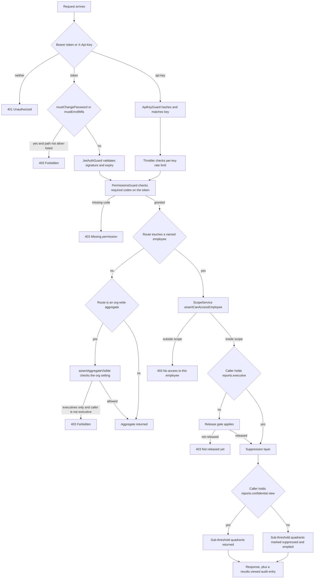

# 09 — Security Model

**Who can see what, and how that is enforced.** This is a working model of the system's
data visibility, not a compliance statement. It describes what the code does today,
including where it is weak.

**Sibling documents:** `01-system-architecture.md` · `04-business-workflows.md` ·
`05-module-architecture.md` · `06-api-integration-map.md` · `07-business-rules.md` ·
`08-codebase-navigation.md` · `10-adr-summary.md` · `11-configuration-reference.md`.

**Status legend:** **Implemented** · **Partial** · **API-only** · **Planned**.

---

## 1. The shape of the model in one paragraph

A request carries a principal. The principal has a **tenant** (`organizationId`), a flat
set of **permission codes**, and a single **data scope**. Permission codes decide *which
endpoints* answer. Data scope decides *which people's records* those endpoints will talk
about. On top of those two, three further gates apply to feedback data specifically: the
**release gate** (has HR published this appraisee's results?), the **anonymity /
suppression layer** (are there enough reviewers in this quadrant to report it?), and the
**aggregate-visibility setting** (may ordinary report viewers see org-wide roll-ups?).
Everything is enforced in the service layer against the tenant id on the token; the
database has no row-level security.

---

## 2. The five system roles

Defined in `apps/api/src/rbac/system-roles.ts`. The permission sets are **fixed** —
administrators assign roles to users, they do not author each role's permission list
(they can revoke individual grants in Access Control, but the seeder re-syncs the
declared set when it runs). `seedSystemRoles()` is idempotent and additive/subtractive to
match the declaration.

| Role | Scope | Permission set (as declared) |
| --- | --- | --- |
| **Super Admin** | organization | `'*'` — every code in the `permissions` table, resolved at seed time. |
| **HR/Admin** | organization | Organisation + employee/department/designation/campus management; import, HR and SIS integration; the whole appraisal set including `appraisal.calibrate`; questionnaires, competencies (incl. `competency.version.manage`); communication incl. `communication.campaign.manage`; `reports.read`, `reports.executive`, `reports.manage`, `reports.dashboard.configure`, **`reports.confidential.view`**, `ai.read`; development, external evaluation, identity mapping, `sis.read`; rating-scale and feature-flag *reads* plus rating-scale management — **not** full system settings; `workflow.read`, `workflow.act`. |
| **Manager** | reporting | `organization.read`, `appraisal.read`, `appraisal.feedback.submit`, `reports.read`, **`reports.confidential.view`**, `development.read`, `development.manage`, `workflow.read`, `workflow.act`, `competency.read`, `questionnaire.read`. |
| **Employee** | own | `organization.read`, `appraisal.read`, `appraisal.feedback.submit`, `reports.read`, `development.read`. |
| **Viewer** | organization | Read-only breadth: `organization.read`, `appraisal.read`, competency reads, `questionnaire.read`, `communication.read`, `reports.read`, `development.read`, `workflow.read`, `sis.read`, rating-scale and feature-flag reads. **Deliberately excludes `reports.executive` and `ai.read`** — those expose named per-person results (nine-box, at-risk lists, AI insights containing verbatim anonymous comments) and `reports.executive` additionally bypasses the release gate. |

`DEFAULT_EMPLOYEE_ROLE = 'Employee'` is granted automatically to people created through
the UI or a bulk import. A user with **no** role authenticates successfully and is then
denied every permissioned endpoint — they cannot even see their own review queue.

Two things to notice about the Manager row. First, a Manager holds
`reports.confidential.view`, but their scope is `reporting`, so it can only ever apply
inside their own reporting line. Second, a Manager does not hold `reports.executive`, so
the release gate applies to them in full.

## 3. Data scope

Three values, carried on the access token as `scope`, ranked broadest-first when a user
holds several roles (`organization` > `reporting` > `own`, in
`TokenService.resolveScopeAndEmployee`).

| Scope | Means |
| --- | --- |
| `organization` | Every employee in the tenant. No record-level restriction. |
| `reporting` | The user's own employee row plus everyone beneath them in the `line_manager_id` tree, to any depth. |
| `own` | The user's own employee row only. |

`ScopeService` (`apps/api/src/rbac/scope.service.ts`) implements it:

- `visibleEmployeeIds(user)` returns `null` for `organization` (meaning unrestricted), a
  one-element set for `own`, and for `reporting` runs a Postgres `WITH RECURSIVE`
  subtree query anchored on the user's `employeeId`, filtered by `organization_id` and
  `deleted_at IS NULL`.
- The recursive result is **memoised per request** through `requestCached()` on the
  AsyncLocalStorage request context — `assertCanAccessEmployee` is typically called
  several times in one request. Nothing is cached across requests, so a reporting-line
  change takes effect on the next request.
- `assertCanAccessEmployee(user, employeeId)` throws `403` when the id is outside the set.

Two consequences worth stating plainly. A user whose scope is restricted but who has **no
employee row** gets an empty set — they can see nobody, including themselves. And scope
is a *record* filter, not a *field* filter: it decides whether an employee's report is
reachable at all, never which columns of it are returned.

## 4. The guard chain

Guards run in the order Nest resolves them: global guards first, then controller-level,
then handler-level.

| Order | Guard | Where | What it does |
| --- | --- | --- | --- |
| 1 | `MustChangePasswordGuard` | Global (`APP_GUARD` in `auth/auth.module.ts`) | Decodes the bearer token itself, independent of guard ordering. If `mustChangePassword` is set, only the password/logout/MFA allow-list passes. If `mustEnrollMfa` is set, only the MFA-enrolment allow-list passes. No token, or an invalid one, falls through so the route's own guard produces the 401. |
| 2 | `JwtAuthGuard` **or** `ApiKeyGuard` | Controller `@UseGuards(...)` | Populates `request.user` with an `AuthUser`. JWT for humans; `X-Api-Key` for the partner API, which synthesises an `AuthUser` whose `permissions` are the key's scopes and whose scope is `organization`. |
| 3 | `ThrottlerGuard` | Partner API controller only | Per-key rate limit, `API_RATE_LIMIT` (default 120) per window. |
| 4 | `PermissionsGuard` | Controller or handler | Reads `@RequirePermissions(...)` metadata and requires **all** listed codes to be present in `user.permissions`. No database hit — the codes came from the token. |
| 5 | `OrgWritableGuard` | Organization controller | Refuses mutating methods when the tenant's HR mode is `external_hr`, making org master data read-only while HR is the source of truth. Reads the mode straight from `configurations`. |
| 6 | `AiEnabledGuard` | AI controller | Enforces the `ai_insights` feature flag server-side. Returns **404, not 403** — a disabled module should look absent, not withheld. |
| 7 | In-handler checks | Service layer | `ScopeService.assertCanAccessEmployee`, `assertReleasedForNonPrivileged`, `assertAggregateVisible`, and the explicit `organizationId` filter on every query. **This is where record-level security actually happens** — a guard alone never proves a caller may see a particular person. |

### 4.1 Authorisation decision path

## 5. The four authentication surfaces

| # | Surface | Credential | Where | Notes |
| --- | --- | --- | --- | --- |
| 1 | **Interactive session** | Password (or SSO / LDAP) → JWT access token + opaque refresh token | `auth/services/login.service.ts`, `token.service.ts`, `sso.service.ts`, `ldap.service.ts` | Access token 15 min by default (`JWT_ACCESS_TTL`); refresh 7 days (`REFRESH_TTL_DAYS`). Lockout after `maxAttempts` failures in `windowMinutes` (configurable, clamped 3–20 / 1–1440). MFA and password policy are per-tenant. SSO and LDAP are **API-only** — no UI. |
| 2 | **Partner Reports API** | `X-Api-Key: <prefix>.<secret>` | `integration/api-key.guard.ts`, `services/api-key.service.ts`, `reports-api.controller.ts` | Read-only, rate-limited, ETag'd. Key scopes (`reports.api.*`) are **API-only strings** that are never assignable to an RBAC role, so a key can never widen a human's access. A key always reads exactly one organisation. |
| 3 | **Tokenised evaluation link** | A 24-byte `base64url` token in the URL, hashed at rest | `external-evaluation/services/evaluation-link.service.ts`, `public-evaluation.controller.ts` | Fully public — no login, no guards. Expiry (default 14 days) and optional single use are the only controls. IP and user-agent are recorded to the append-only feedback audit trail. The link names the teacher being evaluated by design. |
| 4 | **Operator provisioning key** | `X-Provisioning-Key` compared with `timingSafeEqual` against `PLATFORM_PROVISIONING_KEY` | `provisioning/provisioning.service.ts` | Sits **outside JWT and RBAC entirely and by design**: no signed-in user of org A should be able to create org B. Creating the *first* organisation is open (nothing to protect yet); every one after requires the key. If the key is unset once organisations exist, provisioning is refused rather than falling back to something weaker. A tenant Super Admin JWT is explicitly insufficient. |

Two adjacent, non-user surfaces: the **short-link redirect** `/r/:code` and the
**health probes** `/health`, `/ready` are public and unauthenticated by design (they are
excluded from the `/api/v1` prefix in `main.ts`), and inbound **provider delivery
webhooks** authenticate with an HMAC rather than a principal (§6).

## 6. Secret handling

| Secret | How it is stored | Where |
| --- | --- | --- |
| User passwords | bcrypt hash, with a configurable history (`historyCount`, clamped 0–24) preventing reuse | `auth/services/password.service.ts`, `password_history` |
| Refresh tokens | 32 random bytes, **SHA-256 hashed at rest**; one row per session; rotated on every refresh with `replacedTokenId` chaining. Presenting a rotated or expired token revokes **every** active session for that user (reuse detection) | `auth/services/token.service.ts`, `refresh_tokens` |
| MFA TOTP secrets | AES-256-GCM, key from `MFA_ENCRYPTION_KEY` (exactly 64 hex chars); payload is `base64(iv‖tag‖ciphertext)` | `auth/crypto/secret-crypto.ts`, `auth/services/mfa.service.ts` |
| MFA backup codes | bcrypt hashed, single use (`usedAt` stamped on consumption) | `auth/services/mfa.service.ts`, `mfa_backup_codes` |
| HR and SIS connector secrets | **Encrypted with the same `MFA_ENCRYPTION_KEY`** via `encryptSecret()` before being written into the `configurations` JSON blob; decryption failures degrade to an empty string rather than throwing | `hr-integration/hr-connection.service.ts`, `sis-integration/sis-connection.service.ts` |
| Communication provider secrets (SMTP, SMS, WhatsApp, webhook secret) | Stored in the `configurations` JSON blob and **masked on read** (`has*` booleans only) — but *not* encrypted at rest, unlike HR/SIS | `communication/communication.settings.ts` |
| API keys | `prefix` stored in clear for display (`e360_xxxxxxxx`), full `prefix.secret` stored as a SHA-256 hash. The plaintext is shown **once** at creation | `integration/services/api-key.service.ts` |
| Evaluation-link tokens | SHA-256 hashed; only the hash is stored | `external-evaluation/services/evaluation-link.service.ts` |
| OTP codes | 6 digits, **bcrypt** hashed, 5-minute TTL, max 5 attempts | `communication/services/otp.service.ts` |
| Outbound webhook secrets | Used to HMAC-SHA256 the payload; masked when listed | `integration/services/webhook.service.ts` |
| Inbound delivery webhooks | `X-Webhook-Signature: sha256=<hex>` over the **raw request bytes** (hence `rawBody: true` in `main.ts`), timing-safe compare; `X-Hub-Signature-256` and `X-Twilio-Signature` accepted as aliases. **Fail-closed**: a tenant with no secret cannot accept callbacks. Every rejection returns an identical 401 so the response is not an oracle for which message ids or tenants exist | `communication/communication.controller.ts`, `services/notification.service.ts` |

Operational consequence: `MFA_ENCRYPTION_KEY` is a **restore-critical** secret. A database
backup without it leaves MFA enrolments and every HR/SIS connector credential
unrecoverable — which is why `ops/backup.sh|ps1` bundles `env.backup` alongside the dump
and `ops/restore.sh|ps1` checks that the key matches.

## 7. The release gate

Individual 360 results are invisible until HR publishes them.

- `appraisal_participants.visibility` is `draft` until
  `SetupService.setRelease()` flips it to `released` and stamps `releasedAt` /
  `releasedBy`. Retraction reverses it. Both are audited and release raises a
  `results_released` in-app notification.
- `ReportsController.assertReleasedForNonPrivileged()` runs before `individual`, `radar`,
  `gap` and `employee-360`. It calls `ReportsService.hasReleasedResults()` and throws 403
  with "These results have not been released yet."
- **Holders of `reports.executive` bypass the gate**, deliberately: HR and executives need
  pre-release visibility to calibrate. This is exactly why the Viewer role does not hold
  `reports.executive`.
- Every one of those reads writes a `results.viewed` entry to the append-only feedback
  audit trail, recording the report type, the appraisee, the cycle, and whether the caller
  saw sub-threshold quadrants.

## 8. Anonymity and suppression

The system does **not** redact stored data. Reviewer identity is simply never placed in a
report payload, and quadrant-level results are withheld until enough distinct reviewers
have submitted.

- The threshold is `reports/min_responses_to_show` in `configurations`, default **3**,
  minimum 1, editable at Settings → Feedback Rules.
- `ReportsService.sourceCounts()` counts **distinct submitted reviewers per feedback
  source** for one appraisee. `suppressed()` hides a source when its reviewer count is
  below the threshold. The `self` source is exempt by code (`code !== 'self'`) — it is the
  employee's own rating and was never confidential.
- Suppression is applied to `individual().bySource`, radar series, the competency ×
  quadrant matrix, the per-quadrant cells of the shared-competency comparison, and the
  pooled written-comment set (comments are withheld entirely below the threshold). It is
  applied identically on the partner Reports API.
- A **Line Manager quadrant has one reviewer by definition** and is therefore permanently
  suppressed at the default threshold. This is the specific problem
  `reports.confidential.view` exists to solve.
- **`reports.confidential.view`** (`reports/reports.permissions.ts:19`, seeded at `:27`,
  described as *"See quadrant scores held below the minimum-response threshold"*) lifts
  suppression **for that caller only**. Read once per request as
  `ReportsController.canSeeConfidential` and passed as the `unlocked` argument to
  `individual()`, `radar()` and `sharedCompetencies()`.

  **Who holds it:** Super Admin (through `permissions: '*'`), HR/Admin and Manager, by
  default (`rbac/system-roles.ts:49`, `:69`). **Employee and Viewer never hold it.**

  **How it interacts with data scope — the two are independent and both apply.** The
  permission decides *whether small-sample quadrants are shown*; the scope decides *whose
  reports you may open at all*. A Manager's scope is `reporting`, so
  `ScopeService.assertCanAccessEmployee` has already confined them to their own line before
  suppression is even considered. That is what makes the grant safe. Grant this permission
  to an `organization`-scoped role and you have handed them every sub-threshold quadrant in
  the tenant.

  **What it does not do:** it does not reveal *who said what* — reviewer identity is not in
  any report payload at any permission level (structural, not a redaction step); it does not
  widen data scope; it does not bypass the release gate (that is `reports.executive`); it
  does not change stored data, the threshold value, the score calculation, or what any other
  caller sees; and it does not apply to `heatmap()`, which has no `unlocked` parameter.

  **It is audited.** Every person-level report view writes a `results.viewed` entry to the
  append-only feedback trail carrying `confidential: true|false`
  (`ReportsController.recordView`), so an elevated view is distinguishable from an ordinary
  one after the fact.

  **Rollout:** a newly added permission code reaches a user only after the permission table
  is re-seeded and the role grants re-synced (`npm run db:seed`, `npm run db:seed-roles`)
  **and** that user signs in again — permissions are baked into the access token. Revoke it
  in Access Control if your policy is that managers must not see single-reviewer quadrants.
- Separately, `feedback_sources.is_anonymous` governs whether **the evaluator's** identity
  is attributed in the appraisee's report. It has never meant "hide the appraisee" — a
  reviewer always sees who they are reviewing, together with their job title and department
  and one line stating what happens to the reviewer's own name.
- **eNPS has no drill-down** by design: it is anonymous response-level sentiment, and
  drilling from it to named people would defeat the anonymity it depends on.
- AI insights apply the same threshold before surfacing sentiment over verbatim comments;
  aggregate counts are always returned.

One more org-wide control sits beside this: `reports/aggregate_visibility`
(`all_report_viewers` by default, or `executives_only`) gates `departmental`, `campus`,
`trend`, `heatmap` and `institutional` via `assertAggregateVisible()`. Individual reports
and named lists stay restricted regardless of that setting.

## 9. What each role can and cannot see

Assumes the default grants and default settings (threshold 3, aggregates visible to all
report viewers).

| Capability | Super Admin | HR/Admin | Manager | Employee | Viewer |
| --- | --- | --- | --- | --- | --- |
| Employee directory | All | All | Own reporting subtree | Self only | All |
| Own 360 results | Yes | Yes | Yes | Yes, **after release** | Yes |
| Another person's 360 results | Yes | Yes | Subtree only, after release for the Manager's own reports — no gate bypass | No | Only via `reports.read` within the release gate; no executive views |
| Pre-release results | Yes | Yes, via `reports.executive` | No | No | No |
| Sub-threshold quadrant scores | Yes | Yes | Yes, inside the subtree | No | No |
| Reviewer identity | **Never returned to anyone in a report** | Never | Never | Never | Never |
| Executive dashboard, nine-box, at-risk list | Yes | Yes | No | No | **No** |
| AI insights | Yes | Yes | No | No | **No** |
| Org-wide aggregates (departmental, campus, trend, heatmap) | Yes | Yes | Yes, subject to the aggregate-visibility setting | Yes, subject to the same setting | Yes, subject to the same setting |
| Calibrate a final score | Yes | Yes | No | No | No |
| Release or retract results | Yes | Yes | No | No | No |
| Manage employees / org structure | Yes | Yes, unless HR mode is `external_hr` | No | No | No |
| Manage roles and permissions | Yes | No | No | No | No |
| Security policy, SSO, MFA policy | Yes | No | No | No | No |
| Create API keys / webhooks | Yes | No | No | No | No |
| Feedback audit trail | Yes | Per its own permission | No | No | No |
| Provision a new organisation | **No** — requires the operator key, not a permission | No | No | No | No |

## 10. Known weaknesses

Stated plainly. None of these are hypothetical; each is visible in the code.

1. **Permissions are baked into the access token.** `PermissionsGuard` reads
   `user.permissions` straight off the JWT and never touches the database. That is the
   reason authorisation is cheap — and it means **revocation lags**. Removing a role or a
   grant does not take effect until the user's access token expires (default 15 minutes)
   and is refreshed, or they sign out. The same applies to `scope` and `employeeId`. There
   is no token blacklist and no permission-version claim. For an urgent revocation, revoke
   the user's refresh tokens *and* wait out the access-token TTL.
2. **`JWT_ACCESS_SECRET` has a working default.** Both `auth/auth.module.ts` and
   `common/auth/jwt.strategy.ts` fall back to the literal string `'change-me'`. A
   deployment that forgets to set it starts successfully and issues tokens that anyone who
   has read this repository can forge. There is no startup assertion. (`MFA_ENCRYPTION_KEY`
   is handled correctly by contrast — it throws unless it is exactly 64 hex characters.)
3. **No general rate limiting.** `ThrottlerGuard` is applied *only* to the partner Reports
   API controller. `/auth/login` is protected by account lockout, and nothing else is
   throttled at all — imports, report generation, evaluation-link submission and every
   authenticated endpoint are unbounded. This is a known, explicitly deferred item (F9).
4. **No row-level security.** Tenancy is a service-layer discipline: every query filters
   on `organizationId` from the token. Postgres RLS is not enabled on any table. A single
   query that forgets the tenant filter is a cross-tenant leak, and nothing below the
   service layer would catch it. The API integration suite tests tenant isolation, which
   is the only mechanical backstop.
5. **Tokens live in `localStorage`.** `AuthContext.tsx` persists both the access and
   refresh token under `e360.accessToken` / `e360.refreshToken`, so any successful XSS in
   the SPA yields a full, refreshable session. The trade was made so the standalone
   printable-report route can authenticate before the auth provider's effect runs.
6. **Communication provider secrets are not encrypted at rest**, unlike HR/SIS connector
   secrets. They are masked in API responses, but they sit in plain JSON in the
   `configurations` table.
7. **The evaluation link is a bearer credential in a URL.** Anyone who obtains the link
   before it expires can submit as that parent. Expiry and optional single use are the only
   mitigations; there is no second factor and no recipient binding.
8. **`OrgWritableGuard` reads `configurations` on every mutating organisation request**
   with no cache — correctness over speed, but worth knowing before adding it elsewhere.
9. **Provisioning is unauthenticated on first run**, by design (there is nothing to
   protect yet). Between deployment and the creation of the first organisation, anyone who
   can reach `/setup` can become the first Super Admin. Complete setup immediately, or set
   `PLATFORM_PROVISIONING_KEY` before exposing the instance.
10. **Deferred by explicit scope decision, and still open:** general rate limiting (F9),
    accessibility (F17), metrics/APM (F20), GDPR per-subject export and right-to-erasure
    plus retention policy (F24), comment moderation (F30), SCIM (F32).
